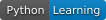

# 배지 복사 예제

<!-- 외부 이미지 대신 저장소의 파일 사용 -->

배지의 문구·색은 직접 정한 값입니다. 숙련도나 자격을 인증하지 않습니다. 외부 Shields.io가 막히면 함께 제공한 assets/python-learning.svg를 저장소에 넣어 상대 경로로 표시하세요.

[badge 공식 안내](https://shields.io/badges/static-badge)
