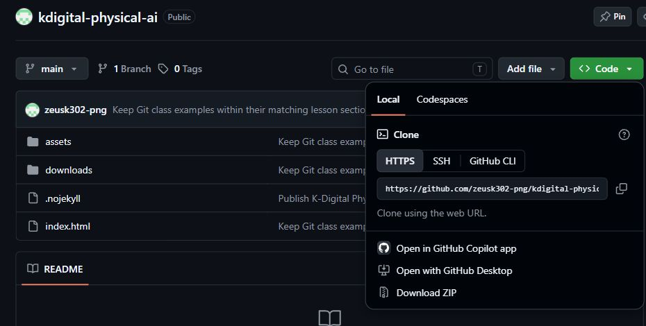
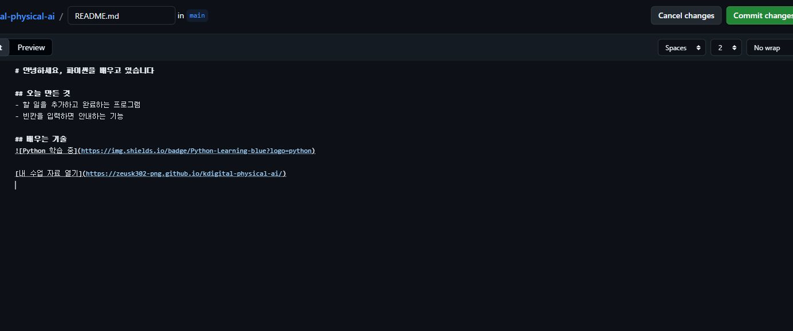
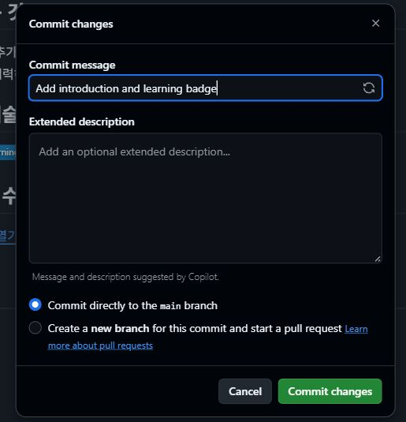
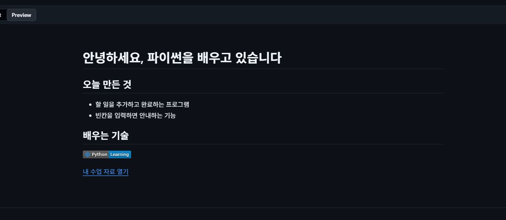
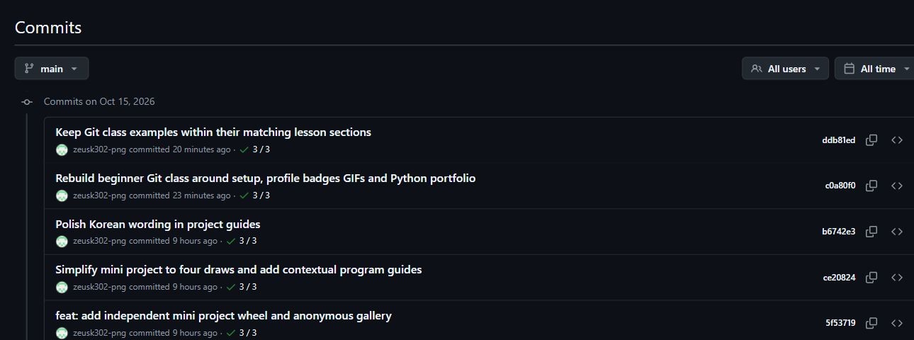
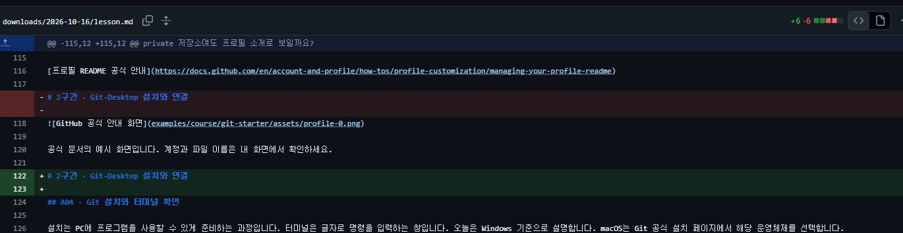
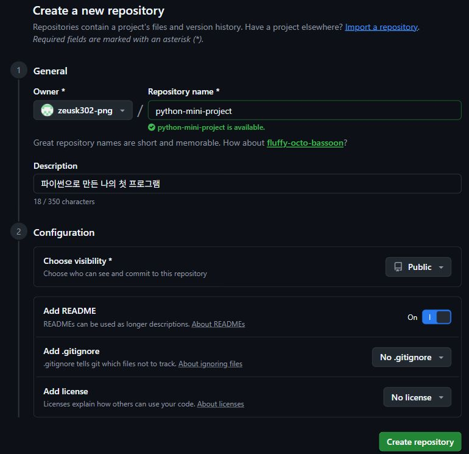
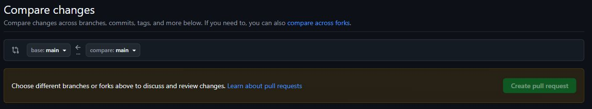

# 오늘 직접 해볼 일

GitHub 가입과 설치부터 시작해 내 프로필을 꾸미고 파이썬 작품을 공유합니다. GitHub Desktop으로 변경을 확인하고 커밋·push를 반복합니다. 마지막에는 자기 저장소에서 브랜치를 만들고 짝과 PR을 검토합니다.

완료한 작업의 프로필·저장소·PR 주소를 개인 점검표에 적으세요. 설치나 인증이 막히면 해당 단계와 오류를 적고 강사에게 알려 주세요. 비밀번호·인증 코드는 적지 않습니다.

## A01 · 파일·Git·GitHub의 역할

**목적:** 폴더는 파일을 담는 곳입니다. 저장소(repository)는 파일과 변경 이력을 함께 관리하는 프로젝트 단위입니다. Git은 내 PC에서 이력을 기록하는 도구, GitHub는 저장소를 인터넷으로 공유하고 검토하는 서비스입니다. GitHub Desktop은 Git 작업을 버튼으로 하는 프로그램입니다.

**준비:** 내 계정·오늘의 작업 폴더·해당 프로그램을 엽니다. 파일은 Show in Explorer로 현재 저장소 위치를 확인합니다.

**단계**

1. 파일 탐색기에서 오늘 작업할 폴더를 만듭니다. 예: 문서 안의 GitPractice.
2. 브라우저는 GitHub, Desktop은 PC의 저장소, 편집기는 README를 고치는 화면임을 구별합니다.
3. 메모장에 자기소개 한 줄을 저장합니다. 저장만으로 Git 이력이 생기지는 않습니다.

**예상 결과:** 내 PC의 작업 폴더와 웹의 공유 위치를 구별합니다.

**확인 방법:** 저장 버튼을 누르면 GitHub에도 바로 올라갈까요?

**오류 해결:** 폴더 주소와 웹 주소를 혼동하면 파일 탐색기와 브라우저를 나란히 열어 비교합니다.

[개인 점검표](examples/course/git-starter/checklist.md) · [Desktop 첫 작업 공식 안내](https://docs.github.com/en/desktop/overview/creating-your-first-repository-using-github-desktop)

## A02 · GitHub 가입·메일 인증·로그인

**목적:** 사용자 이름(username)은 github.com 뒤에 붙는 계정 주소입니다. 표시 이름과 다를 수 있습니다. 이메일 인증은 그 주소를 본인이 사용할 수 있다는 확인입니다. 계정이 이미 있으면 새로 만들지 않고 로그인합니다.

**준비:** 내 계정·오늘의 작업 폴더·해당 프로그램을 엽니다. 파일은 Show in Explorer로 현재 저장소 위치를 확인합니다.

**단계**

1. github.com에서 Sign up 또는 Sign in을 선택합니다. 본인이 확인할 수 있는 이메일을 사용합니다.
2. 사용 가능한 사용자 이름과 비밀번호를 정하고 가입 화면의 안내를 따릅니다. 유료 요금제·Copilot 구독은 수업에 필요하지 않습니다.
3. 메일함에서 인증 메일이나 코드를 확인하고 GitHub 안내에 따라 인증을 마칩니다.
4. 오른쪽 위 프로필 메뉴의 Your profile을 열고 주소의 사용자 이름을 개인 메모에 적습니다.
5. 2단계 인증 설정이 요구되면 본인 인증 수단으로 진행하고 복구 코드는 개인적으로 보관합니다. 비밀번호·인증 코드를 실습지나 화면 공유에 적지 않습니다.

**예상 결과:** 내 계정으로 로그인하고 프로필 주소를 열 수 있습니다.

**확인 방법:** 표시 이름을 바꾸면 프로필 저장소 이름도 바꿔야 할까요?

**오류 해결:** 인증 메일이 없으면 스팸함·이메일 오타·재발송을 확인합니다. CAPTCHA·계정 잠금은 본인이 해결합니다. 빠르게 끝났다면 자기소개 세 문장을 준비합니다.

[개인 점검표](examples/course/git-starter/checklist.md) · [회원가입 공식 안내](https://docs.github.com/en/account-and-profile/how-tos/account-management/creating-an-account-on-github)

## A03 · 내 프로필 저장소 만들기

**목적:** README.md는 프로젝트를 처음 방문한 사람이 읽는 안내 파일입니다. .md는 Markdown 형식이라는 확장자입니다. 내 username과 같은 이름의 공개 저장소에 내용 있는 README.md를 두면 프로필에 소개가 나타납니다.

**준비:** 내 계정·오늘의 작업 폴더·해당 프로그램을 엽니다. 파일은 Show in Explorer로 현재 저장소 위치를 확인합니다.

**단계**

1. GitHub 오른쪽 위 +에서 New repository를 선택합니다. Owner가 내 계정인지 확인합니다.
2. Repository name에 내 username을 그대로 입력합니다. 예: username이 mina-lab이면 저장소 이름도 mina-lab입니다.
3. Public을 선택하고 Add README를 켭니다. 이 프로필 파일은 누구나 볼 수 있으니 개인정보는 적지 않습니다.
4. Create repository를 누른 뒤 README 편집에서 자기소개 한 줄을 쓰고 Commit changes로 기록합니다.
5. 프로필 주소를 다시 열어 소개가 나타나는지 확인합니다. 이 저장소와 나중에 만들 작품 저장소는 별개입니다.

**예상 결과:** 내 프로필에 자기소개 한 줄이 보입니다.

**확인 방법:** private 저장소여도 프로필 소개로 보일까요?

**오류 해결:** 소개가 없으면 username과 저장소 이름·Public·루트의 README.md·내용 유무를 확인합니다. 이미 같은 저장소가 있으면 새로 만들지 않고 사용합니다.

[개인 점검표](examples/course/git-starter/checklist.md) · [프로필 README 공식 안내](https://docs.github.com/en/account-and-profile/how-tos/profile-customization/managing-your-profile-readme)

## A04 · Git 설치와 터미널 확인

**목적:** 설치는 PC에 프로그램을 사용할 수 있게 준비하는 과정입니다. 터미널은 글자로 명령을 입력하는 창입니다. 오늘은 Windows 기준으로 설명합니다. macOS는 Git 공식 설치 페이지에서 해당 운영체제를 선택합니다.

**준비:** 내 계정·오늘의 작업 폴더·해당 프로그램을 엽니다. 파일은 Show in Explorer로 현재 저장소 위치를 확인합니다.

**단계**

1. Git 공식 Windows 설치 페이지에서 PC에 맞는 설치 파일을 받습니다. 학교 PC에서 권한이 막히면 강사에게 알립니다.
2. 설치 화면에서 특별한 기관 설정이 없다면 기본값으로 진행합니다. 편집기 선택에서는 설치된 VS Code 또는 익숙한 편집기를 선택합니다.
3. 설치가 끝나면 열려 있던 터미널을 닫고 PowerShell을 새로 엽니다.
4. git --version을 입력하고 Enter를 누릅니다. 아래 예의 버전 숫자는 PC마다 다를 수 있습니다.
5. 버전 문장이 표시되면 설치 확인을 마칩니다. GitHub 로그인과 Git 설치는 별개입니다.

```text
git --version
```

**예상 결과:** git version으로 시작하는 문장이 나옵니다.

**확인 방법:** git --version이 성공하면 GitHub 로그인도 된 건가요?

**오류 해결:** git을 찾을 수 없으면 터미널 재시작 후 설치 완료와 PATH 설정을 확인합니다. 임의의 보안 설정을 끄지 않습니다. Desktop 작업은 별도로 계속할 수 있습니다.

[개인 점검표](examples/course/git-starter/checklist.md) · [Git 설치 공식 안내](https://git-scm.com/install/windows)

## A05 · GitHub Desktop 설치·브라우저 로그인

**목적:** Desktop은 변경된 줄과 이력을 눈으로 확인하는 프로그램입니다. Desktop에 연결할 계정과 브라우저에서 로그인한 계정이 같아야 내 저장소를 쉽게 찾을 수 있습니다. Git 명령용 비밀번호를 새로 만드는 활동은 하지 않습니다.

**준비:** 내 계정·오늘의 작업 폴더·해당 프로그램을 엽니다. 파일은 Show in Explorer로 현재 저장소 위치를 확인합니다.

**단계**

1. desktop.github.com에서 운영체제에 맞는 설치 파일을 받아 실행합니다.
2. Desktop의 Sign in to GitHub.com을 누릅니다. 브라우저가 열리면 오른쪽 위 계정이 내 계정인지 확인합니다.
3. 브라우저에 표시된 GitHub Desktop 인증 내용을 확인하고 연결을 진행합니다. 브라우저가 앱을 열겠다고 물으면 GitHub Desktop으로 돌아갑니다.
4. Git 설정의 이름과 이메일을 확인합니다. 이메일 공개를 원치 않으면 GitHub Settings → Emails에서 제공한 noreply 주소를 직접 확인해 사용합니다.
5. Desktop File → Options → Accounts에서 연결된 계정을 확인합니다. 먼저 끝나면 File → Options의 편집기 설정도 확인합니다.

**예상 결과:** Desktop에 내 계정이 표시됩니다.

**확인 방법:** PC 사용자 이름과 GitHub username은 같아야 하나요?

**오류 해결:** 다른 계정이 연결됐으면 Desktop과 브라우저 계정을 각각 확인합니다. 인증 실패 시 브라우저 로그인과 기관 네트워크를 확인하고 반복 클릭으로 새 계정을 만들지 않습니다.

[개인 점검표](examples/course/git-starter/checklist.md) · [Desktop 로그인 공식 안내](https://docs.github.com/en/desktop/installing-and-authenticating-to-github-desktop/authenticating-to-github-in-github-desktop) · [Desktop 다운로드 공식 안내](https://desktop.github.com/)

## A06 · 프로필 저장소를 PC로 clone하기

**목적:** clone은 파일뿐 아니라 저장소의 이력도 내 PC로 가져오는 작업입니다. ZIP 다운로드와 다릅니다. 지금부터 README를 수정할 위치는 clone한 폴더입니다. 다른 폴더의 복사본을 고치면 Desktop에서 변경이 보이지 않습니다.

**준비:** 내 계정·오늘의 작업 폴더·해당 프로그램을 엽니다. 파일은 Show in Explorer로 현재 저장소 위치를 확인합니다.

**단계**

1. 브라우저에서 내 프로필 저장소를 엽니다. 초록색 Code → Open with GitHub Desktop을 선택합니다.
2. Desktop의 Local path에서 문서/GitPractice 같은 연습 위치를 고릅니다. 경로를 개인 메모에 적고 Clone을 누릅니다.
3. Current repository가 내 username 저장소인지 확인합니다.
4. Repository → Show in Explorer로 폴더를 열고 README.md를 찾습니다.
5. README.md를 편집기로 열어 봅니다. Desktop의 History에는 웹에서 만든 첫 기록이 보입니다.

### 실제 화면 · Code 메뉴에서 PC로 가져오기



Code → Local → HTTPS를 확인합니다. Open with GitHub Desktop을 누릅니다.

[같은 화면 열기](https://github.com/zeusk302-png/kdigital-physical-ai)

**예상 결과:** 내 PC에 README.md와 Git 이력이 있고 Desktop에서 저장소를 선택할 수 있습니다.

**확인 방법:** ZIP을 받아 풀면 같은 Git 작업 폴더가 될까요?

**오류 해결:** Repository not found는 주소·계정·접근 권한을 확인합니다. 변경이 안 보이면 Show in Explorer로 연 폴더에서 편집했는지 확인합니다.

[개인 점검표](examples/course/git-starter/checklist.md) · [저장소 가져오기 공식 안내](https://docs.github.com/en/desktop/adding-and-cloning-repositories/cloning-a-repository-from-github-to-github-desktop)

## A07 · Markdown으로 자기소개 쓰기

**목적:** Markdown은 제목·목록·링크처럼 글의 구조를 표시하는 간단한 문법입니다. # 뒤에는 공백을 넣고 제목을 씁니다. 대괄호는 화면에 보일 글, 소괄호는 이동할 주소입니다. README는 프로그램 코드가 아니라 설명 문서입니다.

**준비:** 내 계정·오늘의 작업 폴더·해당 프로그램을 엽니다. 파일은 Show in Explorer로 현재 저장소 위치를 확인합니다.

**단계**

1. PC의 README.md를 열고 예제를 붙여넣습니다. 내 관심 분야와 배우는 내용으로 문장을 바꿉니다.
2. 제목의 #, 목록의 -, 굵은 글씨의 **를 한 종류씩 적용합니다.
3. 링크 예시의 문구와 주소를 구별합니다. 예시 계정 주소는 그대로 제출하지 않고 본인 주소로 바꿉니다.
4. Ctrl+S로 저장합니다. Markdown 미리보기가 있는 편집기라면 미리보기를 엽니다.
5. Desktop Changes에서 내가 바꾼 문장을 찾습니다. 이 단계는 아직 PC 변경이며 웹 반영은 뒤에서 합니다.

```markdown
# 안녕하세요!

Python을 배우며 생활 속 불편을 해결하고 있습니다.

## 배우는 중
- **Python**: 작은 프로그램 만들기
- **Git**: 변경 기록하기

[GitHub 공식 안내](https://docs.github.com/)
```

### 실제 화면 · Edit에서 Markdown을 입력하기



README.md의 Edit에서 내용을 씁니다. Preview로 표시 결과를 확인합니다.

[같은 화면 열기](https://github.com/zeusk302-png/kdigital-physical-ai/new/main?filename=README.md)

### 실제 화면 · 웹 편집 · 커밋 전 확인



1. 무엇을 바꿨는지 Commit message에 적습니다.

2. 내 소개 문서는 main에 직접 기록할 수 있습니다.

3. 협업 수정은 새 브랜치와 PR을 선택합니다.

4. 웹 커밋은 곧바로 반영됩니다. Desktop 커밋 뒤에는 push합니다.

[같은 화면 열기](https://github.com/zeusk302-png/kdigital-physical-ai/new/main?filename=README.md)

**예상 결과:** 제목·목록·링크가 있는 자기소개 초안이 저장됩니다.

**확인 방법:** Markdown에서 #과 Python에서 #은 같은 뜻인가요?

**오류 해결:** 전체가 코드처럼 보이면 불필요한 ``` 줄을 지웁니다. README.md.txt라면 탐색기의 파일 확장명 표시를 켜고 이름을 바로잡습니다.

[개인 점검표](examples/course/git-starter/checklist.md) · [Markdown 문법 공식 안내](https://docs.github.com/en/get-started/writing-on-github/getting-started-with-writing-and-formatting-on-github/basic-writing-and-formatting-syntax)

## A08 · 프로필 소개와 꾸미기 순서

**목적:** 프로필은 다른 사람이 나와 작품을 이해하는 첫 화면입니다. 소개는 실제로 배우거나 만든 내용으로 씁니다. 꾸밈은 제목·간격·이미지·배지 순서로 조금씩 추가하면 깨진 부분을 찾기 쉽습니다.

**준비:** 내 계정·오늘의 작업 폴더·해당 프로그램을 엽니다. 파일은 Show in Explorer로 현재 저장소 위치를 확인합니다.

**단계**

1. 자기소개를 한 문장으로 씁니다. 예: Python으로 작은 생활 도구를 만드는 연습을 하고 있습니다.
2. 관심 분야·배우는 기술·만드는 프로젝트를 소제목으로 나눕니다. 연락처는 필수가 아닙니다.
3. 실습 ZIP의 profile/README-basic.md 또는 README-decorated.md를 출발점으로 사용합니다. 기존 README는 덮어쓰기 전에 따로 복사해 둡니다.
4. 내가 쓰지 않는 항목은 지웁니다. GitHub username, 작품 이름, 링크는 본인 내용으로 바꿉니다.
5. 자기소개만 먼저 완성하고 이미지와 배지는 다음 활동에서 추가합니다.

**예상 결과:** 자기소개·관심 분야·학습 내용·작품 소개가 정리됩니다.

**확인 방법:** 배지를 많이 붙이면 실력이 증명되나요?

**오류 해결:** 한꺼번에 긴 템플릿을 넣어 깨지면 마지막 정상 문서로 돌아가 한 단락씩 추가합니다. 모르는 기술을 숙련한 것처럼 적지 않습니다.

[개인 점검표](examples/course/git-starter/checklist.md) · [프로필 README 공식 안내](https://docs.github.com/en/account-and-profile/how-tos/profile-customization/managing-your-profile-readme) · [Markdown 문법 공식 안내](https://docs.github.com/en/get-started/writing-on-github/getting-started-with-writing-and-formatting-on-github/basic-writing-and-formatting-syntax)

## A09 · 이미지·GIF·움짤 넣기

**목적:** GIF는 여러 그림을 순서대로 보여 주는 이미지 파일입니다. README에도 넣을 수 있습니다. 파일 이름만 .gif로 바꾼다고 영상이 GIF가 되지는 않습니다. 먼저 짧고 작은 예제 GIF를 넣고, 나중에 본인 프로그램 시연으로 바꿉니다.

**준비:** 내 계정·오늘의 작업 폴더·해당 프로그램을 엽니다. 파일은 Show in Explorer로 현재 저장소 위치를 확인합니다.

**단계**

1. 실습 ZIP의 assets/demo.gif를 README가 있는 저장소의 assets 폴더로 복사합니다. assets 폴더가 없으면 직접 만듭니다.
2. README에 아래 이미지 문법을 넣습니다. assets/demo.gif는 README 기준 상대 경로입니다.
3. 폭 조절 예제는 HTML img 태그입니다. src는 파일 위치, alt는 그림 설명, width는 표시 너비입니다. 먼저 Markdown 한 줄을 성공시킨 뒤 시도합니다.
4. Desktop에서 README와 GIF가 모두 변경 목록에 있는지 봅니다. GIF 파일도 커밋해야 다른 PC에서 보입니다.
5. push 후 GitHub README에서 움직임을 확인합니다. 움직임이 꺼진 환경에서는 정지 이미지로 보일 수 있으므로 설명 문장도 함께 둡니다.
6. 직접 만든 GIF나 사용 허락이 있는 자료만 올립니다. 수업 권장 크기는 3~5초·2MB 이하입니다. 이는 수업 권장값이며 GitHub 서비스 상한과는 다릅니다.

```html


<!-- 폭을 조절하려면 위 한 줄 대신 아래를 사용 -->

```

**예상 결과:** README에 예제 GIF가 표시되고, 이미지의 위치와 설명을 바꿀 수 있습니다.

**확인 방법:** README만 올리고 demo.gif를 안 올리면 어떻게 될까요?

**오류 해결:** 깨진 그림이면 실제 파일 존재·대소문자·경로·커밋/push 여부를 확인합니다. C:\Users 같은 내 PC 경로는 다른 사람이 볼 수 없습니다. 동영상은 링크로 안내할 수 있지만 GIF와 구분합니다.

[개인 점검표](examples/course/git-starter/checklist.md) · [Markdown 문법 공식 안내](https://docs.github.com/en/get-started/writing-on-github/getting-started-with-writing-and-formatting-on-github/basic-writing-and-formatting-syntax) · [이미지·GIF 공식 안내](https://docs.github.com/en/get-started/writing-on-github/working-with-advanced-formatting/attaching-files)

## A10 · 기술 배지와 학습 배지 꾸미기

**목적:** 배지는 텍스트와 색을 가진 작은 이미지입니다. Shields.io 주소에서 라벨·내용·색을 정할 수 있습니다. 정적 배지는 내용을 직접 적는 장식이며 자격증이나 실력 인증이 아닙니다. 외부 이미지가 막히면 제공한 로컬 SVG를 사용할 수 있습니다.

**준비:** 내 계정·오늘의 작업 폴더·해당 프로그램을 엽니다. 파일은 Show in Explorer로 현재 저장소 위치를 확인합니다.

**단계**

1. 아래 Python 배지 한 줄을 README에 붙여넣습니다. !는 이미지, []는 설명, ()는 이미지 주소입니다.
2. Git 배지도 한 줄 추가합니다. 배지는 지금 배우는 기술만 2~3개 고릅니다.
3. Learning을 Practice로, blue를 green으로 바꾸고 화면 차이를 비교합니다.
4. style=for-the-badge와 style=flat을 각각 적용해 모양을 비교합니다. &는 뒤에 다른 옵션을 이어 붙이는 기호입니다.
5. 외부 서비스가 응답하지 않으면 assets/python-learning.svg를 넣은 로컬 예제를 사용합니다. 기능 확인 없이 임의의 앱 권한이나 토큰을 제공하지 않습니다.

```markdown


<!-- 외부 이미지 대신 저장소의 파일 사용 -->

```

### 실제 화면 · Preview에서 제목·배지·링크 확인



작성 중 미리보기입니다. 제목·목록·배지·링크가 보이는지 확인합니다.

[같은 화면 열기](https://github.com/zeusk302-png/kdigital-physical-ai/new/main?filename=README.md)

**예상 결과:** Python·Git 학습 배지와 내 색 조합을 고른 README가 완성됩니다.

**확인 방법:** 배지의 Learning을 Expert로 바꾸면 무엇이 검증되나요?

**오류 해결:** 배지에 한글·공백을 직접 넣어 주소가 깨지면 단순한 영문 값으로 시작합니다. 외부 주소는 인터넷이 필요합니다. 기본 문법부터 다시 붙여넣습니다.

[개인 점검표](examples/course/git-starter/checklist.md) · [배지 만들기 공식 안내](https://shields.io/badges/static-badge)

## A11 · 변경 비교·커밋·push로 공개하기

**목적:** 저장은 현재 파일을 바꾸는 행동입니다. 커밋은 선택한 변경을 PC의 이력에 기록합니다. push는 기록을 GitHub에 보냅니다. diff는 이전 내용과 바뀐 줄의 비교입니다. 커밋 메시지는 바꾼 목적을 짧게 씁니다.

**준비:** 내 계정·오늘의 작업 폴더·해당 프로그램을 엽니다. 파일은 Show in Explorer로 현재 저장소 위치를 확인합니다.

**단계**

1. Desktop의 Current repository가 프로필 저장소인지 확인합니다. Changes에서 README와 추가한 이미지 파일을 하나씩 봅니다.
2. 현재 목적에 필요한 파일만 체크합니다. 비밀번호·개인 문서·다른 프로젝트가 보이면 먼저 선택을 해제합니다.
3. Summary에 Add profile introduction처럼 목적을 적습니다. Commit to main을 누릅니다. 버튼의 브랜치 이름이 다르면 현재 브랜치를 확인합니다.
4. History에서 방금 기록과 수정한 줄을 확인합니다. 아직 웹에 안 보이는 것이 정상입니다.
5. Push origin을 누르고 완료를 기다린 뒤 브라우저 프로필을 새로고침합니다. 이제 소개·배지·GIF를 확인합니다.
6. 자기소개 한 문장만 다시 바꾸어 저장→비교→커밋→push를 두 번째로 수행합니다. 두 커밋의 목적을 다르게 적습니다.

### 실제 화면 · Commits에서 이전 기록 찾기



기록의 제목·작성 시각·짧은 ID를 확인합니다. 제목을 누르면 바뀐 줄을 봅니다.

[같은 화면 열기](https://github.com/zeusk302-png/kdigital-physical-ai/commits/main/)

### 실제 화면 · diff · 없어진 줄과 추가된 줄



빨강의 −는 이전 줄, 초록의 +는 추가된 줄입니다. 오류 표시가 아닙니다.

[같은 화면 열기](https://github.com/zeusk302-png/kdigital-physical-ai/commit/ddb81edf6cf65dcdc771dcb1dd5114a9129316ad)

**예상 결과:** 프로필에 소개·배지·GIF가 보이고 목적이 다른 커밋 두 개가 남습니다.

**확인 방법:** 커밋 직후 Changes가 비었으면 GitHub에도 올라갔나요?

**오류 해결:** Nothing to commit이면 파일 저장과 폴더 위치를 확인합니다. Push 거절이면 Fetch origin/Pull origin으로 원격 변경을 먼저 확인합니다. 강제 push로 덮지 않습니다.

[개인 점검표](examples/course/git-starter/checklist.md) · [Desktop 첫 작업 공식 안내](https://docs.github.com/en/desktop/overview/creating-your-first-repository-using-github-desktop)

## A12 · 선택: 버튼과 Git 명령 연결하기

**목적:** Desktop에서 본 작업은 명령으로도 확인할 수 있습니다. status는 상태, diff는 바뀐 줄, add는 이번 기록에 넣을 내용 선택, commit은 이력, push는 공유입니다. 명령은 터미널의 현재 폴더를 기준으로 실행합니다.

**준비:** 내 계정·오늘의 작업 폴더·해당 프로그램을 엽니다. 파일은 Show in Explorer로 현재 저장소 위치를 확인합니다.

**단계**

1. Repository 메뉴에서 터미널 열기를 선택하거나 저장소 폴더에서 PowerShell을 엽니다. 터미널의 경로가 맞는지 확인합니다.
2. git status와 git log --oneline -3을 실행해 Desktop과 같은 상태·이력인지 봅니다.
3. README의 한 문장을 고쳐 저장한 뒤 git diff를 봅니다.
4. 아래 add·diff --staged·commit·push 순서를 확인합니다. 작성자 오류가 나면 Desktop 설정과 저장소 로컬 설정을 확인합니다.
5. 두 도구는 같은 저장소를 다루므로 이미 끝낸 커밋을 다시 만들려고 하지 않습니다.

```powershell
git status
git diff
git add README.md
git diff --staged
git commit -m "Update profile introduction"
git push
git log --oneline -3
```

**예상 결과:** Desktop 버튼과 명령어의 역할을 연결해 설명합니다.

**확인 방법:** git add 뒤에 파일을 다시 고치면 새 내용까지 자동 선택되나요?

**오류 해결:** not a git repository는 현재 폴더를 확인합니다. 작성자 설정이 필요하면 git config --local user.name과 user.email에 본인 정보를 넣습니다. 공개 이메일은 개인 noreply 주소를 확인합니다.

[개인 점검표](examples/course/git-starter/checklist.md) · [Desktop 첫 작업 공식 안내](https://docs.github.com/en/desktop/overview/creating-your-first-repository-using-github-desktop)

## A13 · 파이썬 미니 프로젝트 올리기

**목적:** 작품 저장소는 코드·설명·예시 데이터를 함께 담는 별도 공간입니다. 프로필 저장소에는 작품 링크를 두고, 실제 Python 파일은 작품 저장소에서 관리합니다. 완성하지 못했어도 현재 동작하는 범위를 소개할 수 있습니다.

**준비:** 내 계정·오늘의 작업 폴더·해당 프로그램을 엽니다. 파일은 Show in Explorer로 현재 저장소 위치를 확인합니다.

**단계**

1. Desktop File → New repository에서 python-mini-project 저장소를 만듭니다. 이름·Local path를 확인하고 README 초기화를 선택합니다.
2. Show in Explorer로 새 폴더를 열고 오늘 만든 .py 파일을 복사합니다. 원래 프로젝트는 보존합니다. 미완성이라면 실습 ZIP의 project/main.py와 tracker.py를 사용합니다.
3. venv·.venv·__pycache__·.env·개인정보 파일은 넣지 않습니다. 제공한 project/.gitignore를 참고합니다.
4. 그 폴더에서 프로그램을 실행해 동작을 확인합니다. 다른 폴더의 파일을 실행하지 않습니다.
5. Desktop에서 파일을 비교하고 Add first working program으로 커밋합니다. Publish repository에서 공개 범위를 직접 확인해 게시합니다. 공개 전 파일 목록을 다시 봅니다.

### 실제 화면 · 작품 저장소 · 생성 전 설정



1. Repository name에 작품 이름을 적습니다. 예: python-mini-project

2. Public은 누구나 볼 수 있다는 뜻입니다.

3. Add README를 On으로 켭니다.

4. 설정을 확인한 뒤 Create repository를 누릅니다.

[같은 화면 열기](https://github.com/new)

**예상 결과:** 내 작품 또는 공통 예제가 별도 저장소에 올라갑니다.

**확인 방법:** 프로필 저장소에 프로그램을 전부 넣어야 하나요?

**오류 해결:** 중첩된 .git 폴더나 다른 프로젝트를 통째로 복사하지 않습니다. 이미 저장소가 있으면 Add local repository를 사용하고 같은 이름의 원격을 중복 생성하지 않습니다.

[개인 점검표](examples/course/git-starter/checklist.md) · [Desktop 첫 작업 공식 안내](https://docs.github.com/en/desktop/overview/creating-your-first-repository-using-github-desktop)

## A14 · 작품 README와 실행 방법 쓰기

**목적:** 작품 설명은 방문자가 프로그램의 목적과 사용 방법을 이해하게 합니다. 실행 명령은 실제 파일명과 맞아야 합니다. 아직 구현하지 않은 기능은 완성 기능과 나누어 씁니다. 스크린샷이나 GIF는 설명을 돕는 자료입니다.

**준비:** 내 계정·오늘의 작업 폴더·해당 프로그램을 엽니다. 파일은 Show in Explorer로 현재 저장소 위치를 확인합니다.

**단계**

1. project/README-template.md를 작품 저장소의 README.md로 복사하고 제목과 목적을 바꿉니다.
2. 누가 어떤 상황에서 사용하는지 한 문장으로 쓰고 실제 동작하는 기능 3개를 적습니다.
3. Python 버전 확인, 파일 받기, 폴더 열기, python main.py 실행 순서를 적습니다. 추가 라이브러리가 있으면 실제 설치 명령을 확인해 씁니다.
4. 프로그램 화면 PNG 또는 본인 시연 GIF를 assets에 넣고 README에서 연결합니다. 공통 demo.gif는 교안 화면 예시이며 본인 Python 실행 증거로 소개하지 않습니다.
5. 서로 다른 입력 3개와 결과를 적습니다. 미니 프로젝트 조합과 돌발 상황 해결 내용도 본인 작품에 맞게 추가합니다.
6. 문서를 커밋하고 push한 뒤 웹에서 링크와 이미지가 열리는지 확인합니다.

```powershell
python --version
python main.py
```

**예상 결과:** 다른 사람이 프로그램을 받아 실행할 수 있는 작품 설명이 생깁니다.

**확인 방법:** 코드만 올리면 다른 사람도 실행법을 알까요?

**오류 해결:** ModuleNotFoundError는 해당 환경의 설치 명령·실행 Python을 확인합니다. 파일이 없다면 README 명령과 실제 이름을 맞춥니다. 실행 결과를 보지 않고 성공이라고 적지 않습니다.

[개인 점검표](examples/course/git-starter/checklist.md) · [Markdown 문법 공식 안내](https://docs.github.com/en/get-started/writing-on-github/getting-started-with-writing-and-formatting-on-github/basic-writing-and-formatting-syntax)

## A15 · 프로필에 작품 연결하고 대표 저장소 고정

**목적:** 프로필 소개에 작품 링크를 넣으면 방문자가 코드를 찾기 쉽습니다. 고정 저장소(Pinned)는 먼저 보여 줄 작품을 고르는 기능입니다. 잔디는 GitHub가 집계하는 활동 기록이며 배지와 다릅니다. 즉시 녹색 칸이 안 보여도 파일과 커밋부터 확인합니다.

**준비:** 내 계정·오늘의 작업 폴더·해당 프로그램을 엽니다. 파일은 Show in Explorer로 현재 저장소 위치를 확인합니다.

**단계**

1. 작품 저장소 주소를 브라우저에서 복사합니다. 프로필 README의 `[내 파이썬 작품](주소)`에 붙여넣습니다.
2. 작품 한 줄 설명에 기능과 현재 상태를 적습니다. 파일 이름만 나열하지 않습니다.
3. 프로필의 Customize your pins에서 작품 저장소를 선택하고 저장합니다. 계정 화면에 표시되는 안내를 따릅니다.
4. 프로필 링크를 눌러 작품 README까지 이동해 봅니다. 로그아웃 창에서 공개 범위를 확인할 수도 있습니다.
5. 짝에게 프로필 주소만 알려 주고 작품과 실행 방법을 찾을 수 있는지 확인합니다.

**예상 결과:** 프로필에서 작품 저장소와 실행 안내로 이동할 수 있습니다.

**확인 방법:** 배지 이미지와 활동 잔디는 같은 정보인가요?

**오류 해결:** 링크가 404면 username·저장소 이름·공개 범위를 확인합니다. private 작품은 권한 없는 방문자가 볼 수 없습니다.

[개인 점검표](examples/course/git-starter/checklist.md) · [대표 저장소 고정 공식 안내](https://docs.github.com/en/account-and-profile/how-tos/profile-customization/pinning-items-to-your-profile)

## A16 · 짝의 작품에 개선 제안 남기기

**목적:** Issue는 질문·오류·개선 제안을 기록하는 대화입니다. 상대 코드를 직접 수정하지 않아도 남길 수 있습니다. 상대방이 재현할 수 있도록 무엇을 했고 무엇이 보였는지 씁니다. 연락처·비밀번호·인증 화면은 올리지 않습니다.

**준비:** 내 계정·오늘의 작업 폴더·해당 프로그램을 엽니다. 파일은 Show in Explorer로 현재 저장소 위치를 확인합니다.

**단계**

1. 짝의 작품 저장소를 열고 README만 보고 실행 방법을 찾아봅니다. 환경이 되면 받아서 실행합니다. 실행하지 않았으면 문서 검토라고 적습니다.
2. 좋았던 기능 하나와 구체적으로 개선할 점 하나를 고릅니다.
3. Issues → New issue에서 제목과 본문을 작성합니다. Issues가 꺼져 있으면 짝에게 메모로 전달합니다.
4. 기대한 결과·실제로 본 결과·재현 순서를 나누고 Create로 등록합니다. 실제로 확인한 것만 적습니다.

```text
제목: 실행 폴더 안내를 추가해 주세요

확인한 것: README를 읽었습니다.
기대한 결과: 명령을 입력할 폴더를 알 수 있음
현재 내용: python main.py만 적혀 있음
제안: main.py가 있는 폴더에서 실행한다고 안내
```

**예상 결과:** 짝이 이해할 수 있는 개선 제안 한 개를 남깁니다.

**확인 방법:** “안 돼요”만 적으면 충분할까요?

**오류 해결:** 권한이나 Issues가 없으면 익명 우회 대신 짝에게 안내합니다. 원인 추정과 직접 확인한 사실을 구별합니다.

[개인 점검표](examples/course/git-starter/checklist.md) · [PR 만들기 공식 안내](https://docs.github.com/en/desktop/working-with-your-remote-repository-on-github-or-github-enterprise/creating-an-issue-or-pull-request-from-github-desktop)

## A17 · 내 브랜치에서 수정하고 PR·병합하기

**목적:** 브랜치는 기존 기록에서 갈라져 변경을 따로 작업하는 흐름입니다. PR(Pull Request)은 그 변경을 합치기 전에 비교하고 의견을 나누는 제안입니다. 오늘은 자기 저장소에서 브랜치를 만들고 짝이 검토합니다. 상대 저장소에 직접 쓸 권한은 필요하지 않습니다.

**준비:** 내 계정·오늘의 작업 폴더·해당 프로그램을 엽니다. 파일은 Show in Explorer로 현재 저장소 위치를 확인합니다.

**단계**

1. 내 작품 저장소를 Desktop에서 선택하고 Current branch → New branch로 docs-improve를 만듭니다.
2. 짝의 제안을 반영해 README 한 단락을 고칩니다. 저장하고 diff를 확인한 뒤 이 브랜치에 커밋합니다.
3. Publish branch 또는 Push origin으로 브랜치를 보냅니다. Create Pull Request/Preview Pull Request를 열어 GitHub 화면으로 이동합니다.
4. base가 main, compare가 docs-improve인지 확인합니다. 기본 브랜치 이름이 다르면 실제 이름을 선택합니다.
5. 제목에 바뀐 목적, 본문에 문제·변경·확인 내용을 적고 PR을 만듭니다. 짝은 Files changed를 읽고 댓글을 남깁니다.
6. 내가 변경 내용을 확인하고 Merge pull request를 실행합니다. Desktop에서 main으로 돌아가 Fetch/Pull하여 병합된 README를 확인합니다.

```text
제목: 실행 위치와 예제 입력 안내

문제: README에 실행 폴더가 없었습니다.
변경: 실행 위치와 예제 입력을 추가했습니다.
확인: 파일명과 명령을 대조했습니다.
프로그램 실행 여부는 직접 확인한 범위만 씁니다.
```

### 실제 화면 · PR이 안 만들어질 때 · 같은 브랜치



base와 compare가 둘 다 main입니다. compare를 내 작업 브랜치로 바꿉니다.

[같은 화면 열기](https://github.com/zeusk302-png/kdigital-physical-ai/compare)

**예상 결과:** 브랜치 변경·PR·검토 의견·병합 결과를 연결해 볼 수 있습니다.

**확인 방법:** 브랜치를 만들면 PR도 자동으로 생기나요?

**오류 해결:** 변경 없음이면 브랜치 선택과 커밋·push를 확인합니다. 충돌이면 양쪽 의도를 비교하고 표식을 해결한 뒤 커밋합니다. 시간이 부족하면 PR까지 남기고 병합은 해설을 따라 마무리합니다.

[개인 점검표](examples/course/git-starter/checklist.md) · [PR 만들기 공식 안내](https://docs.github.com/en/desktop/working-with-your-remote-repository-on-github-or-github-enterprise/creating-an-issue-or-pull-request-from-github-desktop)

## A18 · 다시 받아 실행하고 오늘 결과 확인

**목적:** 내 폴더에서는 우연히 다른 파일 덕분에 동작할 수 있습니다. 새 폴더로 받아 실행하면 필요한 파일과 안내가 빠졌는지 확인할 수 있습니다. 새 폴더는 기존 작업 폴더를 덮어쓰지 않는 다른 위치로 정합니다.

**준비:** 내 계정·오늘의 작업 폴더·해당 프로그램을 엽니다. 파일은 Show in Explorer로 현재 저장소 위치를 확인합니다.

**단계**

1. 작품을 별도 GitPractice-check 폴더에 clone합니다. Desktop에서 같은 이름이 헷갈리면 Local path를 확인합니다.
2. README만 보고 파일 위치·실행 명령·필요한 자료를 확인합니다.
3. 프로그램을 실행하고 정상 입력·빈 입력·다른 입력을 각각 시험합니다. 필요한 파일이 없다면 원래 저장소에 추가하고 커밋/push합니다.
4. 프로필 링크·배지·GIF, 작품 README, 커밋 두 개 이상, PR 주소를 자기 점검표에 적습니다. 비밀번호·이메일 인증 코드는 적지 않습니다.
5. 수업 종료 전 커밋과 push 여부를 확인합니다. 공용 PC에서는 계정 로그아웃과 기관의 파일 보관 지침을 따릅니다.

**예상 결과:** 새 위치에서도 실행할 수 있는 작품과 프로필 주소가 남습니다.

**확인 방법:** 내 PC에서 실행됐다는 사실만으로 전달이 끝났을까요?

**오류 해결:** clone 목적지가 비어 있지 않다는 오류면 다른 새 폴더를 고릅니다. 원래 폴더를 지워 해결하지 않습니다. 실행이 막히면 오류 메시지와 시도한 명령을 기록합니다.

[개인 점검표](examples/course/git-starter/checklist.md) · [저장소 가져오기 공식 안내](https://docs.github.com/en/desktop/adding-and-cloning-repositories/cloning-a-repository-from-github-to-github-desktop)
