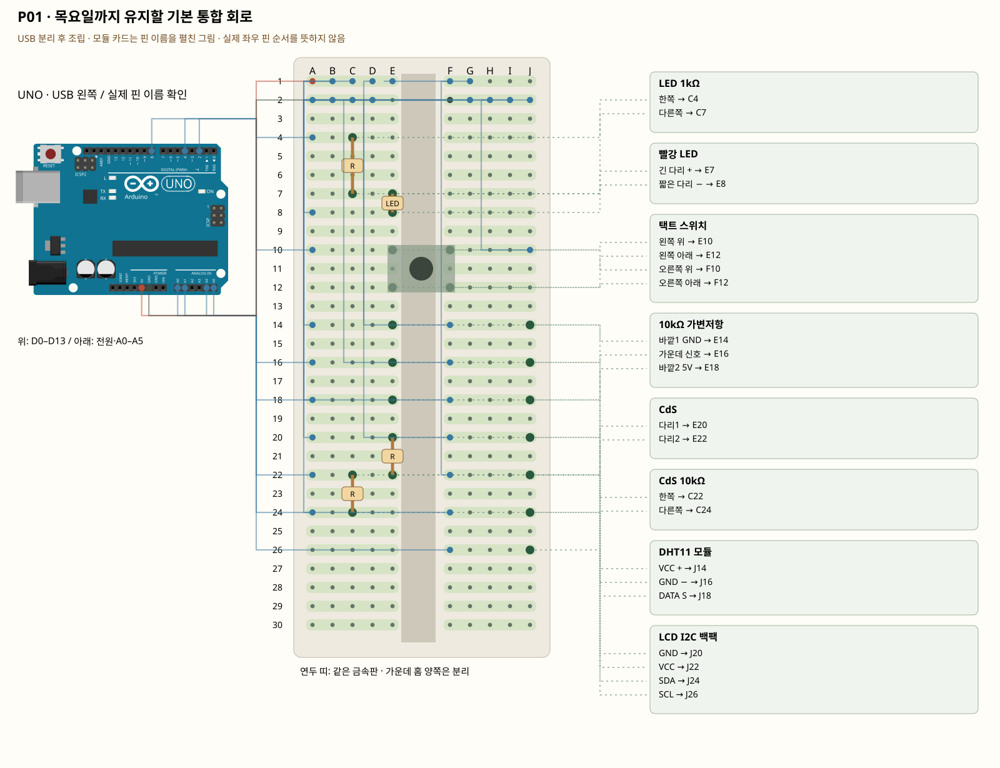
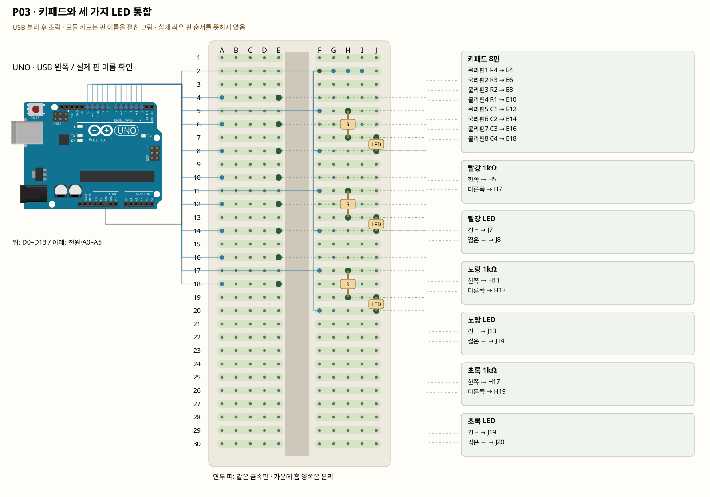
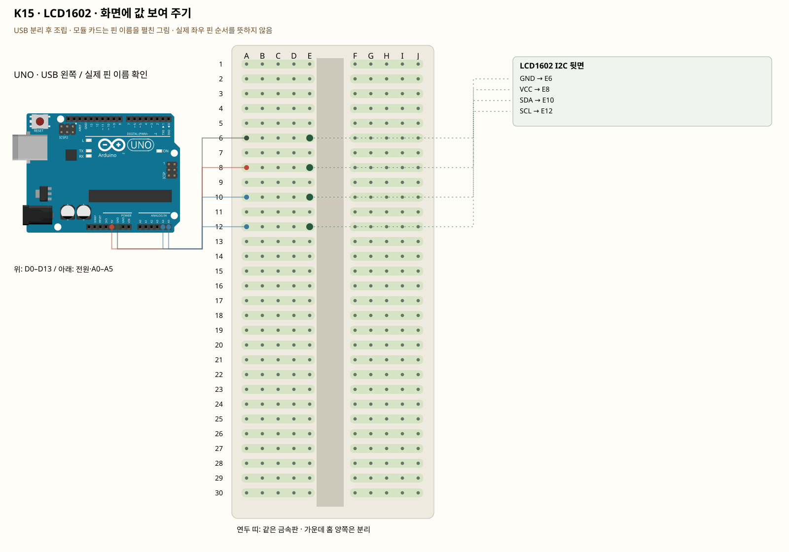
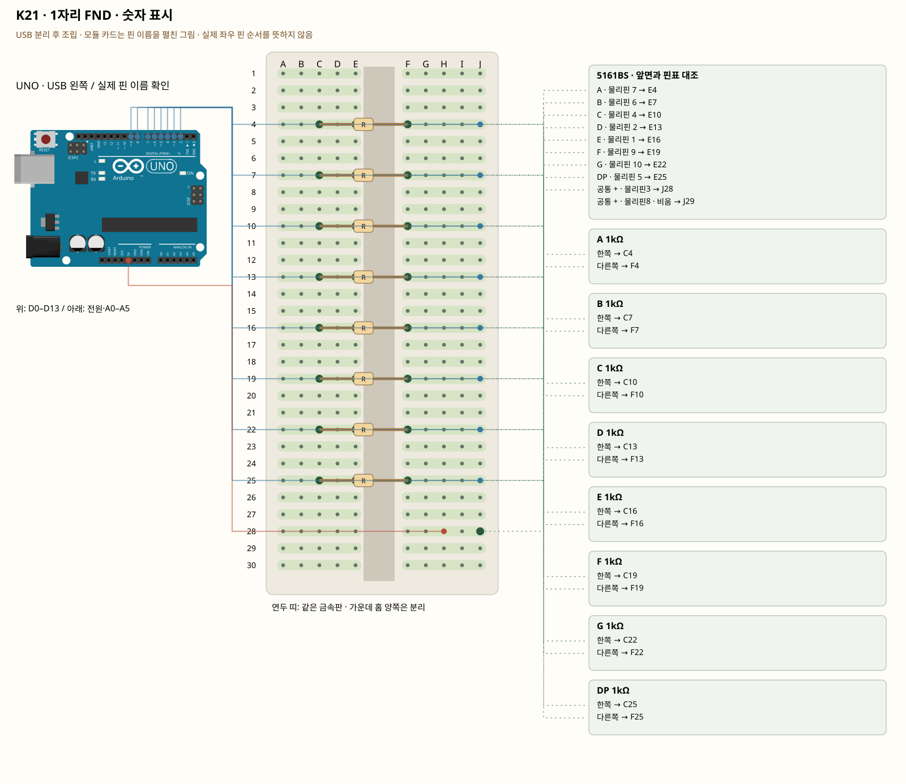
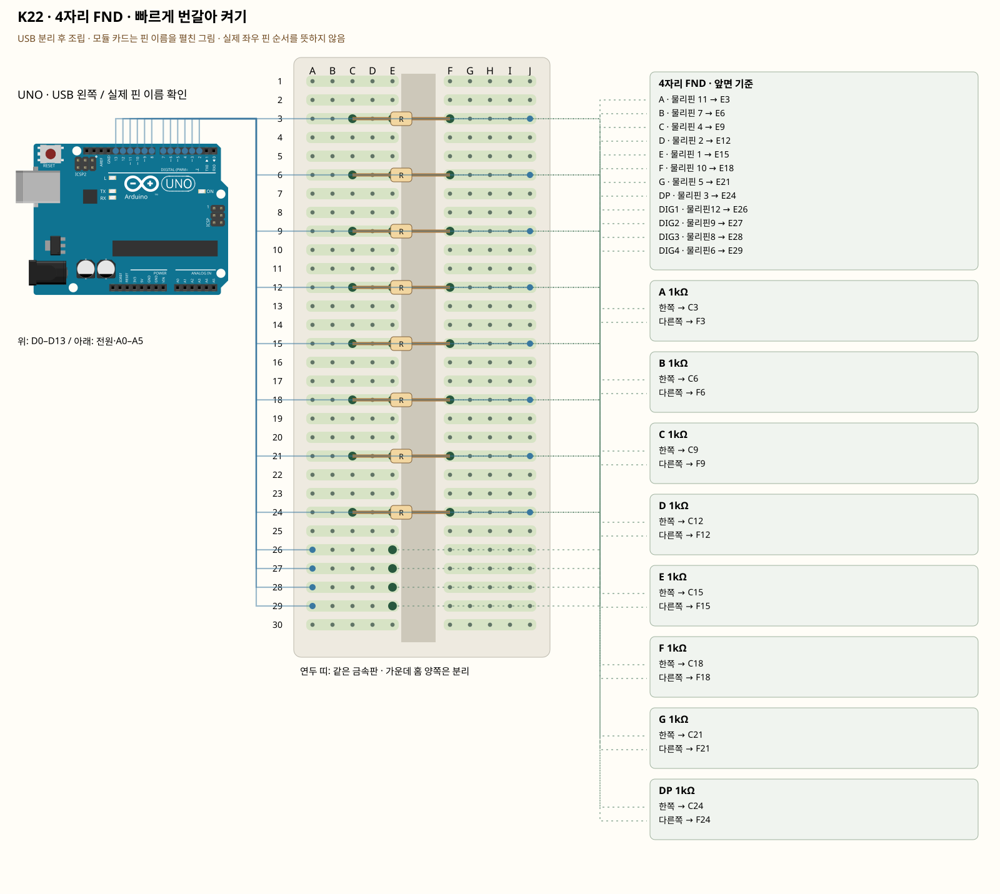
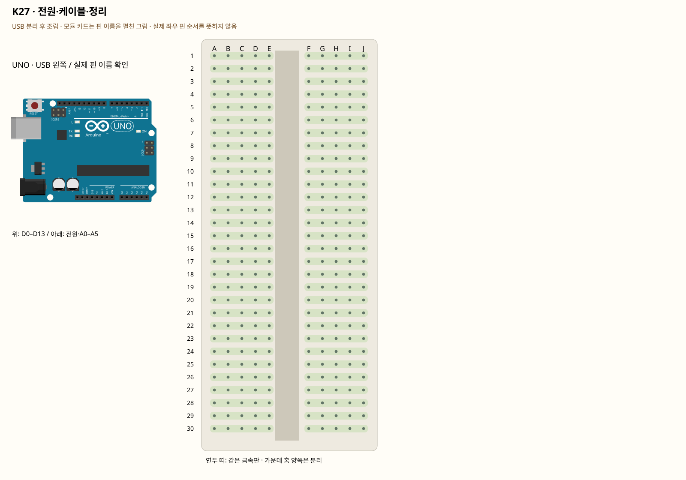

# Claude에 전달할 전체 모듈·배선·코드 계약

이 MD 한 파일에 전체 부품과 배선표를 담았습니다. ZIP을 함께 전달하면 그림과 기준 코드도 볼 수 있습니다. Claude에 대신 전송하지 않았으며 사용자가 직접 전달합니다. 회로 사진을 추가할 때는 다른 사람 얼굴·계정정보를 제외합니다.

## 그대로 붙여 넣을 요청

학습자는 코딩·전자회로 경험이 없는 비전공자다. 보유품은 SZH-EK013 고급키트뿐이다. 추가 보드·추가 빵판·외부 5V 전원·레벨변환기를 보유했다고 가정하지 마라. 보드는 UNO 호환 R3 한 대이며 한 번에 회로 프로파일 하나만 실행한다. 모든 모듈을 동시에 연결하거나 실행했다고 주장하지 마라.

오늘은 배선과 보드 코드 확인, 목요일 2026-10-29는 대시보드 실습이다. 기존 과목 자료의 날짜 10/23과 오늘 보강일 10/26을 구분하라. 전체 모듈의 동시 연결이라는 확장 목표는 남아 있지만 현재 키트만으로 완료한 것으로 쓰지 마라.

먼저 사용할 회로 ID를 확인하고 아래 표의 핀·저항·전원·비움 핀을 유지하라. 실제 모델을 모르는 핀 순서나 새 하드웨어를 만들지 마라. 핀 변경이 필요하면 코드보다 먼저 배선표와 그림의 변경 내역을 제안하라. 모터·모델 미확인 IR/화염/도트매트릭스는 기본 비활성과 상태 null 및 이유를 구현하라. 현재는 외부전원이 없어 모터 구동을 할 수 없으며 코드로 이를 우회하지 마라.

각 측정과 명령의 필드·단위·실패 상태를 정의하라. .ino 폴더와 헤더를 포함한 완결된 코드, 각 줄과 기호의 쉬운 설명, 라이브러리와 버전, 업로드 설정, 정상/경계/실패 시험 순서를 제공하라. 기존 단품 K 참조는 9600 일반 텍스트 출력이므로 아래 115200 JSON/명령 규약을 적용하는 수정을 명시하라. P 기준 코드가 있으면 이를 시작점으로 사용하라.

D0/D1 보존, SRAM 2KB 범위, 타이머 충돌, 긴 delay 없이 입력·출력을 갱신하는 방식, 시작 시 출력 OFF를 확인하라. 먼저 핀 충돌표·부품 준비 조건·명령 목록을 제시한 뒤 코드를 작성하라. 컴파일·업로드·실제 동작 검증을 따로 기록하라. 대시보드 화면 제작은 목요일 작업이며 오늘 확정한 하드웨어 계약을 임의로 바꾸지 마라.

아래 문서는 순서대로 전체 품목 → 전원/드라이버 → 통신 규약 → P01~P04 통합 → K00~K27 단품이다. 포함된 그림 링크는 이 MD와 같은 폴더의 ZIP 파일을 풀었을 때 열린다.


# 전체37품목 대조표

37품목이 독립 제어 채널 37개라는 뜻은 아닙니다. 카드·리모컨·케이블·케이스도 포함합니다. 아래 단품 링크는 각 핀·구멍·전원·저항·참조 코드를 제공하며 P 회로와 동시에 합치지 않습니다.

| 번호 | 품목 | 구분 | 통합프로파일 | 단품ID | 현재조건 |
|---|---|---|---|---|---|
| 1 | UNO 호환보드 | 보조품·전원/보관 | 단품 교체 | K00 | 핀표·단품 코드 제공 |
| 2 | USB A–B 케이블 | 보조품·전원/보관 | 단품 교체 | K00 | 핀표·단품 코드 제공 |
| 3 | LCD1602 · I2C 모듈 | 입출력 부품 | P01 | K15 | 핀표·단품 코드 제공 |
| 4 | RFID RC522 | 입출력 부품 | 단품 교체 | K25 | 실물 조건 확인 |
| 5 | RFID 카드 | 보조품·전원/보관 | 단품 교체 | K25 | 실물 조건 확인 |
| 6 | RFID 열쇠고리 | 보조품·전원/보관 | 단품 교체 | K25 | 실물 조건 확인 |
| 7 | 조이스틱 | 입출력 부품 | P02 | K13 | 핀표·단품 코드 제공 |
| 8 | 4×4 키패드 | 입출력 부품 | P03 | K14 | 핀표·단품 코드 제공 |
| 9 | DS1302 시계 모듈 | 입출력 부품 | 단품 교체 | K17 | 실물 조건 확인 |
| 10 | 수위 센서 | 입출력 부품 | 단품 교체 | K07 | 실물 조건 확인 |
| 11 | DHT11 온습도 모듈 | 입출력 부품 | P01 | K09 | 핀표·단품 코드 제공 |
| 12 | RGB LED 모듈 | 입출력 부품 | P02 | K11 | 실물 조건 확인 |
| 13 | ULN2003 모터 드라이버 | 입출력 부품 | P04 | K19 | 외부전원 없음: 배선 설명/코드 차단, 구동 보류 |
| 14 | 28BYJ-48 스텝모터 | 입출력 부품 | P04 | K19 | 외부전원 없음: 배선 설명/코드 차단, 구동 보류 |
| 15 | 1채널 릴레이 | 입출력 부품 | 단품 교체 | K20 | 실물 조건 확인 |
| 16 | 브레드보드 · 빵판 | 보조품·전원/보관 | 단품 교체 | K01 | 핀표·단품 코드 제공 |
| 17 | 양쪽 수 핀 점퍼선 | 보조품·전원/보관 | 단품 교체 | K01 | 핀표·단품 코드 제공 |
| 18 | 암–수 점퍼선 | 보조품·전원/보관 | 단품 교체 | K07 | 실물 조건 확인 |
| 19 | 소리 감지 모듈 | 입출력 부품 | 단품 교체 | K08 | 실물 조건 확인 |
| 20 | 적외선 리모컨 | 보조품·전원/보관 | 단품 교체 | K16 | 실물 조건 확인 |
| 21 | 10kΩ 가변저항 | 입출력 부품 | P01,P04 | K04 | 핀표·단품 코드 제공 |
| 22 | 1자리 FND · 5161BS | 입출력 부품 | 단품 교체 | K21 | 핀표·단품 코드 제공 |
| 23 | 4자리 FND · HS410561K-32 | 입출력 부품 | 단품 교체 | K22 | 실물 조건 확인 |
| 24 | 8×8 도트매트릭스 | 입출력 부품 | 단품 교체 | K24 | 실물 조건 확인 |
| 25 | SG90 서보모터 | 입출력 부품 | P04 | K18 | 외부전원 없음: 배선 설명/코드 차단, 구동 보류 |
| 26 | 2핀 부저 | 입출력 부품 | 단품 교체 | K12 | 실물 조건 확인 |
| 27 | 볼 · 기울기 스위치 | 입출력 부품 | 단품 교체 | K06 | 핀표·단품 코드 제공 |
| 28 | 조도 센서 · CdS | 입출력 부품 | P01 | K05 | 핀표·단품 코드 제공 |
| 29 | 9V 배터리 클립 | 보조품·전원/보관 | 단품 교체 | K27 | 핀표·단품 코드 제공 |
| 30 | 빨강·노랑·초록 LED | 입출력 부품 | P01,P03 | K03 | 핀표·단품 코드 제공 |
| 31 | 고정저항 | 보조품·전원/보관 | P01,P02,P03 | K01 | 핀표·단품 코드 제공 |
| 32 | 2핀 화염 감지 소자 | 입출력 부품 | 단품 교체 | K26 | 실물 조건 확인 |
| 33 | 택트 스위치와 캡 | 입출력 부품 | P01,P04 | K02 | 핀표·단품 코드 제공 |
| 34 | 적외선 수신 소자 | 입출력 부품 | 단품 교체 | K16 | 실물 조건 확인 |
| 35 | 74HC595 | 입출력 부품 | 단품 교체 | K23 | 핀표·단품 코드 제공 |
| 36 | LM35DZ 온도 센서 | 입출력 부품 | 단품 교체 | K10 | 핀표·단품 코드 제공 |
| 37 | 보관 케이스 | 보조품·전원/보관 | 단품 교체 | K27 | 핀표·단품 코드 제공 |


- [K00 처음 연결 · 설치와 업로드](modules/K00.md)
- [K01 빵판 읽기 · 저항과 LED](modules/K01.md)
- [K02 택트 스위치 · 누르면 값 바꾸기](modules/K02.md)
- [K03 세 가지 LED · 신호등 만들기](modules/K03.md)
- [K04 가변저항 · 손잡이를 숫자로 읽기](modules/K04.md)
- [K05 조도 센서 · 밝기와 저항](modules/K05.md)
- [K06 볼 스위치 · 기울기 감지](modules/K06.md)
- [K07 수위 센서 · 젖는 면적 비교](modules/K07.md)
- [K08 소리 모듈 · 감도와 기준](modules/K08.md)
- [K09 DHT11 · 온도와 습도](modules/K09.md)
- [K10 LM35DZ · 전압을 섭씨로](modules/K10.md)
- [K11 RGB LED · 세 가지 빛 섞기](modules/K11.md)
- [K12 부저 · 짧은 소리 만들기](modules/K12.md)
- [K13 조이스틱 · X·Y·누름 읽기](modules/K13.md)
- [K14 4×4 키패드 · 행과 열](modules/K14.md)
- [K15 LCD1602 · 화면에 값 보여 주기](modules/K15.md)
- [K16 적외선 리모컨 · 버튼 코드 읽기](modules/K16.md)
- [K17 RTC · 껐다 켜도 시간 기억](modules/K17.md)
- [K18 서보모터 · 각도 지정](modules/K18.md)
- [K19 스텝모터 · 드라이버로 순서 제어](modules/K19.md)
- [K20 릴레이 · LED 회로를 접점으로 끊기](modules/K20.md)
- [K21 1자리 FND · 숫자 표시](modules/K21.md)
- [K22 4자리 FND · 빠르게 번갈아 켜기](modules/K22.md)
- [K23 74HC595 · 선 세 개로 출력 늘리기](modules/K23.md)
- [K24 도트매트릭스 · 한 점과 핀 지도](modules/K24.md)
- [K25 RFID · 카드와 열쇠고리 읽기](modules/K25.md)
- [K26 2핀 화염 소자 · 빛 변화와 모델 확인](modules/K26.md)
- [K27 전원·케이블·정리](modules/K27.md)


# 전원과 모터드라이버의 각 핀

확인된 보유품은 **고급키트뿐**입니다. 별도전원·추가보드·추가빵판·레벨변환기를 보유했다고 가정하지 않습니다. 키트의 9V 클립은 수동 연결 부품이며 배터리나 5V 변환기가 아닙니다.

## 오늘 사용하는 USB 전원

PC USB → UNO USB 단자 → UNO 5V → 선택한 회로의 5V 분배 묶음 → 지정 센서/LCD 순서입니다. UNO GND는 별도의 GND 분배 묶음으로 연결합니다. 5V와 GND 묶음은 서로 다릅니다. UNO 한 구멍에 선 여러 개를 겹쳐 꽂지 않습니다.

그림은 전원 레일을 사용하지 않고 가운데 단자의 연결 묶음을 지정합니다. A~E와 F~J의 같은 숫자 줄은 홈 때문에 분리되어 있습니다. 연결이 필요하면 표에 있는 점퍼선을 추가합니다.

모듈의 실제 소비전류와 USB 공급 조건은 실물 대조가 필요합니다. 총소비전류를 문서에서 측정한 것처럼 표시하지 않습니다. UNO 공식 핀표의 I/O 20mA, 3.3V 출력 50mA 표기는 여러 부하의 전체 공급 예산과 구별합니다. 모든 핀에 각각 한도까지 동시에 흘려도 된다는 뜻이 아닙니다.

빨강 LED의 1kΩ은 5V에서 LED 전압 약 2V를 뺀 값에 대해 대략 3mA를 목표로 한 시작값입니다. 실제 LED에 따라 차이가 납니다. RGB는 채널마다 별도 저항을 사용합니다. 모터 부하는 오늘 USB 기본 센서 회로에 추가하지 않습니다.

## 스텝모터와 ULN2003

키트의 ULN2003 모듈을 기준으로 합니다. L298N·TB6612·A4988의 핀 이름이나 배선을 대입하지 않습니다. 실제 보드의 +/− 표시와 전원 점퍼 기능은 리비전을 확인해야 합니다. 그림은 핀 기능을 펼친 연결도이며 헤더의 좌우 순서가 아닙니다.

| 연결 대상 | P04 연결 | 역할 |
|---|---|---|
| UNO D8 | A5 → E5 → IN1 | 코일 1 제어 |
| UNO D9 | A7 → E7 → IN2 | 코일 2 제어 |
| UNO D10 | A9 → E9 → IN3 | 코일 3 제어 |
| UNO D11 | A11 → E11 → IN4 | 코일 4 제어 |
| 별도 정전압 5V 출력 + | J15 → F15/B15 → E15 → 드라이버 전원 + | 모터 에너지. 오늘 미연결 |
| 별도전원 출력 − | J17 → F17/B17 → E17 → 드라이버 GND | 모터 전류 복귀. 오늘 전원 없음 |
| UNO GND 분배 | A17 → E17 | 제어 신호의 기준을 맞춤 |
| 모터의 흰색 5핀 커넥터 | 드라이버의 전용 5핀 소켓 | 홈·걸쇠 방향을 맞춰 연결 |

모터의 다섯 선을 빵판에 풀어 임의로 다시 배열하지 않습니다. 5핀 소켓에 거꾸로 밀어 넣지 않습니다. 모터 몸체의 5V 정격을 확인합니다.

ULN2003 칩의 COM은 보호 다이오드의 공통 단자입니다. 모듈의 전원 +와 어떻게 연결됐는지는 모듈 회로로 확인해야 합니다. IC 데이터시트의 핀 번호를 모듈 단자의 순서로 읽지 않습니다. ULN2003은 부하 전류를 GND 쪽으로 흐르게 제어하는 소자이며, 전압 변환기나 5V 전원 생성기가 아닙니다.

## 서보는 ULN2003을 거치지 않습니다

| SG90 선 | P04 연결 | 역할 |
|---|---|---|
| 주황 신호 | UNO D6 → F5 → J5 | 목표 각도 펄스 신호 |
| 빨강 전원 | 외부 +5V의 C15 → F9/J9 | 서보 에너지. 오늘 미연결 |
| 갈색 GND | 외부전원 −의 C17 → F11/J11 | 전류 복귀와 신호 기준 |

외부 +5V와 UNO 5V를 묶지 않습니다. GND는 공통 기준이지만 모터의 전원 왕복 경로는 UNO 핀을 거치지 않도록 분리합니다. 전체 모터 전류를 불명 정격의 가느다란 점퍼·빵판 접점으로 흘리는 구성을 확정하지 않습니다.

향후 외부전원을 준비하면 출력 5V·극성·모터 시동/정지 전류·서보 걸림 전류·연결부 허용전류를 대조해야 합니다. 실물 확인 없이 특정 전원 용량이 충분하다고 단정하지 않습니다. 전원 분배부·연결 단자·보호 부품의 추가 필요 여부도 함께 결정합니다. P04의 빵판 위치는 신호와 전원 노드를 이해하기 위한 설계이며, 실제 모터 전류 경로의 정격 검증을 대신하지 않습니다.

## 오늘 가능한 범위

부품 식별 → 신호/전원 경로 읽기 → 외부전원 단자에 미연결 표시 → P04 컴파일 → STATUS와 ARM 거절 응답 확인까지입니다. **모터 관련 연결은 보류하고, 가변저항·정지 버튼의 USB 입력 시험만 진행합니다.** 외부전원 확인 전에는 `MOTOR_POWER_CONFIRMED=false`를 유지합니다.

추후 실제 구동을 준비할 때는 P04 표와 실물 사진을 대조하고 외부전원을 분리한 채 배선합니다. 먼저 제어 신호·GND와 코드의 안전한 초기값을 확인한 뒤 모터 전원을 마지막에 연결합니다. 소프트웨어 STOP은 물리 전원 차단을 대신하지 않습니다.

## 핀과 타이머 충돌

UNO USB 시리얼의 D0/D1은 비웁니다. LCD를 쓰면 A4/A5는 I2C로 배정하며 별도 아날로그 센서와 겹치지 않습니다. RFID의 SPI D11/D12/D13과 SS/RST도 따로 배정해야 합니다.

P02의 RGB는 PWM 5/6/9입니다. P04의 Servo는 Timer1을 사용하므로 PWM 9/10에 영향을 줍니다. P04의 D9/D10은 스텝코일의 일반 디지털 출력이며 PWM을 사용하지 않아 이 조합을 택했습니다. P04에서는 tone()을 사용하지 않습니다. 각 단품 회로의 핀은 다른 회로와 중복될 수 있으므로 회로를 바꿀 때는 먼저 해체합니다.

공식 근거: [UNO 핀표](https://docs.arduino.cc/resources/pinouts/A000066-full-pinout.pdf), [서보 전원](https://docs.arduino.cc/learn/electronics/servo-motors/), [TI ULN2003A](https://www.ti.com/lit/ds/symlink/uln2003a.pdf), [Servo 타이머 구현](https://github.com/arduino-libraries/Servo/blob/master/src/avr/ServoTimers.h).


# 목요일 대시보드를 위한 통신 규약

오늘은 Arduino 시리얼 모니터에서 명령과 실제 입력을 확인합니다. 목요일(2026-10-29)에 같은 규약을 PC 연결 프로그램과 대시보드에 붙입니다. 기존 대시보드의 센서 수집 기능에는 아래 장치 제어 기능을 별도로 구현해야 합니다.

## PC에서 보드로 보내기

새 통합 코드는 USB 시리얼 **115200**을 사용합니다. 줄 끝은 LF(새 줄)입니다. `요청번호 명령 인수`를 한 줄로 보냅니다. 요청번호는 1~65535입니다. 보드에는 한 번에 스케치 하나만 올라갑니다. 다른 프로파일의 명령을 보내면 오류를 반환해야 합니다.

연결 직후 UNO가 재시작할 수 있으므로 2초 기다린 뒤 STATUS로 회로 ID를 확인합니다. 한 포트는 연결 프로그램 하나가 관리하고, 웹은 그 프로그램의 API를 사용합니다. Arduino 시리얼 모니터와 PC 프로그램이 동시에 같은 COM 포트를 열 수 없습니다.

| 회로 | 예시 명령 | 범위와 동작 |
|---|---|---|
| 공통 | `1 STATUS` | 현재 상태를 요청 |
| 공통 | `2 PING` | 연결 유지 확인 |
| 공통 | `3 STOP` | 해당 프로파일의 출력을 정지 |
| P01 | `10 LED 1`, `11 LED 0` | LED 켜기/끄기, 자동 모드 해제 |
| P01 | `12 AUTO 1`, `13 AUTO 0` | 자동 모드 켜기/끄기. 해제 직후 LED는 마지막 상태 유지 |
| P01 | `14 THRESH 350 450` | 원시값 0~1023. 켜는 기준 < 끄는 기준 |
| P02 | `20 RGB 30 0 0` | R/G/B 각각 0~255 |
| P03 | `30 SIGNAL 1` | 0=꺼짐, 1=빨강, 2=노랑, 3=초록 |
| P04 | `40 ARM 1`, `43 ARM 0` | 모터 동작 허용/해제. 현재 기본 빌드는 허용을 거절 |
| P04 | `41 SERVO 90` | 확인된 외부전원과 ARM 이후 목표 30~150도 |
| P04 | `42 STEP 32` | 확인된 외부전원과 ARM 이후 -128~128 반스텝. 이동 중에는 busy |

P01의 STOP은 자동 모드 해제와 LED 끄기, P02는 RGB 끄기, P03은 세 LED 끄기입니다. P04는 이동 취소·코일 해제·서보 신호 중단입니다. STOP은 물리적인 전원 차단이 아니며 서보의 하중을 잡아주지 않습니다. 릴레이·LCD 임의 문구 같은 추가 기능은 K20·K15 단품을 바탕으로 다음 회로의 명령을 별도 정의합니다.

## 보드에서 PC로 받기

응답은 JSON 한 줄입니다. 다음은 형식 예시이며 실물 실행 기록이 아닙니다.

```json
{"v":1,"type":"ack","request":10,"applied":true}
{"v":1,"type":"error","request":40,"code":"power_or_stop"}
{"v":1,"type":"state","profile":"P01","request":0,"ms":1234,"light_raw":412,"temperature_c":null}
```

`ack`는 보드 프로그램이 명령 또는 목표를 적용했다는 응답입니다. 실제 LED 발광·모터 각도를 측정했다는 뜻은 아닙니다. STEP의 코드상 완료는 `step_remaining=0`으로 확인하고, 실제 회전은 따로 관찰합니다. P01 LCD의 실제 글자 대비와 표시는 눈으로 확인합니다.

`state`는 회로별 실제 입력과 프로그램 상태를 포함합니다. 1초마다 자동 전송할 때 `request=0`이며, STATUS 응답은 요청번호를 그대로 돌려줍니다. 최초 DHT 측정 전이나 읽기 실패는 `null`입니다. 미허용 모터는 `armed=false`를 보냅니다. P02에 연결하지 않은 소리·수위나 P03에 없는 LCD·릴레이를 측정·제어했다고 표시하지 않습니다.

P04는 유효한 명령이 2초간 없거나 정지 버튼을 누르면 정지합니다. 향후 실제 구동 시에는 1초 이내 간격으로 PING을 보내야 합니다. 현재는 외부전원이 없으므로 ARM이 거절되어야 정상입니다.

## 목요일 화면의 처리 기준

명령 전송 중·응답 오류·보드의 목표 적용·실제 관찰을 구분합니다. `null`, 실제 숫자 0, 연결 끊김을 섞지 않습니다. 마지막 상태가 3초 이상 오래되면 연결 경고를 표시하고 모터 조작을 비활성화합니다. 이때 모든 출력이 꺼졌다고 추정하지 않습니다. 오래된 출력 명령은 재연결 시 자동으로 다시 보내지 않습니다.

기존 K 단품 예제는 **9600의 일반 텍스트 출력**입니다. 이를 새 JSON 규약으로 읽지 않습니다. Claude로 확장할 때 사용할 단품 회로 ID·필드·명령을 먼저 정하고 이 규약을 명시적으로 적용합니다.

## 오늘 PC 연결 프로그램으로 확인하기

먼저 Arduino 시리얼 모니터를 닫습니다. Python이 설치된 PC에서 이 자료 폴더를 열고 실행합니다. 설치가 막히면 Arduino 시리얼 모니터 경로로 계속할 수 있습니다.

```powershell
py -3.12 -m venv .venv
.\.venv\Scripts\python.exe -m pip install -r pc/requirements.txt
.\.venv\Scripts\python.exe pc/serial_check.py --port COM5 --profile P01 --command "LED 1"
```

COM5는 예시이므로 실제 포트로 바꿉니다. 이 프로그램은 STATUS로 프로파일을 확인한 뒤 한 명령만 전송합니다. 응답 유실 시 출력 명령을 자동 재시도하지 않습니다. P04의 지속 PING이나 대시보드를 구현한 프로그램은 아니므로 실제 모터 운전에 사용하지 않습니다.


# P01 · 목요일까지 유지할 기본 통합 회로

센서값 네 종류와 버튼을 읽고 LED를 수동·자동 제어합니다. LCD에도 실제 조도 원시값과 LED 명령 상태를 표시합니다. 이 회로는 28개 부품 전체 동시 연결을 의미하지 않습니다.

**조건:** 부품 표시와 USB 공급 조건을 확인합니다. 지정한 부품만 연결합니다.



[조건부 가지까지 포함한 전체 설계 그림](diagrams/P01.svg). 흐린 점선은 오늘 연결하지 않습니다.

[부품 배치 그림](diagrams/P01-01-placement.svg) · [신호선까지 연결](diagrams/P01-02-signals.svg) · [전원 분배까지 전체 그림](diagrams/P01-03-complete.svg)

모든 한 선의 중간 그림은 `index.html`에서 이 회로를 고르고 이전/다음으로 확인합니다. 그림의 조건부 연결은 오늘 통전 허가가 아닙니다.

## 준비물

빨강·노랑·초록 LED, 고정저항, 택트 스위치와 캡, 10kΩ 가변저항, 조도 센서 · CdS, DHT11 온습도 모듈, LCD1602 · I2C 모듈.

이 펼친 배선에 필요한 선은 **암–수 7개, 수–수 21개**입니다. SG90의 암 커넥터에는 수–수 선을 사용합니다. 외부전원 연결 부품은 이 계산과 별도이며 현재 없습니다. 키트의 암–수 10개 범위에 맞췄으며 수–수 실제 수량과 길이는 실물에서 확인합니다. 저항 종류별 실제 수량도 포장과 대조합니다. 부족하면 완료 표시하지 말고 해당 가지를 연결하기 전에 강사에게 알립니다.

라이브러리: DHT sensor library 1.4.7 / Adafruit Unified Sensor 1.1.15 / hd44780 1.3.2.

## 코드와 보드 핀 대응

| 코드 이름 | UNO 핀 |
|---|---|
| LED | D8 |
| BUTTON | D2 |
| POT | A0 |
| LIGHT | A1 |
| DHT | D4 |
| SDA | A4 |
| SCL | A5 |

## 부품의 각 핀·구멍·전기 연결

| 부품 | 핀/다리 | 구멍 | 같은 금속판 | UNO 또는 저항 경유 연결 |
|---|---|---|---|---|
| LED 1kΩ | 한쪽 | C4 | A4·B4·C4·D4·E4 | UNO D8 |
| LED 1kΩ | 다른쪽 | C7 | A7·B7·C7·D7·E7 | 표의 부품 사이 연결·외부전원 경로 확인 |
| 빨강 LED | 긴 다리 + | E7 | A7·B7·C7·D7·E7 | LED 1kΩ 경유 UNO D8 |
| 빨강 LED | 짧은 다리 − | E8 | A8·B8·C8·D8·E8 | UNO GND, CdS 10kΩ 경유 UNO A1 |
| 택트 스위치 | 왼쪽 위 | E10 | A10·B10·C10·D10·E10 | UNO D2 |
| 택트 스위치 | 왼쪽 아래 | E12 | A12·B12·C12·D12·E12 | UNO D2 |
| 택트 스위치 | 오른쪽 위 | F10 | F10·G10·H10·I10·J10 | UNO GND, CdS 10kΩ 경유 UNO A1 |
| 택트 스위치 | 오른쪽 아래 | F12 | F12·G12·H12·I12·J12 | UNO GND, CdS 10kΩ 경유 UNO A1 |
| 10kΩ 가변저항 | 바깥1 GND | E14 | A14·B14·C14·D14·E14 | UNO GND, CdS 10kΩ 경유 UNO A1 |
| 10kΩ 가변저항 | 가운데 신호 | E16 | A16·B16·C16·D16·E16 | UNO A0 |
| 10kΩ 가변저항 | 바깥2 5V | E18 | A18·B18·C18·D18·E18 | UNO 5V, CdS 경유 UNO A1 |
| CdS | 다리1 | E20 | A20·B20·C20·D20·E20 | UNO 5V |
| CdS | 다리2 | E22 | A22·B22·C22·D22·E22 | UNO A1, CdS 10kΩ 경유 UNO GND |
| CdS 10kΩ | 한쪽 | C22 | A22·B22·C22·D22·E22 | UNO A1, CdS 경유 UNO 5V |
| CdS 10kΩ | 다른쪽 | C24 | A24·B24·C24·D24·E24 | UNO GND |
| DHT11 모듈 | VCC + | J14 | F14·G14·H14·I14·J14 | UNO 5V, CdS 경유 UNO A1 |
| DHT11 모듈 | GND − | J16 | F16·G16·H16·I16·J16 | UNO GND, CdS 10kΩ 경유 UNO A1 |
| DHT11 모듈 | DATA S | J18 | F18·G18·H18·I18·J18 | UNO D4 |
| LCD I2C 백팩 | GND | J20 | F20·G20·H20·I20·J20 | UNO GND, CdS 10kΩ 경유 UNO A1 |
| LCD I2C 백팩 | VCC | J22 | F22·G22·H22·I22·J22 | UNO 5V, CdS 경유 UNO A1 |
| LCD I2C 백팩 | SDA | J24 | F24·G24·H24·I24·J24 | UNO A4 |
| LCD I2C 백팩 | SCL | J26 | F26·G26·H26·I26·J26 | UNO A5 |

## 한 선씩 연결

| 순서 | 출발 | 도착 | 역할 |
|---|---|---|---|
| 1 | UNO D8 | 빵판 A4 | D8 출력은 1kΩ 저항을 거쳐 LED로 갑니다. |
| 2 | UNO D2 | 빵판 A10 | INPUT_PULLUP 입력. 누르면 GND에 연결됩니다. |
| 3 | UNO A0 | 빵판 A16 | 가변저항 가운데 다리의 전압을 읽습니다. |
| 4 | UNO A1 | 빵판 A22 | CdS와 10kΩ 저항 사이 전압을 읽습니다. |
| 5 | UNO D4 | 빵판 F18 | DHT11 데이터선입니다. |
| 6 | UNO A4 | 빵판 F24 | UNO I2C SDA입니다. |
| 7 | UNO A5 | 빵판 F26 | UNO I2C SCL입니다. |
| 8 | UNO 5V | 빵판 A1 | UNO 전원을 분배 묶음에 한 선으로 연결합니다. USB는 아직 분리합니다. |
| 9 | 빵판 B1 | 빵판 A18 | 분배 묶음에서 이 부품의 전원 또는 기준 GND로 연결합니다. |
| 10 | 빵판 C1 | 빵판 A20 | 분배 묶음에서 이 부품의 전원 또는 기준 GND로 연결합니다. |
| 11 | 빵판 D1 | 빵판 F14 | 분배 묶음에서 이 부품의 전원 또는 기준 GND로 연결합니다. |
| 12 | 빵판 E1 | 빵판 F1 | 가운데 홈 건너편 분배 묶음을 점퍼로 잇습니다. |
| 13 | 빵판 G1 | 빵판 F22 | 분배 묶음에서 이 부품의 전원 또는 기준 GND로 연결합니다. |
| 14 | UNO GND | 빵판 F2 | UNO 전원을 분배 묶음에 한 선으로 연결합니다. USB는 아직 분리합니다. |
| 15 | 빵판 G2 | 빵판 A8 | 분배 묶음에서 이 부품의 전원 또는 기준 GND로 연결합니다. |
| 16 | 빵판 H2 | 빵판 J10 | 분배 묶음에서 이 부품의 전원 또는 기준 GND로 연결합니다. |
| 17 | 빵판 I2 | 빵판 A14 | 분배 묶음에서 이 부품의 전원 또는 기준 GND로 연결합니다. |
| 18 | 빵판 J2 | 빵판 A2 | 가운데 홈 건너편 분배 묶음을 점퍼로 잇습니다. |
| 19 | 빵판 B2 | 빵판 A24 | 분배 묶음에서 이 부품의 전원 또는 기준 GND로 연결합니다. |
| 20 | 빵판 C2 | 빵판 F16 | 분배 묶음에서 이 부품의 전원 또는 기준 GND로 연결합니다. |
| 21 | 빵판 D2 | 빵판 F20 | 분배 묶음에서 이 부품의 전원 또는 기준 GND로 연결합니다. |


## 오늘의 준비·연결 순서

1. 폴더 `my-kit`를 만들고 이 자료를 풉니다. `.md`는 설명, `.svg`는 확대 가능한 그림, `.ino`는 보드 프로그램입니다. `index.html`은 더블클릭해 오프라인으로 열 수 있습니다.
2. 화면과 부품 사진을 대조합니다. USB를 빼고, 이전 프로파일 부품·선을 모두 해체합니다. 다른 P/K 회로의 선을 남겨 합치지 않습니다.
3. 지정한 부품을 놓고 신호선을 하나씩 연결합니다. 그림의 모듈 핀은 펼친 표기입니다. 모듈을 그림처럼 빵판에 억지로 꽂지 말고 암–수 선으로 실제 핀 이름을 연결합니다. 부품 자체의 핀 간격·왼쪽 순서는 실물과 모델 핀표를 따릅니다.
4. 전원 분배 묶음과 GND를 연결합니다. 조건부 전원·신호는 보류합니다. A~E와 F~J의 같은 숫자 줄은 서로 다른 금속판입니다. 실제 전원 레일은 이 그림에서 쓰지 않습니다.
5. 핀표와 코드의 `pins.h`를 대조합니다. 저항 값·극성·전원 단락·비어 있어야 할 핀을 확인합니다. 멀티미터가 있으면 **모든 전원을 분리한 빈 빵판**에서 연결 묶음을 확인합니다. 전원 연결 상태에서 저항/연속성 모드를 쓰지 않습니다.
6. PC에 Arduino IDE를 열고 `firmware/Pxx/Pxx.ino`를 엽니다. 같은 폴더의 `pins.h`, `protocol.h`도 유지합니다. Arduino Uno와 실제 COM 포트를 선택하고 필요한 라이브러리를 설치합니다. 검증 → 업로드 후 시리얼 모니터를 **115200**, 줄 끝을 **새 줄**로 설정합니다. 기존 단품 K 예제는 **9600**입니다.
7. `1 STATUS`를 보내고 실제 숫자를 확인합니다. 그다음 이 프로파일의 출력 명령을 하나만 실행합니다. 시리얼 모니터와 PC 연결 프로그램은 같은 COM 포트를 동시에 열지 않습니다.
8. 사진·회로 ID·코드·예상/실제 결과를 저장합니다. 수업 끝에는 USB를 빼고, 목요일 전에도 다시 전원 분리 상태에서 전체 배선을 점검합니다. 다른 회로 실습을 했다면 목요일 사용할 P01로 복원합니다.

## 동작과 완료의 구별

컴파일 성공은 문법·라이브러리 조합 확인입니다. 업로드 성공은 보드 전송, 수신 JSON은 보드 프로그램 응답입니다. LED 실제 발광·모터 실제 각도는 별도 관찰입니다. 자동 자료 검사는 실물 정격·납땜·실제 핀 순서·전류·노이즈를 보증하지 않습니다.

## 실행과 확인

스케치: [firmware/P01/P01.ino](firmware/P01/P01.ino). 다음 줄을 하나씩 보내며 실제 결과를 기록합니다.

```text
1 STATUS
2 LED 1
3 LED 0
4 THRESH 350 450
5 AUTO 1
6 STOP
```

LED 1/0은 실제 빨강 LED가 켜짐/꺼짐으로 바뀌어야 합니다. 버튼을 누르면 button_pressed=true, 손잡이를 돌리면 pot_raw가 변합니다. CdS를 가리면 이 배선에서는 light_raw가 대체로 작아집니다. DHT 최초 2초 또는 실패는 null입니다. LCD 초기화 실패는 lcd_ready=false로 표시하고 나머지 센서는 계속 읽습니다. AUTO는 켜는 기준과 끄는 기준 사이에서 이전 상태를 유지합니다.

## 오류 해결

1. 포트가 없으면 데이터 USB 케이블·보드 선택·실제 COM을 확인합니다. 다른 프로그램이 포트를 열고 있으면 닫습니다.
2. 센서가0/1023에 고정되면 VCC/GND/신호의 위치와 코드 핀부터 비교합니다. 입력 선을 뺀 상태의 흔들리는 값은 센서 측정이 아닙니다.
3. LCD가 안 되면 lcd_ready·A4/A5·VCC·GND·실물 I2C 백팩과 대비 조절을 확인합니다. 실패를 숨기고 가짜 값을 표시하지 않습니다.
4. 출력 응답은 왔지만 실물이 안 움직이면 전원을 분리하고 해당 핀·극성·저항·드라이버·전원 조건을 점검합니다. 현재 조건부 차단을 임의로 해제하지 않습니다.

## 학생 설명·변경 활동

먼저 강사가 한 선과 한 명령을 시연합니다. 함께 STATUS까지 확인한 뒤, 학생은 허용된 값 하나를 바꾸고 예상과 실제를 비교합니다. 필수는 실제 배선과 입력/출력 확인이며 추가 도전은 자동 판단 또는 PC 명령 기능입니다. 마지막에 사용한 핀 하나와 GND가 필요한 이유를 자기 말로 설명합니다.


# P02 · 조이스틱과 RGB 통합

P01을 모두 해체한 뒤 만드는 교체 회로입니다. 암–수 10개 범위에 맞추기 위해 조이스틱과 RGB만 함께 연결합니다. 소리·수위는 K08·K07에서 따로 연결합니다. 연결하지 않은 센서의 떠 있는 값을 실제 측정처럼 전송하지 않습니다.

**조건:** RGB의 공통 −와 채널 이름을 확인한 조건입니다. 공통 +형은 H2–F21 GND 점퍼를 제거하고 빈 C1–F21 점퍼로 5V에 연결한 뒤 COMMON_ANODE=true로 변경합니다. 양쪽 점퍼를 동시에 꽂지 않습니다. 암–수 점퍼 9개와 1kΩ 저항 3개를 확인합니다.


[조건부 가지까지 포함한 전체 설계 그림](diagrams/P02.svg). 흐린 점선은 오늘 연결하지 않습니다.

[부품 배치 그림](diagrams/P02-01-placement.svg) · [신호선까지 연결](diagrams/P02-02-signals.svg) · [전원 분배까지 전체 그림](diagrams/P02-03-complete.svg)

모든 한 선의 중간 그림은 `index.html`에서 이 회로를 고르고 이전/다음으로 확인합니다. 그림의 조건부 연결은 오늘 통전 허가가 아닙니다.

## 준비물

조이스틱, RGB LED 모듈, 고정저항.

이 펼친 배선에 필요한 선은 **암–수 9개, 수–수 11개**입니다. SG90의 암 커넥터에는 수–수 선을 사용합니다. 외부전원 연결 부품은 이 계산과 별도이며 현재 없습니다. 키트의 암–수 10개 범위에 맞췄으며 수–수 실제 수량과 길이는 실물에서 확인합니다. 저항 종류별 실제 수량도 포장과 대조합니다. 부족하면 완료 표시하지 말고 해당 가지를 연결하기 전에 강사에게 알립니다.

라이브러리: 추가 설치 없음.

## 코드와 보드 핀 대응

| 코드 이름 | UNO 핀 |
|---|---|
| JOY_X | A0 |
| JOY_Y | A1 |
| JOY_SW | D2 |
| RED | D5 |
| GREEN | D6 |
| BLUE | D9 |

## 부품의 각 핀·구멍·전기 연결

| 부품 | 핀/다리 | 구멍 | 같은 금속판 | UNO 또는 저항 경유 연결 |
|---|---|---|---|---|
| 조이스틱 | GND | E5 | A5·B5·C5·D5·E5 | UNO GND |
| 조이스틱 | 5V | E7 | A7·B7·C7·D7·E7 | UNO 5V |
| 조이스틱 | VRx | E9 | A9·B9·C9·D9·E9 | UNO A0 |
| 조이스틱 | VRy | E11 | A11·B11·C11·D11·E11 | UNO A1 |
| 조이스틱 | SW | E13 | A13·B13·C13·D13·E13 | UNO D2 |
| RGB 공통 음극 모듈 | R | J7 | F7·G7·H7·I7·J7 | R 1kΩ 경유 UNO D5 |
| RGB 공통 음극 모듈 | G | J12 | F12·G12·H12·I12·J12 | G 1kΩ 경유 UNO D6 |
| RGB 공통 음극 모듈 | B | J17 | F17·G17·H17·I17·J17 | B 1kΩ 경유 UNO D9 |
| RGB 공통 음극 모듈 | 공통 − | J21 | F21·G21·H21·I21·J21 | UNO GND |
| R 1kΩ | 한쪽 | H5 | F5·G5·H5·I5·J5 | UNO D5 |
| R 1kΩ | 다른쪽 | H7 | F7·G7·H7·I7·J7 | 표의 부품 사이 연결·외부전원 경로 확인 |
| G 1kΩ | 한쪽 | H10 | F10·G10·H10·I10·J10 | UNO D6 |
| G 1kΩ | 다른쪽 | H12 | F12·G12·H12·I12·J12 | 표의 부품 사이 연결·외부전원 경로 확인 |
| B 1kΩ | 한쪽 | H15 | F15·G15·H15·I15·J15 | UNO D9 |
| B 1kΩ | 다른쪽 | H17 | F17·G17·H17·I17·J17 | 표의 부품 사이 연결·외부전원 경로 확인 |

## 한 선씩 연결

| 순서 | 출발 | 도착 | 역할 |
|---|---|---|---|
| 1 | UNO A0 | 빵판 A9 | VRx를 읽습니다. |
| 2 | UNO A1 | 빵판 A11 | VRy를 읽습니다. |
| 3 | UNO D2 | 빵판 A13 | 조이스틱 누름 입력입니다. |
| 4 | UNO D5 | 빵판 F5 | PWM R. 저항을 거칩니다. |
| 5 | UNO D6 | 빵판 F10 | PWM G. 저항을 거칩니다. |
| 6 | UNO D9 | 빵판 F15 | PWM B. 저항을 거칩니다. |
| 7 | UNO 5V | 빵판 A1 | UNO 전원을 분배 묶음에 한 선으로 연결합니다. USB는 아직 분리합니다. |
| 8 | 빵판 B1 | 빵판 A7 | 분배 묶음에서 이 부품의 전원 또는 기준 GND로 연결합니다. |
| 9 | UNO GND | 빵판 F2 | UNO 전원을 분배 묶음에 한 선으로 연결합니다. USB는 아직 분리합니다. |
| 10 | 빵판 G2 | 빵판 A5 | 분배 묶음에서 이 부품의 전원 또는 기준 GND로 연결합니다. |
| 11 | 빵판 H2 | 빵판 F21 | 분배 묶음에서 이 부품의 전원 또는 기준 GND로 연결합니다. |


## 오늘의 준비·연결 순서

1. 폴더 `my-kit`를 만들고 이 자료를 풉니다. `.md`는 설명, `.svg`는 확대 가능한 그림, `.ino`는 보드 프로그램입니다. `index.html`은 더블클릭해 오프라인으로 열 수 있습니다.
2. 화면과 부품 사진을 대조합니다. USB를 빼고, 이전 프로파일 부품·선을 모두 해체합니다. 다른 P/K 회로의 선을 남겨 합치지 않습니다.
3. 지정한 부품을 놓고 신호선을 하나씩 연결합니다. 그림의 모듈 핀은 펼친 표기입니다. 모듈을 그림처럼 빵판에 억지로 꽂지 말고 암–수 선으로 실제 핀 이름을 연결합니다. 부품 자체의 핀 간격·왼쪽 순서는 실물과 모델 핀표를 따릅니다.
4. 전원 분배 묶음과 GND를 연결합니다. 조건부 전원·신호는 보류합니다. A~E와 F~J의 같은 숫자 줄은 서로 다른 금속판입니다. 실제 전원 레일은 이 그림에서 쓰지 않습니다.
5. 핀표와 코드의 `pins.h`를 대조합니다. 저항 값·극성·전원 단락·비어 있어야 할 핀을 확인합니다. 멀티미터가 있으면 **모든 전원을 분리한 빈 빵판**에서 연결 묶음을 확인합니다. 전원 연결 상태에서 저항/연속성 모드를 쓰지 않습니다.
6. PC에 Arduino IDE를 열고 `firmware/Pxx/Pxx.ino`를 엽니다. 같은 폴더의 `pins.h`, `protocol.h`도 유지합니다. Arduino Uno와 실제 COM 포트를 선택하고 필요한 라이브러리를 설치합니다. 검증 → 업로드 후 시리얼 모니터를 **115200**, 줄 끝을 **새 줄**로 설정합니다. 기존 단품 K 예제는 **9600**입니다.
7. `1 STATUS`를 보내고 실제 숫자를 확인합니다. 그다음 이 프로파일의 출력 명령을 하나만 실행합니다. 시리얼 모니터와 PC 연결 프로그램은 같은 COM 포트를 동시에 열지 않습니다.
8. 사진·회로 ID·코드·예상/실제 결과를 저장합니다. 수업 끝에는 USB를 빼고, 목요일 전에도 다시 전원 분리 상태에서 전체 배선을 점검합니다. 다른 회로 실습을 했다면 목요일 사용할 P01로 복원합니다.

## 동작과 완료의 구별

컴파일 성공은 문법·라이브러리 조합 확인입니다. 업로드 성공은 보드 전송, 수신 JSON은 보드 프로그램 응답입니다. LED 실제 발광·모터 실제 각도는 별도 관찰입니다. 자동 자료 검사는 실물 정격·납땜·실제 핀 순서·전류·노이즈를 보증하지 않습니다.

## 실행과 확인

스케치: [firmware/P02/P02.ino](firmware/P02/P02.ino). 다음 줄을 하나씩 보내며 실제 결과를 기록합니다.

```text
1 STATUS
2 RGB 30 0 0
3 RGB 0 30 0
4 RGB 0 0 30
5 STOP
```

조이스틱 X/Y와 누름은 손으로 움직였을 때 실제 값이 변해야 합니다. RGB 명령은 지정한 채널의 밝기를 바꿉니다. 소리·수위는 이 회로에 연결하지 않으므로 측정 필드도 보내지 않습니다.

## 오류 해결

1. 포트가 없으면 데이터 USB 케이블·보드 선택·실제 COM을 확인합니다. 다른 프로그램이 포트를 열고 있으면 닫습니다.
2. 센서가0/1023에 고정되면 VCC/GND/신호의 위치와 코드 핀부터 비교합니다. 입력 선을 뺀 상태의 흔들리는 값은 센서 측정이 아닙니다.
3. LCD가 안 되면 lcd_ready·A4/A5·VCC·GND·실물 I2C 백팩과 대비 조절을 확인합니다. 실패를 숨기고 가짜 값을 표시하지 않습니다.
4. 출력 응답은 왔지만 실물이 안 움직이면 전원을 분리하고 해당 핀·극성·저항·드라이버·전원 조건을 점검합니다. 현재 조건부 차단을 임의로 해제하지 않습니다.

## 학생 설명·변경 활동

먼저 강사가 한 선과 한 명령을 시연합니다. 함께 STATUS까지 확인한 뒤, 학생은 허용된 값 하나를 바꾸고 예상과 실제를 비교합니다. 필수는 실제 배선과 입력/출력 확인이며 추가 도전은 자동 판단 또는 PC 명령 기능입니다. 마지막에 사용한 핀 하나와 GND가 필요한 이유를 자기 말로 설명합니다.


# P03 · 키패드와 세 가지 LED 통합

키패드와 세 LED를 함께 연결합니다. 1·2·3·0 키는 각각 빨강·노랑·초록·꺼짐으로 바꿉니다. 목요일에는 같은 출력을 SIGNAL 명령으로 제어합니다. 릴레이는 이 회로에 합치지 않고 K20의 별도 회로에서 조건을 확인합니다.

**조건:** 사진과 판매처 핀표의 키패드 방향을 확인합니다. 암–수 점퍼 8개와 LED별 1kΩ 저항 3개가 필요합니다. 키패드 8개와 LCD 4개를 함께 펼치면 암–수 12개가 되어 키트 10개를 초과하므로 이 회로에서는 LCD를 연결하지 않습니다.



[조건부 가지까지 포함한 전체 설계 그림](diagrams/P03.svg). 흐린 점선은 오늘 연결하지 않습니다.

[부품 배치 그림](diagrams/P03-01-placement.svg) · [신호선까지 연결](diagrams/P03-02-signals.svg) · [전원 분배까지 전체 그림](diagrams/P03-03-complete.svg)

모든 한 선의 중간 그림은 `index.html`에서 이 회로를 고르고 이전/다음으로 확인합니다. 그림의 조건부 연결은 오늘 통전 허가가 아닙니다.

## 준비물

4×4 키패드, 빨강·노랑·초록 LED, 고정저항.

이 펼친 배선에 필요한 선은 **암–수 8개, 수–수 15개**입니다. SG90의 암 커넥터에는 수–수 선을 사용합니다. 외부전원 연결 부품은 이 계산과 별도이며 현재 없습니다. 키트의 암–수 10개 범위에 맞췄으며 수–수 실제 수량과 길이는 실물에서 확인합니다. 저항 종류별 실제 수량도 포장과 대조합니다. 부족하면 완료 표시하지 말고 해당 가지를 연결하기 전에 강사에게 알립니다.

라이브러리: 추가 설치 없음.

## 코드와 보드 핀 대응

| 코드 이름 | UNO 핀 |
|---|---|
| ROW1 | D5 |
| ROW2 | D4 |
| ROW3 | D3 |
| ROW4 | D2 |
| COL1 | D6 |
| COL2 | D7 |
| COL3 | D8 |
| COL4 | D9 |
| RED | D10 |
| YELLOW | D11 |
| GREEN | D12 |

## 부품의 각 핀·구멍·전기 연결

| 부품 | 핀/다리 | 구멍 | 같은 금속판 | UNO 또는 저항 경유 연결 |
|---|---|---|---|---|
| 키패드 8핀 | 물리핀1 R4 | E4 | A4·B4·C4·D4·E4 | UNO D2 |
| 키패드 8핀 | 물리핀2 R3 | E6 | A6·B6·C6·D6·E6 | UNO D3 |
| 키패드 8핀 | 물리핀3 R2 | E8 | A8·B8·C8·D8·E8 | UNO D4 |
| 키패드 8핀 | 물리핀4 R1 | E10 | A10·B10·C10·D10·E10 | UNO D5 |
| 키패드 8핀 | 물리핀5 C1 | E12 | A12·B12·C12·D12·E12 | UNO D6 |
| 키패드 8핀 | 물리핀6 C2 | E14 | A14·B14·C14·D14·E14 | UNO D7 |
| 키패드 8핀 | 물리핀7 C3 | E16 | A16·B16·C16·D16·E16 | UNO D8 |
| 키패드 8핀 | 물리핀8 C4 | E18 | A18·B18·C18·D18·E18 | UNO D9 |
| 빨강 1kΩ | 한쪽 | H5 | F5·G5·H5·I5·J5 | UNO D10 |
| 빨강 1kΩ | 다른쪽 | H7 | F7·G7·H7·I7·J7 | 표의 부품 사이 연결·외부전원 경로 확인 |
| 빨강 LED | 긴 + | J7 | F7·G7·H7·I7·J7 | 빨강 1kΩ 경유 UNO D10 |
| 빨강 LED | 짧은 − | J8 | F8·G8·H8·I8·J8 | UNO GND |
| 노랑 1kΩ | 한쪽 | H11 | F11·G11·H11·I11·J11 | UNO D11 |
| 노랑 1kΩ | 다른쪽 | H13 | F13·G13·H13·I13·J13 | 표의 부품 사이 연결·외부전원 경로 확인 |
| 노랑 LED | 긴 + | J13 | F13·G13·H13·I13·J13 | 노랑 1kΩ 경유 UNO D11 |
| 노랑 LED | 짧은 − | J14 | F14·G14·H14·I14·J14 | UNO GND |
| 초록 1kΩ | 한쪽 | H17 | F17·G17·H17·I17·J17 | UNO D12 |
| 초록 1kΩ | 다른쪽 | H19 | F19·G19·H19·I19·J19 | 표의 부품 사이 연결·외부전원 경로 확인 |
| 초록 LED | 긴 + | J19 | F19·G19·H19·I19·J19 | 초록 1kΩ 경유 UNO D12 |
| 초록 LED | 짧은 − | J20 | F20·G20·H20·I20·J20 | UNO GND |

## 한 선씩 연결

| 순서 | 출발 | 도착 | 역할 |
|---|---|---|---|
| 1 | UNO D2 | 빵판 A4 | 키패드 물리핀1입니다. |
| 2 | UNO D3 | 빵판 A6 | 키패드 물리핀2입니다. |
| 3 | UNO D4 | 빵판 A8 | 키패드 물리핀3입니다. |
| 4 | UNO D5 | 빵판 A10 | 키패드 물리핀4입니다. |
| 5 | UNO D6 | 빵판 A12 | 키패드 물리핀5입니다. |
| 6 | UNO D7 | 빵판 A14 | 키패드 물리핀6입니다. |
| 7 | UNO D8 | 빵판 A16 | 키패드 물리핀7입니다. |
| 8 | UNO D9 | 빵판 A18 | 키패드 물리핀8입니다. |
| 9 | UNO D10 | 빵판 F5 | 빨강 LED 저항 입력입니다. |
| 10 | UNO D11 | 빵판 F11 | 노랑 LED 저항 입력입니다. |
| 11 | UNO D12 | 빵판 F17 | 초록 LED 저항 입력입니다. |
| 12 | UNO GND | 빵판 F2 | UNO 전원을 분배 묶음에 한 선으로 연결합니다. USB는 아직 분리합니다. |
| 13 | 빵판 G2 | 빵판 F8 | 분배 묶음에서 이 부품의 전원 또는 기준 GND로 연결합니다. |
| 14 | 빵판 H2 | 빵판 F14 | 분배 묶음에서 이 부품의 전원 또는 기준 GND로 연결합니다. |
| 15 | 빵판 I2 | 빵판 F20 | 분배 묶음에서 이 부품의 전원 또는 기준 GND로 연결합니다. |


## 오늘의 준비·연결 순서

1. 폴더 `my-kit`를 만들고 이 자료를 풉니다. `.md`는 설명, `.svg`는 확대 가능한 그림, `.ino`는 보드 프로그램입니다. `index.html`은 더블클릭해 오프라인으로 열 수 있습니다.
2. 화면과 부품 사진을 대조합니다. USB를 빼고, 이전 프로파일 부품·선을 모두 해체합니다. 다른 P/K 회로의 선을 남겨 합치지 않습니다.
3. 지정한 부품을 놓고 신호선을 하나씩 연결합니다. 그림의 모듈 핀은 펼친 표기입니다. 모듈을 그림처럼 빵판에 억지로 꽂지 말고 암–수 선으로 실제 핀 이름을 연결합니다. 부품 자체의 핀 간격·왼쪽 순서는 실물과 모델 핀표를 따릅니다.
4. 전원 분배 묶음과 GND를 연결합니다. 조건부 전원·신호는 보류합니다. A~E와 F~J의 같은 숫자 줄은 서로 다른 금속판입니다. 실제 전원 레일은 이 그림에서 쓰지 않습니다.
5. 핀표와 코드의 `pins.h`를 대조합니다. 저항 값·극성·전원 단락·비어 있어야 할 핀을 확인합니다. 멀티미터가 있으면 **모든 전원을 분리한 빈 빵판**에서 연결 묶음을 확인합니다. 전원 연결 상태에서 저항/연속성 모드를 쓰지 않습니다.
6. PC에 Arduino IDE를 열고 `firmware/Pxx/Pxx.ino`를 엽니다. 같은 폴더의 `pins.h`, `protocol.h`도 유지합니다. Arduino Uno와 실제 COM 포트를 선택하고 필요한 라이브러리를 설치합니다. 검증 → 업로드 후 시리얼 모니터를 **115200**, 줄 끝을 **새 줄**로 설정합니다. 기존 단품 K 예제는 **9600**입니다.
7. `1 STATUS`를 보내고 실제 숫자를 확인합니다. 그다음 이 프로파일의 출력 명령을 하나만 실행합니다. 시리얼 모니터와 PC 연결 프로그램은 같은 COM 포트를 동시에 열지 않습니다.
8. 사진·회로 ID·코드·예상/실제 결과를 저장합니다. 수업 끝에는 USB를 빼고, 목요일 전에도 다시 전원 분리 상태에서 전체 배선을 점검합니다. 다른 회로 실습을 했다면 목요일 사용할 P01로 복원합니다.

## 동작과 완료의 구별

컴파일 성공은 문법·라이브러리 조합 확인입니다. 업로드 성공은 보드 전송, 수신 JSON은 보드 프로그램 응답입니다. LED 실제 발광·모터 실제 각도는 별도 관찰입니다. 자동 자료 검사는 실물 정격·납땜·실제 핀 순서·전류·노이즈를 보증하지 않습니다.

## 실행과 확인

스케치: [firmware/P03/P03.ino](firmware/P03/P03.ino). 다음 줄을 하나씩 보내며 실제 결과를 기록합니다.

```text
1 STATUS
2 SIGNAL 1
3 SIGNAL 2
4 SIGNAL 3
5 STOP
```

키패드를 하나씩 누르면 last_key가 바뀝니다. 여러 키 동시 누름은 단일 키로 확정하지 않습니다. 1·2·3·0 키 또는 SIGNAL 1·2·3·0 명령은 빨강·노랑·초록·꺼짐 상태를 만듭니다. signal 필드는0~3의 프로그램 출력 상태이며 실제 발광은 관찰합니다.

## 오류 해결

1. 포트가 없으면 데이터 USB 케이블·보드 선택·실제 COM을 확인합니다. 다른 프로그램이 포트를 열고 있으면 닫습니다.
2. 센서가0/1023에 고정되면 VCC/GND/신호의 위치와 코드 핀부터 비교합니다. 입력 선을 뺀 상태의 흔들리는 값은 센서 측정이 아닙니다.
3. LCD가 안 되면 lcd_ready·A4/A5·VCC·GND·실물 I2C 백팩과 대비 조절을 확인합니다. 실패를 숨기고 가짜 값을 표시하지 않습니다.
4. 출력 응답은 왔지만 실물이 안 움직이면 전원을 분리하고 해당 핀·극성·저항·드라이버·전원 조건을 점검합니다. 현재 조건부 차단을 임의로 해제하지 않습니다.

## 학생 설명·변경 활동

먼저 강사가 한 선과 한 명령을 시연합니다. 함께 STATUS까지 확인한 뒤, 학생은 허용된 값 하나를 바꾸고 예상과 실제를 비교합니다. 필수는 실제 배선과 입력/출력 확인이며 추가 도전은 자동 판단 또는 PC 명령 기능입니다. 마지막에 사용한 핀 하나와 GND가 필요한 이유를 자기 말로 설명합니다.


# P04 · ULN2003·스텝모터·서보의 전원 분리

스텝모터 흰색 5핀 커넥터는 ULN2003 전용 소켓에 꽂습니다. 모터 다섯 선을 빵판에 임의로 풀어 꽂지 않습니다. 외부전원 없는 현재는 핀과 전원 경로 설명, 컴파일, 구동 차단 응답 확인까지만 진행합니다.

**조건:** 학생 보유품은 고급키트뿐이며 별도 5V 전원은 없습니다. 그림의 외부전원과 연결선은 향후 조건부 설계입니다. 오늘 J15/J17에는 실제 전원을 연결하지 않고, 모터·서보 전원선도 보류합니다. MOTOR_POWER_CONFIRMED=false를 유지합니다. 9V 클립은 5V 전원·변환기가 아니며 드라이버/서보에 연결하지 않습니다. 28BYJ-48의 5V 표시와 ULN2003 보드 단자 표시·점퍼 기능을 실물에서 확인해야 합니다.


[조건부 가지까지 포함한 전체 설계 그림](diagrams/P04.svg). 흐린 점선은 오늘 연결하지 않습니다.

[부품 배치 그림](diagrams/P04-01-placement.svg) · [신호선까지 연결](diagrams/P04-02-signals.svg) · [전원 분배까지 전체 그림](diagrams/P04-03-complete.svg)

모든 한 선의 중간 그림은 `index.html`에서 이 회로를 고르고 이전/다음으로 확인합니다. 그림의 조건부 연결은 오늘 통전 허가가 아닙니다.

## 준비물

ULN2003 모터 드라이버, 28BYJ-48 스텝모터, SG90 서보모터, 10kΩ 가변저항, 택트 스위치와 캡.

이 펼친 배선에 필요한 선은 **암–수 6개, 수–수 20개**입니다. SG90의 암 커넥터에는 수–수 선을 사용합니다. 외부전원 연결 부품은 이 계산과 별도이며 현재 없습니다. 키트의 암–수 10개 범위에 맞췄으며 수–수 실제 수량과 길이는 실물에서 확인합니다. 저항 종류별 실제 수량도 포장과 대조합니다. 부족하면 완료 표시하지 말고 해당 가지를 연결하기 전에 강사에게 알립니다.

라이브러리: Servo 1.3.0.

## 코드와 보드 핀 대응

| 코드 이름 | UNO 핀 |
|---|---|
| IN1 | D8 |
| IN2 | D9 |
| IN3 | D10 |
| IN4 | D11 |
| SERVO | D6 |
| POT | A0 |
| BUTTON | D2 |

## 부품의 각 핀·구멍·전기 연결

| 부품 | 핀/다리 | 구멍 | 같은 금속판 | UNO 또는 저항 경유 연결 |
|---|---|---|---|---|
| ULN2003 드라이버 보드 | IN1 | E5 | A5·B5·C5·D5·E5 | 【오늘 미연결】 UNO D8 |
| ULN2003 드라이버 보드 | IN2 | E7 | A7·B7·C7·D7·E7 | 【오늘 미연결】 UNO D9 |
| ULN2003 드라이버 보드 | IN3 | E9 | A9·B9·C9·D9·E9 | 【오늘 미연결】 UNO D10 |
| ULN2003 드라이버 보드 | IN4 | E11 | A11·B11·C11·D11·E11 | 【오늘 미연결】 UNO D11 |
| ULN2003 드라이버 보드 | 모터 전원 + | E15 | A15·B15·C15·D15·E15 | 【오늘 미연결】 표의 부품 사이 연결·외부전원 경로 확인 |
| ULN2003 드라이버 보드 | GND − | E17 | A17·B17·C17·D17·E17 | 【오늘 미연결】 UNO GND |
| SG90 서보 | 신호 주황 | J5 | F5·G5·H5·I5·J5 | 【오늘 미연결】 UNO D6 |
| SG90 서보 | 전원 빨강 | J9 | F9·G9·H9·I9·J9 | 【오늘 미연결】 표의 부품 사이 연결·외부전원 경로 확인 |
| SG90 서보 | GND 갈색 | J11 | F11·G11·H11·I11·J11 | 【오늘 미연결】 UNO GND |
| 10kΩ 가변저항 | 바깥1 GND | E20 | A20·B20·C20·D20·E20 | UNO GND |
| 10kΩ 가변저항 | 가운데 신호 | E22 | A22·B22·C22·D22·E22 | UNO A0 |
| 10kΩ 가변저항 | 바깥2 5V | E24 | A24·B24·C24·D24·E24 | UNO 5V |
| 정지 버튼 | 왼쪽 위 | E26 | A26·B26·C26·D26·E26 | UNO D2 |
| 정지 버튼 | 왼쪽 아래 | E28 | A28·B28·C28·D28·E28 | UNO D2 |
| 정지 버튼 | 오른쪽 위 | F26 | F26·G26·H26·I26·J26 | UNO GND |
| 정지 버튼 | 오른쪽 아래 | F28 | F28·G28·H28·I28·J28 | UNO GND |
| 별도 안정된 5V 전원 — 키트에 없음 | 출력 +5V | J15 | F15·G15·H15·I15·J15 | 【오늘 미연결】 표의 부품 사이 연결·외부전원 경로 확인 |
| 별도 안정된 5V 전원 — 키트에 없음 | 출력 − GND | J17 | F17·G17·H17·I17·J17 | 【오늘 미연결】 UNO GND |

## 한 선씩 연결

| 순서 | 출발 | 도착 | 역할 |
|---|---|---|---|
| 1 | UNO D8 | 빵판 A5 | 조건부 설계의 연결 위치입니다. 현재는 이 선/핀을 꽂지 않습니다. 제어: UNO D8 → ULN2003 IN1. |
| 2 | UNO D9 | 빵판 A7 | 조건부 설계의 연결 위치입니다. 현재는 이 선/핀을 꽂지 않습니다. 제어: UNO D9 → ULN2003 IN2. |
| 3 | UNO D10 | 빵판 A9 | 조건부 설계의 연결 위치입니다. 현재는 이 선/핀을 꽂지 않습니다. 제어: UNO D10 → ULN2003 IN3. |
| 4 | UNO D11 | 빵판 A11 | 조건부 설계의 연결 위치입니다. 현재는 이 선/핀을 꽂지 않습니다. 제어: UNO D11 → ULN2003 IN4. |
| 5 | UNO D6 | 빵판 F5 | 조건부 설계의 연결 위치입니다. 현재는 이 선/핀을 꽂지 않습니다. 서보 목표 신호입니다. ULN2003을 거치지 않습니다. |
| 6 | UNO A0 | 빵판 A22 | 가변저항 입력입니다. |
| 7 | UNO D2 | 빵판 A26 | INPUT_PULLUP 정지 버튼입니다. |
| 8 | 빵판 B15 | 빵판 F15 | 조건부 설계의 연결 위치입니다. 현재는 이 선/핀을 꽂지 않습니다. 조건부 외부 +5V: 드라이버 전원 +와 외부전원 +를 잇습니다. |
| 9 | 빵판 C15 | 빵판 F9 | 조건부 설계의 연결 위치입니다. 현재는 이 선/핀을 꽂지 않습니다. 조건부 외부 +5V: 서보 빨강 선으로 분기합니다. UNO 5V와 묶지 않습니다. |
| 10 | 빵판 B17 | 빵판 F17 | 조건부 설계의 연결 위치입니다. 현재는 이 선/핀을 꽂지 않습니다. 외부전원 −와 드라이버 GND를 잇습니다. |
| 11 | 빵판 C17 | 빵판 F11 | 조건부 설계의 연결 위치입니다. 현재는 이 선/핀을 꽂지 않습니다. 서보 갈색 GND는 외부전원 −로 갑니다. |
| 12 | UNO 5V | 빵판 A1 | UNO 전원을 분배 묶음에 한 선으로 연결합니다. USB는 아직 분리합니다. |
| 13 | 빵판 B1 | 빵판 A24 | 분배 묶음에서 이 부품의 전원 또는 기준 GND로 연결합니다. |
| 14 | UNO GND | 빵판 F2 | UNO 전원을 분배 묶음에 한 선으로 연결합니다. USB는 아직 분리합니다. |
| 15 | 빵판 G2 | 빵판 A17 | 조건부 설계의 연결 위치입니다. 현재는 이 선/핀을 꽂지 않습니다. 분배 묶음에서 이 부품의 전원 또는 기준 GND로 연결합니다. |
| 16 | 빵판 H2 | 빵판 A20 | 분배 묶음에서 이 부품의 전원 또는 기준 GND로 연결합니다. |
| 17 | 빵판 I2 | 빵판 J26 | 분배 묶음에서 이 부품의 전원 또는 기준 GND로 연결합니다. |


## 오늘의 준비·연결 순서

1. 폴더 `my-kit`를 만들고 이 자료를 풉니다. `.md`는 설명, `.svg`는 확대 가능한 그림, `.ino`는 보드 프로그램입니다. `index.html`은 더블클릭해 오프라인으로 열 수 있습니다.
2. 화면과 부품 사진을 대조합니다. USB를 빼고, 이전 프로파일 부품·선을 모두 해체합니다. 다른 P/K 회로의 선을 남겨 합치지 않습니다.
3. 지정한 부품을 놓고 신호선을 하나씩 연결합니다. 그림의 모듈 핀은 펼친 표기입니다. 모듈을 그림처럼 빵판에 억지로 꽂지 말고 암–수 선으로 실제 핀 이름을 연결합니다. 부품 자체의 핀 간격·왼쪽 순서는 실물과 모델 핀표를 따릅니다.
4. 전원 분배 묶음과 GND를 연결합니다. 조건부 전원·신호는 보류합니다. A~E와 F~J의 같은 숫자 줄은 서로 다른 금속판입니다. 실제 전원 레일은 이 그림에서 쓰지 않습니다.
5. 핀표와 코드의 `pins.h`를 대조합니다. 저항 값·극성·전원 단락·비어 있어야 할 핀을 확인합니다. 멀티미터가 있으면 **모든 전원을 분리한 빈 빵판**에서 연결 묶음을 확인합니다. 전원 연결 상태에서 저항/연속성 모드를 쓰지 않습니다.
6. PC에 Arduino IDE를 열고 `firmware/Pxx/Pxx.ino`를 엽니다. 같은 폴더의 `pins.h`, `protocol.h`도 유지합니다. Arduino Uno와 실제 COM 포트를 선택하고 필요한 라이브러리를 설치합니다. 검증 → 업로드 후 시리얼 모니터를 **115200**, 줄 끝을 **새 줄**로 설정합니다. 기존 단품 K 예제는 **9600**입니다.
7. `1 STATUS`를 보내고 실제 숫자를 확인합니다. 그다음 이 프로파일의 출력 명령을 하나만 실행합니다. 시리얼 모니터와 PC 연결 프로그램은 같은 COM 포트를 동시에 열지 않습니다.
8. 사진·회로 ID·코드·예상/실제 결과를 저장합니다. 수업 끝에는 USB를 빼고, 목요일 전에도 다시 전원 분리 상태에서 전체 배선을 점검합니다. 다른 회로 실습을 했다면 목요일 사용할 P01로 복원합니다.

## 동작과 완료의 구별

컴파일 성공은 문법·라이브러리 조합 확인입니다. 업로드 성공은 보드 전송, 수신 JSON은 보드 프로그램 응답입니다. LED 실제 발광·모터 실제 각도는 별도 관찰입니다. 자동 자료 검사는 실물 정격·납땜·실제 핀 순서·전류·노이즈를 보증하지 않습니다.

## 실행과 확인

스케치: [firmware/P04/P04.ino](firmware/P04/P04.ino). 다음 줄을 하나씩 보내며 실제 결과를 기록합니다.

```text
1 STATUS
2 ARM 1
3 STOP
```

현재 기본 설정에서는 motor_power_confirmed=false, armed=false입니다. ARM 1은 power_or_stop 오류여야 합니다. 오늘은 모터가 돌지 않는 것이 정상입니다. 외부전원을 추후 확인한 조건에서만 MOTOR_POWER_CONFIRMED=true로 컴파일합니다. ARM 후 기본 목표90도, SERVO는30~150도, STEP은-128~128 반스텝 요청입니다. 이는 실제 각도 측정이 아닙니다. PING을1초 이내 간격으로 보내야 하며 유효 명령이2초간 없거나 정지 버튼을 누르면 코일 해제·서보 신호 중단입니다. STOP은 전원 차단이 아니며 서보 하중을 잡아주지 않습니다.

## 오류 해결

1. 포트가 없으면 데이터 USB 케이블·보드 선택·실제 COM을 확인합니다. 다른 프로그램이 포트를 열고 있으면 닫습니다.
2. 센서가0/1023에 고정되면 VCC/GND/신호의 위치와 코드 핀부터 비교합니다. 입력 선을 뺀 상태의 흔들리는 값은 센서 측정이 아닙니다.
3. LCD가 안 되면 lcd_ready·A4/A5·VCC·GND·실물 I2C 백팩과 대비 조절을 확인합니다. 실패를 숨기고 가짜 값을 표시하지 않습니다.
4. 출력 응답은 왔지만 실물이 안 움직이면 전원을 분리하고 해당 핀·극성·저항·드라이버·전원 조건을 점검합니다. 현재 조건부 차단을 임의로 해제하지 않습니다.

## 학생 설명·변경 활동

먼저 강사가 한 선과 한 명령을 시연합니다. 함께 STATUS까지 확인한 뒤, 학생은 허용된 값 하나를 바꾸고 예상과 실제를 비교합니다. 필수는 실제 배선과 입력/출력 확인이며 추가 도전은 자동 판단 또는 PC 명령 기능입니다. 마지막에 사용한 핀 하나와 GND가 필요한 이유를 자기 말로 설명합니다.


# K00 · 처음 연결 · 설치와 업로드

이 단품 회로는 P01~P04와 동시에 꽂지 않는 별도 배선입니다. 같은 키트 부품을 재사용하며 이전 회로의 모든 선을 먼저 제거합니다.

스케치는 UNO에 넣는 프로그램이고 .ino가 파일 확장자입니다. 업로드는 PC의 코드를 보드로 보내는 과정입니다. 컴파일은 실행할 수 있는 형태로 바꾸면서 문법을 검사하는 과정입니다.

**실물·전원 조건:** 실물 표시와 코드의 핀을 대조합니다.


## 부품 방향

아직 빵판을 연결하지 않습니다. Arduino 공식 사이트 → Software → Arduino IDE 2 설치 → 보드 USB 연결 → 보드 선택에서 Arduino Uno → 연결된 COM 포트 선택 → 새 스케치 → 코드 붙여넣기 → 저장(K00/K00.ino) → ✓ 검증 → → 업로드 → 시리얼 모니터 9600 순서입니다. UNO R4나 XIAO를 선택하지 않습니다.

## 각 핀의 연결

| 부품 | 다리/핀 | 빵판 구멍 | 같은 금속판 | 전기적 도착점 |
|---|---|---|---|---|


## 전선 연결 순서

| 순서 | 출발 | 도착 | 이유 |
|---|---|---|---|


모듈을 펼친 핀 그림과 실물 커넥터 순서를 혼동하지 않습니다.

## 저장·컴파일·실행

라이브러리: 추가 설치 없음. [단품 참조 스케치](reference-sketches/K00/K00.ino). 코드가 없는 전원·정리 항목은 실행 스케치가 없습니다. K18/K19는 외부전원이 없어 오늘 구동하지 않습니다. 모터 명령 차단 확인은 P04를 사용합니다. 기존 단품 코드는 시리얼9600이며 P 프로파일115200과 구분합니다.

예상 결과: 보드의 L LED가 0.5초씩 켜지고 꺼집니다. 시리얼 창에 UNO ready가 반복됩니다.

한 값 수정: delay 두 곳을 200으로 바꾸고 다시 업로드합니다.

오류 해결: 포트가 없다면 데이터 케이블·다른 USB 포트부터 확인합니다. 업로드 중 포트를 쓰는 다른 프로그램을 닫습니다.

## Claude에 줄 구현 조건

위의 핀·전원·저항·비움 핀을 고정하고 이 회로 하나의 코드를 작성합니다. 단품의 기존 핀 번호를 다른 프로파일과 합치지 않습니다.
실물 모델이 필요한 IR·화염 소자·도트매트릭스는 핀표 확인 전 해당 입력/출력을 비활성으로 만들고 상태 null과 이유를 보냅니다. 모터·미확인 릴레이를 켜진 상태로 시작하지 않습니다. 실제 값과 원시값의 단위를 구별합니다. 목요일 양방향 규약을 붙일 때는 `PROTOCOL.md`를 따르고 상태·명령 목록을 먼저 제시합니다.

- [핀표·공식 설명](https://www.arduino.cc/en/software/)
- [핀표·공식 설명](https://docs.arduino.cc/software/ide-v2/tutorials/getting-started-ide-v2/)


# K01 · 빵판 읽기 · 저항과 LED

이 단품 회로는 P01~P04와 동시에 꽂지 않는 별도 배선입니다. 같은 키트 부품을 재사용하며 이전 회로의 모든 선을 먼저 제거합니다.

빵판은 구멍 안의 금속으로 부품을 연결합니다. 같은 숫자의 A~E는 한 묶음, F~J는 다른 한 묶음입니다. 옆 숫자 줄끼리는 이어지지 않습니다. 전압은 두 점 사이의 차이, 전류는 회로를 따라 흐르는 양, 저항은 그 흐름을 제한하는 부품입니다. 5V → LED → GND 경로에는 반드시 저항을 둡니다.

**실물·전원 조건:** 실물 표시와 코드의 핀을 대조합니다.


## 부품 방향

USB는 왼쪽. 빵판 숫자가 작은 쪽을 위로 맞춥니다. 저항 C10–C15, LED 긴 다리 E10·짧은 다리 E11입니다. 그림은 빵판 가운데 단자 부분이며 긴 전원 레일은 사용하지 않습니다. 1kΩ은 갈색-검정-빨강(4띠) 또는 갈색-검정-검정-갈색-갈색(5띠)입니다. 판매처 사진은 외형이므로 실제 값은 색띠로 확인합니다.

## 각 핀의 연결

| 부품 | 다리/핀 | 빵판 구멍 | 같은 금속판 | 전기적 도착점 |
|---|---|---|---|---|
| 1kΩ 저항 | 한쪽 | C15 | A15·B15·C15·D15·E15 | UNO D8 |
| 1kΩ 저항 | 다른쪽 | C10 | A10·B10·C10·D10·E10 | 표의 부품 사이 연결·외부전원 경로 확인 |
| LED | 긴 다리 + | E10 | A10·B10·C10·D10·E10 | 1kΩ 저항 경유 UNO D8 |
| LED | 짧은 다리 − | E11 | A11·B11·C11·D11·E11 | UNO GND |

## 전선 연결 순서

| 순서 | 출발 | 도착 | 이유 |
|---|---|---|---|
| 1 | UNO D8 | 빵판 A15 | UNO D8 핀은 코드에서 정한 디지털 입출력·통신 핀입니다. 빵판 줄 번호가 아니라 UNO 핀 번호와 코드가 일치해야 합니다. 보드 쪽 연결점은 UNO D8입니다. A15 위치는 A15·B15·C15·D15·E15와 같은 금속판입니다. C15에 놓인 1kΩ 저항의 한쪽 지점과 이어집니다. A15와 C15는 같은 묶음입니다. 출력이 저항으로 들어갑니다. |
| 2 | UNO GND | 빵판 A11 | GND는 보드의 0V 기준입니다. 부품과 보드의 기준을 맞추고 이 회로에 필요한 전류의 돌아가는 길을 연결합니다. 보드 쪽 연결점은 UNO GND입니다. A11 위치는 A11·B11·C11·D11·E11와 같은 금속판입니다. E11에 놓인 LED의 짧은 다리 − 지점과 이어집니다. A11과 E11이 이어져 LED의 짧은 다리가 GND로 돌아갑니다. |


모듈을 펼친 핀 그림과 실물 커넥터 순서를 혼동하지 않습니다.

## 저장·컴파일·실행

라이브러리: 추가 설치 없음. [단품 참조 스케치](reference-sketches/K01/K01.ino). 코드가 없는 전원·정리 항목은 실행 스케치가 없습니다. K18/K19는 외부전원이 없어 오늘 구동하지 않습니다. 모터 명령 차단 확인은 P04를 사용합니다. 기존 단품 코드는 시리얼9600이며 P 프로파일115200과 구분합니다.

예상 결과: 외부 LED가 1초씩 켜졌다 꺼집니다.

한 값 수정: 켜진 시간은 200ms, 꺼진 시간은 800ms로 바꿉니다.

오류 해결: 안 켜지면 LED 극성 → 저항 값 → C10/E10 같은 줄 → GND 순으로 확인합니다. 저항을 제거해 고치지 않습니다.

## Claude에 줄 구현 조건

위의 핀·전원·저항·비움 핀을 고정하고 이 회로 하나의 코드를 작성합니다. 단품의 기존 핀 번호를 다른 프로파일과 합치지 않습니다.
실물 모델이 필요한 IR·화염 소자·도트매트릭스는 핀표 확인 전 해당 입력/출력을 비활성으로 만들고 상태 null과 이유를 보냅니다. 모터·미확인 릴레이를 켜진 상태로 시작하지 않습니다. 실제 값과 원시값의 단위를 구별합니다. 목요일 양방향 규약을 붙일 때는 `PROTOCOL.md`를 따르고 상태·명령 목록을 먼저 제시합니다.


# K02 · 택트 스위치 · 누르면 값 바꾸기

이 단품 회로는 P01~P04와 동시에 꽂지 않는 별도 배선입니다. 같은 키트 부품을 재사용하며 이전 회로의 모든 선을 먼저 제거합니다.

입력은 사람이 누른 상태를 컴퓨터가 읽는 것입니다. INPUT_PULLUP은 내부 저항으로 기본값을 HIGH로 유지합니다. 버튼을 누르면 GND와 연결되어 LOW가 됩니다. 떠 있는 입력을 읽으면 손을 대지 않아도 값이 흔들릴 수 있습니다.

**실물·전원 조건:** 실물 표시와 코드의 핀을 대조합니다.


## 부품 방향

버튼 네 다리가 가운데 홈을 가로지르도록 E10·E12와 F10·F12에 놓습니다. 이 그림은 같은 쪽 세로 두 다리가 원래 연결되고, 누르면 좌우가 이어지는 버튼 기준입니다. 다른 형태는 전원이 없는 상태에서 연속성 측정으로 같은 다리를 먼저 확인합니다.

## 각 핀의 연결

| 부품 | 다리/핀 | 빵판 구멍 | 같은 금속판 | 전기적 도착점 |
|---|---|---|---|---|
| 택트 스위치 · 홈을 가로질러 배치 | 왼쪽 위 | E10 | A10·B10·C10·D10·E10 | UNO D2 |
| 택트 스위치 · 홈을 가로질러 배치 | 왼쪽 아래 | E12 | A12·B12·C12·D12·E12 | UNO D2 |
| 택트 스위치 · 홈을 가로질러 배치 | 오른쪽 위 | F10 | F10·G10·H10·I10·J10 | UNO GND |
| 택트 스위치 · 홈을 가로질러 배치 | 오른쪽 아래 | F12 | F12·G12·H12·I12·J12 | UNO GND |

## 전선 연결 순서

| 순서 | 출발 | 도착 | 이유 |
|---|---|---|---|
| 1 | UNO D2 | 빵판 A10 | UNO D2 핀은 코드에서 정한 디지털 입출력·통신 핀입니다. 빵판 줄 번호가 아니라 UNO 핀 번호와 코드가 일치해야 합니다. 보드 쪽 연결점은 UNO D2입니다. A10 위치는 A10·B10·C10·D10·E10와 같은 금속판입니다. E10에 놓인 택트 스위치 · 홈을 가로질러 배치의 왼쪽 위 지점과 이어집니다. |
| 2 | UNO GND | 빵판 J10 | GND는 보드의 0V 기준입니다. 부품과 보드의 기준을 맞추고 이 회로에 필요한 전류의 돌아가는 길을 연결합니다. 보드 쪽 연결점은 UNO GND입니다. J10 위치는 F10·G10·H10·I10·J10와 같은 금속판입니다. F10에 놓인 택트 스위치 · 홈을 가로질러 배치의 오른쪽 위 지점과 이어집니다. |


모듈을 펼친 핀 그림과 실물 커넥터 순서를 혼동하지 않습니다.

## 저장·컴파일·실행

라이브러리: 추가 설치 없음. [단품 참조 스케치](reference-sketches/K02/K02.ino). 코드가 없는 전원·정리 항목은 실행 스케치가 없습니다. K18/K19는 외부전원이 없어 오늘 구동하지 않습니다. 모터 명령 차단 확인은 P04를 사용합니다. 기존 단품 코드는 시리얼9600이며 P 프로파일115200과 구분합니다.

예상 결과: 누르지 않으면 open, 누르면 closed입니다.

한 값 수정: digitalRead가 LOW일 때 보드 내장 LED를 켜 봅니다.

오류 해결: 항상 closed면 버튼을 90도 잘못 놓았거나 내부에서 원래 붙어 있는 다리 두 개를 골랐을 수 있습니다. USB를 빼고 다리 연결을 확인합니다.

## Claude에 줄 구현 조건

위의 핀·전원·저항·비움 핀을 고정하고 이 회로 하나의 코드를 작성합니다. 단품의 기존 핀 번호를 다른 프로파일과 합치지 않습니다.
실물 모델이 필요한 IR·화염 소자·도트매트릭스는 핀표 확인 전 해당 입력/출력을 비활성으로 만들고 상태 null과 이유를 보냅니다. 모터·미확인 릴레이를 켜진 상태로 시작하지 않습니다. 실제 값과 원시값의 단위를 구별합니다. 목요일 양방향 규약을 붙일 때는 `PROTOCOL.md`를 따르고 상태·명령 목록을 먼저 제시합니다.


# K03 · 세 가지 LED · 신호등 만들기

이 단품 회로는 P01~P04와 동시에 꽂지 않는 별도 배선입니다. 같은 키트 부품을 재사용하며 이전 회로의 모든 선을 먼저 제거합니다.

출력 여러 개를 순서대로 바꾸면 상태를 표현할 수 있습니다. 각 LED에는 각자의 저항이 필요합니다. 신호등처럼 지금 어떤 상태인지 정하고, 그 상태에서 켤 LED를 명확히 정합니다.

**실물·전원 조건:** 실물 표시와 코드의 핀을 대조합니다.


## 부품 방향

부품 핀의 이름을 먼저 확인합니다. 모듈 그림은 핀 이름을 읽기 위한 펼친 그림이며, 실물 커넥터의 좌우 순서를 뜻하지 않습니다. 표시가 다른 부품은 연결 전에 해당 모델 핀표와 대조합니다.

## 각 핀의 연결

| 부품 | 다리/핀 | 빵판 구멍 | 같은 금속판 | 전기적 도착점 |
|---|---|---|---|---|
| 빨강 LED | 긴 + | E6 | A6·B6·C6·D6·E6 | 빨강 1kΩ 경유 UNO D8 |
| 빨강 LED | 짧은 − | E7 | A7·B7·C7·D7·E7 | UNO GND |
| 노랑 LED | 긴 + | E12 | A12·B12·C12·D12·E12 | 노랑 1kΩ 경유 UNO D9 |
| 노랑 LED | 짧은 − | E13 | A13·B13·C13·D13·E13 | UNO GND |
| 초록 LED | 긴 + | E18 | A18·B18·C18·D18·E18 | 초록 1kΩ 경유 UNO D10 |
| 초록 LED | 짧은 − | E19 | A19·B19·C19·D19·E19 | UNO GND |
| 빨강 1kΩ | 한쪽 | C6 | A6·B6·C6·D6·E6 | 표의 부품 사이 연결·외부전원 경로 확인 |
| 빨강 1kΩ | 다른쪽 | C9 | A9·B9·C9·D9·E9 | UNO D8 |
| 노랑 1kΩ | 한쪽 | C12 | A12·B12·C12·D12·E12 | 표의 부품 사이 연결·외부전원 경로 확인 |
| 노랑 1kΩ | 다른쪽 | C15 | A15·B15·C15·D15·E15 | UNO D9 |
| 초록 1kΩ | 한쪽 | C18 | A18·B18·C18·D18·E18 | 표의 부품 사이 연결·외부전원 경로 확인 |
| 초록 1kΩ | 다른쪽 | C21 | A21·B21·C21·D21·E21 | UNO D10 |

## 전선 연결 순서

| 순서 | 출발 | 도착 | 이유 |
|---|---|---|---|
| 1 | UNO D8 | 빵판 A9 | UNO D8 핀은 코드에서 정한 디지털 입출력·통신 핀입니다. 빵판 줄 번호가 아니라 UNO 핀 번호와 코드가 일치해야 합니다. 보드 쪽 연결점은 UNO D8입니다. A9 위치는 A9·B9·C9·D9·E9와 같은 금속판입니다. C9에 놓인 빨강 1kΩ의 다른쪽 지점과 이어집니다. |
| 2 | UNO D9 | 빵판 A15 | UNO D9 핀은 코드에서 정한 디지털 입출력·통신 핀입니다. 빵판 줄 번호가 아니라 UNO 핀 번호와 코드가 일치해야 합니다. 보드 쪽 연결점은 UNO D9입니다. A15 위치는 A15·B15·C15·D15·E15와 같은 금속판입니다. C15에 놓인 노랑 1kΩ의 다른쪽 지점과 이어집니다. |
| 3 | UNO D10 | 빵판 A21 | UNO D10 핀은 코드에서 정한 디지털 입출력·통신 핀입니다. 빵판 줄 번호가 아니라 UNO 핀 번호와 코드가 일치해야 합니다. 보드 쪽 연결점은 UNO D10입니다. A21 위치는 A21·B21·C21·D21·E21와 같은 금속판입니다. C21에 놓인 초록 1kΩ의 다른쪽 지점과 이어집니다. |
| 4 | UNO GND | 빵판 A7 | GND는 보드의 0V 기준입니다. 부품과 보드의 기준을 맞추고 이 회로에 필요한 전류의 돌아가는 길을 연결합니다. 보드 쪽 연결점은 UNO GND입니다. A7 위치는 A7·B7·C7·D7·E7와 같은 금속판입니다. E7에 놓인 빨강 LED의 짧은 − 지점과 이어집니다. |
| 5 | 빵판 B7 | 빵판 B13 | 서로 떨어진 연결 묶음을 이 점퍼선으로 이어 같은 전기 연결을 만듭니다. B7 위치는 A7·B7·C7·D7·E7와 같은 금속판입니다. E7에 놓인 빨강 LED의 짧은 − 지점과 이어집니다. B13 위치는 A13·B13·C13·D13·E13와 같은 금속판입니다. E13에 놓인 노랑 LED의 짧은 − 지점과 이어집니다. |
| 6 | 빵판 C13 | 빵판 B19 | 서로 떨어진 연결 묶음을 이 점퍼선으로 이어 같은 전기 연결을 만듭니다. C13 위치는 A13·B13·C13·D13·E13와 같은 금속판입니다. E13에 놓인 노랑 LED의 짧은 − 지점과 이어집니다. B19 위치는 A19·B19·C19·D19·E19와 같은 금속판입니다. E19에 놓인 초록 LED의 짧은 − 지점과 이어집니다. |


모듈을 펼친 핀 그림과 실물 커넥터 순서를 혼동하지 않습니다.

## 저장·컴파일·실행

라이브러리: 추가 설치 없음. [단품 참조 스케치](reference-sketches/K03/K03.ino). 코드가 없는 전원·정리 항목은 실행 스케치가 없습니다. K18/K19는 외부전원이 없어 오늘 구동하지 않습니다. 모터 명령 차단 확인은 P04를 사용합니다. 기존 단품 코드는 시리얼9600이며 P 프로파일115200과 구분합니다.

예상 결과: 빨강 → 초록 → 노랑 순서로 한 개씩 켜집니다.

한 값 수정: 정지·출발·주의 시간을 각각 바꾸고 이유를 적습니다.

오류 해결: 한 LED가 안 꺼지면 해당 출력 번호와 연결표를 비교합니다. 세 LED에 저항 하나만 공유하지 않습니다.

## Claude에 줄 구현 조건

위의 핀·전원·저항·비움 핀을 고정하고 이 회로 하나의 코드를 작성합니다. 단품의 기존 핀 번호를 다른 프로파일과 합치지 않습니다.
실물 모델이 필요한 IR·화염 소자·도트매트릭스는 핀표 확인 전 해당 입력/출력을 비활성으로 만들고 상태 null과 이유를 보냅니다. 모터·미확인 릴레이를 켜진 상태로 시작하지 않습니다. 실제 값과 원시값의 단위를 구별합니다. 목요일 양방향 규약을 붙일 때는 `PROTOCOL.md`를 따르고 상태·명령 목록을 먼저 제시합니다.


# K04 · 가변저항 · 손잡이를 숫자로 읽기

이 단품 회로는 P01~P04와 동시에 꽂지 않는 별도 배선입니다. 같은 키트 부품을 재사용하며 이전 회로의 모든 선을 먼저 제거합니다.

아날로그 입력은 전압이 얼마나 높은지 읽습니다. UNO의 analogRead는 0~약5V를 0~1023 숫자로 바꿉니다. 가변저항 양끝에 5V·GND를 연결하면 가운데 다리 전압이 손잡이에 따라 달라집니다.

**실물·전원 조건:** 실물 표시와 코드의 핀을 대조합니다.


## 부품 방향

세 다리를 서로 다른 숫자 줄 E8·E10·E12에 꽂도록 부드럽게 벌립니다. 가운데 다리는 A0 신호입니다. 세 다리를 같은 줄 A~E에 나란히 꽂으면 단락됩니다.

## 각 핀의 연결

| 부품 | 다리/핀 | 빵판 구멍 | 같은 금속판 | 전기적 도착점 |
|---|---|---|---|---|
| 10kΩ 가변저항 | 바깥 다리 1 | E8 | A8·B8·C8·D8·E8 | UNO 5V |
| 10kΩ 가변저항 | 가운데 다리 | E10 | A10·B10·C10·D10·E10 | UNO A0 |
| 10kΩ 가변저항 | 바깥 다리 2 | E12 | A12·B12·C12·D12·E12 | UNO GND |

## 전선 연결 순서

| 순서 | 출발 | 도착 | 이유 |
|---|---|---|---|
| 1 | UNO 5V | 빵판 A8 | 부품에 5V 전원을 공급하는 연결입니다. 신호를 읽는 선과 역할이 다릅니다. 보드 쪽 연결점은 UNO 5V입니다. A8 위치는 A8·B8·C8·D8·E8와 같은 금속판입니다. E8에 놓인 10kΩ 가변저항의 바깥 다리 1 지점과 이어집니다. |
| 2 | UNO A0 | 빵판 A10 | UNO A0 핀은 이 예제에서 센서 출력 전압을 읽는 입력입니다. 전원선과 별도로 측정 지점이 이 핀에 닿아야 합니다. 보드 쪽 연결점은 UNO A0입니다. A10 위치는 A10·B10·C10·D10·E10와 같은 금속판입니다. E10에 놓인 10kΩ 가변저항의 가운데 다리 지점과 이어집니다. |
| 3 | UNO GND | 빵판 A12 | GND는 보드의 0V 기준입니다. 부품과 보드의 기준을 맞추고 이 회로에 필요한 전류의 돌아가는 길을 연결합니다. 보드 쪽 연결점은 UNO GND입니다. A12 위치는 A12·B12·C12·D12·E12와 같은 금속판입니다. E12에 놓인 10kΩ 가변저항의 바깥 다리 2 지점과 이어집니다. |


모듈을 펼친 핀 그림과 실물 커넥터 순서를 혼동하지 않습니다.

## 저장·컴파일·실행

라이브러리: 추가 설치 없음. [단품 참조 스케치](reference-sketches/K04/K04.ino). 코드가 없는 전원·정리 항목은 실행 스케치가 없습니다. K18/K19는 외부전원이 없어 오늘 구동하지 않습니다. 모터 명령 차단 확인은 P04를 사용합니다. 기존 단품 코드는 시리얼9600이며 P 프로파일115200과 구분합니다.

예상 결과: 돌릴 때 값이 대략 0~1023 사이로 변합니다. 실제 끝값은 조금 다를 수 있습니다.

한 값 수정: 512보다 큰 때 내장 LED를 켜는 조건문을 추가합니다.

오류 해결: 값이 늘 0 또는 1023이면 가운데 다리가 A0인지 확인합니다. 양끝을 바꾸면 증가 방향만 뒤집힙니다.

## Claude에 줄 구현 조건

위의 핀·전원·저항·비움 핀을 고정하고 이 회로 하나의 코드를 작성합니다. 단품의 기존 핀 번호를 다른 프로파일과 합치지 않습니다.
실물 모델이 필요한 IR·화염 소자·도트매트릭스는 핀표 확인 전 해당 입력/출력을 비활성으로 만들고 상태 null과 이유를 보냅니다. 모터·미확인 릴레이를 켜진 상태로 시작하지 않습니다. 실제 값과 원시값의 단위를 구별합니다. 목요일 양방향 규약을 붙일 때는 `PROTOCOL.md`를 따르고 상태·명령 목록을 먼저 제시합니다.


# K05 · 조도 센서 · 밝기와 저항

이 단품 회로는 P01~P04와 동시에 꽂지 않는 별도 배선입니다. 같은 키트 부품을 재사용하며 이전 회로의 모든 선을 먼저 제거합니다.

CdS는 빛에 따라 저항이 바뀝니다. 저항 변화 자체를 analogRead로 읽을 수 없어 고정저항과 나눠 걸리는 전압을 읽습니다. 이것을 전압 분배라고 합니다. 이 회로에서는 밝아지면 값이 대체로 커집니다.

**실물·전원 조건:** 실물 표시와 코드의 핀을 대조합니다.


## 부품 방향

부품 핀의 이름을 먼저 확인합니다. 모듈 그림은 핀 이름을 읽기 위한 펼친 그림이며, 실물 커넥터의 좌우 순서를 뜻하지 않습니다. 표시가 다른 부품은 연결 전에 해당 모델 핀표와 대조합니다.

## 각 핀의 연결

| 부품 | 다리/핀 | 빵판 구멍 | 같은 금속판 | 전기적 도착점 |
|---|---|---|---|---|
| CdS | 다리 1 | E8 | A8·B8·C8·D8·E8 | UNO 5V |
| CdS | 다리 2 | E10 | A10·B10·C10·D10·E10 | UNO A0, 10kΩ 저항 경유 UNO GND |
| 10kΩ 저항 | 한쪽 | C10 | A10·B10·C10·D10·E10 | UNO A0 |
| 10kΩ 저항 | 다른쪽 | C14 | A14·B14·C14·D14·E14 | UNO GND |

## 전선 연결 순서

| 순서 | 출발 | 도착 | 이유 |
|---|---|---|---|
| 1 | UNO 5V | 빵판 A8 | 부품에 5V 전원을 공급하는 연결입니다. 신호를 읽는 선과 역할이 다릅니다. 보드 쪽 연결점은 UNO 5V입니다. A8 위치는 A8·B8·C8·D8·E8와 같은 금속판입니다. E8에 놓인 CdS의 다리 1 지점과 이어집니다. |
| 2 | UNO A0 | 빵판 A10 | UNO A0 핀은 이 예제에서 센서 출력 전압을 읽는 입력입니다. 전원선과 별도로 측정 지점이 이 핀에 닿아야 합니다. 보드 쪽 연결점은 UNO A0입니다. A10 위치는 A10·B10·C10·D10·E10와 같은 금속판입니다. E10에 놓인 CdS의 다리 2, C10에 놓인 10kΩ 저항의 한쪽 지점과 이어집니다. |
| 3 | UNO GND | 빵판 A14 | GND는 보드의 0V 기준입니다. 부품과 보드의 기준을 맞추고 이 회로에 필요한 전류의 돌아가는 길을 연결합니다. 보드 쪽 연결점은 UNO GND입니다. A14 위치는 A14·B14·C14·D14·E14와 같은 금속판입니다. C14에 놓인 10kΩ 저항의 다른쪽 지점과 이어집니다. |


모듈을 펼친 핀 그림과 실물 커넥터 순서를 혼동하지 않습니다.

## 저장·컴파일·실행

라이브러리: 추가 설치 없음. [단품 참조 스케치](reference-sketches/K05/K05.ino). 코드가 없는 전원·정리 항목은 실행 스케치가 없습니다. K18/K19는 외부전원이 없어 오늘 구동하지 않습니다. 모터 명령 차단 확인은 P04를 사용합니다. 기존 단품 코드는 시리얼9600이며 P 프로파일115200과 구분합니다.

예상 결과: 손으로 가리거나 조명을 가까이 했을 때 숫자가 변합니다.

한 값 수정: 밝을 때·가렸을 때 값을 기록하고 그 사이를 경계값으로 정합니다.

오류 해결: 값이 흔들리면 A10이 CdS와 저항 사이인지 확인합니다. 다른 교실에서 같은 경계값이 통할 것으로 가정하지 않습니다.

## Claude에 줄 구현 조건

위의 핀·전원·저항·비움 핀을 고정하고 이 회로 하나의 코드를 작성합니다. 단품의 기존 핀 번호를 다른 프로파일과 합치지 않습니다.
실물 모델이 필요한 IR·화염 소자·도트매트릭스는 핀표 확인 전 해당 입력/출력을 비활성으로 만들고 상태 null과 이유를 보냅니다. 모터·미확인 릴레이를 켜진 상태로 시작하지 않습니다. 실제 값과 원시값의 단위를 구별합니다. 목요일 양방향 규약을 붙일 때는 `PROTOCOL.md`를 따르고 상태·명령 목록을 먼저 제시합니다.


# K06 · 볼 스위치 · 기울기 감지

이 단품 회로는 P01~P04와 동시에 꽂지 않는 별도 배선입니다. 같은 키트 부품을 재사용하며 이전 회로의 모든 선을 먼저 제거합니다.

기울기 스위치는 각도를 연속 숫자로 재지 않습니다. 안쪽 접점이 붙었는지 여부를 읽습니다. 흔들면 짧게 여러 번 붙었다 떨어질 수 있으므로 한 번의 변화와 안정된 상태를 구별합니다.

**실물·전원 조건:** 실물 표시와 코드의 핀을 대조합니다.


## 부품 방향

부품 핀의 이름을 먼저 확인합니다. 모듈 그림은 핀 이름을 읽기 위한 펼친 그림이며, 실물 커넥터의 좌우 순서를 뜻하지 않습니다. 표시가 다른 부품은 연결 전에 해당 모델 핀표와 대조합니다.

## 각 핀의 연결

| 부품 | 다리/핀 | 빵판 구멍 | 같은 금속판 | 전기적 도착점 |
|---|---|---|---|---|
| 볼 스위치 | 다리1 | E8 | A8·B8·C8·D8·E8 | UNO D2 |
| 볼 스위치 | 다리2 | E10 | A10·B10·C10·D10·E10 | UNO GND |

## 전선 연결 순서

| 순서 | 출발 | 도착 | 이유 |
|---|---|---|---|
| 1 | UNO D2 | 빵판 A8 | UNO D2 핀은 코드에서 정한 디지털 입출력·통신 핀입니다. 빵판 줄 번호가 아니라 UNO 핀 번호와 코드가 일치해야 합니다. 보드 쪽 연결점은 UNO D2입니다. A8 위치는 A8·B8·C8·D8·E8와 같은 금속판입니다. E8에 놓인 볼 스위치의 다리1 지점과 이어집니다. |
| 2 | UNO GND | 빵판 A10 | GND는 보드의 0V 기준입니다. 부품과 보드의 기준을 맞추고 이 회로에 필요한 전류의 돌아가는 길을 연결합니다. 보드 쪽 연결점은 UNO GND입니다. A10 위치는 A10·B10·C10·D10·E10와 같은 금속판입니다. E10에 놓인 볼 스위치의 다리2 지점과 이어집니다. |


모듈을 펼친 핀 그림과 실물 커넥터 순서를 혼동하지 않습니다.

## 저장·컴파일·실행

라이브러리: 추가 설치 없음. [단품 참조 스케치](reference-sketches/K06/K06.ino). 코드가 없는 전원·정리 항목은 실행 스케치가 없습니다. K18/K19는 외부전원이 없어 오늘 구동하지 않습니다. 모터 명령 차단 확인은 P04를 사용합니다. 기존 단품 코드는 시리얼9600이며 P 프로파일115200과 구분합니다.

예상 결과: 기울였을 때 open과 closed 상태가 바뀝니다.

한 값 수정: 같은 상태가 5번 연속 읽혔을 때만 화면을 바꿉니다.

오류 해결: 기울여도 한쪽 상태라면 선과 입력 핀을 확인한 뒤 여러 방향으로 천천히 돌려 봅니다.

## Claude에 줄 구현 조건

위의 핀·전원·저항·비움 핀을 고정하고 이 회로 하나의 코드를 작성합니다. 단품의 기존 핀 번호를 다른 프로파일과 합치지 않습니다.
실물 모델이 필요한 IR·화염 소자·도트매트릭스는 핀표 확인 전 해당 입력/출력을 비활성으로 만들고 상태 null과 이유를 보냅니다. 모터·미확인 릴레이를 켜진 상태로 시작하지 않습니다. 실제 값과 원시값의 단위를 구별합니다. 목요일 양방향 규약을 붙일 때는 `PROTOCOL.md`를 따르고 상태·명령 목록을 먼저 제시합니다.


# K07 · 수위 센서 · 젖는 면적 비교

이 단품 회로는 P01~P04와 동시에 꽂지 않는 별도 배선입니다. 같은 키트 부품을 재사용하며 이전 회로의 모든 선을 먼저 제거합니다.

금속 무늬 사이에 물이 닿으면 전기가 흐르는 정도가 달라집니다. 센서 숫자를 곧바로 정확한 수위 cm로 바꿀 수는 없습니다. 먼저 마른 상태·조금 담근 상태·더 담근 상태를 비교합니다.

**실물·전원 조건:** 컵의 물은 PC·보드에서 떨어뜨려 놓습니다. 금속 무늬만 조금 담그고, 회로·핀·USB는 물에 닿지 않게 합니다. 관찰할 때만 전원을 연결하고 끝나면 분리해 말립니다.


## 부품 방향

부품 핀의 이름을 먼저 확인합니다. 모듈 그림은 핀 이름을 읽기 위한 펼친 그림이며, 실물 커넥터의 좌우 순서를 뜻하지 않습니다. 표시가 다른 부품은 연결 전에 해당 모델 핀표와 대조합니다.

## 각 핀의 연결

| 부품 | 다리/핀 | 빵판 구멍 | 같은 금속판 | 전기적 도착점 |
|---|---|---|---|---|
| 수위 센서 | VCC / + | E8 | A8·B8·C8·D8·E8 | UNO 5V |
| 수위 센서 | GND / − | E10 | A10·B10·C10·D10·E10 | UNO GND |
| 수위 센서 | S | E12 | A12·B12·C12·D12·E12 | UNO A0 |

## 전선 연결 순서

| 순서 | 출발 | 도착 | 이유 |
|---|---|---|---|
| 1 | UNO 5V | 빵판 A8 | 부품에 5V 전원을 공급하는 연결입니다. 신호를 읽는 선과 역할이 다릅니다. 보드 쪽 연결점은 UNO 5V입니다. A8 위치는 A8·B8·C8·D8·E8와 같은 금속판입니다. E8에 놓인 수위 센서의 VCC / + 지점과 이어집니다. |
| 2 | UNO GND | 빵판 A10 | GND는 보드의 0V 기준입니다. 부품과 보드의 기준을 맞추고 이 회로에 필요한 전류의 돌아가는 길을 연결합니다. 보드 쪽 연결점은 UNO GND입니다. A10 위치는 A10·B10·C10·D10·E10와 같은 금속판입니다. E10에 놓인 수위 센서의 GND / − 지점과 이어집니다. |
| 3 | UNO A0 | 빵판 A12 | UNO A0 핀은 이 예제에서 센서 출력 전압을 읽는 입력입니다. 전원선과 별도로 측정 지점이 이 핀에 닿아야 합니다. 보드 쪽 연결점은 UNO A0입니다. A12 위치는 A12·B12·C12·D12·E12와 같은 금속판입니다. E12에 놓인 수위 센서의 S 지점과 이어집니다. |


모듈을 펼친 핀 그림과 실물 커넥터 순서를 혼동하지 않습니다. 컵의 물은 PC·보드에서 떨어뜨려 놓습니다. 금속 무늬만 조금 담그고, 회로·핀·USB는 물에 닿지 않게 합니다. 관찰할 때만 전원을 연결하고 끝나면 분리해 말립니다.

## 저장·컴파일·실행

라이브러리: 추가 설치 없음. [단품 참조 스케치](reference-sketches/K07/K07.ino). 코드가 없는 전원·정리 항목은 실행 스케치가 없습니다. K18/K19는 외부전원이 없어 오늘 구동하지 않습니다. 모터 명령 차단 확인은 P04를 사용합니다. 기존 단품 코드는 시리얼9600이며 P 프로파일115200과 구분합니다.

예상 결과: 세 상태의 숫자 범위가 달라지는지 기록합니다.

한 값 수정: 경계값을 정해 dry / wet 문구로 출력합니다. 센서가 마른 뒤 값이 돌아오는지도 봅니다.

오류 해결: 값이 고정되면 +·−·신호의 글자를 확인합니다. 커넥터의 왼쪽부터라는 추측으로 전원을 연결하지 않습니다.

## Claude에 줄 구현 조건

위의 핀·전원·저항·비움 핀을 고정하고 이 회로 하나의 코드를 작성합니다. 단품의 기존 핀 번호를 다른 프로파일과 합치지 않습니다. 컵의 물은 PC·보드에서 떨어뜨려 놓습니다. 금속 무늬만 조금 담그고, 회로·핀·USB는 물에 닿지 않게 합니다. 관찰할 때만 전원을 연결하고 끝나면 분리해 말립니다.
실물 모델이 필요한 IR·화염 소자·도트매트릭스는 핀표 확인 전 해당 입력/출력을 비활성으로 만들고 상태 null과 이유를 보냅니다. 모터·미확인 릴레이를 켜진 상태로 시작하지 않습니다. 실제 값과 원시값의 단위를 구별합니다. 목요일 양방향 규약을 붙일 때는 `PROTOCOL.md`를 따르고 상태·명령 목록을 먼저 제시합니다.


# K08 · 소리 모듈 · 감도와 기준

이 단품 회로는 P01~P04와 동시에 꽂지 않는 별도 배선입니다. 같은 키트 부품을 재사용하며 이전 회로의 모든 선을 먼저 제거합니다.

소리 모듈의 AO는 아날로그 값, DO는 감도 조절 기준을 넘었는지입니다. 마이크 값은 정확한 소음 dB가 아닙니다. 짧은 소리를 놓치지 않으려면 짧은 구간의 최대·최소 차이를 읽는 확장도 할 수 있습니다.

**실물·전원 조건:** 이 배선은 AO·DO가 모두 있는 4핀 모듈 기준입니다. 실제가 3핀 S·+·−이면 S가 아날로그인지 디지털인지 모듈 자료를 확인한 뒤 해당 입력을 사용합니다.


## 부품 방향

부품 핀의 이름을 먼저 확인합니다. 모듈 그림은 핀 이름을 읽기 위한 펼친 그림이며, 실물 커넥터의 좌우 순서를 뜻하지 않습니다. 표시가 다른 부품은 연결 전에 해당 모델 핀표와 대조합니다.

## 각 핀의 연결

| 부품 | 다리/핀 | 빵판 구멍 | 같은 금속판 | 전기적 도착점 |
|---|---|---|---|---|
| 소리 감지 모듈 | VCC / + | E8 | A8·B8·C8·D8·E8 | UNO 5V |
| 소리 감지 모듈 | GND / − | E10 | A10·B10·C10·D10·E10 | UNO GND |
| 소리 감지 모듈 | AO | E12 | A12·B12·C12·D12·E12 | UNO A0 |

## 전선 연결 순서

| 순서 | 출발 | 도착 | 이유 |
|---|---|---|---|
| 1 | UNO 5V | 빵판 A8 | 부품에 5V 전원을 공급하는 연결입니다. 신호를 읽는 선과 역할이 다릅니다. 보드 쪽 연결점은 UNO 5V입니다. A8 위치는 A8·B8·C8·D8·E8와 같은 금속판입니다. E8에 놓인 소리 감지 모듈의 VCC / + 지점과 이어집니다. |
| 2 | UNO GND | 빵판 A10 | GND는 보드의 0V 기준입니다. 부품과 보드의 기준을 맞추고 이 회로에 필요한 전류의 돌아가는 길을 연결합니다. 보드 쪽 연결점은 UNO GND입니다. A10 위치는 A10·B10·C10·D10·E10와 같은 금속판입니다. E10에 놓인 소리 감지 모듈의 GND / − 지점과 이어집니다. |
| 3 | UNO A0 | 빵판 A12 | UNO A0 핀은 이 예제에서 센서 출력 전압을 읽는 입력입니다. 전원선과 별도로 측정 지점이 이 핀에 닿아야 합니다. 보드 쪽 연결점은 UNO A0입니다. A12 위치는 A12·B12·C12·D12·E12와 같은 금속판입니다. E12에 놓인 소리 감지 모듈의 AO 지점과 이어집니다. |


모듈을 펼친 핀 그림과 실물 커넥터 순서를 혼동하지 않습니다. 이 배선은 AO·DO가 모두 있는 4핀 모듈 기준입니다. 실제가 3핀 S·+·−이면 S가 아날로그인지 디지털인지 모듈 자료를 확인한 뒤 해당 입력을 사용합니다.

## 저장·컴파일·실행

라이브러리: 추가 설치 없음. [단품 참조 스케치](reference-sketches/K08/K08.ino). 코드가 없는 전원·정리 항목은 실행 스케치가 없습니다. K18/K19는 외부전원이 없어 오늘 구동하지 않습니다. 모터 명령 차단 확인은 P04를 사용합니다. 기존 단품 코드는 시리얼9600이며 P 프로파일115200과 구분합니다.

예상 결과: 평소 값과 손뼉을 쳤을 때 값이 달라지는지 봅니다.

한 값 수정: delay를 줄여 보고 50ms 구간 최대값−최소값을 계산합니다. AO가 없는 제품은 DO 입력으로 바꿉니다.

오류 해결: 값이 고정되면 +·−·신호의 글자를 확인합니다. 커넥터의 왼쪽부터라는 추측으로 전원을 연결하지 않습니다.

## Claude에 줄 구현 조건

위의 핀·전원·저항·비움 핀을 고정하고 이 회로 하나의 코드를 작성합니다. 단품의 기존 핀 번호를 다른 프로파일과 합치지 않습니다. 이 배선은 AO·DO가 모두 있는 4핀 모듈 기준입니다. 실제가 3핀 S·+·−이면 S가 아날로그인지 디지털인지 모듈 자료를 확인한 뒤 해당 입력을 사용합니다.
실물 모델이 필요한 IR·화염 소자·도트매트릭스는 핀표 확인 전 해당 입력/출력을 비활성으로 만들고 상태 null과 이유를 보냅니다. 모터·미확인 릴레이를 켜진 상태로 시작하지 않습니다. 실제 값과 원시값의 단위를 구별합니다. 목요일 양방향 규약을 붙일 때는 `PROTOCOL.md`를 따르고 상태·명령 목록을 먼저 제시합니다.


# K09 · DHT11 · 온도와 습도

이 단품 회로는 P01~P04와 동시에 꽂지 않는 별도 배선입니다. 같은 키트 부품을 재사용하며 이전 회로의 모든 선을 먼저 제거합니다.

DHT11은 약속된 디지털 신호로 온도와 습도를 보냅니다. 단순 analogRead 대신 센서 전용 라이브러리로 읽습니다. 읽기 실패는 0°C로 처리하지 않고 실패로 표시합니다.

**실물·전원 조건:** 실물 표시와 코드의 핀을 대조합니다.


## 부품 방향

부품 핀의 이름을 먼저 확인합니다. 모듈 그림은 핀 이름을 읽기 위한 펼친 그림이며, 실물 커넥터의 좌우 순서를 뜻하지 않습니다. 표시가 다른 부품은 연결 전에 해당 모델 핀표와 대조합니다.

## 각 핀의 연결

| 부품 | 다리/핀 | 빵판 구멍 | 같은 금속판 | 전기적 도착점 |
|---|---|---|---|---|
| DHT11 모듈 | VCC / + | E8 | A8·B8·C8·D8·E8 | UNO 5V |
| DHT11 모듈 | GND / − | E10 | A10·B10·C10·D10·E10 | UNO GND |
| DHT11 모듈 | DATA / S | E12 | A12·B12·C12·D12·E12 | UNO D2 |

## 전선 연결 순서

| 순서 | 출발 | 도착 | 이유 |
|---|---|---|---|
| 1 | UNO 5V | 빵판 A8 | 부품에 5V 전원을 공급하는 연결입니다. 신호를 읽는 선과 역할이 다릅니다. 보드 쪽 연결점은 UNO 5V입니다. A8 위치는 A8·B8·C8·D8·E8와 같은 금속판입니다. E8에 놓인 DHT11 모듈의 VCC / + 지점과 이어집니다. |
| 2 | UNO GND | 빵판 A10 | GND는 보드의 0V 기준입니다. 부품과 보드의 기준을 맞추고 이 회로에 필요한 전류의 돌아가는 길을 연결합니다. 보드 쪽 연결점은 UNO GND입니다. A10 위치는 A10·B10·C10·D10·E10와 같은 금속판입니다. E10에 놓인 DHT11 모듈의 GND / − 지점과 이어집니다. |
| 3 | UNO D2 | 빵판 A12 | UNO D2 핀은 코드에서 정한 디지털 입출력·통신 핀입니다. 빵판 줄 번호가 아니라 UNO 핀 번호와 코드가 일치해야 합니다. 보드 쪽 연결점은 UNO D2입니다. A12 위치는 A12·B12·C12·D12·E12와 같은 금속판입니다. E12에 놓인 DHT11 모듈의 DATA / S 지점과 이어집니다. |


모듈을 펼친 핀 그림과 실물 커넥터 순서를 혼동하지 않습니다.

## 저장·컴파일·실행

라이브러리: DHT sensor library 1.4.7 · Adafruit Unified Sensor 1.1.15. [단품 참조 스케치](reference-sketches/K09/K09.ino). 코드가 없는 전원·정리 항목은 실행 스케치가 없습니다. K18/K19는 외부전원이 없어 오늘 구동하지 않습니다. 모터 명령 차단 확인은 P04를 사용합니다. 기존 단품 코드는 시리얼9600이며 P 프로파일115200과 구분합니다.

예상 결과: 2초마다 temperature_c와 humidity_pct가 출력됩니다.

한 값 수정: 손 가까이 두었을 때 변화와 반복 측정의 차이를 기록합니다.

오류 해결: DHT.h 없음은 라이브러리 설치 문제, read failed는 센서 종류·배선·간격 문제로 나눠 확인합니다.

## Claude에 줄 구현 조건

위의 핀·전원·저항·비움 핀을 고정하고 이 회로 하나의 코드를 작성합니다. 단품의 기존 핀 번호를 다른 프로파일과 합치지 않습니다.
실물 모델이 필요한 IR·화염 소자·도트매트릭스는 핀표 확인 전 해당 입력/출력을 비활성으로 만들고 상태 null과 이유를 보냅니다. 모터·미확인 릴레이를 켜진 상태로 시작하지 않습니다. 실제 값과 원시값의 단위를 구별합니다. 목요일 양방향 규약을 붙일 때는 `PROTOCOL.md`를 따르고 상태·명령 목록을 먼저 제시합니다.

- [핀표·공식 설명](https://github.com/adafruit/DHT-sensor-library)


# K10 · LM35DZ · 전압을 섭씨로

이 단품 회로는 P01~P04와 동시에 꽂지 않는 별도 배선입니다. 같은 키트 부품을 재사용하며 이전 회로의 모든 선을 먼저 제거합니다.

LM35DZ는 온도 1°C마다 약 0.01V를 냅니다. analogRead 숫자를 먼저 전압으로 바꾸고, 다시 100을 곱해 섭씨로 바꿉니다. UNO의 5V가 정확히 5.000V는 아니므로 정밀 측정값으로 사용하려면 전원·기준전압을 확인해야 합니다.

**실물·전원 조건:** 실물 표시와 코드의 핀을 대조합니다.


## 부품 방향

LM35DZ의 평평한 글자 면을 정면으로, 다리를 아래로 봤을 때 왼쪽부터 1(+Vs)·2(Vout)·3(GND)입니다. 각 다리를 E8·E10·E12의 다른 줄로 벌립니다. 판매처 도면 assets/reference/6.png는 BOTTOM VIEW(아래에서 본 그림)라는 점을 함께 확인합니다.

## 각 핀의 연결

| 부품 | 다리/핀 | 빵판 구멍 | 같은 금속판 | 전기적 도착점 |
|---|---|---|---|---|
| LM35DZ · 평평한 면 확인 | 1 +Vs | E8 | A8·B8·C8·D8·E8 | UNO 5V |
| LM35DZ · 평평한 면 확인 | 2 Vout | E10 | A10·B10·C10·D10·E10 | UNO A0 |
| LM35DZ · 평평한 면 확인 | 3 GND | E12 | A12·B12·C12·D12·E12 | UNO GND |

## 전선 연결 순서

| 순서 | 출발 | 도착 | 이유 |
|---|---|---|---|
| 1 | UNO 5V | 빵판 A8 | 부품에 5V 전원을 공급하는 연결입니다. 신호를 읽는 선과 역할이 다릅니다. 보드 쪽 연결점은 UNO 5V입니다. A8 위치는 A8·B8·C8·D8·E8와 같은 금속판입니다. E8에 놓인 LM35DZ · 평평한 면 확인의 1 +Vs 지점과 이어집니다. |
| 2 | UNO A0 | 빵판 A10 | UNO A0 핀은 이 예제에서 센서 출력 전압을 읽는 입력입니다. 전원선과 별도로 측정 지점이 이 핀에 닿아야 합니다. 보드 쪽 연결점은 UNO A0입니다. A10 위치는 A10·B10·C10·D10·E10와 같은 금속판입니다. E10에 놓인 LM35DZ · 평평한 면 확인의 2 Vout 지점과 이어집니다. |
| 3 | UNO GND | 빵판 A12 | GND는 보드의 0V 기준입니다. 부품과 보드의 기준을 맞추고 이 회로에 필요한 전류의 돌아가는 길을 연결합니다. 보드 쪽 연결점은 UNO GND입니다. A12 위치는 A12·B12·C12·D12·E12와 같은 금속판입니다. E12에 놓인 LM35DZ · 평평한 면 확인의 3 GND 지점과 이어집니다. |


모듈을 펼친 핀 그림과 실물 커넥터 순서를 혼동하지 않습니다.

## 저장·컴파일·실행

라이브러리: 추가 설치 없음. [단품 참조 스케치](reference-sketches/K10/K10.ino). 코드가 없는 전원·정리 항목은 실행 스케치가 없습니다. K18/K19는 외부전원이 없어 오늘 구동하지 않습니다. 모터 명령 차단 확인은 P04를 사용합니다. 기존 단품 코드는 시리얼9600이며 P 프로파일115200과 구분합니다.

예상 결과: 실내 온도 근처 값이 출력되고 손가락으로 몸체를 잡으면 천천히 변합니다.

한 값 수정: raw·volts·celsius를 함께 출력해 계산 단계를 설명합니다.

오류 해결: 값이 비정상적이거나 부품이 뜨거워지면 즉시 USB를 분리합니다. LM35DZ와 외형이 비슷한 트랜지스터를 혼동하지 않습니다.

## Claude에 줄 구현 조건

위의 핀·전원·저항·비움 핀을 고정하고 이 회로 하나의 코드를 작성합니다. 단품의 기존 핀 번호를 다른 프로파일과 합치지 않습니다.
실물 모델이 필요한 IR·화염 소자·도트매트릭스는 핀표 확인 전 해당 입력/출력을 비활성으로 만들고 상태 null과 이유를 보냅니다. 모터·미확인 릴레이를 켜진 상태로 시작하지 않습니다. 실제 값과 원시값의 단위를 구별합니다. 목요일 양방향 규약을 붙일 때는 `PROTOCOL.md`를 따르고 상태·명령 목록을 먼저 제시합니다.

- [핀표·공식 설명](https://www.ti.com/lit/ds/symlink/lm35.pdf)


# K11 · RGB LED · 세 가지 빛 섞기

이 단품 회로는 P01~P04와 동시에 꽂지 않는 별도 배선입니다. 같은 키트 부품을 재사용하며 이전 회로의 모든 선을 먼저 제거합니다.

RGB는 세 LED를 한 부품에 넣은 것입니다. 채널별로 저항을 달고 PWM 출력으로 밝기를 바꿉니다. PWM은 출력 전압을 연속으로 낮추는 대신 켜진 시간 비율을 바꿉니다. 공통 −와 공통 +는 켜는 값이 반대입니다.

**실물·전원 조건:** 그림은 R·G·B·−가 확인되는 공통 음극 모듈 기준입니다. 공통 +라면 공통 핀을 5V로 바꾸고 COMMON_ANODE를 true로 바꿉니다. 표시와 저항 유무를 확인하기 전에는 전원을 연결하지 않습니다.


## 부품 방향

부품 핀의 이름을 먼저 확인합니다. 모듈 그림은 핀 이름을 읽기 위한 펼친 그림이며, 실물 커넥터의 좌우 순서를 뜻하지 않습니다. 표시가 다른 부품은 연결 전에 해당 모델 핀표와 대조합니다.

## 각 핀의 연결

| 부품 | 다리/핀 | 빵판 구멍 | 같은 금속판 | 전기적 도착점 |
|---|---|---|---|---|
| RGB 모듈 · 공통 − 기준 | R | E6 | A6·B6·C6·D6·E6 | R 1kΩ 경유 UNO D9 |
| RGB 모듈 · 공통 − 기준 | G | E10 | A10·B10·C10·D10·E10 | G 1kΩ 경유 UNO D10 |
| RGB 모듈 · 공통 − 기준 | B | E14 | A14·B14·C14·D14·E14 | B 1kΩ 경유 UNO D11 |
| RGB 모듈 · 공통 − 기준 | 공통 − | E18 | A18·B18·C18·D18·E18 | UNO GND |
| R 1kΩ | 한쪽 | C6 | A6·B6·C6·D6·E6 | 표의 부품 사이 연결·외부전원 경로 확인 |
| R 1kΩ | 다른쪽 | C8 | A8·B8·C8·D8·E8 | UNO D9 |
| G 1kΩ | 한쪽 | C10 | A10·B10·C10·D10·E10 | 표의 부품 사이 연결·외부전원 경로 확인 |
| G 1kΩ | 다른쪽 | C12 | A12·B12·C12·D12·E12 | UNO D10 |
| B 1kΩ | 한쪽 | C14 | A14·B14·C14·D14·E14 | 표의 부품 사이 연결·외부전원 경로 확인 |
| B 1kΩ | 다른쪽 | C16 | A16·B16·C16·D16·E16 | UNO D11 |

## 전선 연결 순서

| 순서 | 출발 | 도착 | 이유 |
|---|---|---|---|
| 1 | UNO D9 | 빵판 A8 | UNO D9 핀은 코드에서 정한 디지털 입출력·통신 핀입니다. 빵판 줄 번호가 아니라 UNO 핀 번호와 코드가 일치해야 합니다. 보드 쪽 연결점은 UNO D9입니다. A8 위치는 A8·B8·C8·D8·E8와 같은 금속판입니다. C8에 놓인 R 1kΩ의 다른쪽 지점과 이어집니다. |
| 2 | UNO D10 | 빵판 A12 | UNO D10 핀은 코드에서 정한 디지털 입출력·통신 핀입니다. 빵판 줄 번호가 아니라 UNO 핀 번호와 코드가 일치해야 합니다. 보드 쪽 연결점은 UNO D10입니다. A12 위치는 A12·B12·C12·D12·E12와 같은 금속판입니다. C12에 놓인 G 1kΩ의 다른쪽 지점과 이어집니다. |
| 3 | UNO D11 | 빵판 A16 | UNO D11 핀은 코드에서 정한 디지털 입출력·통신 핀입니다. 빵판 줄 번호가 아니라 UNO 핀 번호와 코드가 일치해야 합니다. 보드 쪽 연결점은 UNO D11입니다. A16 위치는 A16·B16·C16·D16·E16와 같은 금속판입니다. C16에 놓인 B 1kΩ의 다른쪽 지점과 이어집니다. |
| 4 | UNO GND | 빵판 A18 | GND는 보드의 0V 기준입니다. 부품과 보드의 기준을 맞추고 이 회로에 필요한 전류의 돌아가는 길을 연결합니다. 보드 쪽 연결점은 UNO GND입니다. A18 위치는 A18·B18·C18·D18·E18와 같은 금속판입니다. E18에 놓인 RGB 모듈 · 공통 − 기준의 공통 − 지점과 이어집니다. |


모듈을 펼친 핀 그림과 실물 커넥터 순서를 혼동하지 않습니다. 그림은 R·G·B·−가 확인되는 공통 음극 모듈 기준입니다. 공통 +라면 공통 핀을 5V로 바꾸고 COMMON_ANODE를 true로 바꿉니다. 표시와 저항 유무를 확인하기 전에는 전원을 연결하지 않습니다.

## 저장·컴파일·실행

라이브러리: 추가 설치 없음. [단품 참조 스케치](reference-sketches/K11/K11.ino). 코드가 없는 전원·정리 항목은 실행 스케치가 없습니다. K18/K19는 외부전원이 없어 오늘 구동하지 않습니다. 모터 명령 차단 확인은 P04를 사용합니다. 기존 단품 코드는 시리얼9600이며 P 프로파일115200과 구분합니다.

예상 결과: 빨강·초록·파랑·섞은 색이 차례로 켜집니다.

한 값 수정: 색 세 숫자를 바꿔 자신만의 상태 표시 색을 만듭니다.

오류 해결: 어떤 색만 안 켜지면 해당 채널의 저항과 PWM 핀을 확인합니다.

## Claude에 줄 구현 조건

위의 핀·전원·저항·비움 핀을 고정하고 이 회로 하나의 코드를 작성합니다. 단품의 기존 핀 번호를 다른 프로파일과 합치지 않습니다. 그림은 R·G·B·−가 확인되는 공통 음극 모듈 기준입니다. 공통 +라면 공통 핀을 5V로 바꾸고 COMMON_ANODE를 true로 바꿉니다. 표시와 저항 유무를 확인하기 전에는 전원을 연결하지 않습니다.
실물 모델이 필요한 IR·화염 소자·도트매트릭스는 핀표 확인 전 해당 입력/출력을 비활성으로 만들고 상태 null과 이유를 보냅니다. 모터·미확인 릴레이를 켜진 상태로 시작하지 않습니다. 실제 값과 원시값의 단위를 구별합니다. 목요일 양방향 규약을 붙일 때는 `PROTOCOL.md`를 따르고 상태·명령 목록을 먼저 제시합니다.


# K12 · 부저 · 짧은 소리 만들기

이 단품 회로는 P01~P04와 동시에 꽂지 않는 별도 배선입니다. 같은 키트 부품을 재사용하며 이전 회로의 모든 선을 먼저 제거합니다.

수동 피에조 부저는 주파수를 넣어야 소리가 납니다. tone(pin,주파수,시간)에서 주파수는 음 높이, 시간은 소리 길이입니다. 능동 부저는 전원을 주면 정해진 소리가 나며 정격 전류에 따라 드라이버가 필요합니다.

**실물·전원 조건:** 수동 피에조형과 정격을 확인한 부품만 이 그림을 사용합니다. 능동형·자기형·모델 미상은 GPIO 직결하지 않고 해당 정격에 맞는 트랜지스터·보호회로를 준비합니다. 사진 속 두 부품을 같은 종류로 가정하지 않습니다.


## 부품 방향

부품 핀의 이름을 먼저 확인합니다. 모듈 그림은 핀 이름을 읽기 위한 펼친 그림이며, 실물 커넥터의 좌우 순서를 뜻하지 않습니다. 표시가 다른 부품은 연결 전에 해당 모델 핀표와 대조합니다.

## 각 핀의 연결

| 부품 | 다리/핀 | 빵판 구멍 | 같은 금속판 | 전기적 도착점 |
|---|---|---|---|---|
| 수동 피에조 부저 | 신호 + | E8 | A8·B8·C8·D8·E8 | 1kΩ 제한 저항 경유 UNO D8 |
| 수동 피에조 부저 | − | E10 | A10·B10·C10·D10·E10 | UNO GND |
| 1kΩ 제한 저항 | 한쪽 | C8 | A8·B8·C8·D8·E8 | 표의 부품 사이 연결·외부전원 경로 확인 |
| 1kΩ 제한 저항 | 다른쪽 | C14 | A14·B14·C14·D14·E14 | UNO D8 |

## 전선 연결 순서

| 순서 | 출발 | 도착 | 이유 |
|---|---|---|---|
| 1 | UNO D8 | 빵판 A14 | UNO D8 핀은 코드에서 정한 디지털 입출력·통신 핀입니다. 빵판 줄 번호가 아니라 UNO 핀 번호와 코드가 일치해야 합니다. 보드 쪽 연결점은 UNO D8입니다. A14 위치는 A14·B14·C14·D14·E14와 같은 금속판입니다. C14에 놓인 1kΩ 제한 저항의 다른쪽 지점과 이어집니다. |
| 2 | UNO GND | 빵판 A10 | GND는 보드의 0V 기준입니다. 부품과 보드의 기준을 맞추고 이 회로에 필요한 전류의 돌아가는 길을 연결합니다. 보드 쪽 연결점은 UNO GND입니다. A10 위치는 A10·B10·C10·D10·E10와 같은 금속판입니다. E10에 놓인 수동 피에조 부저의 − 지점과 이어집니다. |


모듈을 펼친 핀 그림과 실물 커넥터 순서를 혼동하지 않습니다. 수동 피에조형과 정격을 확인한 부품만 이 그림을 사용합니다. 능동형·자기형·모델 미상은 GPIO 직결하지 않고 해당 정격에 맞는 트랜지스터·보호회로를 준비합니다. 사진 속 두 부품을 같은 종류로 가정하지 않습니다.

## 저장·컴파일·실행

라이브러리: 추가 설치 없음. [단품 참조 스케치](reference-sketches/K12/K12.ino). 코드가 없는 전원·정리 항목은 실행 스케치가 없습니다. K18/K19는 외부전원이 없어 오늘 구동하지 않습니다. 모터 명령 차단 확인은 P04를 사용합니다. 기존 단품 코드는 시리얼9600이며 P 프로파일115200과 구분합니다.

예상 결과: 확인된 수동 피에조에서 작은 삐 소리가 주기적으로 납니다.

한 값 수정: 주파수를 500·1500으로 바꿔 음 높이를 비교합니다.

오류 해결: 소리가 없다고 저항을 빼거나 능동 자기 부저를 직접 연결하지 않습니다.

## Claude에 줄 구현 조건

위의 핀·전원·저항·비움 핀을 고정하고 이 회로 하나의 코드를 작성합니다. 단품의 기존 핀 번호를 다른 프로파일과 합치지 않습니다. 수동 피에조형과 정격을 확인한 부품만 이 그림을 사용합니다. 능동형·자기형·모델 미상은 GPIO 직결하지 않고 해당 정격에 맞는 트랜지스터·보호회로를 준비합니다. 사진 속 두 부품을 같은 종류로 가정하지 않습니다.
실물 모델이 필요한 IR·화염 소자·도트매트릭스는 핀표 확인 전 해당 입력/출력을 비활성으로 만들고 상태 null과 이유를 보냅니다. 모터·미확인 릴레이를 켜진 상태로 시작하지 않습니다. 실제 값과 원시값의 단위를 구별합니다. 목요일 양방향 규약을 붙일 때는 `PROTOCOL.md`를 따르고 상태·명령 목록을 먼저 제시합니다.


# K13 · 조이스틱 · X·Y·누름 읽기

이 단품 회로는 P01~P04와 동시에 꽂지 않는 별도 배선입니다. 같은 키트 부품을 재사용하며 이전 회로의 모든 선을 먼저 제거합니다.

조이스틱에는 가변저항 두 개와 버튼 한 개가 있습니다. X·Y는 아날로그, 누름은 디지털로 읽습니다. 가운데 위치가 정확히 512는 아니므로 실제 중립값과 작은 흔들림 범위를 기록합니다.

**실물·전원 조건:** 실물 표시와 코드의 핀을 대조합니다.


## 부품 방향

부품 핀의 이름을 먼저 확인합니다. 모듈 그림은 핀 이름을 읽기 위한 펼친 그림이며, 실물 커넥터의 좌우 순서를 뜻하지 않습니다. 표시가 다른 부품은 연결 전에 해당 모델 핀표와 대조합니다.

## 각 핀의 연결

| 부품 | 다리/핀 | 빵판 구멍 | 같은 금속판 | 전기적 도착점 |
|---|---|---|---|---|
| 조이스틱 | GND | E6 | A6·B6·C6·D6·E6 | UNO GND |
| 조이스틱 | +5V | E8 | A8·B8·C8·D8·E8 | UNO 5V |
| 조이스틱 | VRx | E10 | A10·B10·C10·D10·E10 | UNO A0 |
| 조이스틱 | VRy | E12 | A12·B12·C12·D12·E12 | UNO A1 |
| 조이스틱 | SW | E14 | A14·B14·C14·D14·E14 | UNO D2 |

## 전선 연결 순서

| 순서 | 출발 | 도착 | 이유 |
|---|---|---|---|
| 1 | UNO GND | 빵판 A6 | GND는 보드의 0V 기준입니다. 부품과 보드의 기준을 맞추고 이 회로에 필요한 전류의 돌아가는 길을 연결합니다. 보드 쪽 연결점은 UNO GND입니다. A6 위치는 A6·B6·C6·D6·E6와 같은 금속판입니다. E6에 놓인 조이스틱의 GND 지점과 이어집니다. |
| 2 | UNO 5V | 빵판 A8 | 부품에 5V 전원을 공급하는 연결입니다. 신호를 읽는 선과 역할이 다릅니다. 보드 쪽 연결점은 UNO 5V입니다. A8 위치는 A8·B8·C8·D8·E8와 같은 금속판입니다. E8에 놓인 조이스틱의 +5V 지점과 이어집니다. |
| 3 | UNO A0 | 빵판 A10 | UNO A0 핀은 이 예제에서 센서 출력 전압을 읽는 입력입니다. 전원선과 별도로 측정 지점이 이 핀에 닿아야 합니다. 보드 쪽 연결점은 UNO A0입니다. A10 위치는 A10·B10·C10·D10·E10와 같은 금속판입니다. E10에 놓인 조이스틱의 VRx 지점과 이어집니다. |
| 4 | UNO A1 | 빵판 A12 | UNO A1 핀은 이 예제에서 센서 출력 전압을 읽는 입력입니다. 전원선과 별도로 측정 지점이 이 핀에 닿아야 합니다. 보드 쪽 연결점은 UNO A1입니다. A12 위치는 A12·B12·C12·D12·E12와 같은 금속판입니다. E12에 놓인 조이스틱의 VRy 지점과 이어집니다. |
| 5 | UNO D2 | 빵판 A14 | UNO D2 핀은 코드에서 정한 디지털 입출력·통신 핀입니다. 빵판 줄 번호가 아니라 UNO 핀 번호와 코드가 일치해야 합니다. 보드 쪽 연결점은 UNO D2입니다. A14 위치는 A14·B14·C14·D14·E14와 같은 금속판입니다. E14에 놓인 조이스틱의 SW 지점과 이어집니다. |


모듈을 펼친 핀 그림과 실물 커넥터 순서를 혼동하지 않습니다.

## 저장·컴파일·실행

라이브러리: 추가 설치 없음. [단품 참조 스케치](reference-sketches/K13/K13.ino). 코드가 없는 전원·정리 항목은 실행 스케치가 없습니다. K18/K19는 외부전원이 없어 오늘 구동하지 않습니다. 모터 명령 차단 확인은 P04를 사용합니다. 기존 단품 코드는 시리얼9600이며 P 프로파일115200과 구분합니다.

예상 결과: X·Y 숫자와 pressed 0/1이 동작에 따라 바뀝니다.

한 값 수정: 중립값 ±50 안은 STOP, 밖은 LEFT·RIGHT 등으로 분류합니다.

오류 해결: 대각선에서 두 축이 함께 바뀌는 것은 정상입니다. SW를 아날로그 핀값으로 해석하지 않습니다.

## Claude에 줄 구현 조건

위의 핀·전원·저항·비움 핀을 고정하고 이 회로 하나의 코드를 작성합니다. 단품의 기존 핀 번호를 다른 프로파일과 합치지 않습니다.
실물 모델이 필요한 IR·화염 소자·도트매트릭스는 핀표 확인 전 해당 입력/출력을 비활성으로 만들고 상태 null과 이유를 보냅니다. 모터·미확인 릴레이를 켜진 상태로 시작하지 않습니다. 실제 값과 원시값의 단위를 구별합니다. 목요일 양방향 규약을 붙일 때는 `PROTOCOL.md`를 따르고 상태·명령 목록을 먼저 제시합니다.


# K14 · 4×4 키패드 · 행과 열

이 단품 회로는 P01~P04와 동시에 꽂지 않는 별도 배선입니다. 같은 키트 부품을 재사용하며 이전 회로의 모든 선을 먼저 제거합니다.

버튼 하나는 한 행과 한 열을 이어 줍니다. 행 하나만 LOW로 만들고 어느 열이 LOW가 되는지 읽으면 누른 위치를 찾습니다. 다른 행은 입력 상태로 둬 동시에 여러 버튼을 눌러도 HIGH와 LOW 출력이 서로 충돌하지 않게 합니다.

**실물·전원 조건:** 실물 표시와 코드의 핀을 대조합니다.


## 부품 방향

판매처 핀표를 먼저 펼칩니다. 핀1은 사진 표의 아래쪽, 핀8은 위쪽이며 윗줄 버튼 S1은 핀4와5를 잇습니다. 실제 키패드가 다르면 도통 검사로 행·열을 확인합니다.

## 각 핀의 연결

| 부품 | 다리/핀 | 빵판 구멍 | 같은 금속판 | 전기적 도착점 |
|---|---|---|---|---|
| 키패드 · 판매처 핀 1~8 | 핀 1 | E6 | A6·B6·C6·D6·E6 | UNO D2 |
| 키패드 · 판매처 핀 1~8 | 핀 2 | E8 | A8·B8·C8·D8·E8 | UNO D3 |
| 키패드 · 판매처 핀 1~8 | 핀 3 | E10 | A10·B10·C10·D10·E10 | UNO D4 |
| 키패드 · 판매처 핀 1~8 | 핀 4 | E12 | A12·B12·C12·D12·E12 | UNO D5 |
| 키패드 · 판매처 핀 1~8 | 핀 5 | E14 | A14·B14·C14·D14·E14 | UNO D6 |
| 키패드 · 판매처 핀 1~8 | 핀 6 | E16 | A16·B16·C16·D16·E16 | UNO D7 |
| 키패드 · 판매처 핀 1~8 | 핀 7 | E18 | A18·B18·C18·D18·E18 | UNO D8 |
| 키패드 · 판매처 핀 1~8 | 핀 8 | E20 | A20·B20·C20·D20·E20 | UNO D9 |

## 전선 연결 순서

| 순서 | 출발 | 도착 | 이유 |
|---|---|---|---|
| 1 | UNO D2 | 빵판 A6 | UNO D2 핀은 코드에서 정한 디지털 입출력·통신 핀입니다. 빵판 줄 번호가 아니라 UNO 핀 번호와 코드가 일치해야 합니다. 보드 쪽 연결점은 UNO D2입니다. A6 위치는 A6·B6·C6·D6·E6와 같은 금속판입니다. E6에 놓인 키패드 · 판매처 핀 1~8의 핀 1 지점과 이어집니다. |
| 2 | UNO D3 | 빵판 A8 | UNO D3 핀은 코드에서 정한 디지털 입출력·통신 핀입니다. 빵판 줄 번호가 아니라 UNO 핀 번호와 코드가 일치해야 합니다. 보드 쪽 연결점은 UNO D3입니다. A8 위치는 A8·B8·C8·D8·E8와 같은 금속판입니다. E8에 놓인 키패드 · 판매처 핀 1~8의 핀 2 지점과 이어집니다. |
| 3 | UNO D4 | 빵판 A10 | UNO D4 핀은 코드에서 정한 디지털 입출력·통신 핀입니다. 빵판 줄 번호가 아니라 UNO 핀 번호와 코드가 일치해야 합니다. 보드 쪽 연결점은 UNO D4입니다. A10 위치는 A10·B10·C10·D10·E10와 같은 금속판입니다. E10에 놓인 키패드 · 판매처 핀 1~8의 핀 3 지점과 이어집니다. |
| 4 | UNO D5 | 빵판 A12 | UNO D5 핀은 코드에서 정한 디지털 입출력·통신 핀입니다. 빵판 줄 번호가 아니라 UNO 핀 번호와 코드가 일치해야 합니다. 보드 쪽 연결점은 UNO D5입니다. A12 위치는 A12·B12·C12·D12·E12와 같은 금속판입니다. E12에 놓인 키패드 · 판매처 핀 1~8의 핀 4 지점과 이어집니다. |
| 5 | UNO D6 | 빵판 A14 | UNO D6 핀은 코드에서 정한 디지털 입출력·통신 핀입니다. 빵판 줄 번호가 아니라 UNO 핀 번호와 코드가 일치해야 합니다. 보드 쪽 연결점은 UNO D6입니다. A14 위치는 A14·B14·C14·D14·E14와 같은 금속판입니다. E14에 놓인 키패드 · 판매처 핀 1~8의 핀 5 지점과 이어집니다. |
| 6 | UNO D7 | 빵판 A16 | UNO D7 핀은 코드에서 정한 디지털 입출력·통신 핀입니다. 빵판 줄 번호가 아니라 UNO 핀 번호와 코드가 일치해야 합니다. 보드 쪽 연결점은 UNO D7입니다. A16 위치는 A16·B16·C16·D16·E16와 같은 금속판입니다. E16에 놓인 키패드 · 판매처 핀 1~8의 핀 6 지점과 이어집니다. |
| 7 | UNO D8 | 빵판 A18 | UNO D8 핀은 코드에서 정한 디지털 입출력·통신 핀입니다. 빵판 줄 번호가 아니라 UNO 핀 번호와 코드가 일치해야 합니다. 보드 쪽 연결점은 UNO D8입니다. A18 위치는 A18·B18·C18·D18·E18와 같은 금속판입니다. E18에 놓인 키패드 · 판매처 핀 1~8의 핀 7 지점과 이어집니다. |
| 8 | UNO D9 | 빵판 A20 | UNO D9 핀은 코드에서 정한 디지털 입출력·통신 핀입니다. 빵판 줄 번호가 아니라 UNO 핀 번호와 코드가 일치해야 합니다. 보드 쪽 연결점은 UNO D9입니다. A20 위치는 A20·B20·C20·D20·E20와 같은 금속판입니다. E20에 놓인 키패드 · 판매처 핀 1~8의 핀 8 지점과 이어집니다. |


모듈을 펼친 핀 그림과 실물 커넥터 순서를 혼동하지 않습니다.

## 저장·컴파일·실행

라이브러리: 추가 설치 없음. [단품 참조 스케치](reference-sketches/K14/K14.ino). 코드가 없는 전원·정리 항목은 실행 스케치가 없습니다. K18/K19는 외부전원이 없어 오늘 구동하지 않습니다. 모터 명령 차단 확인은 P04를 사용합니다. 기존 단품 코드는 시리얼9600이며 P 프로파일115200과 구분합니다.

예상 결과: 각 버튼을 누를 때 대응 글자가 한 번 출력됩니다. 동시 입력 인증 장치로 사용하지 않습니다.

한 값 수정: 네 자리 입력을 모아 #을 누르면 확인하는 기능을 만듭니다.

오류 해결: 버튼 이름이 뒤집히면 rows·cols 순서를 판매처 표와 비교합니다.

## Claude에 줄 구현 조건

위의 핀·전원·저항·비움 핀을 고정하고 이 회로 하나의 코드를 작성합니다. 단품의 기존 핀 번호를 다른 프로파일과 합치지 않습니다.
실물 모델이 필요한 IR·화염 소자·도트매트릭스는 핀표 확인 전 해당 입력/출력을 비활성으로 만들고 상태 null과 이유를 보냅니다. 모터·미확인 릴레이를 켜진 상태로 시작하지 않습니다. 실제 값과 원시값의 단위를 구별합니다. 목요일 양방향 규약을 붙일 때는 `PROTOCOL.md`를 따르고 상태·명령 목록을 먼저 제시합니다.

- [핀표·공식 설명](assets/reference/4.png)


# K15 · LCD1602 · 화면에 값 보여 주기

이 단품 회로는 P01~P04와 동시에 꽂지 않는 별도 배선입니다. 같은 키트 부품을 재사용하며 이전 회로의 모든 선을 먼저 제거합니다.

I2C는 SDA(데이터)와 SCL(시계) 두 신호로 장치를 연결하는 방식입니다. UNO에서 SDA는 A4, SCL은 A5입니다. 오늘 LCD는 뒤에 I2C 변환 기판이 붙은 모델입니다. 한글 폰트를 바로 표시할 수 있는 화면은 아니어서 짧은 영문과 숫자로 시작합니다.

**실물·전원 조건:** 실물 표시와 코드의 핀을 대조합니다.



## 부품 방향

부품 핀의 이름을 먼저 확인합니다. 모듈 그림은 핀 이름을 읽기 위한 펼친 그림이며, 실물 커넥터의 좌우 순서를 뜻하지 않습니다. 표시가 다른 부품은 연결 전에 해당 모델 핀표와 대조합니다.

## 각 핀의 연결

| 부품 | 다리/핀 | 빵판 구멍 | 같은 금속판 | 전기적 도착점 |
|---|---|---|---|---|
| LCD1602 I2C 뒷면 | GND | E6 | A6·B6·C6·D6·E6 | UNO GND |
| LCD1602 I2C 뒷면 | VCC | E8 | A8·B8·C8·D8·E8 | UNO 5V |
| LCD1602 I2C 뒷면 | SDA | E10 | A10·B10·C10·D10·E10 | UNO A4 |
| LCD1602 I2C 뒷면 | SCL | E12 | A12·B12·C12·D12·E12 | UNO A5 |

## 전선 연결 순서

| 순서 | 출발 | 도착 | 이유 |
|---|---|---|---|
| 1 | UNO GND | 빵판 A6 | GND는 보드의 0V 기준입니다. 부품과 보드의 기준을 맞추고 이 회로에 필요한 전류의 돌아가는 길을 연결합니다. 보드 쪽 연결점은 UNO GND입니다. A6 위치는 A6·B6·C6·D6·E6와 같은 금속판입니다. E6에 놓인 LCD1602 I2C 뒷면의 GND 지점과 이어집니다. |
| 2 | UNO 5V | 빵판 A8 | 부품에 5V 전원을 공급하는 연결입니다. 신호를 읽는 선과 역할이 다릅니다. 보드 쪽 연결점은 UNO 5V입니다. A8 위치는 A8·B8·C8·D8·E8와 같은 금속판입니다. E8에 놓인 LCD1602 I2C 뒷면의 VCC 지점과 이어집니다. |
| 3 | UNO A4 | 빵판 A10 | A4는 이 LCD 회로에서 I2C의 SDA 데이터 신호를 주고받습니다. 5V 전원선과 역할이 다르므로 따로 연결합니다. 보드 쪽 연결점은 UNO A4입니다. A10 위치는 A10·B10·C10·D10·E10와 같은 금속판입니다. E10에 놓인 LCD1602 I2C 뒷면의 SDA 지점과 이어집니다. |
| 4 | UNO A5 | 빵판 A12 | A5는 이 LCD 회로에서 I2C의 SCL 시계 신호를 주고받습니다. 5V 전원선과 역할이 다르므로 따로 연결합니다. 보드 쪽 연결점은 UNO A5입니다. A12 위치는 A12·B12·C12·D12·E12와 같은 금속판입니다. E12에 놓인 LCD1602 I2C 뒷면의 SCL 지점과 이어집니다. |


모듈을 펼친 핀 그림과 실물 커넥터 순서를 혼동하지 않습니다.

## 저장·컴파일·실행

라이브러리: hd44780 by Bill Perry 1.3.2. [단품 참조 스케치](reference-sketches/K15/K15.ino). 코드가 없는 전원·정리 항목은 실행 스케치가 없습니다. K18/K19는 외부전원이 없어 오늘 구동하지 않습니다. 모터 명령 차단 확인은 P04를 사용합니다. 기존 단품 코드는 시리얼9600이며 P 프로파일115200과 구분합니다.

예상 결과: 첫 줄에 My first circuit, 둘째 줄에 켜진 뒤 지난 초가 보입니다.

한 값 수정: 가변저항 실습을 추가해 둘째 줄에 A0 값을 표시합니다.

오류 해결: 백라이트만 켜지면 뒤의 대비 조절 나사를 조금씩 돌립니다. init failed면 GND·전원·SDA·SCL과 I2Cexp의 I2CexpDiag 예제로 확인합니다.

## Claude에 줄 구현 조건

위의 핀·전원·저항·비움 핀을 고정하고 이 회로 하나의 코드를 작성합니다. 단품의 기존 핀 번호를 다른 프로파일과 합치지 않습니다.
실물 모델이 필요한 IR·화염 소자·도트매트릭스는 핀표 확인 전 해당 입력/출력을 비활성으로 만들고 상태 null과 이유를 보냅니다. 모터·미확인 릴레이를 켜진 상태로 시작하지 않습니다. 실제 값과 원시값의 단위를 구별합니다. 목요일 양방향 규약을 붙일 때는 `PROTOCOL.md`를 따르고 상태·명령 목록을 먼저 제시합니다.

- [핀표·공식 설명](https://github.com/duinoWitchery/hd44780)


# K16 · 적외선 리모컨 · 버튼 코드 읽기

이 단품 회로는 P01~P04와 동시에 꽂지 않는 별도 배선입니다. 같은 키트 부품을 재사용하며 이전 회로의 모든 선을 먼저 제거합니다.

리모컨은 빠르게 깜빡이는 적외선으로 코드를 보냅니다. 수신 소자는 이 신호를 읽기 쉬운 디지털 신호로 바꿉니다. 송신 리모컨과 수신 소자를 함께 사용해야 합니다. 일반적인 빛 센서의 analogRead와 다릅니다.

**실물·전원 조건:** 판매처 사진만으로 수신 소자의 모델과 핀 순서를 확정할 수 없습니다. 몸체 글자를 읽고 해당 제조사의 자료에서 OUT·GND·Vs와 5V 허용 여부를 확인해야 이 배선을 사용할 수 있습니다. TSOP38238의 핀1 OUT·2 GND·3 Vs를 다른 부품에 적용하지 않습니다.


## 부품 방향

부품 핀의 이름을 먼저 확인합니다. 모듈 그림은 핀 이름을 읽기 위한 펼친 그림이며, 실물 커넥터의 좌우 순서를 뜻하지 않습니다. 표시가 다른 부품은 연결 전에 해당 모델 핀표와 대조합니다.

## 각 핀의 연결

| 부품 | 다리/핀 | 빵판 구멍 | 같은 금속판 | 전기적 도착점 |
|---|---|---|---|---|
| 모델 확인 후 IR 수신 소자 | OUT | E8 | A8·B8·C8·D8·E8 | UNO D2 |
| 모델 확인 후 IR 수신 소자 | GND | E10 | A10·B10·C10·D10·E10 | UNO GND |
| 모델 확인 후 IR 수신 소자 | Vs | E12 | A12·B12·C12·D12·E12 | UNO 5V |

## 전선 연결 순서

| 순서 | 출발 | 도착 | 이유 |
|---|---|---|---|
| 1 | UNO D2 | 빵판 A8 | UNO D2 핀은 코드에서 정한 디지털 입출력·통신 핀입니다. 빵판 줄 번호가 아니라 UNO 핀 번호와 코드가 일치해야 합니다. 보드 쪽 연결점은 UNO D2입니다. A8 위치는 A8·B8·C8·D8·E8와 같은 금속판입니다. E8에 놓인 모델 확인 후 IR 수신 소자의 OUT 지점과 이어집니다. |
| 2 | UNO GND | 빵판 A10 | GND는 보드의 0V 기준입니다. 부품과 보드의 기준을 맞추고 이 회로에 필요한 전류의 돌아가는 길을 연결합니다. 보드 쪽 연결점은 UNO GND입니다. A10 위치는 A10·B10·C10·D10·E10와 같은 금속판입니다. E10에 놓인 모델 확인 후 IR 수신 소자의 GND 지점과 이어집니다. |
| 3 | UNO 5V | 빵판 A12 | 부품에 5V 전원을 공급하는 연결입니다. 신호를 읽는 선과 역할이 다릅니다. 보드 쪽 연결점은 UNO 5V입니다. A12 위치는 A12·B12·C12·D12·E12와 같은 금속판입니다. E12에 놓인 모델 확인 후 IR 수신 소자의 Vs 지점과 이어집니다. |


모듈을 펼친 핀 그림과 실물 커넥터 순서를 혼동하지 않습니다. 판매처 사진만으로 수신 소자의 모델과 핀 순서를 확정할 수 없습니다. 몸체 글자를 읽고 해당 제조사의 자료에서 OUT·GND·Vs와 5V 허용 여부를 확인해야 이 배선을 사용할 수 있습니다. TSOP38238의 핀1 OUT·2 GND·3 Vs를 다른 부품에 적용하지 않습니다.

## 저장·컴파일·실행

라이브러리: IRremote 4.7.1. [단품 참조 스케치](reference-sketches/K16/K16.ino). 코드가 없는 전원·정리 항목은 실행 스케치가 없습니다. K18/K19는 외부전원이 없어 오늘 구동하지 않습니다. 모터 명령 차단 확인은 P04를 사용합니다. 기존 단품 코드는 시리얼9600이며 P 프로파일115200과 구분합니다.

예상 결과: 리모컨을 향해 버튼을 누르면 protocol·address·command가 출력됩니다.

한 값 수정: 한 버튼의 command를 기록하고 그 값일 때 내장 LED를 켭니다.

오류 해결: 전원이 맞는데 값이 없으면 리모컨 배터리·수신 방향·OUT 연결·라이브러리 버전을 확인합니다.

## Claude에 줄 구현 조건

위의 핀·전원·저항·비움 핀을 고정하고 이 회로 하나의 코드를 작성합니다. 단품의 기존 핀 번호를 다른 프로파일과 합치지 않습니다. 판매처 사진만으로 수신 소자의 모델과 핀 순서를 확정할 수 없습니다. 몸체 글자를 읽고 해당 제조사의 자료에서 OUT·GND·Vs와 5V 허용 여부를 확인해야 이 배선을 사용할 수 있습니다. TSOP38238의 핀1 OUT·2 GND·3 Vs를 다른 부품에 적용하지 않습니다.
실물 모델이 필요한 IR·화염 소자·도트매트릭스는 핀표 확인 전 해당 입력/출력을 비활성으로 만들고 상태 null과 이유를 보냅니다. 모터·미확인 릴레이를 켜진 상태로 시작하지 않습니다. 실제 값과 원시값의 단위를 구별합니다. 목요일 양방향 규약을 붙일 때는 `PROTOCOL.md`를 따르고 상태·명령 목록을 먼저 제시합니다.

- [핀표·공식 설명](https://github.com/Arduino-IRremote/Arduino-IRremote)
- [핀표·공식 설명](https://www.vishay.com/docs/82491/tsop382.pdf)


# K17 · RTC · 껐다 켜도 시간 기억

이 단품 회로는 P01~P04와 동시에 꽂지 않는 별도 배선입니다. 같은 키트 부품을 재사용하며 이전 회로의 모든 선을 먼저 제거합니다.

millis는 전원을 켠 뒤 흐른 시간이고 달력 시간이 아닙니다. RTC는 별도 시계를 유지합니다. DS1302는 CLK·DAT·RST 세 신호를 쓰며 I2C RTC와 코드가 다릅니다. 통신의 날짜가 유효한지 먼저 확인합니다.

**실물·전원 조건:** 모듈의 코인 전지 종류와 충전 회로를 먼저 확인합니다. 충전 기능이 있는 모듈에 비충전식 CR2032가 장착돼 있으면 5V 연결을 진행하지 않습니다. 전지·충전 회로를 확인할 수 없다면 전지를 분리한 뒤 허용 사양을 확인해 USB 전원 상태에서만 시험합니다. 배터리를 임의로 교체·충전하지 않습니다.


## 부품 방향

부품 핀의 이름을 먼저 확인합니다. 모듈 그림은 핀 이름을 읽기 위한 펼친 그림이며, 실물 커넥터의 좌우 순서를 뜻하지 않습니다. 표시가 다른 부품은 연결 전에 해당 모델 핀표와 대조합니다.

## 각 핀의 연결

| 부품 | 다리/핀 | 빵판 구멍 | 같은 금속판 | 전기적 도착점 |
|---|---|---|---|---|
| DS1302 모듈 | VCC | E6 | A6·B6·C6·D6·E6 | UNO 5V |
| DS1302 모듈 | GND | E8 | A8·B8·C8·D8·E8 | UNO GND |
| DS1302 모듈 | CLK | E10 | A10·B10·C10·D10·E10 | UNO D6 |
| DS1302 모듈 | DAT | E12 | A12·B12·C12·D12·E12 | UNO D7 |
| DS1302 모듈 | RST / CE | E14 | A14·B14·C14·D14·E14 | UNO D8 |

## 전선 연결 순서

| 순서 | 출발 | 도착 | 이유 |
|---|---|---|---|
| 1 | UNO 5V | 빵판 A6 | 부품에 5V 전원을 공급하는 연결입니다. 신호를 읽는 선과 역할이 다릅니다. 보드 쪽 연결점은 UNO 5V입니다. A6 위치는 A6·B6·C6·D6·E6와 같은 금속판입니다. E6에 놓인 DS1302 모듈의 VCC 지점과 이어집니다. |
| 2 | UNO GND | 빵판 A8 | GND는 보드의 0V 기준입니다. 부품과 보드의 기준을 맞추고 이 회로에 필요한 전류의 돌아가는 길을 연결합니다. 보드 쪽 연결점은 UNO GND입니다. A8 위치는 A8·B8·C8·D8·E8와 같은 금속판입니다. E8에 놓인 DS1302 모듈의 GND 지점과 이어집니다. |
| 3 | UNO D6 | 빵판 A10 | UNO D6 핀은 코드에서 정한 디지털 입출력·통신 핀입니다. 빵판 줄 번호가 아니라 UNO 핀 번호와 코드가 일치해야 합니다. 보드 쪽 연결점은 UNO D6입니다. A10 위치는 A10·B10·C10·D10·E10와 같은 금속판입니다. E10에 놓인 DS1302 모듈의 CLK 지점과 이어집니다. |
| 4 | UNO D7 | 빵판 A12 | UNO D7 핀은 코드에서 정한 디지털 입출력·통신 핀입니다. 빵판 줄 번호가 아니라 UNO 핀 번호와 코드가 일치해야 합니다. 보드 쪽 연결점은 UNO D7입니다. A12 위치는 A12·B12·C12·D12·E12와 같은 금속판입니다. E12에 놓인 DS1302 모듈의 DAT 지점과 이어집니다. |
| 5 | UNO D8 | 빵판 A14 | UNO D8 핀은 코드에서 정한 디지털 입출력·통신 핀입니다. 빵판 줄 번호가 아니라 UNO 핀 번호와 코드가 일치해야 합니다. 보드 쪽 연결점은 UNO D8입니다. A14 위치는 A14·B14·C14·D14·E14와 같은 금속판입니다. E14에 놓인 DS1302 모듈의 RST / CE 지점과 이어집니다. |


모듈을 펼친 핀 그림과 실물 커넥터 순서를 혼동하지 않습니다. 모듈의 코인 전지 종류와 충전 회로를 먼저 확인합니다. 충전 기능이 있는 모듈에 비충전식 CR2032가 장착돼 있으면 5V 연결을 진행하지 않습니다. 전지·충전 회로를 확인할 수 없다면 전지를 분리한 뒤 허용 사양을 확인해 USB 전원 상태에서만 시험합니다. 배터리를 임의로 교체·충전하지 않습니다.

## 저장·컴파일·실행

라이브러리: Rtc by Makuna 2.5.0. [단품 참조 스케치](reference-sketches/K17/K17.ino). 코드가 없는 전원·정리 항목은 실행 스케치가 없습니다. K18/K19는 외부전원이 없어 오늘 구동하지 않습니다. 모터 명령 차단 확인은 P04를 사용합니다. 기존 단품 코드는 시리얼9600이며 P 프로파일115200과 구분합니다.

예상 결과: 설정 후 날짜와 시각이 1초마다 나옵니다. PC 컴파일 시각이므로 정확한 표준시 동기화는 아닙니다.

한 값 수정: 시각을 한 번 설정한 후 SET_TIME_ONCE=false로 다시 업로드하고 리셋해 비교합니다.

오류 해결: 재업로드할 때 과거 컴파일 시각으로 돌아가면 SET_TIME_ONCE가 true인지 확인합니다.

## Claude에 줄 구현 조건

위의 핀·전원·저항·비움 핀을 고정하고 이 회로 하나의 코드를 작성합니다. 단품의 기존 핀 번호를 다른 프로파일과 합치지 않습니다. 모듈의 코인 전지 종류와 충전 회로를 먼저 확인합니다. 충전 기능이 있는 모듈에 비충전식 CR2032가 장착돼 있으면 5V 연결을 진행하지 않습니다. 전지·충전 회로를 확인할 수 없다면 전지를 분리한 뒤 허용 사양을 확인해 USB 전원 상태에서만 시험합니다. 배터리를 임의로 교체·충전하지 않습니다.
실물 모델이 필요한 IR·화염 소자·도트매트릭스는 핀표 확인 전 해당 입력/출력을 비활성으로 만들고 상태 null과 이유를 보냅니다. 모터·미확인 릴레이를 켜진 상태로 시작하지 않습니다. 실제 값과 원시값의 단위를 구별합니다. 목요일 양방향 규약을 붙일 때는 `PROTOCOL.md`를 따르고 상태·명령 목록을 먼저 제시합니다.

- [핀표·공식 설명](https://github.com/Makuna/Rtc)
- [핀표·공식 설명](assets/reference/2.pdf)


# K18 · 서보모터 · 각도 지정

이 단품 회로는 P01~P04와 동시에 꽂지 않는 별도 배선입니다. 같은 키트 부품을 재사용하며 이전 회로의 모든 선을 먼저 제거합니다.

서보는 신호 펄스로 목표 각도를 받습니다. 주황 선은 신호이고 빨강 선으로 전원을 받습니다. 모터는 순간 전류가 커서 UNO가 리셋될 수 있으므로 별도 안정된 5V 전원을 사용합니다. 공통 GND는 신호를 같은 기준으로 읽게 합니다.

**실물·전원 조건:** 별도 안정된 5V 전원과 적절한 연결 부품은 판매처 37개 구성표에 없습니다. 준비 전에는 전원 연결 단계를 진행하지 않습니다. 모터에 9V를 넣거나 UNO의 신호 핀·3.3V 핀에서 전원을 공급하지 않습니다. 외부 +5V를 UNO 5V에 병렬 연결하지 않습니다.


## 부품 방향

부품 핀의 이름을 먼저 확인합니다. 모듈 그림은 핀 이름을 읽기 위한 펼친 그림이며, 실물 커넥터의 좌우 순서를 뜻하지 않습니다. 표시가 다른 부품은 연결 전에 해당 모델 핀표와 대조합니다.

## 각 핀의 연결

| 부품 | 다리/핀 | 빵판 구멍 | 같은 금속판 | 전기적 도착점 |
|---|---|---|---|---|
| SG90 | 주황 · 신호 | E8 | A8·B8·C8·D8·E8 | UNO D9 |
| SG90 | 빨강 · 전원 | E10 | A10·B10·C10·D10·E10 | 표의 부품 사이 연결·외부전원 경로 확인 |
| SG90 | 갈색 · GND | E12 | A12·B12·C12·D12·E12 | UNO GND |
| 별도 안정된 5V 전원 · 추가 준비 | 5V + | J10 | F10·G10·H10·I10·J10 | 표의 부품 사이 연결·외부전원 경로 확인 |
| 별도 안정된 5V 전원 · 추가 준비 | GND − | J12 | F12·G12·H12·I12·J12 | UNO GND |

## 전선 연결 순서

| 순서 | 출발 | 도착 | 이유 |
|---|---|---|---|
| 1 | UNO D9 | 빵판 A8 | UNO D9 핀은 코드에서 정한 디지털 입출력·통신 핀입니다. 빵판 줄 번호가 아니라 UNO 핀 번호와 코드가 일치해야 합니다. 보드 쪽 연결점은 UNO D9입니다. A8 위치는 A8·B8·C8·D8·E8와 같은 금속판입니다. E8에 놓인 SG90의 주황 · 신호 지점과 이어집니다. |
| 2 | 빵판 B10 | 빵판 F10 | 같은 숫자라도 가운데 홈 양쪽은 떨어져 있습니다. 이 점퍼선으로 두 금속판을 이어야 회로가 연결됩니다. B10 위치는 A10·B10·C10·D10·E10와 같은 금속판입니다. E10에 놓인 SG90의 빨강 · 전원 지점과 이어집니다. F10 위치는 F10·G10·H10·I10·J10와 같은 금속판입니다. J10에 놓인 별도 안정된 5V 전원 · 추가 준비의 5V + 지점과 이어집니다. |
| 3 | 빵판 B12 | 빵판 F12 | 같은 숫자라도 가운데 홈 양쪽은 떨어져 있습니다. 이 점퍼선으로 두 금속판을 이어야 회로가 연결됩니다. B12 위치는 A12·B12·C12·D12·E12와 같은 금속판입니다. E12에 놓인 SG90의 갈색 · GND 지점과 이어집니다. F12 위치는 F12·G12·H12·I12·J12와 같은 금속판입니다. J12에 놓인 별도 안정된 5V 전원 · 추가 준비의 GND − 지점과 이어집니다. |
| 4 | UNO GND | 빵판 A12 | 외부 전원과 UNO의 0V 기준을 맞춰 제어 신호를 읽게 합니다. 모터의 전원 전류는 별도 외부 전원 경로를 이용하며 UNO 신호 핀에서 공급하지 않습니다. 보드 쪽 연결점은 UNO GND입니다. A12 위치는 A12·B12·C12·D12·E12와 같은 금속판입니다. E12에 놓인 SG90의 갈색 · GND 지점과 이어집니다. |


모듈을 펼친 핀 그림과 실물 커넥터 순서를 혼동하지 않습니다. 별도 안정된 5V 전원과 적절한 연결 부품은 판매처 37개 구성표에 없습니다. 준비 전에는 전원 연결 단계를 진행하지 않습니다. 모터에 9V를 넣거나 UNO의 신호 핀·3.3V 핀에서 전원을 공급하지 않습니다. 외부 +5V를 UNO 5V에 병렬 연결하지 않습니다.

## 저장·컴파일·실행

라이브러리: Servo 1.3.0. [단품 참조 스케치](reference-sketches/K18/K18.ino). 코드가 없는 전원·정리 항목은 실행 스케치가 없습니다. K18/K19는 외부전원이 없어 오늘 구동하지 않습니다. 모터 명령 차단 확인은 P04를 사용합니다. 기존 단품 코드는 시리얼9600이며 P 프로파일115200과 구분합니다.

예상 결과: 외부 전원이 준비되면 70°와 110° 사이를 오갑니다. 실제 기계 각도는 제품마다 다릅니다.

한 값 수정: 80°와100°로 범위를 줄이고 5°씩 부드럽게 이동하도록 바꿉니다.

오류 해결: 떨림·리셋·이상음은 즉시 전원을 끄고 전류 용량·공통 GND·기계 간섭을 확인합니다.

## Claude에 줄 구현 조건

위의 핀·전원·저항·비움 핀을 고정하고 이 회로 하나의 코드를 작성합니다. 단품의 기존 핀 번호를 다른 프로파일과 합치지 않습니다. 별도 안정된 5V 전원과 적절한 연결 부품은 판매처 37개 구성표에 없습니다. 준비 전에는 전원 연결 단계를 진행하지 않습니다. 모터에 9V를 넣거나 UNO의 신호 핀·3.3V 핀에서 전원을 공급하지 않습니다. 외부 +5V를 UNO 5V에 병렬 연결하지 않습니다.
실물 모델이 필요한 IR·화염 소자·도트매트릭스는 핀표 확인 전 해당 입력/출력을 비활성으로 만들고 상태 null과 이유를 보냅니다. 모터·미확인 릴레이를 켜진 상태로 시작하지 않습니다. 실제 값과 원시값의 단위를 구별합니다. 목요일 양방향 규약을 붙일 때는 `PROTOCOL.md`를 따르고 상태·명령 목록을 먼저 제시합니다.

- [핀표·공식 설명](https://docs.arduino.cc/learn/electronics/servo-motors/)
- [핀표·공식 설명](assets/reference/7.png)


# K19 · 스텝모터 · 드라이버로 순서 제어

이 단품 회로는 P01~P04와 동시에 꽂지 않는 별도 배선입니다. 같은 키트 부품을 재사용하며 이전 회로의 모든 선을 먼저 제거합니다.

스텝모터는 코일을 순서대로 켜서 조금씩 회전합니다. UNO는 제어 순서만 보내고 ULN2003이 모터 전류를 다룹니다. 28BYJ-48의 기어비와 1회전 스텝 수에는 차이가 있어 코드 상수를 실제 회전과 비교해야 합니다.

**실물·전원 조건:** 정격 5V 모터와 별도 5V 전원이 필요합니다. 외부 전원과 UNO는 GND만 공통으로 연결합니다. 모터 정격·드라이버 전원 단자의 +/−가 확인되기 전에는 켜지 않습니다.


## 부품 방향

모터는 빵판에 꽂지 않습니다. 흰 커넥터의 걸쇠 방향을 맞춰 ULN2003 전용 5핀 소켓에 꽂습니다. 억지로 거꾸로 꽂지 않습니다. UNO D8~D11은 IN1~IN4에 차례로 연결하되 코드 생성자 순서는 8,10,9,11입니다.

## 각 핀의 연결

| 부품 | 다리/핀 | 빵판 구멍 | 같은 금속판 | 전기적 도착점 |
|---|---|---|---|---|
| ULN2003 | IN1 | E6 | A6·B6·C6·D6·E6 | UNO D8 |
| ULN2003 | IN2 | E8 | A8·B8·C8·D8·E8 | UNO D9 |
| ULN2003 | IN3 | E10 | A10·B10·C10·D10·E10 | UNO D10 |
| ULN2003 | IN4 | E12 | A12·B12·C12·D12·E12 | UNO D11 |
| ULN2003 | +5V | E16 | A16·B16·C16·D16·E16 | 표의 부품 사이 연결·외부전원 경로 확인 |
| ULN2003 | GND | E18 | A18·B18·C18·D18·E18 | UNO GND |
| 외부 안정된 5V 전원 · 추가 준비 | 5V + | J16 | F16·G16·H16·I16·J16 | 표의 부품 사이 연결·외부전원 경로 확인 |
| 외부 안정된 5V 전원 · 추가 준비 | GND − | J18 | F18·G18·H18·I18·J18 | UNO GND |

## 전선 연결 순서

| 순서 | 출발 | 도착 | 이유 |
|---|---|---|---|
| 1 | UNO D8 | 빵판 A6 | UNO D8 핀은 코드에서 정한 디지털 입출력·통신 핀입니다. 빵판 줄 번호가 아니라 UNO 핀 번호와 코드가 일치해야 합니다. 보드 쪽 연결점은 UNO D8입니다. A6 위치는 A6·B6·C6·D6·E6와 같은 금속판입니다. E6에 놓인 ULN2003의 IN1 지점과 이어집니다. |
| 2 | UNO D9 | 빵판 A8 | UNO D9 핀은 코드에서 정한 디지털 입출력·통신 핀입니다. 빵판 줄 번호가 아니라 UNO 핀 번호와 코드가 일치해야 합니다. 보드 쪽 연결점은 UNO D9입니다. A8 위치는 A8·B8·C8·D8·E8와 같은 금속판입니다. E8에 놓인 ULN2003의 IN2 지점과 이어집니다. |
| 3 | UNO D10 | 빵판 A10 | UNO D10 핀은 코드에서 정한 디지털 입출력·통신 핀입니다. 빵판 줄 번호가 아니라 UNO 핀 번호와 코드가 일치해야 합니다. 보드 쪽 연결점은 UNO D10입니다. A10 위치는 A10·B10·C10·D10·E10와 같은 금속판입니다. E10에 놓인 ULN2003의 IN3 지점과 이어집니다. |
| 4 | UNO D11 | 빵판 A12 | UNO D11 핀은 코드에서 정한 디지털 입출력·통신 핀입니다. 빵판 줄 번호가 아니라 UNO 핀 번호와 코드가 일치해야 합니다. 보드 쪽 연결점은 UNO D11입니다. A12 위치는 A12·B12·C12·D12·E12와 같은 금속판입니다. E12에 놓인 ULN2003의 IN4 지점과 이어집니다. |
| 5 | 빵판 B16 | 빵판 F16 | 같은 숫자라도 가운데 홈 양쪽은 떨어져 있습니다. 이 점퍼선으로 두 금속판을 이어야 회로가 연결됩니다. B16 위치는 A16·B16·C16·D16·E16와 같은 금속판입니다. E16에 놓인 ULN2003의 +5V 지점과 이어집니다. F16 위치는 F16·G16·H16·I16·J16와 같은 금속판입니다. J16에 놓인 외부 안정된 5V 전원 · 추가 준비의 5V + 지점과 이어집니다. |
| 6 | 빵판 B18 | 빵판 F18 | 같은 숫자라도 가운데 홈 양쪽은 떨어져 있습니다. 이 점퍼선으로 두 금속판을 이어야 회로가 연결됩니다. B18 위치는 A18·B18·C18·D18·E18와 같은 금속판입니다. E18에 놓인 ULN2003의 GND 지점과 이어집니다. F18 위치는 F18·G18·H18·I18·J18와 같은 금속판입니다. J18에 놓인 외부 안정된 5V 전원 · 추가 준비의 GND − 지점과 이어집니다. |
| 7 | UNO GND | 빵판 A18 | 외부 전원과 UNO의 0V 기준을 맞춰 제어 신호를 읽게 합니다. 모터의 전원 전류는 별도 외부 전원 경로를 이용하며 UNO 신호 핀에서 공급하지 않습니다. 보드 쪽 연결점은 UNO GND입니다. A18 위치는 A18·B18·C18·D18·E18와 같은 금속판입니다. E18에 놓인 ULN2003의 GND 지점과 이어집니다. |


모듈을 펼친 핀 그림과 실물 커넥터 순서를 혼동하지 않습니다. 정격 5V 모터와 별도 5V 전원이 필요합니다. 외부 전원과 UNO는 GND만 공통으로 연결합니다. 모터 정격·드라이버 전원 단자의 +/−가 확인되기 전에는 켜지 않습니다.

## 저장·컴파일·실행

라이브러리: Stepper 1.1.3. [단품 참조 스케치](reference-sketches/K19/K19.ino). 코드가 없는 전원·정리 항목은 실행 스케치가 없습니다. K18/K19는 외부전원이 없어 오늘 구동하지 않습니다. 모터 명령 차단 확인은 P04를 사용합니다. 기존 단품 코드는 시리얼9600이며 P 프로파일115200과 구분합니다.

예상 결과: 모터의 흰 5핀 커넥터를 드라이버 전용 소켓에 꽂은 뒤, 축이 조금씩 정·역회전합니다.

한 값 수정: 한 바퀴가 되도록 스텝 수를 관찰해 기록합니다.

오류 해결: LED만 켜지고 축이 떨리면 전원·모터 플러그·8,10,9,11 순서를 확인합니다.

## Claude에 줄 구현 조건

위의 핀·전원·저항·비움 핀을 고정하고 이 회로 하나의 코드를 작성합니다. 단품의 기존 핀 번호를 다른 프로파일과 합치지 않습니다. 정격 5V 모터와 별도 5V 전원이 필요합니다. 외부 전원과 UNO는 GND만 공통으로 연결합니다. 모터 정격·드라이버 전원 단자의 +/−가 확인되기 전에는 켜지 않습니다.
실물 모델이 필요한 IR·화염 소자·도트매트릭스는 핀표 확인 전 해당 입력/출력을 비활성으로 만들고 상태 null과 이유를 보냅니다. 모터·미확인 릴레이를 켜진 상태로 시작하지 않습니다. 실제 값과 원시값의 단위를 구별합니다. 목요일 양방향 규약을 붙일 때는 `PROTOCOL.md`를 따르고 상태·명령 목록을 먼저 제시합니다.

- [핀표·공식 설명](assets/reference/8.pdf)
- [핀표·공식 설명](assets/reference/11.png)


# K20 · 릴레이 · LED 회로를 접점으로 끊기

이 단품 회로는 P01~P04와 동시에 꽂지 않는 별도 배선입니다. 같은 키트 부품을 재사용하며 이전 회로의 모든 선을 먼저 제거합니다.

릴레이에는 제어 쪽 VCC·GND·IN과 접점 쪽 COM·NO·NC가 있습니다. COM–NO는 평소 떨어져 있고 동작하면 붙습니다. 릴레이가 신호에 반응하는 방향은 모듈마다 다르므로 LOW/HIGH를 확인합니다. 수업은 USB의 저전압 LED만 사용합니다.

**실물·전원 조건:** 트랜지스터·역기전력 보호가 있는 5V 릴레이 모듈 기준입니다. 맨 릴레이 코일을 GPIO에 연결하지 않습니다. 콘센트·220V·가전제품은 수업 회로에 절대로 연결하지 않습니다.


## 부품 방향

부품 핀의 이름을 먼저 확인합니다. 모듈 그림은 핀 이름을 읽기 위한 펼친 그림이며, 실물 커넥터의 좌우 순서를 뜻하지 않습니다. 표시가 다른 부품은 연결 전에 해당 모델 핀표와 대조합니다.

## 각 핀의 연결

| 부품 | 다리/핀 | 빵판 구멍 | 같은 금속판 | 전기적 도착점 |
|---|---|---|---|---|
| 릴레이 입력 | VCC | E4 | A4·B4·C4·D4·E4 | UNO 5V |
| 릴레이 입력 | GND | E6 | A6·B6·C6·D6·E6 | UNO GND |
| 릴레이 입력 | IN | E8 | A8·B8·C8·D8·E8 | UNO D7 |
| 릴레이 접점 | COM | E12 | A12·B12·C12·D12·E12 | UNO 5V |
| 릴레이 접점 | NO | E14 | A14·B14·C14·D14·E14 | 표의 부품 사이 연결·외부전원 경로 확인 |
| 릴레이 접점 | NC · 비움 | E16 | A16·B16·C16·D16·E16 | 연결하지 않음 |
| 1kΩ 저항 | 한쪽 | C14 | A14·B14·C14·D14·E14 | 표의 부품 사이 연결·외부전원 경로 확인 |
| 1kΩ 저항 | 다른쪽 | C20 | A20·B20·C20·D20·E20 | 표의 부품 사이 연결·외부전원 경로 확인 |
| LED | 긴 + | E20 | A20·B20·C20·D20·E20 | 표의 부품 사이 연결·외부전원 경로 확인 |
| LED | 짧은 − | E22 | A22·B22·C22·D22·E22 | UNO GND |

## 전선 연결 순서

| 순서 | 출발 | 도착 | 이유 |
|---|---|---|---|
| 1 | UNO 5V | 빵판 A4 | 부품에 5V 전원을 공급하는 연결입니다. 신호를 읽는 선과 역할이 다릅니다. 보드 쪽 연결점은 UNO 5V입니다. A4 위치는 A4·B4·C4·D4·E4와 같은 금속판입니다. E4에 놓인 릴레이 입력의 VCC 지점과 이어집니다. |
| 2 | UNO GND | 빵판 A6 | GND는 보드의 0V 기준입니다. 부품과 보드의 기준을 맞추고 이 회로에 필요한 전류의 돌아가는 길을 연결합니다. 보드 쪽 연결점은 UNO GND입니다. A6 위치는 A6·B6·C6·D6·E6와 같은 금속판입니다. E6에 놓인 릴레이 입력의 GND 지점과 이어집니다. |
| 3 | UNO D7 | 빵판 A8 | UNO D7 핀은 코드에서 정한 디지털 입출력·통신 핀입니다. 빵판 줄 번호가 아니라 UNO 핀 번호와 코드가 일치해야 합니다. 보드 쪽 연결점은 UNO D7입니다. A8 위치는 A8·B8·C8·D8·E8와 같은 금속판입니다. E8에 놓인 릴레이 입력의 IN 지점과 이어집니다. |
| 4 | 빵판 B4 | 빵판 A12 | 서로 떨어진 연결 묶음을 이 점퍼선으로 이어 같은 전기 연결을 만듭니다. B4 위치는 A4·B4·C4·D4·E4와 같은 금속판입니다. E4에 놓인 릴레이 입력의 VCC 지점과 이어집니다. A12 위치는 A12·B12·C12·D12·E12와 같은 금속판입니다. E12에 놓인 릴레이 접점의 COM 지점과 이어집니다. |
| 5 | 빵판 B6 | 빵판 A22 | 서로 떨어진 연결 묶음을 이 점퍼선으로 이어 같은 전기 연결을 만듭니다. B6 위치는 A6·B6·C6·D6·E6와 같은 금속판입니다. E6에 놓인 릴레이 입력의 GND 지점과 이어집니다. A22 위치는 A22·B22·C22·D22·E22와 같은 금속판입니다. E22에 놓인 LED의 짧은 − 지점과 이어집니다. |


모듈을 펼친 핀 그림과 실물 커넥터 순서를 혼동하지 않습니다. 트랜지스터·역기전력 보호가 있는 5V 릴레이 모듈 기준입니다. 맨 릴레이 코일을 GPIO에 연결하지 않습니다. 콘센트·220V·가전제품은 수업 회로에 절대로 연결하지 않습니다.

## 저장·컴파일·실행

라이브러리: 추가 설치 없음. [단품 참조 스케치](reference-sketches/K20/K20.ino). 코드가 없는 전원·정리 항목은 실행 스케치가 없습니다. K18/K19는 외부전원이 없어 오늘 구동하지 않습니다. 모터 명령 차단 확인은 P04를 사용합니다. 기존 단품 코드는 시리얼9600이며 P 프로파일115200과 구분합니다.

예상 결과: 클릭 소리와 함께 COM–NO를 거친 LED가 켜졌다 꺼집니다.

한 값 수정: NO 대신 NC를 쓸 때 반대 동작이 되는지 전원을 끈 뒤 바꿔 비교합니다.

오류 해결: 릴레이 LED는 켜지는데 외부 LED가 꺼져 있으면 COM·NO와 LED 극성을 확인합니다.

## Claude에 줄 구현 조건

위의 핀·전원·저항·비움 핀을 고정하고 이 회로 하나의 코드를 작성합니다. 단품의 기존 핀 번호를 다른 프로파일과 합치지 않습니다. 트랜지스터·역기전력 보호가 있는 5V 릴레이 모듈 기준입니다. 맨 릴레이 코일을 GPIO에 연결하지 않습니다. 콘센트·220V·가전제품은 수업 회로에 절대로 연결하지 않습니다.
실물 모델이 필요한 IR·화염 소자·도트매트릭스는 핀표 확인 전 해당 입력/출력을 비활성으로 만들고 상태 null과 이유를 보냅니다. 모터·미확인 릴레이를 켜진 상태로 시작하지 않습니다. 실제 값과 원시값의 단위를 구별합니다. 목요일 양방향 규약을 붙일 때는 `PROTOCOL.md`를 따르고 상태·명령 목록을 먼저 제시합니다.

- [핀표·공식 설명](assets/reference/9.pdf)


# K21 · 1자리 FND · 숫자 표시

이 단품 회로는 P01~P04와 동시에 꽂지 않는 별도 배선입니다. 같은 키트 부품을 재사용하며 이전 회로의 모든 선을 먼저 제거합니다.

FND의 한 막대를 세그먼트라고 합니다. 5161BS는 공통 +를 쓰므로 세그먼트 쪽을 LOW로 만들면 켜집니다. 막대 7개와 점에 각각 저항을 달아야 합니다. 앞에서 본 핀 번호와 뒤에서 본 번호를 섞지 않습니다.

**실물·전원 조건:** 실물 표시와 코드의 핀을 대조합니다.



## 부품 방향

판매처 5161BS 핀표를 확대합니다. 앞면 기준 아래줄은 왼쪽부터1~5, 윗줄은 왼쪽부터10~6입니다. 표시기를 빵판 바깥에 두고 각 핀에 암–수 선을 연결해 그림의 지정 구멍으로 펼쳐 꽂습니다. 본체의 핀 간격을 그림의 줄 간격으로 오해하지 않습니다. 공통핀8은 이번에는 비워 둡니다.

## 각 핀의 연결

| 부품 | 다리/핀 | 빵판 구멍 | 같은 금속판 | 전기적 도착점 |
|---|---|---|---|---|
| 5161BS · 앞면과 핀표 대조 | A · 물리핀 7 | E4 | A4·B4·C4·D4·E4 | A 1kΩ 경유 UNO D2 |
| 5161BS · 앞면과 핀표 대조 | B · 물리핀 6 | E7 | A7·B7·C7·D7·E7 | B 1kΩ 경유 UNO D3 |
| 5161BS · 앞면과 핀표 대조 | C · 물리핀 4 | E10 | A10·B10·C10·D10·E10 | C 1kΩ 경유 UNO D4 |
| 5161BS · 앞면과 핀표 대조 | D · 물리핀 2 | E13 | A13·B13·C13·D13·E13 | D 1kΩ 경유 UNO D5 |
| 5161BS · 앞면과 핀표 대조 | E · 물리핀 1 | E16 | A16·B16·C16·D16·E16 | E 1kΩ 경유 UNO D6 |
| 5161BS · 앞면과 핀표 대조 | F · 물리핀 9 | E19 | A19·B19·C19·D19·E19 | F 1kΩ 경유 UNO D7 |
| 5161BS · 앞면과 핀표 대조 | G · 물리핀 10 | E22 | A22·B22·C22·D22·E22 | G 1kΩ 경유 UNO D8 |
| 5161BS · 앞면과 핀표 대조 | DP · 물리핀 5 | E25 | A25·B25·C25·D25·E25 | DP 1kΩ 경유 UNO D9 |
| 5161BS · 앞면과 핀표 대조 | 공통 + · 물리핀3 | J28 | F28·G28·H28·I28·J28 | UNO 5V |
| 5161BS · 앞면과 핀표 대조 | 공통 + · 물리핀8 · 비움 | J29 | F29·G29·H29·I29·J29 | 연결하지 않음 |
| A 1kΩ | 한쪽 | C4 | A4·B4·C4·D4·E4 | 표의 부품 사이 연결·외부전원 경로 확인 |
| A 1kΩ | 다른쪽 | F4 | F4·G4·H4·I4·J4 | UNO D2 |
| B 1kΩ | 한쪽 | C7 | A7·B7·C7·D7·E7 | 표의 부품 사이 연결·외부전원 경로 확인 |
| B 1kΩ | 다른쪽 | F7 | F7·G7·H7·I7·J7 | UNO D3 |
| C 1kΩ | 한쪽 | C10 | A10·B10·C10·D10·E10 | 표의 부품 사이 연결·외부전원 경로 확인 |
| C 1kΩ | 다른쪽 | F10 | F10·G10·H10·I10·J10 | UNO D4 |
| D 1kΩ | 한쪽 | C13 | A13·B13·C13·D13·E13 | 표의 부품 사이 연결·외부전원 경로 확인 |
| D 1kΩ | 다른쪽 | F13 | F13·G13·H13·I13·J13 | UNO D5 |
| E 1kΩ | 한쪽 | C16 | A16·B16·C16·D16·E16 | 표의 부품 사이 연결·외부전원 경로 확인 |
| E 1kΩ | 다른쪽 | F16 | F16·G16·H16·I16·J16 | UNO D6 |
| F 1kΩ | 한쪽 | C19 | A19·B19·C19·D19·E19 | 표의 부품 사이 연결·외부전원 경로 확인 |
| F 1kΩ | 다른쪽 | F19 | F19·G19·H19·I19·J19 | UNO D7 |
| G 1kΩ | 한쪽 | C22 | A22·B22·C22·D22·E22 | 표의 부품 사이 연결·외부전원 경로 확인 |
| G 1kΩ | 다른쪽 | F22 | F22·G22·H22·I22·J22 | UNO D8 |
| DP 1kΩ | 한쪽 | C25 | A25·B25·C25·D25·E25 | 표의 부품 사이 연결·외부전원 경로 확인 |
| DP 1kΩ | 다른쪽 | F25 | F25·G25·H25·I25·J25 | UNO D9 |

## 전선 연결 순서

| 순서 | 출발 | 도착 | 이유 |
|---|---|---|---|
| 1 | UNO D2 | 빵판 J4 | UNO D2 핀은 코드에서 정한 디지털 입출력·통신 핀입니다. 빵판 줄 번호가 아니라 UNO 핀 번호와 코드가 일치해야 합니다. 보드 쪽 연결점은 UNO D2입니다. J4 위치는 F4·G4·H4·I4·J4와 같은 금속판입니다. F4에 놓인 A 1kΩ의 다른쪽 지점과 이어집니다. |
| 2 | UNO D3 | 빵판 J7 | UNO D3 핀은 코드에서 정한 디지털 입출력·통신 핀입니다. 빵판 줄 번호가 아니라 UNO 핀 번호와 코드가 일치해야 합니다. 보드 쪽 연결점은 UNO D3입니다. J7 위치는 F7·G7·H7·I7·J7와 같은 금속판입니다. F7에 놓인 B 1kΩ의 다른쪽 지점과 이어집니다. |
| 3 | UNO D4 | 빵판 J10 | UNO D4 핀은 코드에서 정한 디지털 입출력·통신 핀입니다. 빵판 줄 번호가 아니라 UNO 핀 번호와 코드가 일치해야 합니다. 보드 쪽 연결점은 UNO D4입니다. J10 위치는 F10·G10·H10·I10·J10와 같은 금속판입니다. F10에 놓인 C 1kΩ의 다른쪽 지점과 이어집니다. |
| 4 | UNO D5 | 빵판 J13 | UNO D5 핀은 코드에서 정한 디지털 입출력·통신 핀입니다. 빵판 줄 번호가 아니라 UNO 핀 번호와 코드가 일치해야 합니다. 보드 쪽 연결점은 UNO D5입니다. J13 위치는 F13·G13·H13·I13·J13와 같은 금속판입니다. F13에 놓인 D 1kΩ의 다른쪽 지점과 이어집니다. |
| 5 | UNO D6 | 빵판 J16 | UNO D6 핀은 코드에서 정한 디지털 입출력·통신 핀입니다. 빵판 줄 번호가 아니라 UNO 핀 번호와 코드가 일치해야 합니다. 보드 쪽 연결점은 UNO D6입니다. J16 위치는 F16·G16·H16·I16·J16와 같은 금속판입니다. F16에 놓인 E 1kΩ의 다른쪽 지점과 이어집니다. |
| 6 | UNO D7 | 빵판 J19 | UNO D7 핀은 코드에서 정한 디지털 입출력·통신 핀입니다. 빵판 줄 번호가 아니라 UNO 핀 번호와 코드가 일치해야 합니다. 보드 쪽 연결점은 UNO D7입니다. J19 위치는 F19·G19·H19·I19·J19와 같은 금속판입니다. F19에 놓인 F 1kΩ의 다른쪽 지점과 이어집니다. |
| 7 | UNO D8 | 빵판 J22 | UNO D8 핀은 코드에서 정한 디지털 입출력·통신 핀입니다. 빵판 줄 번호가 아니라 UNO 핀 번호와 코드가 일치해야 합니다. 보드 쪽 연결점은 UNO D8입니다. J22 위치는 F22·G22·H22·I22·J22와 같은 금속판입니다. F22에 놓인 G 1kΩ의 다른쪽 지점과 이어집니다. |
| 8 | UNO D9 | 빵판 J25 | UNO D9 핀은 코드에서 정한 디지털 입출력·통신 핀입니다. 빵판 줄 번호가 아니라 UNO 핀 번호와 코드가 일치해야 합니다. 보드 쪽 연결점은 UNO D9입니다. J25 위치는 F25·G25·H25·I25·J25와 같은 금속판입니다. F25에 놓인 DP 1kΩ의 다른쪽 지점과 이어집니다. |
| 9 | UNO 5V | 빵판 H28 | 부품에 5V 전원을 공급하는 연결입니다. 신호를 읽는 선과 역할이 다릅니다. 보드 쪽 연결점은 UNO 5V입니다. H28 위치는 F28·G28·H28·I28·J28와 같은 금속판입니다. J28에 놓인 5161BS · 앞면과 핀표 대조의 공통 + · 물리핀3 지점과 이어집니다. |


모듈을 펼친 핀 그림과 실물 커넥터 순서를 혼동하지 않습니다.

## 저장·컴파일·실행

라이브러리: 추가 설치 없음. [단품 참조 스케치](reference-sketches/K21/K21.ino). 코드가 없는 전원·정리 항목은 실행 스케치가 없습니다. K18/K19는 외부전원이 없어 오늘 구동하지 않습니다. 모터 명령 차단 확인은 P04를 사용합니다. 기존 단품 코드는 시리얼9600이며 P 프로파일115200과 구분합니다.

예상 결과: 0~9가 순서대로 표시됩니다.

한 값 수정: 키패드에서 받은 숫자를 표시하도록 바꿉니다.

오류 해결: 이상한 모양이면 A~G와 물리핀 대응을 다시 봅니다. 공통 캐소드형 예제의 HIGH 켜짐을 적용하지 않습니다.

## Claude에 줄 구현 조건

위의 핀·전원·저항·비움 핀을 고정하고 이 회로 하나의 코드를 작성합니다. 단품의 기존 핀 번호를 다른 프로파일과 합치지 않습니다.
실물 모델이 필요한 IR·화염 소자·도트매트릭스는 핀표 확인 전 해당 입력/출력을 비활성으로 만들고 상태 null과 이유를 보냅니다. 모터·미확인 릴레이를 켜진 상태로 시작하지 않습니다. 실제 값과 원시값의 단위를 구별합니다. 목요일 양방향 규약을 붙일 때는 `PROTOCOL.md`를 따르고 상태·명령 목록을 먼저 제시합니다.

- [핀표·공식 설명](assets/reference/0.jpg)


# K22 · 4자리 FND · 빠르게 번갈아 켜기

이 단품 회로는 P01~P04와 동시에 꽂지 않는 별도 배선입니다. 같은 키트 부품을 재사용하며 이전 회로의 모든 선을 먼저 제거합니다.

여러 자리를 아주 빠르게 번갈아 켜면 눈에는 함께 보입니다. 이를 다중화라고 합니다. 이 예제는 공통 핀 전류를 낮추기 위해 한 번에 한 자리의 한 막대만 켭니다. 드라이버 없이 모든 막대를 한꺼번에 켜지 않습니다.

**실물·전원 조건:** 막대마다 1kΩ 저항 8개가 필요합니다. 구성표는 저항 종류별 수량을 밝히지 않으므로 실제 수량을 먼저 셉니다. 부족하면 같은 값을 추가 준비하고, 임의로 저항을 생략하지 않습니다. 이 펼친 배선 방식에는 암–수 점퍼선12개가 필요합니다. 기본10개보다2개가 더 필요하므로 추가 준비합니다.



## 부품 방향

판매처 HS410561K-32의 FRONT VIEW 핀표를 확인합니다. A11·B7·C4·D2·E1·F10·G5·DP3, DIG1=12·DIG2=9·DIG3=8·DIG4=6입니다. 표시기를 바깥에 두고 암–수 선으로 각 핀을 그림의 구멍에 펼쳐 연결합니다.

## 각 핀의 연결

| 부품 | 다리/핀 | 빵판 구멍 | 같은 금속판 | 전기적 도착점 |
|---|---|---|---|---|
| 4자리 FND · 앞면 기준 | A · 물리핀 11 | E3 | A3·B3·C3·D3·E3 | A 1kΩ 경유 UNO D2 |
| 4자리 FND · 앞면 기준 | B · 물리핀 7 | E6 | A6·B6·C6·D6·E6 | B 1kΩ 경유 UNO D3 |
| 4자리 FND · 앞면 기준 | C · 물리핀 4 | E9 | A9·B9·C9·D9·E9 | C 1kΩ 경유 UNO D4 |
| 4자리 FND · 앞면 기준 | D · 물리핀 2 | E12 | A12·B12·C12·D12·E12 | D 1kΩ 경유 UNO D5 |
| 4자리 FND · 앞면 기준 | E · 물리핀 1 | E15 | A15·B15·C15·D15·E15 | E 1kΩ 경유 UNO D6 |
| 4자리 FND · 앞면 기준 | F · 물리핀 10 | E18 | A18·B18·C18·D18·E18 | F 1kΩ 경유 UNO D7 |
| 4자리 FND · 앞면 기준 | G · 물리핀 5 | E21 | A21·B21·C21·D21·E21 | G 1kΩ 경유 UNO D8 |
| 4자리 FND · 앞면 기준 | DP · 물리핀 3 | E24 | A24·B24·C24·D24·E24 | DP 1kΩ 경유 UNO D9 |
| 4자리 FND · 앞면 기준 | DIG1 · 물리핀12 | E26 | A26·B26·C26·D26·E26 | UNO D10 |
| 4자리 FND · 앞면 기준 | DIG2 · 물리핀9 | E27 | A27·B27·C27·D27·E27 | UNO D11 |
| 4자리 FND · 앞면 기준 | DIG3 · 물리핀8 | E28 | A28·B28·C28·D28·E28 | UNO D12 |
| 4자리 FND · 앞면 기준 | DIG4 · 물리핀6 | E29 | A29·B29·C29·D29·E29 | UNO D13 |
| A 1kΩ | 한쪽 | C3 | A3·B3·C3·D3·E3 | 표의 부품 사이 연결·외부전원 경로 확인 |
| A 1kΩ | 다른쪽 | F3 | F3·G3·H3·I3·J3 | UNO D2 |
| B 1kΩ | 한쪽 | C6 | A6·B6·C6·D6·E6 | 표의 부품 사이 연결·외부전원 경로 확인 |
| B 1kΩ | 다른쪽 | F6 | F6·G6·H6·I6·J6 | UNO D3 |
| C 1kΩ | 한쪽 | C9 | A9·B9·C9·D9·E9 | 표의 부품 사이 연결·외부전원 경로 확인 |
| C 1kΩ | 다른쪽 | F9 | F9·G9·H9·I9·J9 | UNO D4 |
| D 1kΩ | 한쪽 | C12 | A12·B12·C12·D12·E12 | 표의 부품 사이 연결·외부전원 경로 확인 |
| D 1kΩ | 다른쪽 | F12 | F12·G12·H12·I12·J12 | UNO D5 |
| E 1kΩ | 한쪽 | C15 | A15·B15·C15·D15·E15 | 표의 부품 사이 연결·외부전원 경로 확인 |
| E 1kΩ | 다른쪽 | F15 | F15·G15·H15·I15·J15 | UNO D6 |
| F 1kΩ | 한쪽 | C18 | A18·B18·C18·D18·E18 | 표의 부품 사이 연결·외부전원 경로 확인 |
| F 1kΩ | 다른쪽 | F18 | F18·G18·H18·I18·J18 | UNO D7 |
| G 1kΩ | 한쪽 | C21 | A21·B21·C21·D21·E21 | 표의 부품 사이 연결·외부전원 경로 확인 |
| G 1kΩ | 다른쪽 | F21 | F21·G21·H21·I21·J21 | UNO D8 |
| DP 1kΩ | 한쪽 | C24 | A24·B24·C24·D24·E24 | 표의 부품 사이 연결·외부전원 경로 확인 |
| DP 1kΩ | 다른쪽 | F24 | F24·G24·H24·I24·J24 | UNO D9 |

## 전선 연결 순서

| 순서 | 출발 | 도착 | 이유 |
|---|---|---|---|
| 1 | UNO D2 | 빵판 J3 | UNO D2 핀은 코드에서 정한 디지털 입출력·통신 핀입니다. 빵판 줄 번호가 아니라 UNO 핀 번호와 코드가 일치해야 합니다. 보드 쪽 연결점은 UNO D2입니다. J3 위치는 F3·G3·H3·I3·J3와 같은 금속판입니다. F3에 놓인 A 1kΩ의 다른쪽 지점과 이어집니다. |
| 2 | UNO D3 | 빵판 J6 | UNO D3 핀은 코드에서 정한 디지털 입출력·통신 핀입니다. 빵판 줄 번호가 아니라 UNO 핀 번호와 코드가 일치해야 합니다. 보드 쪽 연결점은 UNO D3입니다. J6 위치는 F6·G6·H6·I6·J6와 같은 금속판입니다. F6에 놓인 B 1kΩ의 다른쪽 지점과 이어집니다. |
| 3 | UNO D4 | 빵판 J9 | UNO D4 핀은 코드에서 정한 디지털 입출력·통신 핀입니다. 빵판 줄 번호가 아니라 UNO 핀 번호와 코드가 일치해야 합니다. 보드 쪽 연결점은 UNO D4입니다. J9 위치는 F9·G9·H9·I9·J9와 같은 금속판입니다. F9에 놓인 C 1kΩ의 다른쪽 지점과 이어집니다. |
| 4 | UNO D5 | 빵판 J12 | UNO D5 핀은 코드에서 정한 디지털 입출력·통신 핀입니다. 빵판 줄 번호가 아니라 UNO 핀 번호와 코드가 일치해야 합니다. 보드 쪽 연결점은 UNO D5입니다. J12 위치는 F12·G12·H12·I12·J12와 같은 금속판입니다. F12에 놓인 D 1kΩ의 다른쪽 지점과 이어집니다. |
| 5 | UNO D6 | 빵판 J15 | UNO D6 핀은 코드에서 정한 디지털 입출력·통신 핀입니다. 빵판 줄 번호가 아니라 UNO 핀 번호와 코드가 일치해야 합니다. 보드 쪽 연결점은 UNO D6입니다. J15 위치는 F15·G15·H15·I15·J15와 같은 금속판입니다. F15에 놓인 E 1kΩ의 다른쪽 지점과 이어집니다. |
| 6 | UNO D7 | 빵판 J18 | UNO D7 핀은 코드에서 정한 디지털 입출력·통신 핀입니다. 빵판 줄 번호가 아니라 UNO 핀 번호와 코드가 일치해야 합니다. 보드 쪽 연결점은 UNO D7입니다. J18 위치는 F18·G18·H18·I18·J18와 같은 금속판입니다. F18에 놓인 F 1kΩ의 다른쪽 지점과 이어집니다. |
| 7 | UNO D8 | 빵판 J21 | UNO D8 핀은 코드에서 정한 디지털 입출력·통신 핀입니다. 빵판 줄 번호가 아니라 UNO 핀 번호와 코드가 일치해야 합니다. 보드 쪽 연결점은 UNO D8입니다. J21 위치는 F21·G21·H21·I21·J21와 같은 금속판입니다. F21에 놓인 G 1kΩ의 다른쪽 지점과 이어집니다. |
| 8 | UNO D9 | 빵판 J24 | UNO D9 핀은 코드에서 정한 디지털 입출력·통신 핀입니다. 빵판 줄 번호가 아니라 UNO 핀 번호와 코드가 일치해야 합니다. 보드 쪽 연결점은 UNO D9입니다. J24 위치는 F24·G24·H24·I24·J24와 같은 금속판입니다. F24에 놓인 DP 1kΩ의 다른쪽 지점과 이어집니다. |
| 9 | UNO D10 | 빵판 A26 | UNO D10 핀은 코드에서 정한 디지털 입출력·통신 핀입니다. 빵판 줄 번호가 아니라 UNO 핀 번호와 코드가 일치해야 합니다. 보드 쪽 연결점은 UNO D10입니다. A26 위치는 A26·B26·C26·D26·E26와 같은 금속판입니다. E26에 놓인 4자리 FND · 앞면 기준의 DIG1 · 물리핀12 지점과 이어집니다. |
| 10 | UNO D11 | 빵판 A27 | UNO D11 핀은 코드에서 정한 디지털 입출력·통신 핀입니다. 빵판 줄 번호가 아니라 UNO 핀 번호와 코드가 일치해야 합니다. 보드 쪽 연결점은 UNO D11입니다. A27 위치는 A27·B27·C27·D27·E27와 같은 금속판입니다. E27에 놓인 4자리 FND · 앞면 기준의 DIG2 · 물리핀9 지점과 이어집니다. |
| 11 | UNO D12 | 빵판 A28 | UNO D12 핀은 코드에서 정한 디지털 입출력·통신 핀입니다. 빵판 줄 번호가 아니라 UNO 핀 번호와 코드가 일치해야 합니다. 보드 쪽 연결점은 UNO D12입니다. A28 위치는 A28·B28·C28·D28·E28와 같은 금속판입니다. E28에 놓인 4자리 FND · 앞면 기준의 DIG3 · 물리핀8 지점과 이어집니다. |
| 12 | UNO D13 | 빵판 A29 | UNO D13 핀은 코드에서 정한 디지털 입출력·통신 핀입니다. 빵판 줄 번호가 아니라 UNO 핀 번호와 코드가 일치해야 합니다. 보드 쪽 연결점은 UNO D13입니다. A29 위치는 A29·B29·C29·D29·E29와 같은 금속판입니다. E29에 놓인 4자리 FND · 앞면 기준의 DIG4 · 물리핀6 지점과 이어집니다. |


모듈을 펼친 핀 그림과 실물 커넥터 순서를 혼동하지 않습니다. 막대마다 1kΩ 저항 8개가 필요합니다. 구성표는 저항 종류별 수량을 밝히지 않으므로 실제 수량을 먼저 셉니다. 부족하면 같은 값을 추가 준비하고, 임의로 저항을 생략하지 않습니다. 이 펼친 배선 방식에는 암–수 점퍼선12개가 필요합니다. 기본10개보다2개가 더 필요하므로 추가 준비합니다.

## 저장·컴파일·실행

라이브러리: 추가 설치 없음. [단품 참조 스케치](reference-sketches/K22/K22.ino). 코드가 없는 전원·정리 항목은 실행 스케치가 없습니다. K18/K19는 외부전원이 없어 오늘 구동하지 않습니다. 모터 명령 차단 확인은 P04를 사용합니다. 기존 단품 코드는 시리얼9600이며 P 프로파일115200과 구분합니다.

예상 결과: 1234가 희미하게 표시됩니다. 카메라에는 줄무늬·깜빡임이 보일 수 있습니다.

한 값 수정: values 배열을 자신의 네 자리 숫자로 바꿉니다.

오류 해결: 어두운 것은 낮은 듀티 때문일 수 있습니다. 저항을 빼 밝게 만들지 않습니다. 밝은 완성품은 별도 표시기 드라이버로 설계합니다.

## Claude에 줄 구현 조건

위의 핀·전원·저항·비움 핀을 고정하고 이 회로 하나의 코드를 작성합니다. 단품의 기존 핀 번호를 다른 프로파일과 합치지 않습니다. 막대마다 1kΩ 저항 8개가 필요합니다. 구성표는 저항 종류별 수량을 밝히지 않으므로 실제 수량을 먼저 셉니다. 부족하면 같은 값을 추가 준비하고, 임의로 저항을 생략하지 않습니다. 이 펼친 배선 방식에는 암–수 점퍼선12개가 필요합니다. 기본10개보다2개가 더 필요하므로 추가 준비합니다.
실물 모델이 필요한 IR·화염 소자·도트매트릭스는 핀표 확인 전 해당 입력/출력을 비활성으로 만들고 상태 null과 이유를 보냅니다. 모터·미확인 릴레이를 켜진 상태로 시작하지 않습니다. 실제 값과 원시값의 단위를 구별합니다. 목요일 양방향 규약을 붙일 때는 `PROTOCOL.md`를 따르고 상태·명령 목록을 먼저 제시합니다.

- [핀표·공식 설명](assets/reference/3.png)


# K23 · 74HC595 · 선 세 개로 출력 늘리기

이 단품 회로는 P01~P04와 동시에 꽂지 않는 별도 배선입니다. 같은 키트 부품을 재사용하며 이전 회로의 모든 선을 먼저 제거합니다.

시프트 레지스터는 데이터를 한 비트씩 받은 뒤 한 번에 출력으로 옮깁니다. DS는 데이터, SHCP는 데이터를 밀어 넣는 시계, STCP는 출력에 반영하는 래치입니다. 처음에는 Q0 LED 한 개로 순서를 확인합니다.

**실물·전원 조건:** 실물 표시와 코드의 핀을 대조합니다.


## 부품 방향

칩의 반달 홈·점이 위로 보이게 빵판 가운데 홈을 가로질러 E6~E13·F6~F13에 꽂습니다. 위에서 본 1번은 왼쪽 위, 아래로1~8·오른쪽 아래9부터 위로16입니다. 부품을 꽂기 전 모든 다리가 바깥으로 벌어지거나 접히지 않았는지 확인합니다.

## 각 핀의 연결

| 부품 | 다리/핀 | 빵판 구멍 | 같은 금속판 | 전기적 도착점 |
|---|---|---|---|---|
| 74HC595 · 홈이 위 | 16 VCC | F6 | F6·G6·H6·I6·J6 | UNO 5V |
| 74HC595 · 홈이 위 | 15 Q0 | F7 | F7·G7·H7·I7·J7 | 표의 부품 사이 연결·외부전원 경로 확인 |
| 74HC595 · 홈이 위 | 14 DS | F8 | F8·G8·H8·I8·J8 | UNO D11 |
| 74HC595 · 홈이 위 | 13 /OE | F9 | F9·G9·H9·I9·J9 | UNO GND |
| 74HC595 · 홈이 위 | 12 STCP | F10 | F10·G10·H10·I10·J10 | UNO D12 |
| 74HC595 · 홈이 위 | 11 SHCP | F11 | F11·G11·H11·I11·J11 | UNO D13 |
| 74HC595 · 홈이 위 | 10 /MR | F12 | F12·G12·H12·I12·J12 | UNO 5V |
| 74HC595 · 홈이 위 | 9 Q7S · 비움 | F13 | F13·G13·H13·I13·J13 | 연결하지 않음 |
| 74HC595 · 홈이 위 | 1 Q1 · 비움 | E6 | A6·B6·C6·D6·E6 | 연결하지 않음 |
| 74HC595 · 홈이 위 | 2 Q2 · 비움 | E7 | A7·B7·C7·D7·E7 | 연결하지 않음 |
| 74HC595 · 홈이 위 | 3 Q3 · 비움 | E8 | A8·B8·C8·D8·E8 | 연결하지 않음 |
| 74HC595 · 홈이 위 | 4 Q4 · 비움 | E9 | A9·B9·C9·D9·E9 | 연결하지 않음 |
| 74HC595 · 홈이 위 | 5 Q5 · 비움 | E10 | A10·B10·C10·D10·E10 | 연결하지 않음 |
| 74HC595 · 홈이 위 | 6 Q6 · 비움 | E11 | A11·B11·C11·D11·E11 | 연결하지 않음 |
| 74HC595 · 홈이 위 | 7 Q7 · 비움 | E12 | A12·B12·C12·D12·E12 | 연결하지 않음 |
| 74HC595 · 홈이 위 | 8 GND | E13 | A13·B13·C13·D13·E13 | UNO GND |
| 1kΩ | 한쪽 | H7 | F7·G7·H7·I7·J7 | 표의 부품 사이 연결·외부전원 경로 확인 |
| 1kΩ | 다른쪽 | H18 | F18·G18·H18·I18·J18 | 표의 부품 사이 연결·외부전원 경로 확인 |
| LED | 긴 + | J18 | F18·G18·H18·I18·J18 | 표의 부품 사이 연결·외부전원 경로 확인 |
| LED | 짧은 − | J20 | F20·G20·H20·I20·J20 | UNO GND |

## 전선 연결 순서

| 순서 | 출발 | 도착 | 이유 |
|---|---|---|---|
| 1 | UNO 5V | 빵판 J6 | 부품에 5V 전원을 공급하는 연결입니다. 신호를 읽는 선과 역할이 다릅니다. 보드 쪽 연결점은 UNO 5V입니다. J6 위치는 F6·G6·H6·I6·J6와 같은 금속판입니다. F6에 놓인 74HC595 · 홈이 위의 16 VCC 지점과 이어집니다. |
| 2 | UNO GND | 빵판 A13 | GND는 보드의 0V 기준입니다. 부품과 보드의 기준을 맞추고 이 회로에 필요한 전류의 돌아가는 길을 연결합니다. 보드 쪽 연결점은 UNO GND입니다. A13 위치는 A13·B13·C13·D13·E13와 같은 금속판입니다. E13에 놓인 74HC595 · 홈이 위의 8 GND 지점과 이어집니다. |
| 3 | 빵판 B13 | 빵판 J9 | 서로 떨어진 연결 묶음을 이 점퍼선으로 이어 같은 전기 연결을 만듭니다. B13 위치는 A13·B13·C13·D13·E13와 같은 금속판입니다. E13에 놓인 74HC595 · 홈이 위의 8 GND 지점과 이어집니다. J9 위치는 F9·G9·H9·I9·J9와 같은 금속판입니다. F9에 놓인 74HC595 · 홈이 위의 13 /OE 지점과 이어집니다. |
| 4 | 빵판 I6 | 빵판 J12 | 서로 떨어진 연결 묶음을 이 점퍼선으로 이어 같은 전기 연결을 만듭니다. I6 위치는 F6·G6·H6·I6·J6와 같은 금속판입니다. F6에 놓인 74HC595 · 홈이 위의 16 VCC 지점과 이어집니다. J12 위치는 F12·G12·H12·I12·J12와 같은 금속판입니다. F12에 놓인 74HC595 · 홈이 위의 10 /MR 지점과 이어집니다. |
| 5 | UNO D11 | 빵판 J8 | UNO D11 핀은 코드에서 정한 디지털 입출력·통신 핀입니다. 빵판 줄 번호가 아니라 UNO 핀 번호와 코드가 일치해야 합니다. 보드 쪽 연결점은 UNO D11입니다. J8 위치는 F8·G8·H8·I8·J8와 같은 금속판입니다. F8에 놓인 74HC595 · 홈이 위의 14 DS 지점과 이어집니다. |
| 6 | UNO D12 | 빵판 J10 | UNO D12 핀은 코드에서 정한 디지털 입출력·통신 핀입니다. 빵판 줄 번호가 아니라 UNO 핀 번호와 코드가 일치해야 합니다. 보드 쪽 연결점은 UNO D12입니다. J10 위치는 F10·G10·H10·I10·J10와 같은 금속판입니다. F10에 놓인 74HC595 · 홈이 위의 12 STCP 지점과 이어집니다. |
| 7 | UNO D13 | 빵판 J11 | UNO D13 핀은 코드에서 정한 디지털 입출력·통신 핀입니다. 빵판 줄 번호가 아니라 UNO 핀 번호와 코드가 일치해야 합니다. 보드 쪽 연결점은 UNO D13입니다. J11 위치는 F11·G11·H11·I11·J11와 같은 금속판입니다. F11에 놓인 74HC595 · 홈이 위의 11 SHCP 지점과 이어집니다. |
| 8 | 빵판 C13 | 빵판 H20 | 서로 떨어진 연결 묶음을 이 점퍼선으로 이어 같은 전기 연결을 만듭니다. C13 위치는 A13·B13·C13·D13·E13와 같은 금속판입니다. E13에 놓인 74HC595 · 홈이 위의 8 GND 지점과 이어집니다. H20 위치는 F20·G20·H20·I20·J20와 같은 금속판입니다. J20에 놓인 LED의 짧은 − 지점과 이어집니다. |


모듈을 펼친 핀 그림과 실물 커넥터 순서를 혼동하지 않습니다.

## 저장·컴파일·실행

라이브러리: 추가 설치 없음. [단품 참조 스케치](reference-sketches/K23/K23.ino). 코드가 없는 전원·정리 항목은 실행 스케치가 없습니다. K18/K19는 외부전원이 없어 오늘 구동하지 않습니다. 모터 명령 차단 확인은 P04를 사용합니다. 기존 단품 코드는 시리얼9600이며 P 프로파일115200과 구분합니다.

예상 결과: Q0에 연결한 LED가 1초마다 켜졌다 꺼집니다.

한 값 수정: 각 출력에 개별 저항을 추가 준비해 Q1~Q7로 이동하는 불빛을 만듭니다.

오류 해결: /OE는 LOW, /MR은 HIGH여야 합니다. 16 VCC와 8 GND를 뒤집지 않습니다.

## Claude에 줄 구현 조건

위의 핀·전원·저항·비움 핀을 고정하고 이 회로 하나의 코드를 작성합니다. 단품의 기존 핀 번호를 다른 프로파일과 합치지 않습니다.
실물 모델이 필요한 IR·화염 소자·도트매트릭스는 핀표 확인 전 해당 입력/출력을 비활성으로 만들고 상태 null과 이유를 보냅니다. 모터·미확인 릴레이를 켜진 상태로 시작하지 않습니다. 실제 값과 원시값의 단위를 구별합니다. 목요일 양방향 규약을 붙일 때는 `PROTOCOL.md`를 따르고 상태·명령 목록을 먼저 제시합니다.

- [핀표·공식 설명](assets/reference/1.pdf)


# K24 · 도트매트릭스 · 한 점과 핀 지도

이 단품 회로는 P01~P04와 동시에 꽂지 않는 별도 배선입니다. 같은 키트 부품을 재사용하며 이전 회로의 모든 선을 먼저 제거합니다.

8×8 표시기는 64개 LED를 행과 열로 묶습니다. 키트 사진은 핀16개짜리 맨 부품이며 MAX7219 통신 모듈이 아닙니다. 핀 번호·행열·극성이 확인돼야 전체 화면 스캔을 만들 수 있습니다. 외형이 같은 1088·1388 부품의 서로 다른 핀표를 섞지 않습니다.

**실물·전원 조건:** 상품 사진의 SH13888A 글자만으로 공급된 부품의 제조사·행열 핀표·역전압 정격을 확정할 수 없습니다. 이 실습은 해당 부품의 핀표와 허용전압을 확보한 후 진행하는 조건부 한 점 회로입니다. 자료가 없으면 부품 식별·핀 지도 작성까지만 하고 전원을 연결하지 않습니다. 모든 핀을 추측한 완성 배선도로 제공하지 않습니다.


## 부품 방향

부품 핀의 이름을 먼저 확인합니다. 모듈 그림은 핀 이름을 읽기 위한 펼친 그림이며, 실물 커넥터의 좌우 순서를 뜻하지 않습니다. 표시가 다른 부품은 연결 전에 해당 모델 핀표와 대조합니다.

## 각 핀의 연결

| 부품 | 다리/핀 | 빵판 구멍 | 같은 금속판 | 전기적 도착점 |
|---|---|---|---|---|
| 확인된 행 애노드 · 열 캐소드 | 확인한 ROW 애노드 | E8 | A8·B8·C8·D8·E8 | 1kΩ 경유 UNO 3V3 |
| 확인된 행 애노드 · 열 캐소드 | 확인한 COL 캐소드 | E12 | A12·B12·C12·D12·E12 | UNO GND |
| 1kΩ | 한쪽 | C8 | A8·B8·C8·D8·E8 | 표의 부품 사이 연결·외부전원 경로 확인 |
| 1kΩ | 다른쪽 | C16 | A16·B16·C16·D16·E16 | UNO 3V3 |

## 전선 연결 순서

| 순서 | 출발 | 도착 | 이유 |
|---|---|---|---|
| 1 | UNO 3V3 | 빵판 A16 | 부품에 3.3V 전원을 공급하는 연결입니다. 신호를 읽는 선과 역할이 다릅니다. 보드 쪽 연결점은 UNO 3V3입니다. A16 위치는 A16·B16·C16·D16·E16와 같은 금속판입니다. C16에 놓인 1kΩ의 다른쪽 지점과 이어집니다. |
| 2 | UNO GND | 빵판 A12 | GND는 보드의 0V 기준입니다. 부품과 보드의 기준을 맞추고 이 회로에 필요한 전류의 돌아가는 길을 연결합니다. 보드 쪽 연결점은 UNO GND입니다. A12 위치는 A12·B12·C12·D12·E12와 같은 금속판입니다. E12에 놓인 확인된 행 애노드 · 열 캐소드의 확인한 COL 캐소드 지점과 이어집니다. |


모듈을 펼친 핀 그림과 실물 커넥터 순서를 혼동하지 않습니다. 상품 사진의 SH13888A 글자만으로 공급된 부품의 제조사·행열 핀표·역전압 정격을 확정할 수 없습니다. 이 실습은 해당 부품의 핀표와 허용전압을 확보한 후 진행하는 조건부 한 점 회로입니다. 자료가 없으면 부품 식별·핀 지도 작성까지만 하고 전원을 연결하지 않습니다. 모든 핀을 추측한 완성 배선도로 제공하지 않습니다.

## 저장·컴파일·실행

라이브러리: 추가 설치 없음. [단품 참조 스케치](reference-sketches/K24/K24.ino). 코드가 없는 전원·정리 항목은 실행 스케치가 없습니다. K18/K19는 외부전원이 없어 오늘 구동하지 않습니다. 모터 명령 차단 확인은 P04를 사용합니다. 기존 단품 코드는 시리얼9600이며 P 프로파일115200과 구분합니다.

예상 결과: 자료에서 확인한 행·열의 교차점 LED 한 개가 켜집니다.

한 값 수정: 공식 핀표에 각 핀의 행·열을 적고, 전원을 끈 뒤 다른 확인된 한 쌍으로 옮겨 위치를 비교합니다.

오류 해결: 불이 안 들어오면 무작정 극성을 바꾸지 말고 부품 모델·핀표의 앞/뒤 방향을 확인합니다.

## Claude에 줄 구현 조건

위의 핀·전원·저항·비움 핀을 고정하고 이 회로 하나의 코드를 작성합니다. 단품의 기존 핀 번호를 다른 프로파일과 합치지 않습니다. 상품 사진의 SH13888A 글자만으로 공급된 부품의 제조사·행열 핀표·역전압 정격을 확정할 수 없습니다. 이 실습은 해당 부품의 핀표와 허용전압을 확보한 후 진행하는 조건부 한 점 회로입니다. 자료가 없으면 부품 식별·핀 지도 작성까지만 하고 전원을 연결하지 않습니다. 모든 핀을 추측한 완성 배선도로 제공하지 않습니다.
실물 모델이 필요한 IR·화염 소자·도트매트릭스는 핀표 확인 전 해당 입력/출력을 비활성으로 만들고 상태 null과 이유를 보냅니다. 모터·미확인 릴레이를 켜진 상태로 시작하지 않습니다. 실제 값과 원시값의 단위를 구별합니다. 목요일 양방향 규약을 붙일 때는 `PROTOCOL.md`를 따르고 상태·명령 목록을 먼저 제시합니다.


# K25 · RFID · 카드와 열쇠고리 읽기

이 단품 회로는 P01~P04와 동시에 꽂지 않는 별도 배선입니다. 같은 키트 부품을 재사용하며 이전 회로의 모든 선을 먼저 제거합니다.

SPI는 SCK·MOSI·MISO·SS로 통신합니다. RC522의 SDA 표시는 이 SPI 실습에서는 SS입니다. UNO의 A4 I2C에 연결하지 않습니다. UNO 출력5V는 2.2kΩ·3.3kΩ 분압으로 약3.0V로 낮춥니다. 카드 UID는 비밀번호가 아니며 보안 인증을 대신하지 못합니다.

**실물·전원 조건:** 2.2kΩ 4개와3.3kΩ 4개 또는 SPI에 맞는 5V→3.3V 레벨 변환기가 필요합니다. 구성표는 저항 값별 수량을 보장하지 않습니다. 부족하면 추가 준비 후 진행합니다. RC522 전원에5V를 넣거나 UNO의5V출력 네 선을 직결하지 않습니다. MISO3.3V는 UNO의 입력으로만 연결합니다.


## 부품 방향

부품 핀의 이름을 먼저 확인합니다. 모듈 그림은 핀 이름을 읽기 위한 펼친 그림이며, 실물 커넥터의 좌우 순서를 뜻하지 않습니다. 표시가 다른 부품은 연결 전에 해당 모델 핀표와 대조합니다.

## 각 핀의 연결

| 부품 | 다리/핀 | 빵판 구멍 | 같은 금속판 | 전기적 도착점 |
|---|---|---|---|---|
| RC522 | 3.3V | E4 | A4·B4·C4·D4·E4 | UNO 3V3 |
| RC522 | GND | E6 | A6·B6·C6·D6·E6 | UNO GND |
| RC522 | SDA / SS | E9 | A9·B9·C9·D9·E9 | D10 상단2.2kΩ 경유 UNO D10, D10 하단3.3kΩ 경유 UNO GND |
| RC522 | SCK | E13 | A13·B13·C13·D13·E13 | D13 상단2.2kΩ 경유 UNO D13, D13 하단3.3kΩ 경유 UNO GND |
| RC522 | MOSI | E17 | A17·B17·C17·D17·E17 | D11 상단2.2kΩ 경유 UNO D11, D11 하단3.3kΩ 경유 UNO GND |
| RC522 | MISO | E23 | A23·B23·C23·D23·E23 | UNO D12 |
| RC522 | RST | E21 | A21·B21·C21·D21·E21 | D9 상단2.2kΩ 경유 UNO D9, D9 하단3.3kΩ 경유 UNO GND |
| RC522 | IRQ · 비움 | E26 | A26·B26·C26·D26·E26 | 연결하지 않음 |
| D10 상단2.2kΩ | 한쪽 | F9 | F9·G9·H9·I9·J9 | UNO D10 |
| D10 상단2.2kΩ | 다른쪽 | C9 | A9·B9·C9·D9·E9 | D10 하단3.3kΩ 경유 UNO GND |
| D10 하단3.3kΩ | 한쪽 | D9 | A9·B9·C9·D9·E9 | D10 상단2.2kΩ 경유 UNO D10 |
| D10 하단3.3kΩ | 다른쪽 | D10 | A10·B10·C10·D10·E10 | UNO GND |
| D13 상단2.2kΩ | 한쪽 | F13 | F13·G13·H13·I13·J13 | UNO D13 |
| D13 상단2.2kΩ | 다른쪽 | C13 | A13·B13·C13·D13·E13 | D13 하단3.3kΩ 경유 UNO GND |
| D13 하단3.3kΩ | 한쪽 | D13 | A13·B13·C13·D13·E13 | D13 상단2.2kΩ 경유 UNO D13 |
| D13 하단3.3kΩ | 다른쪽 | D14 | A14·B14·C14·D14·E14 | UNO GND |
| D11 상단2.2kΩ | 한쪽 | F17 | F17·G17·H17·I17·J17 | UNO D11 |
| D11 상단2.2kΩ | 다른쪽 | C17 | A17·B17·C17·D17·E17 | D11 하단3.3kΩ 경유 UNO GND |
| D11 하단3.3kΩ | 한쪽 | D17 | A17·B17·C17·D17·E17 | D11 상단2.2kΩ 경유 UNO D11 |
| D11 하단3.3kΩ | 다른쪽 | D18 | A18·B18·C18·D18·E18 | UNO GND |
| D9 상단2.2kΩ | 한쪽 | F21 | F21·G21·H21·I21·J21 | UNO D9 |
| D9 상단2.2kΩ | 다른쪽 | C21 | A21·B21·C21·D21·E21 | D9 하단3.3kΩ 경유 UNO GND |
| D9 하단3.3kΩ | 한쪽 | D21 | A21·B21·C21·D21·E21 | D9 상단2.2kΩ 경유 UNO D9 |
| D9 하단3.3kΩ | 다른쪽 | D22 | A22·B22·C22·D22·E22 | UNO GND |

## 전선 연결 순서

| 순서 | 출발 | 도착 | 이유 |
|---|---|---|---|
| 1 | UNO 3V3 | 빵판 A4 | 부품에 3.3V 전원을 공급하는 연결입니다. 신호를 읽는 선과 역할이 다릅니다. 보드 쪽 연결점은 UNO 3V3입니다. A4 위치는 A4·B4·C4·D4·E4와 같은 금속판입니다. E4에 놓인 RC522의 3.3V 지점과 이어집니다. |
| 2 | UNO GND | 빵판 A6 | GND는 보드의 0V 기준입니다. 부품과 보드의 기준을 맞추고 이 회로에 필요한 전류의 돌아가는 길을 연결합니다. 보드 쪽 연결점은 UNO GND입니다. A6 위치는 A6·B6·C6·D6·E6와 같은 금속판입니다. E6에 놓인 RC522의 GND 지점과 이어집니다. |
| 3 | 빵판 B6 | 빵판 A2 | 서로 떨어진 연결 묶음을 이 점퍼선으로 이어 같은 전기 연결을 만듭니다. B6 위치는 A6·B6·C6·D6·E6와 같은 금속판입니다. E6에 놓인 RC522의 GND 지점과 이어집니다. A2 위치는 A2·B2·C2·D2·E2와 같은 금속판입니다. |
| 4 | UNO D12 | 빵판 A23 | UNO D12 핀은 코드에서 정한 디지털 입출력·통신 핀입니다. 빵판 줄 번호가 아니라 UNO 핀 번호와 코드가 일치해야 합니다. 보드 쪽 연결점은 UNO D12입니다. A23 위치는 A23·B23·C23·D23·E23와 같은 금속판입니다. E23에 놓인 RC522의 MISO 지점과 이어집니다. |
| 5 | UNO D10 | 빵판 J9 | UNO D10 핀은 코드에서 정한 디지털 입출력·통신 핀입니다. 빵판 줄 번호가 아니라 UNO 핀 번호와 코드가 일치해야 합니다. 보드 쪽 연결점은 UNO D10입니다. J9 위치는 F9·G9·H9·I9·J9와 같은 금속판입니다. F9에 놓인 D10 상단2.2kΩ의 한쪽 지점과 이어집니다. UNO의 5V 출력을 먼저 2.2kΩ 저항으로 보냅니다. |
| 6 | 빵판 A10 | 빵판 B2 | 서로 떨어진 연결 묶음을 이 점퍼선으로 이어 같은 전기 연결을 만듭니다. A10 위치는 A10·B10·C10·D10·E10와 같은 금속판입니다. D10에 놓인 D10 하단3.3kΩ의 다른쪽 지점과 이어집니다. B2 위치는 A2·B2·C2·D2·E2와 같은 금속판입니다. 분압 하단 3.3kΩ을 GND에 연결해 신호를 약3.0V로 낮춥니다. 3.3V 전원의 허용범위를 별도 확인합니다. |
| 7 | UNO D13 | 빵판 J13 | UNO D13 핀은 코드에서 정한 디지털 입출력·통신 핀입니다. 빵판 줄 번호가 아니라 UNO 핀 번호와 코드가 일치해야 합니다. 보드 쪽 연결점은 UNO D13입니다. J13 위치는 F13·G13·H13·I13·J13와 같은 금속판입니다. F13에 놓인 D13 상단2.2kΩ의 한쪽 지점과 이어집니다. UNO의 5V 출력을 먼저 2.2kΩ 저항으로 보냅니다. |
| 8 | 빵판 A14 | 빵판 C2 | 서로 떨어진 연결 묶음을 이 점퍼선으로 이어 같은 전기 연결을 만듭니다. A14 위치는 A14·B14·C14·D14·E14와 같은 금속판입니다. D14에 놓인 D13 하단3.3kΩ의 다른쪽 지점과 이어집니다. C2 위치는 A2·B2·C2·D2·E2와 같은 금속판입니다. 분압 하단 3.3kΩ을 GND에 연결해 신호를 약3.0V로 낮춥니다. 3.3V 전원의 허용범위를 별도 확인합니다. |
| 9 | UNO D11 | 빵판 J17 | UNO D11 핀은 코드에서 정한 디지털 입출력·통신 핀입니다. 빵판 줄 번호가 아니라 UNO 핀 번호와 코드가 일치해야 합니다. 보드 쪽 연결점은 UNO D11입니다. J17 위치는 F17·G17·H17·I17·J17와 같은 금속판입니다. F17에 놓인 D11 상단2.2kΩ의 한쪽 지점과 이어집니다. UNO의 5V 출력을 먼저 2.2kΩ 저항으로 보냅니다. |
| 10 | 빵판 A18 | 빵판 D2 | 서로 떨어진 연결 묶음을 이 점퍼선으로 이어 같은 전기 연결을 만듭니다. A18 위치는 A18·B18·C18·D18·E18와 같은 금속판입니다. D18에 놓인 D11 하단3.3kΩ의 다른쪽 지점과 이어집니다. D2 위치는 A2·B2·C2·D2·E2와 같은 금속판입니다. 분압 하단 3.3kΩ을 GND에 연결해 신호를 약3.0V로 낮춥니다. 3.3V 전원의 허용범위를 별도 확인합니다. |
| 11 | UNO D9 | 빵판 J21 | UNO D9 핀은 코드에서 정한 디지털 입출력·통신 핀입니다. 빵판 줄 번호가 아니라 UNO 핀 번호와 코드가 일치해야 합니다. 보드 쪽 연결점은 UNO D9입니다. J21 위치는 F21·G21·H21·I21·J21와 같은 금속판입니다. F21에 놓인 D9 상단2.2kΩ의 한쪽 지점과 이어집니다. UNO의 5V 출력을 먼저 2.2kΩ 저항으로 보냅니다. |
| 12 | 빵판 A22 | 빵판 E2 | 서로 떨어진 연결 묶음을 이 점퍼선으로 이어 같은 전기 연결을 만듭니다. A22 위치는 A22·B22·C22·D22·E22와 같은 금속판입니다. D22에 놓인 D9 하단3.3kΩ의 다른쪽 지점과 이어집니다. E2 위치는 A2·B2·C2·D2·E2와 같은 금속판입니다. 분압 하단 3.3kΩ을 GND에 연결해 신호를 약3.0V로 낮춥니다. 3.3V 전원의 허용범위를 별도 확인합니다. |


모듈을 펼친 핀 그림과 실물 커넥터 순서를 혼동하지 않습니다. 2.2kΩ 4개와3.3kΩ 4개 또는 SPI에 맞는 5V→3.3V 레벨 변환기가 필요합니다. 구성표는 저항 값별 수량을 보장하지 않습니다. 부족하면 추가 준비 후 진행합니다. RC522 전원에5V를 넣거나 UNO의5V출력 네 선을 직결하지 않습니다. MISO3.3V는 UNO의 입력으로만 연결합니다.

## 저장·컴파일·실행

라이브러리: MFRC522 1.4.12. [단품 참조 스케치](reference-sketches/K25/K25.ino). 코드가 없는 전원·정리 항목은 실행 스케치가 없습니다. K18/K19는 외부전원이 없어 오늘 구동하지 않습니다. 모터 명령 차단 확인은 P04를 사용합니다. 기존 단품 코드는 시리얼9600이며 P 프로파일115200과 구분합니다.

예상 결과: 카드·열쇠고리를 한 개씩 가까이 대면 서로의 UID가 출력됩니다.

한 값 수정: 특정 UID를 표시용 이름에 연결해 인사 문구를 바꿉니다. 실제 출입 보안에는 쓰지 않습니다.

오류 해결: 아무 값도 없으면 3.3V·공통 GND·네 개 분압과 SPI핀부터 확인합니다. 모듈 헤더 납땜 여부도 확인합니다.

## Claude에 줄 구현 조건

위의 핀·전원·저항·비움 핀을 고정하고 이 회로 하나의 코드를 작성합니다. 단품의 기존 핀 번호를 다른 프로파일과 합치지 않습니다. 2.2kΩ 4개와3.3kΩ 4개 또는 SPI에 맞는 5V→3.3V 레벨 변환기가 필요합니다. 구성표는 저항 값별 수량을 보장하지 않습니다. 부족하면 추가 준비 후 진행합니다. RC522 전원에5V를 넣거나 UNO의5V출력 네 선을 직결하지 않습니다. MISO3.3V는 UNO의 입력으로만 연결합니다.
실물 모델이 필요한 IR·화염 소자·도트매트릭스는 핀표 확인 전 해당 입력/출력을 비활성으로 만들고 상태 null과 이유를 보냅니다. 모터·미확인 릴레이를 켜진 상태로 시작하지 않습니다. 실제 값과 원시값의 단위를 구별합니다. 목요일 양방향 규약을 붙일 때는 `PROTOCOL.md`를 따르고 상태·명령 목록을 먼저 제시합니다.

- [핀표·공식 설명](https://github.com/miguelbalboa/rfid)
- [핀표·공식 설명](assets/reference/12.jpg)


# K26 · 2핀 화염 소자 · 빛 변화와 모델 확인

이 단품 회로는 P01~P04와 동시에 꽂지 않는 별도 배선입니다. 같은 키트 부품을 재사용하며 이전 회로의 모든 선을 먼저 제거합니다.

판매처의 부품은 2핀 감지 소자입니다. 디지털 모듈의 VCC·GND·DO 세 핀을 가진 것처럼 연결하지 않습니다. 광트랜지스터형인지 광다이오드형인지에 따라 동작과 극성·회로가 달라집니다. 이름만 보고 임의로 전원을 넣지 않는 것도 부품 사용의 한 단계입니다.

**실물·전원 조건:** 이 회로는 C·E가 확인되고 해당 전압을 허용하는 광트랜지스터일 때만 사용합니다. 상품 사진은 정확한 모델·극성을 제공하지 않으므로 현물 각인·공급사 자료 확인이 먼저입니다. 광다이오드형이나 미확인 소자는 식별 기록까지만 진행합니다. 불·라이터를 쓰지 않습니다.


## 부품 방향

부품 핀의 이름을 먼저 확인합니다. 모듈 그림은 핀 이름을 읽기 위한 펼친 그림이며, 실물 커넥터의 좌우 순서를 뜻하지 않습니다. 표시가 다른 부품은 연결 전에 해당 모델 핀표와 대조합니다.

## 각 핀의 연결

| 부품 | 다리/핀 | 빵판 구멍 | 같은 금속판 | 전기적 도착점 |
|---|---|---|---|---|
| 핀표가 확인된 광트랜지스터형만 | Collector C | E8 | A8·B8·C8·D8·E8 | UNO A0, 10kΩ 경유 UNO 3V3 |
| 핀표가 확인된 광트랜지스터형만 | Emitter E | E12 | A12·B12·C12·D12·E12 | UNO GND |
| 10kΩ | 한쪽 | C8 | A8·B8·C8·D8·E8 | UNO A0 |
| 10kΩ | 다른쪽 | C16 | A16·B16·C16·D16·E16 | UNO 3V3 |

## 전선 연결 순서

| 순서 | 출발 | 도착 | 이유 |
|---|---|---|---|
| 1 | UNO 3V3 | 빵판 A16 | 부품에 3.3V 전원을 공급하는 연결입니다. 신호를 읽는 선과 역할이 다릅니다. 보드 쪽 연결점은 UNO 3V3입니다. A16 위치는 A16·B16·C16·D16·E16와 같은 금속판입니다. C16에 놓인 10kΩ의 다른쪽 지점과 이어집니다. |
| 2 | UNO A0 | 빵판 A8 | UNO A0 핀은 이 예제에서 센서 출력 전압을 읽는 입력입니다. 전원선과 별도로 측정 지점이 이 핀에 닿아야 합니다. 보드 쪽 연결점은 UNO A0입니다. A8 위치는 A8·B8·C8·D8·E8와 같은 금속판입니다. E8에 놓인 핀표가 확인된 광트랜지스터형만의 Collector C, C8에 놓인 10kΩ의 한쪽 지점과 이어집니다. |
| 3 | UNO GND | 빵판 A12 | GND는 보드의 0V 기준입니다. 부품과 보드의 기준을 맞추고 이 회로에 필요한 전류의 돌아가는 길을 연결합니다. 보드 쪽 연결점은 UNO GND입니다. A12 위치는 A12·B12·C12·D12·E12와 같은 금속판입니다. E12에 놓인 핀표가 확인된 광트랜지스터형만의 Emitter E 지점과 이어집니다. |


모듈을 펼친 핀 그림과 실물 커넥터 순서를 혼동하지 않습니다. 이 회로는 C·E가 확인되고 해당 전압을 허용하는 광트랜지스터일 때만 사용합니다. 상품 사진은 정확한 모델·극성을 제공하지 않으므로 현물 각인·공급사 자료 확인이 먼저입니다. 광다이오드형이나 미확인 소자는 식별 기록까지만 진행합니다. 불·라이터를 쓰지 않습니다.

## 저장·컴파일·실행

라이브러리: 추가 설치 없음. [단품 참조 스케치](reference-sketches/K26/K26.ino). 코드가 없는 전원·정리 항목은 실행 스케치가 없습니다. K18/K19는 외부전원이 없어 오늘 구동하지 않습니다. 모터 명령 차단 확인은 P04를 사용합니다. 기존 단품 코드는 시리얼9600이며 P 프로파일115200과 구분합니다.

예상 결과: 핀표·정격이 맞는 광트랜지스터형에서 적외선 광량에 따라 값이 변합니다.

한 값 수정: 불꽃 대신 적외선 리모컨을 눌러 가까이 댔을 때의 변화를 비교합니다. 변화가 작으면 센서 파장·샘플링도 함께 확인합니다.

오류 해결: 반응이 없다고 불을 붙이거나 다리를 바꾸지 않습니다. 다른 광소자면 그 제조사 응용 회로로 바꿉니다.

## Claude에 줄 구현 조건

위의 핀·전원·저항·비움 핀을 고정하고 이 회로 하나의 코드를 작성합니다. 단품의 기존 핀 번호를 다른 프로파일과 합치지 않습니다. 이 회로는 C·E가 확인되고 해당 전압을 허용하는 광트랜지스터일 때만 사용합니다. 상품 사진은 정확한 모델·극성을 제공하지 않으므로 현물 각인·공급사 자료 확인이 먼저입니다. 광다이오드형이나 미확인 소자는 식별 기록까지만 진행합니다. 불·라이터를 쓰지 않습니다.
실물 모델이 필요한 IR·화염 소자·도트매트릭스는 핀표 확인 전 해당 입력/출력을 비활성으로 만들고 상태 null과 이유를 보냅니다. 모터·미확인 릴레이를 켜진 상태로 시작하지 않습니다. 실제 값과 원시값의 단위를 구별합니다. 목요일 양방향 규약을 붙일 때는 `PROTOCOL.md`를 따르고 상태·명령 목록을 먼저 제시합니다.


# K27 · 전원·케이블·정리

이 단품 회로는 P01~P04와 동시에 꽂지 않는 별도 배선입니다. 같은 키트 부품을 재사용하며 이전 회로의 모든 선을 먼저 제거합니다.

USB 케이블은 코드 업로드·시리얼 통신·전원 공급에 사용합니다. 점퍼선은 핀과 구멍을 연결합니다. 9V 클립은 전압을5V로 바꾸지 않습니다. 정리할 때는 전원을 먼저 분리하고 다른 회로로 넘어가기 전에 이전 선을 모두 제거합니다.

**실물·전원 조건:** 실물 표시와 코드의 핀을 대조합니다.



## 부품 방향

9V 클립은 오늘 기본 USB 실습에 사용하지 않습니다. 배터리도 별도 품목입니다. 외부 전원 학습 시에는 보드 DC 입력의 허용 범위·플러그 극성부터 확인합니다. 사용하지 않는 보조품도 이 목록에 남겨 실제 구성품과 대조할 수 있게 했습니다.

## 각 핀의 연결

| 부품 | 다리/핀 | 빵판 구멍 | 같은 금속판 | 전기적 도착점 |
|---|---|---|---|---|


## 전선 연결 순서

| 순서 | 출발 | 도착 | 이유 |
|---|---|---|---|


모듈을 펼친 핀 그림과 실물 커넥터 순서를 혼동하지 않습니다.

## 저장·컴파일·실행

라이브러리: 추가 설치 없음. 실행 코드 없음. 코드가 없는 전원·정리 항목은 실행 스케치가 없습니다. K18/K19는 외부전원이 없어 오늘 구동하지 않습니다. 모터 명령 차단 확인은 P04를 사용합니다. 기존 단품 코드는 시리얼9600이며 P 프로파일115200과 구분합니다.

예상 결과: 보드·빵판 전원을 분리하고 부품·케이블 수량을 처음 사진과 대조합니다.

한 값 수정: 자신의 완성 회로 사진과 연결표·코드·실제 결과를 같은 폴더에 저장합니다.

오류 해결: 9V를5V·3.3V핀·센서에 넣지 않습니다. 전원 레일이나 부품에 꽂힌 선을 잡아당기지 말고 커넥터를 잡습니다.

## Claude에 줄 구현 조건

위의 핀·전원·저항·비움 핀을 고정하고 이 회로 하나의 코드를 작성합니다. 단품의 기존 핀 번호를 다른 프로파일과 합치지 않습니다.
실물 모델이 필요한 IR·화염 소자·도트매트릭스는 핀표 확인 전 해당 입력/출력을 비활성으로 만들고 상태 null과 이유를 보냅니다. 모터·미확인 릴레이를 켜진 상태로 시작하지 않습니다. 실제 값과 원시값의 단위를 구별합니다. 목요일 양방향 규약을 붙일 때는 `PROTOCOL.md`를 따르고 상태·명령 목록을 먼저 제시합니다.
