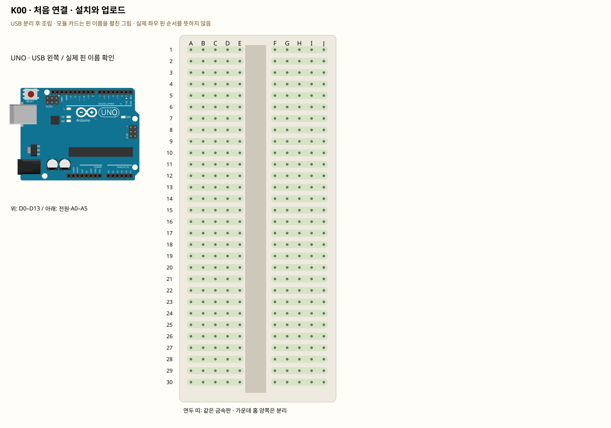

# K00 · 처음 연결 · 설치와 업로드

이 단품 회로는 P01~P04와 동시에 꽂지 않는 별도 배선입니다. 같은 키트 부품을 재사용하며 이전 회로의 모든 선을 먼저 제거합니다.

스케치는 UNO에 넣는 프로그램이고 .ino가 파일 확장자입니다. 업로드는 PC의 코드를 보드로 보내는 과정입니다. 컴파일은 실행할 수 있는 형태로 바꾸면서 문법을 검사하는 과정입니다.

**실물·전원 조건:** 실물 표시와 코드의 핀을 대조합니다.

## 부품 방향

아직 빵판을 연결하지 않습니다. Arduino 공식 사이트 → Software → Arduino IDE 2 설치 → 보드 USB 연결 → 보드 선택에서 Arduino Uno → 연결된 COM 포트 선택 → 새 스케치 → 코드 붙여넣기 → 저장(K00/K00.ino) → ✓ 검증 → → 업로드 → 시리얼 모니터 9600 순서입니다. UNO R4나 XIAO를 선택하지 않습니다.

## 각 핀의 연결

| 부품 | 다리/핀 | 빵판 구멍 | 같은 금속판 | 전기적 도착점 |
|---|---|---|---|---|

## 전선 연결 순서

| 순서 | 출발 | 도착 | 이유 |
|---|---|---|---|

모듈을 펼친 핀 그림과 실물 커넥터 순서를 혼동하지 않습니다.

## 저장·컴파일·실행

라이브러리: 추가 설치 없음. [단품 참조 스케치](../reference-sketches/K00/K00.ino). 코드가 없는 전원·정리 항목은 실행 스케치가 없습니다. K18/K19는 외부전원이 없어 오늘 구동하지 않습니다. 모터 명령 차단 확인은 P04를 사용합니다. 기존 단품 코드는 시리얼9600이며 P 프로파일115200과 구분합니다.

예상 결과: 보드의 L LED가 0.5초씩 켜지고 꺼집니다. 시리얼 창에 UNO ready가 반복됩니다.

한 값 수정: delay 두 곳을 200으로 바꾸고 다시 업로드합니다.

오류 해결: 포트가 없다면 데이터 케이블·다른 USB 포트부터 확인합니다. 업로드 중 포트를 쓰는 다른 프로그램을 닫습니다.

## Claude에 줄 구현 조건

위의 핀·전원·저항·비움 핀을 고정하고 이 회로 하나의 코드를 작성합니다. 단품의 기존 핀 번호를 다른 프로파일과 합치지 않습니다.
실물 모델이 필요한 IR·화염 소자·도트매트릭스는 핀표 확인 전 해당 입력/출력을 비활성으로 만들고 상태 null과 이유를 보냅니다. 모터·미확인 릴레이를 켜진 상태로 시작하지 않습니다. 실제 값과 원시값의 단위를 구별합니다. 목요일 양방향 규약을 붙일 때는 `PROTOCOL.md`를 따르고 상태·명령 목록을 먼저 제시합니다.

- [핀표·공식 설명](https://www.arduino.cc/en/software/)
- [핀표·공식 설명](https://docs.arduino.cc/software/ide-v2/tutorials/getting-started-ide-v2/)
