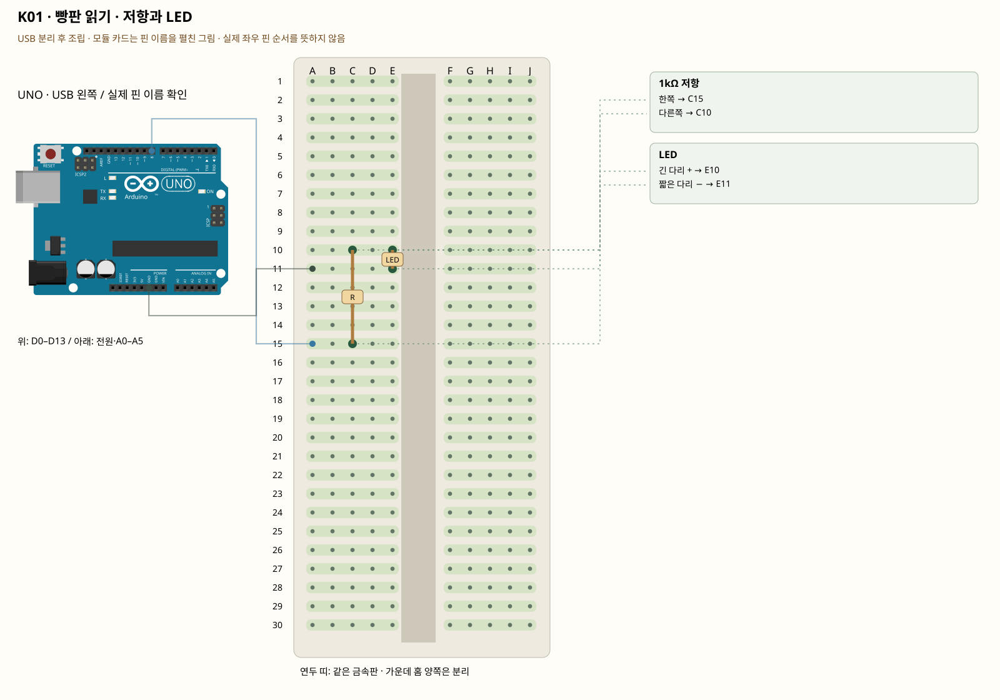

# K01 · 빵판 읽기 · 저항과 LED

이 단품 회로는 P01~P04와 동시에 꽂지 않는 별도 배선입니다. 같은 키트 부품을 재사용하며 이전 회로의 모든 선을 먼저 제거합니다.

빵판은 구멍 안의 금속으로 부품을 연결합니다. 같은 숫자의 A~E는 한 묶음, F~J는 다른 한 묶음입니다. 옆 숫자 줄끼리는 이어지지 않습니다. 전압은 두 점 사이의 차이, 전류는 회로를 따라 흐르는 양, 저항은 그 흐름을 제한하는 부품입니다. 5V → LED → GND 경로에는 반드시 저항을 둡니다.

**실물·전원 조건:** 실물 표시와 코드의 핀을 대조합니다.

## 부품 방향

USB는 왼쪽. 빵판 숫자가 작은 쪽을 위로 맞춥니다. 저항 C10–C15, LED 긴 다리 E10·짧은 다리 E11입니다. 그림은 빵판 가운데 단자 부분이며 긴 전원 레일은 사용하지 않습니다. 1kΩ은 갈색-검정-빨강(4띠) 또는 갈색-검정-검정-갈색-갈색(5띠)입니다. 판매처 사진은 외형이므로 실제 값은 색띠로 확인합니다.

## 각 핀의 연결

| 부품 | 다리/핀 | 빵판 구멍 | 같은 금속판 | 전기적 도착점 |
|---|---|---|---|---|
| 1kΩ 저항 | 한쪽 | C15 | A15·B15·C15·D15·E15 | UNO D8 |
| 1kΩ 저항 | 다른쪽 | C10 | A10·B10·C10·D10·E10 | 표의 부품 사이 연결·외부전원 경로 확인 |
| LED | 긴 다리 + | E10 | A10·B10·C10·D10·E10 | 1kΩ 저항 경유 UNO D8 |
| LED | 짧은 다리 − | E11 | A11·B11·C11·D11·E11 | UNO GND |

## 전선 연결 순서

| 순서 | 출발 | 도착 | 이유 |
|---|---|---|---|
| 1 | UNO D8 | 빵판 A15 | UNO D8 핀은 코드에서 정한 디지털 입출력·통신 핀입니다. 빵판 줄 번호가 아니라 UNO 핀 번호와 코드가 일치해야 합니다. 보드 쪽 연결점은 UNO D8입니다. A15 위치는 A15·B15·C15·D15·E15와 같은 금속판입니다. C15에 놓인 1kΩ 저항의 한쪽 지점과 이어집니다. A15와 C15는 같은 묶음입니다. 출력이 저항으로 들어갑니다. |
| 2 | UNO GND | 빵판 A11 | GND는 보드의 0V 기준입니다. 부품과 보드의 기준을 맞추고 이 회로에 필요한 전류의 돌아가는 길을 연결합니다. 보드 쪽 연결점은 UNO GND입니다. A11 위치는 A11·B11·C11·D11·E11와 같은 금속판입니다. E11에 놓인 LED의 짧은 다리 − 지점과 이어집니다. A11과 E11이 이어져 LED의 짧은 다리가 GND로 돌아갑니다. |

모듈을 펼친 핀 그림과 실물 커넥터 순서를 혼동하지 않습니다.

## 저장·컴파일·실행

라이브러리: 추가 설치 없음. [단품 참조 스케치](../reference-sketches/K01/K01.ino). 코드가 없는 전원·정리 항목은 실행 스케치가 없습니다. K18/K19는 외부전원이 없어 오늘 구동하지 않습니다. 모터 명령 차단 확인은 P04를 사용합니다. 기존 단품 코드는 시리얼9600이며 P 프로파일115200과 구분합니다.

예상 결과: 외부 LED가 1초씩 켜졌다 꺼집니다.

한 값 수정: 켜진 시간은 200ms, 꺼진 시간은 800ms로 바꿉니다.

오류 해결: 안 켜지면 LED 극성 → 저항 값 → C10/E10 같은 줄 → GND 순으로 확인합니다. 저항을 제거해 고치지 않습니다.

## Claude에 줄 구현 조건

위의 핀·전원·저항·비움 핀을 고정하고 이 회로 하나의 코드를 작성합니다. 단품의 기존 핀 번호를 다른 프로파일과 합치지 않습니다.
실물 모델이 필요한 IR·화염 소자·도트매트릭스는 핀표 확인 전 해당 입력/출력을 비활성으로 만들고 상태 null과 이유를 보냅니다. 모터·미확인 릴레이를 켜진 상태로 시작하지 않습니다. 실제 값과 원시값의 단위를 구별합니다. 목요일 양방향 규약을 붙일 때는 `PROTOCOL.md`를 따르고 상태·명령 목록을 먼저 제시합니다.
