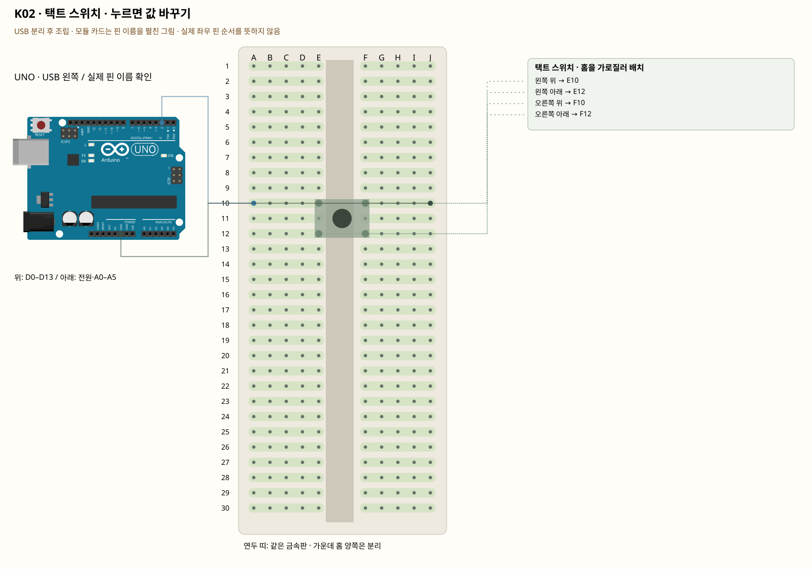

# K02 · 택트 스위치 · 누르면 값 바꾸기

이 단품 회로는 P01~P04와 동시에 꽂지 않는 별도 배선입니다. 같은 키트 부품을 재사용하며 이전 회로의 모든 선을 먼저 제거합니다.

입력은 사람이 누른 상태를 컴퓨터가 읽는 것입니다. INPUT_PULLUP은 내부 저항으로 기본값을 HIGH로 유지합니다. 버튼을 누르면 GND와 연결되어 LOW가 됩니다. 떠 있는 입력을 읽으면 손을 대지 않아도 값이 흔들릴 수 있습니다.

**실물·전원 조건:** 실물 표시와 코드의 핀을 대조합니다.

## 부품 방향

버튼 네 다리가 가운데 홈을 가로지르도록 E10·E12와 F10·F12에 놓습니다. 이 그림은 같은 쪽 세로 두 다리가 원래 연결되고, 누르면 좌우가 이어지는 버튼 기준입니다. 다른 형태는 전원이 없는 상태에서 연속성 측정으로 같은 다리를 먼저 확인합니다.

## 각 핀의 연결

| 부품 | 다리/핀 | 빵판 구멍 | 같은 금속판 | 전기적 도착점 |
|---|---|---|---|---|
| 택트 스위치 · 홈을 가로질러 배치 | 왼쪽 위 | E10 | A10·B10·C10·D10·E10 | UNO D2 |
| 택트 스위치 · 홈을 가로질러 배치 | 왼쪽 아래 | E12 | A12·B12·C12·D12·E12 | UNO D2 |
| 택트 스위치 · 홈을 가로질러 배치 | 오른쪽 위 | F10 | F10·G10·H10·I10·J10 | UNO GND |
| 택트 스위치 · 홈을 가로질러 배치 | 오른쪽 아래 | F12 | F12·G12·H12·I12·J12 | UNO GND |

## 전선 연결 순서

| 순서 | 출발 | 도착 | 이유 |
|---|---|---|---|
| 1 | UNO D2 | 빵판 A10 | UNO D2 핀은 코드에서 정한 디지털 입출력·통신 핀입니다. 빵판 줄 번호가 아니라 UNO 핀 번호와 코드가 일치해야 합니다. 보드 쪽 연결점은 UNO D2입니다. A10 위치는 A10·B10·C10·D10·E10와 같은 금속판입니다. E10에 놓인 택트 스위치 · 홈을 가로질러 배치의 왼쪽 위 지점과 이어집니다. |
| 2 | UNO GND | 빵판 J10 | GND는 보드의 0V 기준입니다. 부품과 보드의 기준을 맞추고 이 회로에 필요한 전류의 돌아가는 길을 연결합니다. 보드 쪽 연결점은 UNO GND입니다. J10 위치는 F10·G10·H10·I10·J10와 같은 금속판입니다. F10에 놓인 택트 스위치 · 홈을 가로질러 배치의 오른쪽 위 지점과 이어집니다. |

모듈을 펼친 핀 그림과 실물 커넥터 순서를 혼동하지 않습니다.

## 저장·컴파일·실행

라이브러리: 추가 설치 없음. [단품 참조 스케치](../reference-sketches/K02/K02.ino). 코드가 없는 전원·정리 항목은 실행 스케치가 없습니다. K18/K19는 외부전원이 없어 오늘 구동하지 않습니다. 모터 명령 차단 확인은 P04를 사용합니다. 기존 단품 코드는 시리얼9600이며 P 프로파일115200과 구분합니다.

예상 결과: 누르지 않으면 open, 누르면 closed입니다.

한 값 수정: digitalRead가 LOW일 때 보드 내장 LED를 켜 봅니다.

오류 해결: 항상 closed면 버튼을 90도 잘못 놓았거나 내부에서 원래 붙어 있는 다리 두 개를 골랐을 수 있습니다. USB를 빼고 다리 연결을 확인합니다.

## Claude에 줄 구현 조건

위의 핀·전원·저항·비움 핀을 고정하고 이 회로 하나의 코드를 작성합니다. 단품의 기존 핀 번호를 다른 프로파일과 합치지 않습니다.
실물 모델이 필요한 IR·화염 소자·도트매트릭스는 핀표 확인 전 해당 입력/출력을 비활성으로 만들고 상태 null과 이유를 보냅니다. 모터·미확인 릴레이를 켜진 상태로 시작하지 않습니다. 실제 값과 원시값의 단위를 구별합니다. 목요일 양방향 규약을 붙일 때는 `PROTOCOL.md`를 따르고 상태·명령 목록을 먼저 제시합니다.
