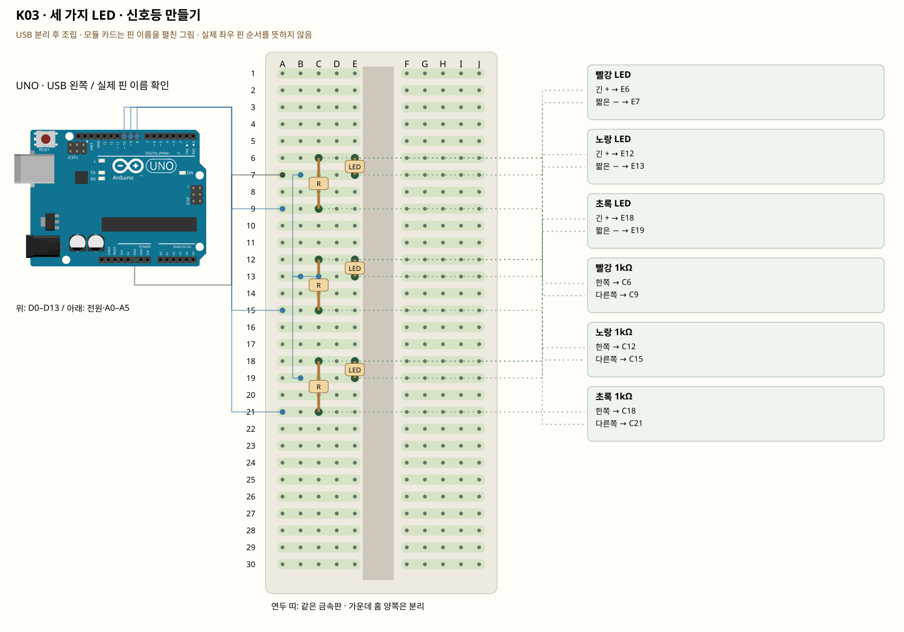

# K03 · 세 가지 LED · 신호등 만들기

이 단품 회로는 P01~P04와 동시에 꽂지 않는 별도 배선입니다. 같은 키트 부품을 재사용하며 이전 회로의 모든 선을 먼저 제거합니다.

출력 여러 개를 순서대로 바꾸면 상태를 표현할 수 있습니다. 각 LED에는 각자의 저항이 필요합니다. 신호등처럼 지금 어떤 상태인지 정하고, 그 상태에서 켤 LED를 명확히 정합니다.

**실물·전원 조건:** 실물 표시와 코드의 핀을 대조합니다.

## 부품 방향

부품 핀의 이름을 먼저 확인합니다. 모듈 그림은 핀 이름을 읽기 위한 펼친 그림이며, 실물 커넥터의 좌우 순서를 뜻하지 않습니다. 표시가 다른 부품은 연결 전에 해당 모델 핀표와 대조합니다.

## 각 핀의 연결

| 부품 | 다리/핀 | 빵판 구멍 | 같은 금속판 | 전기적 도착점 |
|---|---|---|---|---|
| 빨강 LED | 긴 + | E6 | A6·B6·C6·D6·E6 | 빨강 1kΩ 경유 UNO D8 |
| 빨강 LED | 짧은 − | E7 | A7·B7·C7·D7·E7 | UNO GND |
| 노랑 LED | 긴 + | E12 | A12·B12·C12·D12·E12 | 노랑 1kΩ 경유 UNO D9 |
| 노랑 LED | 짧은 − | E13 | A13·B13·C13·D13·E13 | UNO GND |
| 초록 LED | 긴 + | E18 | A18·B18·C18·D18·E18 | 초록 1kΩ 경유 UNO D10 |
| 초록 LED | 짧은 − | E19 | A19·B19·C19·D19·E19 | UNO GND |
| 빨강 1kΩ | 한쪽 | C6 | A6·B6·C6·D6·E6 | 표의 부품 사이 연결·외부전원 경로 확인 |
| 빨강 1kΩ | 다른쪽 | C9 | A9·B9·C9·D9·E9 | UNO D8 |
| 노랑 1kΩ | 한쪽 | C12 | A12·B12·C12·D12·E12 | 표의 부품 사이 연결·외부전원 경로 확인 |
| 노랑 1kΩ | 다른쪽 | C15 | A15·B15·C15·D15·E15 | UNO D9 |
| 초록 1kΩ | 한쪽 | C18 | A18·B18·C18·D18·E18 | 표의 부품 사이 연결·외부전원 경로 확인 |
| 초록 1kΩ | 다른쪽 | C21 | A21·B21·C21·D21·E21 | UNO D10 |

## 전선 연결 순서

| 순서 | 출발 | 도착 | 이유 |
|---|---|---|---|
| 1 | UNO D8 | 빵판 A9 | UNO D8 핀은 코드에서 정한 디지털 입출력·통신 핀입니다. 빵판 줄 번호가 아니라 UNO 핀 번호와 코드가 일치해야 합니다. 보드 쪽 연결점은 UNO D8입니다. A9 위치는 A9·B9·C9·D9·E9와 같은 금속판입니다. C9에 놓인 빨강 1kΩ의 다른쪽 지점과 이어집니다. |
| 2 | UNO D9 | 빵판 A15 | UNO D9 핀은 코드에서 정한 디지털 입출력·통신 핀입니다. 빵판 줄 번호가 아니라 UNO 핀 번호와 코드가 일치해야 합니다. 보드 쪽 연결점은 UNO D9입니다. A15 위치는 A15·B15·C15·D15·E15와 같은 금속판입니다. C15에 놓인 노랑 1kΩ의 다른쪽 지점과 이어집니다. |
| 3 | UNO D10 | 빵판 A21 | UNO D10 핀은 코드에서 정한 디지털 입출력·통신 핀입니다. 빵판 줄 번호가 아니라 UNO 핀 번호와 코드가 일치해야 합니다. 보드 쪽 연결점은 UNO D10입니다. A21 위치는 A21·B21·C21·D21·E21와 같은 금속판입니다. C21에 놓인 초록 1kΩ의 다른쪽 지점과 이어집니다. |
| 4 | UNO GND | 빵판 A7 | GND는 보드의 0V 기준입니다. 부품과 보드의 기준을 맞추고 이 회로에 필요한 전류의 돌아가는 길을 연결합니다. 보드 쪽 연결점은 UNO GND입니다. A7 위치는 A7·B7·C7·D7·E7와 같은 금속판입니다. E7에 놓인 빨강 LED의 짧은 − 지점과 이어집니다. |
| 5 | 빵판 B7 | 빵판 B13 | 서로 떨어진 연결 묶음을 이 점퍼선으로 이어 같은 전기 연결을 만듭니다. B7 위치는 A7·B7·C7·D7·E7와 같은 금속판입니다. E7에 놓인 빨강 LED의 짧은 − 지점과 이어집니다. B13 위치는 A13·B13·C13·D13·E13와 같은 금속판입니다. E13에 놓인 노랑 LED의 짧은 − 지점과 이어집니다. |
| 6 | 빵판 C13 | 빵판 B19 | 서로 떨어진 연결 묶음을 이 점퍼선으로 이어 같은 전기 연결을 만듭니다. C13 위치는 A13·B13·C13·D13·E13와 같은 금속판입니다. E13에 놓인 노랑 LED의 짧은 − 지점과 이어집니다. B19 위치는 A19·B19·C19·D19·E19와 같은 금속판입니다. E19에 놓인 초록 LED의 짧은 − 지점과 이어집니다. |

모듈을 펼친 핀 그림과 실물 커넥터 순서를 혼동하지 않습니다.

## 저장·컴파일·실행

라이브러리: 추가 설치 없음. [단품 참조 스케치](../reference-sketches/K03/K03.ino). 코드가 없는 전원·정리 항목은 실행 스케치가 없습니다. K18/K19는 외부전원이 없어 오늘 구동하지 않습니다. 모터 명령 차단 확인은 P04를 사용합니다. 기존 단품 코드는 시리얼9600이며 P 프로파일115200과 구분합니다.

예상 결과: 빨강 → 초록 → 노랑 순서로 한 개씩 켜집니다.

한 값 수정: 정지·출발·주의 시간을 각각 바꾸고 이유를 적습니다.

오류 해결: 한 LED가 안 꺼지면 해당 출력 번호와 연결표를 비교합니다. 세 LED에 저항 하나만 공유하지 않습니다.

## Claude에 줄 구현 조건

위의 핀·전원·저항·비움 핀을 고정하고 이 회로 하나의 코드를 작성합니다. 단품의 기존 핀 번호를 다른 프로파일과 합치지 않습니다.
실물 모델이 필요한 IR·화염 소자·도트매트릭스는 핀표 확인 전 해당 입력/출력을 비활성으로 만들고 상태 null과 이유를 보냅니다. 모터·미확인 릴레이를 켜진 상태로 시작하지 않습니다. 실제 값과 원시값의 단위를 구별합니다. 목요일 양방향 규약을 붙일 때는 `PROTOCOL.md`를 따르고 상태·명령 목록을 먼저 제시합니다.
