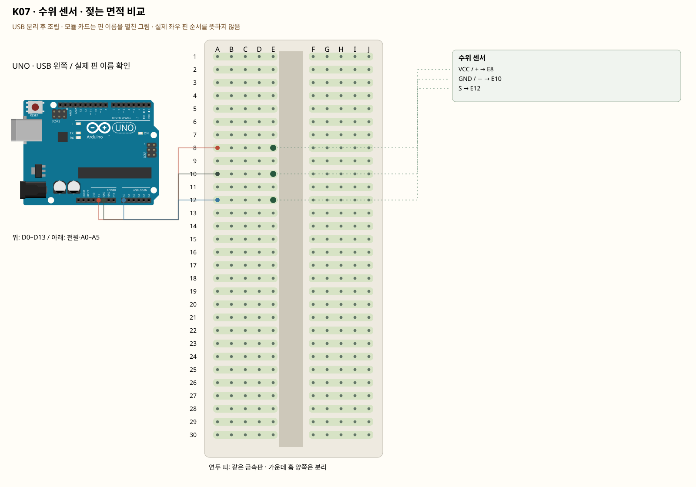

# K07 · 수위 센서 · 젖는 면적 비교

이 단품 회로는 P01~P04와 동시에 꽂지 않는 별도 배선입니다. 같은 키트 부품을 재사용하며 이전 회로의 모든 선을 먼저 제거합니다.

금속 무늬 사이에 물이 닿으면 전기가 흐르는 정도가 달라집니다. 센서 숫자를 곧바로 정확한 수위 cm로 바꿀 수는 없습니다. 먼저 마른 상태·조금 담근 상태·더 담근 상태를 비교합니다.

**실물·전원 조건:** 컵의 물은 PC·보드에서 떨어뜨려 놓습니다. 금속 무늬만 조금 담그고, 회로·핀·USB는 물에 닿지 않게 합니다. 관찰할 때만 전원을 연결하고 끝나면 분리해 말립니다.

## 부품 방향

부품 핀의 이름을 먼저 확인합니다. 모듈 그림은 핀 이름을 읽기 위한 펼친 그림이며, 실물 커넥터의 좌우 순서를 뜻하지 않습니다. 표시가 다른 부품은 연결 전에 해당 모델 핀표와 대조합니다.

## 각 핀의 연결

| 부품 | 다리/핀 | 빵판 구멍 | 같은 금속판 | 전기적 도착점 |
|---|---|---|---|---|
| 수위 센서 | VCC / + | E8 | A8·B8·C8·D8·E8 | UNO 5V |
| 수위 센서 | GND / − | E10 | A10·B10·C10·D10·E10 | UNO GND |
| 수위 센서 | S | E12 | A12·B12·C12·D12·E12 | UNO A0 |

## 전선 연결 순서

| 순서 | 출발 | 도착 | 이유 |
|---|---|---|---|
| 1 | UNO 5V | 빵판 A8 | 부품에 5V 전원을 공급하는 연결입니다. 신호를 읽는 선과 역할이 다릅니다. 보드 쪽 연결점은 UNO 5V입니다. A8 위치는 A8·B8·C8·D8·E8와 같은 금속판입니다. E8에 놓인 수위 센서의 VCC / + 지점과 이어집니다. |
| 2 | UNO GND | 빵판 A10 | GND는 보드의 0V 기준입니다. 부품과 보드의 기준을 맞추고 이 회로에 필요한 전류의 돌아가는 길을 연결합니다. 보드 쪽 연결점은 UNO GND입니다. A10 위치는 A10·B10·C10·D10·E10와 같은 금속판입니다. E10에 놓인 수위 센서의 GND / − 지점과 이어집니다. |
| 3 | UNO A0 | 빵판 A12 | UNO A0 핀은 이 예제에서 센서 출력 전압을 읽는 입력입니다. 전원선과 별도로 측정 지점이 이 핀에 닿아야 합니다. 보드 쪽 연결점은 UNO A0입니다. A12 위치는 A12·B12·C12·D12·E12와 같은 금속판입니다. E12에 놓인 수위 센서의 S 지점과 이어집니다. |

모듈을 펼친 핀 그림과 실물 커넥터 순서를 혼동하지 않습니다. 컵의 물은 PC·보드에서 떨어뜨려 놓습니다. 금속 무늬만 조금 담그고, 회로·핀·USB는 물에 닿지 않게 합니다. 관찰할 때만 전원을 연결하고 끝나면 분리해 말립니다.

## 저장·컴파일·실행

라이브러리: 추가 설치 없음. [단품 참조 스케치](../reference-sketches/K07/K07.ino). 코드가 없는 전원·정리 항목은 실행 스케치가 없습니다. K18/K19는 외부전원이 없어 오늘 구동하지 않습니다. 모터 명령 차단 확인은 P04를 사용합니다. 기존 단품 코드는 시리얼9600이며 P 프로파일115200과 구분합니다.

예상 결과: 세 상태의 숫자 범위가 달라지는지 기록합니다.

한 값 수정: 경계값을 정해 dry / wet 문구로 출력합니다. 센서가 마른 뒤 값이 돌아오는지도 봅니다.

오류 해결: 값이 고정되면 +·−·신호의 글자를 확인합니다. 커넥터의 왼쪽부터라는 추측으로 전원을 연결하지 않습니다.

## Claude에 줄 구현 조건

위의 핀·전원·저항·비움 핀을 고정하고 이 회로 하나의 코드를 작성합니다. 단품의 기존 핀 번호를 다른 프로파일과 합치지 않습니다. 컵의 물은 PC·보드에서 떨어뜨려 놓습니다. 금속 무늬만 조금 담그고, 회로·핀·USB는 물에 닿지 않게 합니다. 관찰할 때만 전원을 연결하고 끝나면 분리해 말립니다.
실물 모델이 필요한 IR·화염 소자·도트매트릭스는 핀표 확인 전 해당 입력/출력을 비활성으로 만들고 상태 null과 이유를 보냅니다. 모터·미확인 릴레이를 켜진 상태로 시작하지 않습니다. 실제 값과 원시값의 단위를 구별합니다. 목요일 양방향 규약을 붙일 때는 `PROTOCOL.md`를 따르고 상태·명령 목록을 먼저 제시합니다.
