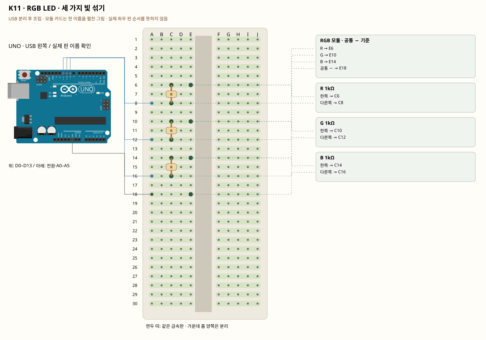

# K11 · RGB LED · 세 가지 빛 섞기

이 단품 회로는 P01~P04와 동시에 꽂지 않는 별도 배선입니다. 같은 키트 부품을 재사용하며 이전 회로의 모든 선을 먼저 제거합니다.

RGB는 세 LED를 한 부품에 넣은 것입니다. 채널별로 저항을 달고 PWM 출력으로 밝기를 바꿉니다. PWM은 출력 전압을 연속으로 낮추는 대신 켜진 시간 비율을 바꿉니다. 공통 −와 공통 +는 켜는 값이 반대입니다.

**실물·전원 조건:** 그림은 R·G·B·−가 확인되는 공통 음극 모듈 기준입니다. 공통 +라면 공통 핀을 5V로 바꾸고 COMMON_ANODE를 true로 바꿉니다. 표시와 저항 유무를 확인하기 전에는 전원을 연결하지 않습니다.

## 부품 방향

부품 핀의 이름을 먼저 확인합니다. 모듈 그림은 핀 이름을 읽기 위한 펼친 그림이며, 실물 커넥터의 좌우 순서를 뜻하지 않습니다. 표시가 다른 부품은 연결 전에 해당 모델 핀표와 대조합니다.

## 각 핀의 연결

| 부품 | 다리/핀 | 빵판 구멍 | 같은 금속판 | 전기적 도착점 |
|---|---|---|---|---|
| RGB 모듈 · 공통 − 기준 | R | E6 | A6·B6·C6·D6·E6 | R 1kΩ 경유 UNO D9 |
| RGB 모듈 · 공통 − 기준 | G | E10 | A10·B10·C10·D10·E10 | G 1kΩ 경유 UNO D10 |
| RGB 모듈 · 공통 − 기준 | B | E14 | A14·B14·C14·D14·E14 | B 1kΩ 경유 UNO D11 |
| RGB 모듈 · 공통 − 기준 | 공통 − | E18 | A18·B18·C18·D18·E18 | UNO GND |
| R 1kΩ | 한쪽 | C6 | A6·B6·C6·D6·E6 | 표의 부품 사이 연결·외부전원 경로 확인 |
| R 1kΩ | 다른쪽 | C8 | A8·B8·C8·D8·E8 | UNO D9 |
| G 1kΩ | 한쪽 | C10 | A10·B10·C10·D10·E10 | 표의 부품 사이 연결·외부전원 경로 확인 |
| G 1kΩ | 다른쪽 | C12 | A12·B12·C12·D12·E12 | UNO D10 |
| B 1kΩ | 한쪽 | C14 | A14·B14·C14·D14·E14 | 표의 부품 사이 연결·외부전원 경로 확인 |
| B 1kΩ | 다른쪽 | C16 | A16·B16·C16·D16·E16 | UNO D11 |

## 전선 연결 순서

| 순서 | 출발 | 도착 | 이유 |
|---|---|---|---|
| 1 | UNO D9 | 빵판 A8 | UNO D9 핀은 코드에서 정한 디지털 입출력·통신 핀입니다. 빵판 줄 번호가 아니라 UNO 핀 번호와 코드가 일치해야 합니다. 보드 쪽 연결점은 UNO D9입니다. A8 위치는 A8·B8·C8·D8·E8와 같은 금속판입니다. C8에 놓인 R 1kΩ의 다른쪽 지점과 이어집니다. |
| 2 | UNO D10 | 빵판 A12 | UNO D10 핀은 코드에서 정한 디지털 입출력·통신 핀입니다. 빵판 줄 번호가 아니라 UNO 핀 번호와 코드가 일치해야 합니다. 보드 쪽 연결점은 UNO D10입니다. A12 위치는 A12·B12·C12·D12·E12와 같은 금속판입니다. C12에 놓인 G 1kΩ의 다른쪽 지점과 이어집니다. |
| 3 | UNO D11 | 빵판 A16 | UNO D11 핀은 코드에서 정한 디지털 입출력·통신 핀입니다. 빵판 줄 번호가 아니라 UNO 핀 번호와 코드가 일치해야 합니다. 보드 쪽 연결점은 UNO D11입니다. A16 위치는 A16·B16·C16·D16·E16와 같은 금속판입니다. C16에 놓인 B 1kΩ의 다른쪽 지점과 이어집니다. |
| 4 | UNO GND | 빵판 A18 | GND는 보드의 0V 기준입니다. 부품과 보드의 기준을 맞추고 이 회로에 필요한 전류의 돌아가는 길을 연결합니다. 보드 쪽 연결점은 UNO GND입니다. A18 위치는 A18·B18·C18·D18·E18와 같은 금속판입니다. E18에 놓인 RGB 모듈 · 공통 − 기준의 공통 − 지점과 이어집니다. |

모듈을 펼친 핀 그림과 실물 커넥터 순서를 혼동하지 않습니다. 그림은 R·G·B·−가 확인되는 공통 음극 모듈 기준입니다. 공통 +라면 공통 핀을 5V로 바꾸고 COMMON_ANODE를 true로 바꿉니다. 표시와 저항 유무를 확인하기 전에는 전원을 연결하지 않습니다.

## 저장·컴파일·실행

라이브러리: 추가 설치 없음. [단품 참조 스케치](../reference-sketches/K11/K11.ino). 코드가 없는 전원·정리 항목은 실행 스케치가 없습니다. K18/K19는 외부전원이 없어 오늘 구동하지 않습니다. 모터 명령 차단 확인은 P04를 사용합니다. 기존 단품 코드는 시리얼9600이며 P 프로파일115200과 구분합니다.

예상 결과: 빨강·초록·파랑·섞은 색이 차례로 켜집니다.

한 값 수정: 색 세 숫자를 바꿔 자신만의 상태 표시 색을 만듭니다.

오류 해결: 어떤 색만 안 켜지면 해당 채널의 저항과 PWM 핀을 확인합니다.

## Claude에 줄 구현 조건

위의 핀·전원·저항·비움 핀을 고정하고 이 회로 하나의 코드를 작성합니다. 단품의 기존 핀 번호를 다른 프로파일과 합치지 않습니다. 그림은 R·G·B·−가 확인되는 공통 음극 모듈 기준입니다. 공통 +라면 공통 핀을 5V로 바꾸고 COMMON_ANODE를 true로 바꿉니다. 표시와 저항 유무를 확인하기 전에는 전원을 연결하지 않습니다.
실물 모델이 필요한 IR·화염 소자·도트매트릭스는 핀표 확인 전 해당 입력/출력을 비활성으로 만들고 상태 null과 이유를 보냅니다. 모터·미확인 릴레이를 켜진 상태로 시작하지 않습니다. 실제 값과 원시값의 단위를 구별합니다. 목요일 양방향 규약을 붙일 때는 `PROTOCOL.md`를 따르고 상태·명령 목록을 먼저 제시합니다.
