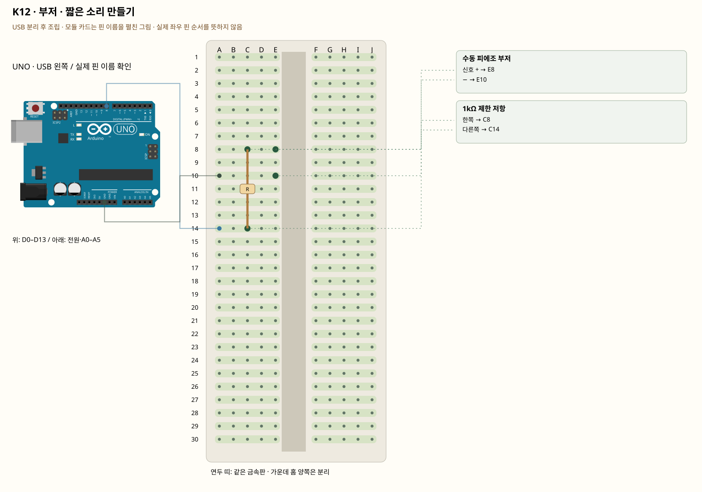

# K12 · 부저 · 짧은 소리 만들기

이 단품 회로는 P01~P04와 동시에 꽂지 않는 별도 배선입니다. 같은 키트 부품을 재사용하며 이전 회로의 모든 선을 먼저 제거합니다.

수동 피에조 부저는 주파수를 넣어야 소리가 납니다. tone(pin,주파수,시간)에서 주파수는 음 높이, 시간은 소리 길이입니다. 능동 부저는 전원을 주면 정해진 소리가 나며 정격 전류에 따라 드라이버가 필요합니다.

**실물·전원 조건:** 수동 피에조형과 정격을 확인한 부품만 이 그림을 사용합니다. 능동형·자기형·모델 미상은 GPIO 직결하지 않고 해당 정격에 맞는 트랜지스터·보호회로를 준비합니다. 사진 속 두 부품을 같은 종류로 가정하지 않습니다.

## 부품 방향

부품 핀의 이름을 먼저 확인합니다. 모듈 그림은 핀 이름을 읽기 위한 펼친 그림이며, 실물 커넥터의 좌우 순서를 뜻하지 않습니다. 표시가 다른 부품은 연결 전에 해당 모델 핀표와 대조합니다.

## 각 핀의 연결

| 부품 | 다리/핀 | 빵판 구멍 | 같은 금속판 | 전기적 도착점 |
|---|---|---|---|---|
| 수동 피에조 부저 | 신호 + | E8 | A8·B8·C8·D8·E8 | 1kΩ 제한 저항 경유 UNO D8 |
| 수동 피에조 부저 | − | E10 | A10·B10·C10·D10·E10 | UNO GND |
| 1kΩ 제한 저항 | 한쪽 | C8 | A8·B8·C8·D8·E8 | 표의 부품 사이 연결·외부전원 경로 확인 |
| 1kΩ 제한 저항 | 다른쪽 | C14 | A14·B14·C14·D14·E14 | UNO D8 |

## 전선 연결 순서

| 순서 | 출발 | 도착 | 이유 |
|---|---|---|---|
| 1 | UNO D8 | 빵판 A14 | UNO D8 핀은 코드에서 정한 디지털 입출력·통신 핀입니다. 빵판 줄 번호가 아니라 UNO 핀 번호와 코드가 일치해야 합니다. 보드 쪽 연결점은 UNO D8입니다. A14 위치는 A14·B14·C14·D14·E14와 같은 금속판입니다. C14에 놓인 1kΩ 제한 저항의 다른쪽 지점과 이어집니다. |
| 2 | UNO GND | 빵판 A10 | GND는 보드의 0V 기준입니다. 부품과 보드의 기준을 맞추고 이 회로에 필요한 전류의 돌아가는 길을 연결합니다. 보드 쪽 연결점은 UNO GND입니다. A10 위치는 A10·B10·C10·D10·E10와 같은 금속판입니다. E10에 놓인 수동 피에조 부저의 − 지점과 이어집니다. |

모듈을 펼친 핀 그림과 실물 커넥터 순서를 혼동하지 않습니다. 수동 피에조형과 정격을 확인한 부품만 이 그림을 사용합니다. 능동형·자기형·모델 미상은 GPIO 직결하지 않고 해당 정격에 맞는 트랜지스터·보호회로를 준비합니다. 사진 속 두 부품을 같은 종류로 가정하지 않습니다.

## 저장·컴파일·실행

라이브러리: 추가 설치 없음. [단품 참조 스케치](../reference-sketches/K12/K12.ino). 코드가 없는 전원·정리 항목은 실행 스케치가 없습니다. K18/K19는 외부전원이 없어 오늘 구동하지 않습니다. 모터 명령 차단 확인은 P04를 사용합니다. 기존 단품 코드는 시리얼9600이며 P 프로파일115200과 구분합니다.

예상 결과: 확인된 수동 피에조에서 작은 삐 소리가 주기적으로 납니다.

한 값 수정: 주파수를 500·1500으로 바꿔 음 높이를 비교합니다.

오류 해결: 소리가 없다고 저항을 빼거나 능동 자기 부저를 직접 연결하지 않습니다.

## Claude에 줄 구현 조건

위의 핀·전원·저항·비움 핀을 고정하고 이 회로 하나의 코드를 작성합니다. 단품의 기존 핀 번호를 다른 프로파일과 합치지 않습니다. 수동 피에조형과 정격을 확인한 부품만 이 그림을 사용합니다. 능동형·자기형·모델 미상은 GPIO 직결하지 않고 해당 정격에 맞는 트랜지스터·보호회로를 준비합니다. 사진 속 두 부품을 같은 종류로 가정하지 않습니다.
실물 모델이 필요한 IR·화염 소자·도트매트릭스는 핀표 확인 전 해당 입력/출력을 비활성으로 만들고 상태 null과 이유를 보냅니다. 모터·미확인 릴레이를 켜진 상태로 시작하지 않습니다. 실제 값과 원시값의 단위를 구별합니다. 목요일 양방향 규약을 붙일 때는 `PROTOCOL.md`를 따르고 상태·명령 목록을 먼저 제시합니다.
