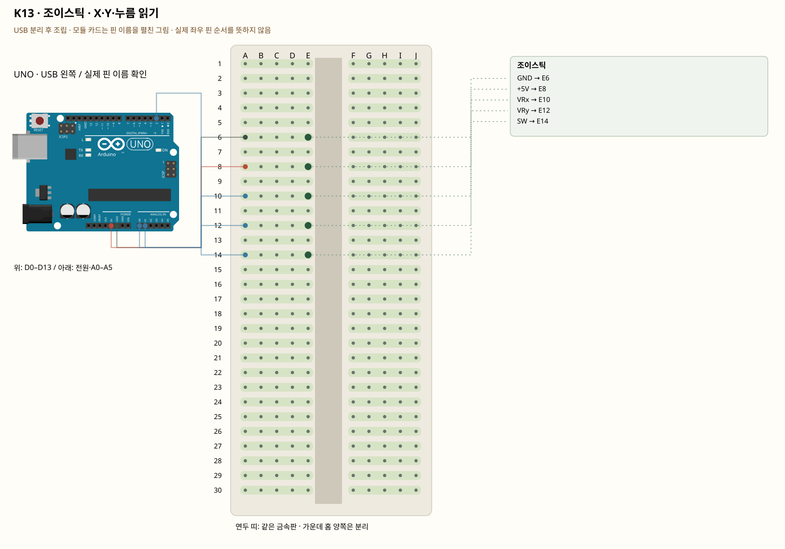

# K13 · 조이스틱 · X·Y·누름 읽기

이 단품 회로는 P01~P04와 동시에 꽂지 않는 별도 배선입니다. 같은 키트 부품을 재사용하며 이전 회로의 모든 선을 먼저 제거합니다.

조이스틱에는 가변저항 두 개와 버튼 한 개가 있습니다. X·Y는 아날로그, 누름은 디지털로 읽습니다. 가운데 위치가 정확히 512는 아니므로 실제 중립값과 작은 흔들림 범위를 기록합니다.

**실물·전원 조건:** 실물 표시와 코드의 핀을 대조합니다.

## 부품 방향

부품 핀의 이름을 먼저 확인합니다. 모듈 그림은 핀 이름을 읽기 위한 펼친 그림이며, 실물 커넥터의 좌우 순서를 뜻하지 않습니다. 표시가 다른 부품은 연결 전에 해당 모델 핀표와 대조합니다.

## 각 핀의 연결

| 부품 | 다리/핀 | 빵판 구멍 | 같은 금속판 | 전기적 도착점 |
|---|---|---|---|---|
| 조이스틱 | GND | E6 | A6·B6·C6·D6·E6 | UNO GND |
| 조이스틱 | +5V | E8 | A8·B8·C8·D8·E8 | UNO 5V |
| 조이스틱 | VRx | E10 | A10·B10·C10·D10·E10 | UNO A0 |
| 조이스틱 | VRy | E12 | A12·B12·C12·D12·E12 | UNO A1 |
| 조이스틱 | SW | E14 | A14·B14·C14·D14·E14 | UNO D2 |

## 전선 연결 순서

| 순서 | 출발 | 도착 | 이유 |
|---|---|---|---|
| 1 | UNO GND | 빵판 A6 | GND는 보드의 0V 기준입니다. 부품과 보드의 기준을 맞추고 이 회로에 필요한 전류의 돌아가는 길을 연결합니다. 보드 쪽 연결점은 UNO GND입니다. A6 위치는 A6·B6·C6·D6·E6와 같은 금속판입니다. E6에 놓인 조이스틱의 GND 지점과 이어집니다. |
| 2 | UNO 5V | 빵판 A8 | 부품에 5V 전원을 공급하는 연결입니다. 신호를 읽는 선과 역할이 다릅니다. 보드 쪽 연결점은 UNO 5V입니다. A8 위치는 A8·B8·C8·D8·E8와 같은 금속판입니다. E8에 놓인 조이스틱의 +5V 지점과 이어집니다. |
| 3 | UNO A0 | 빵판 A10 | UNO A0 핀은 이 예제에서 센서 출력 전압을 읽는 입력입니다. 전원선과 별도로 측정 지점이 이 핀에 닿아야 합니다. 보드 쪽 연결점은 UNO A0입니다. A10 위치는 A10·B10·C10·D10·E10와 같은 금속판입니다. E10에 놓인 조이스틱의 VRx 지점과 이어집니다. |
| 4 | UNO A1 | 빵판 A12 | UNO A1 핀은 이 예제에서 센서 출력 전압을 읽는 입력입니다. 전원선과 별도로 측정 지점이 이 핀에 닿아야 합니다. 보드 쪽 연결점은 UNO A1입니다. A12 위치는 A12·B12·C12·D12·E12와 같은 금속판입니다. E12에 놓인 조이스틱의 VRy 지점과 이어집니다. |
| 5 | UNO D2 | 빵판 A14 | UNO D2 핀은 코드에서 정한 디지털 입출력·통신 핀입니다. 빵판 줄 번호가 아니라 UNO 핀 번호와 코드가 일치해야 합니다. 보드 쪽 연결점은 UNO D2입니다. A14 위치는 A14·B14·C14·D14·E14와 같은 금속판입니다. E14에 놓인 조이스틱의 SW 지점과 이어집니다. |

모듈을 펼친 핀 그림과 실물 커넥터 순서를 혼동하지 않습니다.

## 저장·컴파일·실행

라이브러리: 추가 설치 없음. [단품 참조 스케치](../reference-sketches/K13/K13.ino). 코드가 없는 전원·정리 항목은 실행 스케치가 없습니다. K18/K19는 외부전원이 없어 오늘 구동하지 않습니다. 모터 명령 차단 확인은 P04를 사용합니다. 기존 단품 코드는 시리얼9600이며 P 프로파일115200과 구분합니다.

예상 결과: X·Y 숫자와 pressed 0/1이 동작에 따라 바뀝니다.

한 값 수정: 중립값 ±50 안은 STOP, 밖은 LEFT·RIGHT 등으로 분류합니다.

오류 해결: 대각선에서 두 축이 함께 바뀌는 것은 정상입니다. SW를 아날로그 핀값으로 해석하지 않습니다.

## Claude에 줄 구현 조건

위의 핀·전원·저항·비움 핀을 고정하고 이 회로 하나의 코드를 작성합니다. 단품의 기존 핀 번호를 다른 프로파일과 합치지 않습니다.
실물 모델이 필요한 IR·화염 소자·도트매트릭스는 핀표 확인 전 해당 입력/출력을 비활성으로 만들고 상태 null과 이유를 보냅니다. 모터·미확인 릴레이를 켜진 상태로 시작하지 않습니다. 실제 값과 원시값의 단위를 구별합니다. 목요일 양방향 규약을 붙일 때는 `PROTOCOL.md`를 따르고 상태·명령 목록을 먼저 제시합니다.
