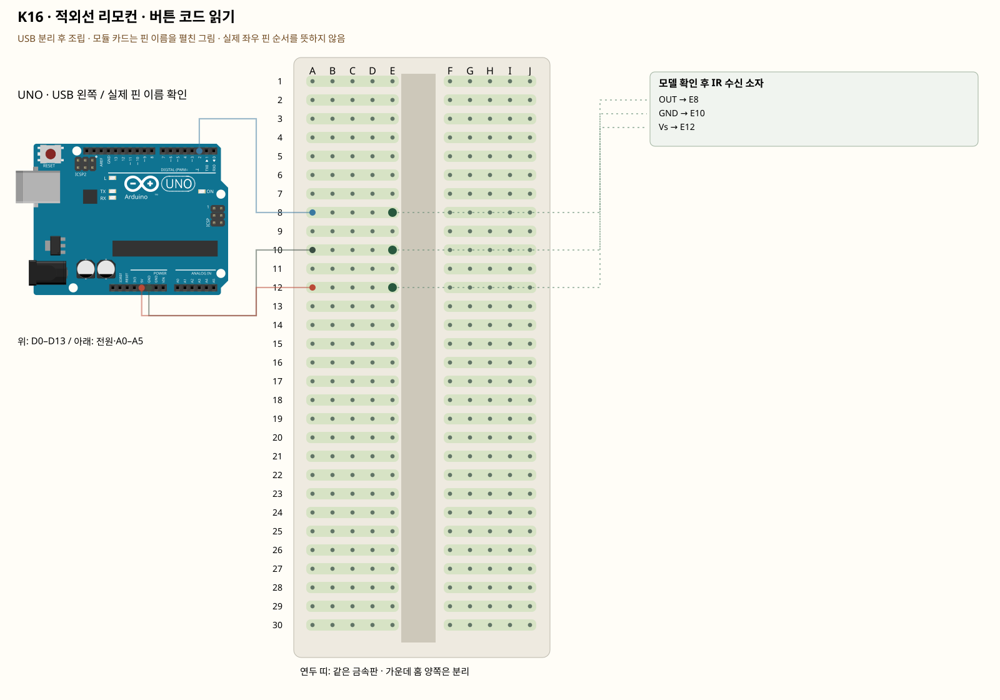

# K16 · 적외선 리모컨 · 버튼 코드 읽기

이 단품 회로는 P01~P04와 동시에 꽂지 않는 별도 배선입니다. 같은 키트 부품을 재사용하며 이전 회로의 모든 선을 먼저 제거합니다.

리모컨은 빠르게 깜빡이는 적외선으로 코드를 보냅니다. 수신 소자는 이 신호를 읽기 쉬운 디지털 신호로 바꿉니다. 송신 리모컨과 수신 소자를 함께 사용해야 합니다. 일반적인 빛 센서의 analogRead와 다릅니다.

**실물·전원 조건:** 판매처 사진만으로 수신 소자의 모델과 핀 순서를 확정할 수 없습니다. 몸체 글자를 읽고 해당 제조사의 자료에서 OUT·GND·Vs와 5V 허용 여부를 확인해야 이 배선을 사용할 수 있습니다. TSOP38238의 핀1 OUT·2 GND·3 Vs를 다른 부품에 적용하지 않습니다.

## 부품 방향

부품 핀의 이름을 먼저 확인합니다. 모듈 그림은 핀 이름을 읽기 위한 펼친 그림이며, 실물 커넥터의 좌우 순서를 뜻하지 않습니다. 표시가 다른 부품은 연결 전에 해당 모델 핀표와 대조합니다.

## 각 핀의 연결

| 부품 | 다리/핀 | 빵판 구멍 | 같은 금속판 | 전기적 도착점 |
|---|---|---|---|---|
| 모델 확인 후 IR 수신 소자 | OUT | E8 | A8·B8·C8·D8·E8 | UNO D2 |
| 모델 확인 후 IR 수신 소자 | GND | E10 | A10·B10·C10·D10·E10 | UNO GND |
| 모델 확인 후 IR 수신 소자 | Vs | E12 | A12·B12·C12·D12·E12 | UNO 5V |

## 전선 연결 순서

| 순서 | 출발 | 도착 | 이유 |
|---|---|---|---|
| 1 | UNO D2 | 빵판 A8 | UNO D2 핀은 코드에서 정한 디지털 입출력·통신 핀입니다. 빵판 줄 번호가 아니라 UNO 핀 번호와 코드가 일치해야 합니다. 보드 쪽 연결점은 UNO D2입니다. A8 위치는 A8·B8·C8·D8·E8와 같은 금속판입니다. E8에 놓인 모델 확인 후 IR 수신 소자의 OUT 지점과 이어집니다. |
| 2 | UNO GND | 빵판 A10 | GND는 보드의 0V 기준입니다. 부품과 보드의 기준을 맞추고 이 회로에 필요한 전류의 돌아가는 길을 연결합니다. 보드 쪽 연결점은 UNO GND입니다. A10 위치는 A10·B10·C10·D10·E10와 같은 금속판입니다. E10에 놓인 모델 확인 후 IR 수신 소자의 GND 지점과 이어집니다. |
| 3 | UNO 5V | 빵판 A12 | 부품에 5V 전원을 공급하는 연결입니다. 신호를 읽는 선과 역할이 다릅니다. 보드 쪽 연결점은 UNO 5V입니다. A12 위치는 A12·B12·C12·D12·E12와 같은 금속판입니다. E12에 놓인 모델 확인 후 IR 수신 소자의 Vs 지점과 이어집니다. |

모듈을 펼친 핀 그림과 실물 커넥터 순서를 혼동하지 않습니다. 판매처 사진만으로 수신 소자의 모델과 핀 순서를 확정할 수 없습니다. 몸체 글자를 읽고 해당 제조사의 자료에서 OUT·GND·Vs와 5V 허용 여부를 확인해야 이 배선을 사용할 수 있습니다. TSOP38238의 핀1 OUT·2 GND·3 Vs를 다른 부품에 적용하지 않습니다.

## 저장·컴파일·실행

라이브러리: IRremote 4.7.1. [단품 참조 스케치](../reference-sketches/K16/K16.ino). 코드가 없는 전원·정리 항목은 실행 스케치가 없습니다. K18/K19는 외부전원이 없어 오늘 구동하지 않습니다. 모터 명령 차단 확인은 P04를 사용합니다. 기존 단품 코드는 시리얼9600이며 P 프로파일115200과 구분합니다.

예상 결과: 리모컨을 향해 버튼을 누르면 protocol·address·command가 출력됩니다.

한 값 수정: 한 버튼의 command를 기록하고 그 값일 때 내장 LED를 켭니다.

오류 해결: 전원이 맞는데 값이 없으면 리모컨 배터리·수신 방향·OUT 연결·라이브러리 버전을 확인합니다.

## Claude에 줄 구현 조건

위의 핀·전원·저항·비움 핀을 고정하고 이 회로 하나의 코드를 작성합니다. 단품의 기존 핀 번호를 다른 프로파일과 합치지 않습니다. 판매처 사진만으로 수신 소자의 모델과 핀 순서를 확정할 수 없습니다. 몸체 글자를 읽고 해당 제조사의 자료에서 OUT·GND·Vs와 5V 허용 여부를 확인해야 이 배선을 사용할 수 있습니다. TSOP38238의 핀1 OUT·2 GND·3 Vs를 다른 부품에 적용하지 않습니다.
실물 모델이 필요한 IR·화염 소자·도트매트릭스는 핀표 확인 전 해당 입력/출력을 비활성으로 만들고 상태 null과 이유를 보냅니다. 모터·미확인 릴레이를 켜진 상태로 시작하지 않습니다. 실제 값과 원시값의 단위를 구별합니다. 목요일 양방향 규약을 붙일 때는 `PROTOCOL.md`를 따르고 상태·명령 목록을 먼저 제시합니다.

- [핀표·공식 설명](https://github.com/Arduino-IRremote/Arduino-IRremote)
- [핀표·공식 설명](https://www.vishay.com/docs/82491/tsop382.pdf)
