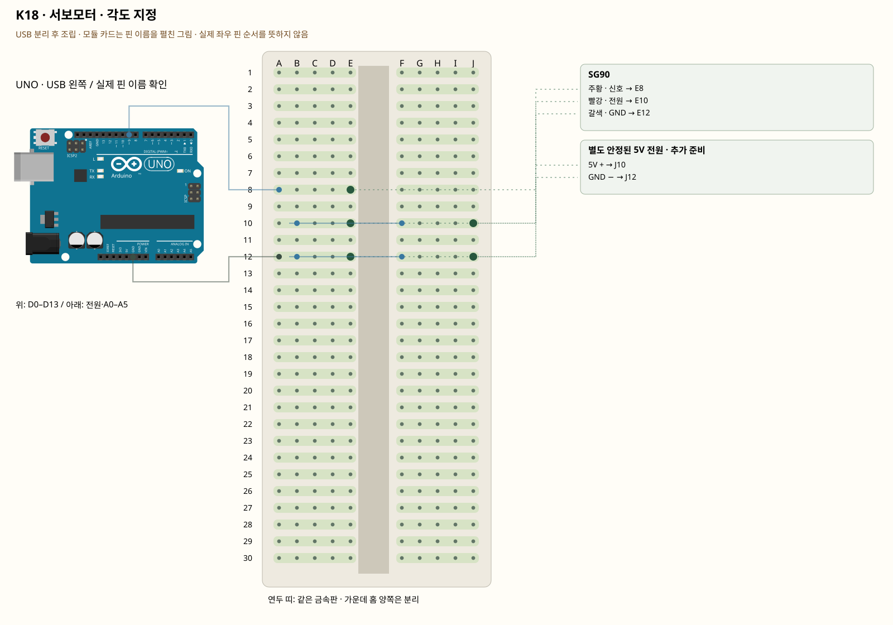

# K18 · 서보모터 · 각도 지정

이 단품 회로는 P01~P04와 동시에 꽂지 않는 별도 배선입니다. 같은 키트 부품을 재사용하며 이전 회로의 모든 선을 먼저 제거합니다.

서보는 신호 펄스로 목표 각도를 받습니다. 주황 선은 신호이고 빨강 선으로 전원을 받습니다. 모터는 순간 전류가 커서 UNO가 리셋될 수 있으므로 별도 안정된 5V 전원을 사용합니다. 공통 GND는 신호를 같은 기준으로 읽게 합니다.

**실물·전원 조건:** 별도 안정된 5V 전원과 적절한 연결 부품은 판매처 37개 구성표에 없습니다. 준비 전에는 전원 연결 단계를 진행하지 않습니다. 모터에 9V를 넣거나 UNO의 신호 핀·3.3V 핀에서 전원을 공급하지 않습니다. 외부 +5V를 UNO 5V에 병렬 연결하지 않습니다.

## 부품 방향

부품 핀의 이름을 먼저 확인합니다. 모듈 그림은 핀 이름을 읽기 위한 펼친 그림이며, 실물 커넥터의 좌우 순서를 뜻하지 않습니다. 표시가 다른 부품은 연결 전에 해당 모델 핀표와 대조합니다.

## 각 핀의 연결

| 부품 | 다리/핀 | 빵판 구멍 | 같은 금속판 | 전기적 도착점 |
|---|---|---|---|---|
| SG90 | 주황 · 신호 | E8 | A8·B8·C8·D8·E8 | UNO D9 |
| SG90 | 빨강 · 전원 | E10 | A10·B10·C10·D10·E10 | 표의 부품 사이 연결·외부전원 경로 확인 |
| SG90 | 갈색 · GND | E12 | A12·B12·C12·D12·E12 | UNO GND |
| 별도 안정된 5V 전원 · 추가 준비 | 5V + | J10 | F10·G10·H10·I10·J10 | 표의 부품 사이 연결·외부전원 경로 확인 |
| 별도 안정된 5V 전원 · 추가 준비 | GND − | J12 | F12·G12·H12·I12·J12 | UNO GND |

## 전선 연결 순서

| 순서 | 출발 | 도착 | 이유 |
|---|---|---|---|
| 1 | UNO D9 | 빵판 A8 | UNO D9 핀은 코드에서 정한 디지털 입출력·통신 핀입니다. 빵판 줄 번호가 아니라 UNO 핀 번호와 코드가 일치해야 합니다. 보드 쪽 연결점은 UNO D9입니다. A8 위치는 A8·B8·C8·D8·E8와 같은 금속판입니다. E8에 놓인 SG90의 주황 · 신호 지점과 이어집니다. |
| 2 | 빵판 B10 | 빵판 F10 | 같은 숫자라도 가운데 홈 양쪽은 떨어져 있습니다. 이 점퍼선으로 두 금속판을 이어야 회로가 연결됩니다. B10 위치는 A10·B10·C10·D10·E10와 같은 금속판입니다. E10에 놓인 SG90의 빨강 · 전원 지점과 이어집니다. F10 위치는 F10·G10·H10·I10·J10와 같은 금속판입니다. J10에 놓인 별도 안정된 5V 전원 · 추가 준비의 5V + 지점과 이어집니다. |
| 3 | 빵판 B12 | 빵판 F12 | 같은 숫자라도 가운데 홈 양쪽은 떨어져 있습니다. 이 점퍼선으로 두 금속판을 이어야 회로가 연결됩니다. B12 위치는 A12·B12·C12·D12·E12와 같은 금속판입니다. E12에 놓인 SG90의 갈색 · GND 지점과 이어집니다. F12 위치는 F12·G12·H12·I12·J12와 같은 금속판입니다. J12에 놓인 별도 안정된 5V 전원 · 추가 준비의 GND − 지점과 이어집니다. |
| 4 | UNO GND | 빵판 A12 | 외부 전원과 UNO의 0V 기준을 맞춰 제어 신호를 읽게 합니다. 모터의 전원 전류는 별도 외부 전원 경로를 이용하며 UNO 신호 핀에서 공급하지 않습니다. 보드 쪽 연결점은 UNO GND입니다. A12 위치는 A12·B12·C12·D12·E12와 같은 금속판입니다. E12에 놓인 SG90의 갈색 · GND 지점과 이어집니다. |

모듈을 펼친 핀 그림과 실물 커넥터 순서를 혼동하지 않습니다. 별도 안정된 5V 전원과 적절한 연결 부품은 판매처 37개 구성표에 없습니다. 준비 전에는 전원 연결 단계를 진행하지 않습니다. 모터에 9V를 넣거나 UNO의 신호 핀·3.3V 핀에서 전원을 공급하지 않습니다. 외부 +5V를 UNO 5V에 병렬 연결하지 않습니다.

## 저장·컴파일·실행

라이브러리: Servo 1.3.0. [단품 참조 스케치](../reference-sketches/K18/K18.ino). 코드가 없는 전원·정리 항목은 실행 스케치가 없습니다. K18/K19는 외부전원이 없어 오늘 구동하지 않습니다. 모터 명령 차단 확인은 P04를 사용합니다. 기존 단품 코드는 시리얼9600이며 P 프로파일115200과 구분합니다.

예상 결과: 외부 전원이 준비되면 70°와 110° 사이를 오갑니다. 실제 기계 각도는 제품마다 다릅니다.

한 값 수정: 80°와100°로 범위를 줄이고 5°씩 부드럽게 이동하도록 바꿉니다.

오류 해결: 떨림·리셋·이상음은 즉시 전원을 끄고 전류 용량·공통 GND·기계 간섭을 확인합니다.

## Claude에 줄 구현 조건

위의 핀·전원·저항·비움 핀을 고정하고 이 회로 하나의 코드를 작성합니다. 단품의 기존 핀 번호를 다른 프로파일과 합치지 않습니다. 별도 안정된 5V 전원과 적절한 연결 부품은 판매처 37개 구성표에 없습니다. 준비 전에는 전원 연결 단계를 진행하지 않습니다. 모터에 9V를 넣거나 UNO의 신호 핀·3.3V 핀에서 전원을 공급하지 않습니다. 외부 +5V를 UNO 5V에 병렬 연결하지 않습니다.
실물 모델이 필요한 IR·화염 소자·도트매트릭스는 핀표 확인 전 해당 입력/출력을 비활성으로 만들고 상태 null과 이유를 보냅니다. 모터·미확인 릴레이를 켜진 상태로 시작하지 않습니다. 실제 값과 원시값의 단위를 구별합니다. 목요일 양방향 규약을 붙일 때는 `PROTOCOL.md`를 따르고 상태·명령 목록을 먼저 제시합니다.

- [핀표·공식 설명](https://docs.arduino.cc/learn/electronics/servo-motors/)
- [핀표·공식 설명](../assets/reference/7.png)
