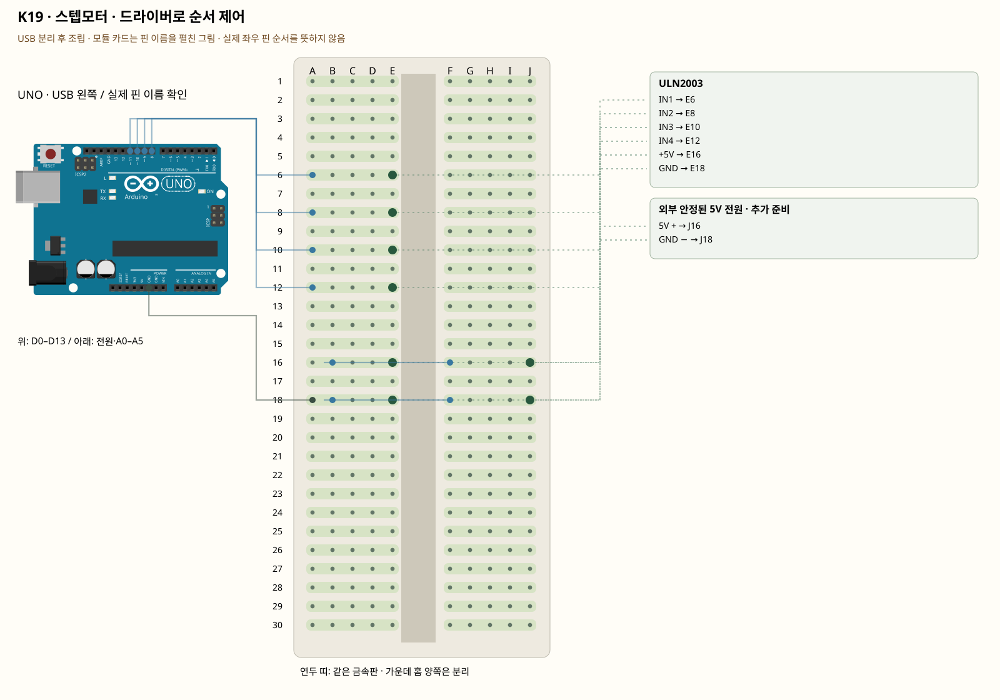

# K19 · 스텝모터 · 드라이버로 순서 제어

이 단품 회로는 P01~P04와 동시에 꽂지 않는 별도 배선입니다. 같은 키트 부품을 재사용하며 이전 회로의 모든 선을 먼저 제거합니다.

스텝모터는 코일을 순서대로 켜서 조금씩 회전합니다. UNO는 제어 순서만 보내고 ULN2003이 모터 전류를 다룹니다. 28BYJ-48의 기어비와 1회전 스텝 수에는 차이가 있어 코드 상수를 실제 회전과 비교해야 합니다.

**실물·전원 조건:** 정격 5V 모터와 별도 5V 전원이 필요합니다. 외부 전원과 UNO는 GND만 공통으로 연결합니다. 모터 정격·드라이버 전원 단자의 +/−가 확인되기 전에는 켜지 않습니다.

## 부품 방향

모터는 빵판에 꽂지 않습니다. 흰 커넥터의 걸쇠 방향을 맞춰 ULN2003 전용 5핀 소켓에 꽂습니다. 억지로 거꾸로 꽂지 않습니다. UNO D8~D11은 IN1~IN4에 차례로 연결하되 코드 생성자 순서는 8,10,9,11입니다.

## 각 핀의 연결

| 부품 | 다리/핀 | 빵판 구멍 | 같은 금속판 | 전기적 도착점 |
|---|---|---|---|---|
| ULN2003 | IN1 | E6 | A6·B6·C6·D6·E6 | UNO D8 |
| ULN2003 | IN2 | E8 | A8·B8·C8·D8·E8 | UNO D9 |
| ULN2003 | IN3 | E10 | A10·B10·C10·D10·E10 | UNO D10 |
| ULN2003 | IN4 | E12 | A12·B12·C12·D12·E12 | UNO D11 |
| ULN2003 | +5V | E16 | A16·B16·C16·D16·E16 | 표의 부품 사이 연결·외부전원 경로 확인 |
| ULN2003 | GND | E18 | A18·B18·C18·D18·E18 | UNO GND |
| 외부 안정된 5V 전원 · 추가 준비 | 5V + | J16 | F16·G16·H16·I16·J16 | 표의 부품 사이 연결·외부전원 경로 확인 |
| 외부 안정된 5V 전원 · 추가 준비 | GND − | J18 | F18·G18·H18·I18·J18 | UNO GND |

## 전선 연결 순서

| 순서 | 출발 | 도착 | 이유 |
|---|---|---|---|
| 1 | UNO D8 | 빵판 A6 | UNO D8 핀은 코드에서 정한 디지털 입출력·통신 핀입니다. 빵판 줄 번호가 아니라 UNO 핀 번호와 코드가 일치해야 합니다. 보드 쪽 연결점은 UNO D8입니다. A6 위치는 A6·B6·C6·D6·E6와 같은 금속판입니다. E6에 놓인 ULN2003의 IN1 지점과 이어집니다. |
| 2 | UNO D9 | 빵판 A8 | UNO D9 핀은 코드에서 정한 디지털 입출력·통신 핀입니다. 빵판 줄 번호가 아니라 UNO 핀 번호와 코드가 일치해야 합니다. 보드 쪽 연결점은 UNO D9입니다. A8 위치는 A8·B8·C8·D8·E8와 같은 금속판입니다. E8에 놓인 ULN2003의 IN2 지점과 이어집니다. |
| 3 | UNO D10 | 빵판 A10 | UNO D10 핀은 코드에서 정한 디지털 입출력·통신 핀입니다. 빵판 줄 번호가 아니라 UNO 핀 번호와 코드가 일치해야 합니다. 보드 쪽 연결점은 UNO D10입니다. A10 위치는 A10·B10·C10·D10·E10와 같은 금속판입니다. E10에 놓인 ULN2003의 IN3 지점과 이어집니다. |
| 4 | UNO D11 | 빵판 A12 | UNO D11 핀은 코드에서 정한 디지털 입출력·통신 핀입니다. 빵판 줄 번호가 아니라 UNO 핀 번호와 코드가 일치해야 합니다. 보드 쪽 연결점은 UNO D11입니다. A12 위치는 A12·B12·C12·D12·E12와 같은 금속판입니다. E12에 놓인 ULN2003의 IN4 지점과 이어집니다. |
| 5 | 빵판 B16 | 빵판 F16 | 같은 숫자라도 가운데 홈 양쪽은 떨어져 있습니다. 이 점퍼선으로 두 금속판을 이어야 회로가 연결됩니다. B16 위치는 A16·B16·C16·D16·E16와 같은 금속판입니다. E16에 놓인 ULN2003의 +5V 지점과 이어집니다. F16 위치는 F16·G16·H16·I16·J16와 같은 금속판입니다. J16에 놓인 외부 안정된 5V 전원 · 추가 준비의 5V + 지점과 이어집니다. |
| 6 | 빵판 B18 | 빵판 F18 | 같은 숫자라도 가운데 홈 양쪽은 떨어져 있습니다. 이 점퍼선으로 두 금속판을 이어야 회로가 연결됩니다. B18 위치는 A18·B18·C18·D18·E18와 같은 금속판입니다. E18에 놓인 ULN2003의 GND 지점과 이어집니다. F18 위치는 F18·G18·H18·I18·J18와 같은 금속판입니다. J18에 놓인 외부 안정된 5V 전원 · 추가 준비의 GND − 지점과 이어집니다. |
| 7 | UNO GND | 빵판 A18 | 외부 전원과 UNO의 0V 기준을 맞춰 제어 신호를 읽게 합니다. 모터의 전원 전류는 별도 외부 전원 경로를 이용하며 UNO 신호 핀에서 공급하지 않습니다. 보드 쪽 연결점은 UNO GND입니다. A18 위치는 A18·B18·C18·D18·E18와 같은 금속판입니다. E18에 놓인 ULN2003의 GND 지점과 이어집니다. |

모듈을 펼친 핀 그림과 실물 커넥터 순서를 혼동하지 않습니다. 정격 5V 모터와 별도 5V 전원이 필요합니다. 외부 전원과 UNO는 GND만 공통으로 연결합니다. 모터 정격·드라이버 전원 단자의 +/−가 확인되기 전에는 켜지 않습니다.

## 저장·컴파일·실행

라이브러리: Stepper 1.1.3. [단품 참조 스케치](../reference-sketches/K19/K19.ino). 코드가 없는 전원·정리 항목은 실행 스케치가 없습니다. K18/K19는 외부전원이 없어 오늘 구동하지 않습니다. 모터 명령 차단 확인은 P04를 사용합니다. 기존 단품 코드는 시리얼9600이며 P 프로파일115200과 구분합니다.

예상 결과: 모터의 흰 5핀 커넥터를 드라이버 전용 소켓에 꽂은 뒤, 축이 조금씩 정·역회전합니다.

한 값 수정: 한 바퀴가 되도록 스텝 수를 관찰해 기록합니다.

오류 해결: LED만 켜지고 축이 떨리면 전원·모터 플러그·8,10,9,11 순서를 확인합니다.

## Claude에 줄 구현 조건

위의 핀·전원·저항·비움 핀을 고정하고 이 회로 하나의 코드를 작성합니다. 단품의 기존 핀 번호를 다른 프로파일과 합치지 않습니다. 정격 5V 모터와 별도 5V 전원이 필요합니다. 외부 전원과 UNO는 GND만 공통으로 연결합니다. 모터 정격·드라이버 전원 단자의 +/−가 확인되기 전에는 켜지 않습니다.
실물 모델이 필요한 IR·화염 소자·도트매트릭스는 핀표 확인 전 해당 입력/출력을 비활성으로 만들고 상태 null과 이유를 보냅니다. 모터·미확인 릴레이를 켜진 상태로 시작하지 않습니다. 실제 값과 원시값의 단위를 구별합니다. 목요일 양방향 규약을 붙일 때는 `PROTOCOL.md`를 따르고 상태·명령 목록을 먼저 제시합니다.

- [핀표·공식 설명](../assets/reference/8.pdf)
- [핀표·공식 설명](../assets/reference/11.png)
