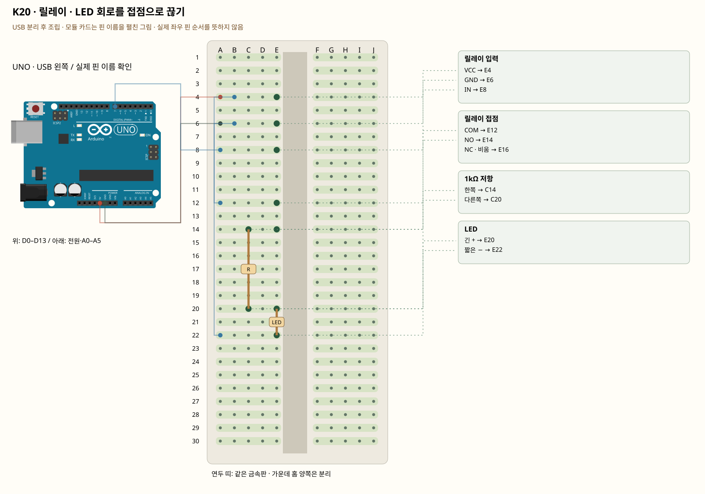

# K20 · 릴레이 · LED 회로를 접점으로 끊기

이 단품 회로는 P01~P04와 동시에 꽂지 않는 별도 배선입니다. 같은 키트 부품을 재사용하며 이전 회로의 모든 선을 먼저 제거합니다.

릴레이에는 제어 쪽 VCC·GND·IN과 접점 쪽 COM·NO·NC가 있습니다. COM–NO는 평소 떨어져 있고 동작하면 붙습니다. 릴레이가 신호에 반응하는 방향은 모듈마다 다르므로 LOW/HIGH를 확인합니다. 수업은 USB의 저전압 LED만 사용합니다.

**실물·전원 조건:** 트랜지스터·역기전력 보호가 있는 5V 릴레이 모듈 기준입니다. 맨 릴레이 코일을 GPIO에 연결하지 않습니다. 콘센트·220V·가전제품은 수업 회로에 절대로 연결하지 않습니다.

## 부품 방향

부품 핀의 이름을 먼저 확인합니다. 모듈 그림은 핀 이름을 읽기 위한 펼친 그림이며, 실물 커넥터의 좌우 순서를 뜻하지 않습니다. 표시가 다른 부품은 연결 전에 해당 모델 핀표와 대조합니다.

## 각 핀의 연결

| 부품 | 다리/핀 | 빵판 구멍 | 같은 금속판 | 전기적 도착점 |
|---|---|---|---|---|
| 릴레이 입력 | VCC | E4 | A4·B4·C4·D4·E4 | UNO 5V |
| 릴레이 입력 | GND | E6 | A6·B6·C6·D6·E6 | UNO GND |
| 릴레이 입력 | IN | E8 | A8·B8·C8·D8·E8 | UNO D7 |
| 릴레이 접점 | COM | E12 | A12·B12·C12·D12·E12 | UNO 5V |
| 릴레이 접점 | NO | E14 | A14·B14·C14·D14·E14 | 표의 부품 사이 연결·외부전원 경로 확인 |
| 릴레이 접점 | NC · 비움 | E16 | A16·B16·C16·D16·E16 | 연결하지 않음 |
| 1kΩ 저항 | 한쪽 | C14 | A14·B14·C14·D14·E14 | 표의 부품 사이 연결·외부전원 경로 확인 |
| 1kΩ 저항 | 다른쪽 | C20 | A20·B20·C20·D20·E20 | 표의 부품 사이 연결·외부전원 경로 확인 |
| LED | 긴 + | E20 | A20·B20·C20·D20·E20 | 표의 부품 사이 연결·외부전원 경로 확인 |
| LED | 짧은 − | E22 | A22·B22·C22·D22·E22 | UNO GND |

## 전선 연결 순서

| 순서 | 출발 | 도착 | 이유 |
|---|---|---|---|
| 1 | UNO 5V | 빵판 A4 | 부품에 5V 전원을 공급하는 연결입니다. 신호를 읽는 선과 역할이 다릅니다. 보드 쪽 연결점은 UNO 5V입니다. A4 위치는 A4·B4·C4·D4·E4와 같은 금속판입니다. E4에 놓인 릴레이 입력의 VCC 지점과 이어집니다. |
| 2 | UNO GND | 빵판 A6 | GND는 보드의 0V 기준입니다. 부품과 보드의 기준을 맞추고 이 회로에 필요한 전류의 돌아가는 길을 연결합니다. 보드 쪽 연결점은 UNO GND입니다. A6 위치는 A6·B6·C6·D6·E6와 같은 금속판입니다. E6에 놓인 릴레이 입력의 GND 지점과 이어집니다. |
| 3 | UNO D7 | 빵판 A8 | UNO D7 핀은 코드에서 정한 디지털 입출력·통신 핀입니다. 빵판 줄 번호가 아니라 UNO 핀 번호와 코드가 일치해야 합니다. 보드 쪽 연결점은 UNO D7입니다. A8 위치는 A8·B8·C8·D8·E8와 같은 금속판입니다. E8에 놓인 릴레이 입력의 IN 지점과 이어집니다. |
| 4 | 빵판 B4 | 빵판 A12 | 서로 떨어진 연결 묶음을 이 점퍼선으로 이어 같은 전기 연결을 만듭니다. B4 위치는 A4·B4·C4·D4·E4와 같은 금속판입니다. E4에 놓인 릴레이 입력의 VCC 지점과 이어집니다. A12 위치는 A12·B12·C12·D12·E12와 같은 금속판입니다. E12에 놓인 릴레이 접점의 COM 지점과 이어집니다. |
| 5 | 빵판 B6 | 빵판 A22 | 서로 떨어진 연결 묶음을 이 점퍼선으로 이어 같은 전기 연결을 만듭니다. B6 위치는 A6·B6·C6·D6·E6와 같은 금속판입니다. E6에 놓인 릴레이 입력의 GND 지점과 이어집니다. A22 위치는 A22·B22·C22·D22·E22와 같은 금속판입니다. E22에 놓인 LED의 짧은 − 지점과 이어집니다. |

모듈을 펼친 핀 그림과 실물 커넥터 순서를 혼동하지 않습니다. 트랜지스터·역기전력 보호가 있는 5V 릴레이 모듈 기준입니다. 맨 릴레이 코일을 GPIO에 연결하지 않습니다. 콘센트·220V·가전제품은 수업 회로에 절대로 연결하지 않습니다.

## 저장·컴파일·실행

라이브러리: 추가 설치 없음. [단품 참조 스케치](../reference-sketches/K20/K20.ino). 코드가 없는 전원·정리 항목은 실행 스케치가 없습니다. K18/K19는 외부전원이 없어 오늘 구동하지 않습니다. 모터 명령 차단 확인은 P04를 사용합니다. 기존 단품 코드는 시리얼9600이며 P 프로파일115200과 구분합니다.

예상 결과: 클릭 소리와 함께 COM–NO를 거친 LED가 켜졌다 꺼집니다.

한 값 수정: NO 대신 NC를 쓸 때 반대 동작이 되는지 전원을 끈 뒤 바꿔 비교합니다.

오류 해결: 릴레이 LED는 켜지는데 외부 LED가 꺼져 있으면 COM·NO와 LED 극성을 확인합니다.

## Claude에 줄 구현 조건

위의 핀·전원·저항·비움 핀을 고정하고 이 회로 하나의 코드를 작성합니다. 단품의 기존 핀 번호를 다른 프로파일과 합치지 않습니다. 트랜지스터·역기전력 보호가 있는 5V 릴레이 모듈 기준입니다. 맨 릴레이 코일을 GPIO에 연결하지 않습니다. 콘센트·220V·가전제품은 수업 회로에 절대로 연결하지 않습니다.
실물 모델이 필요한 IR·화염 소자·도트매트릭스는 핀표 확인 전 해당 입력/출력을 비활성으로 만들고 상태 null과 이유를 보냅니다. 모터·미확인 릴레이를 켜진 상태로 시작하지 않습니다. 실제 값과 원시값의 단위를 구별합니다. 목요일 양방향 규약을 붙일 때는 `PROTOCOL.md`를 따르고 상태·명령 목록을 먼저 제시합니다.

- [핀표·공식 설명](../assets/reference/9.pdf)
