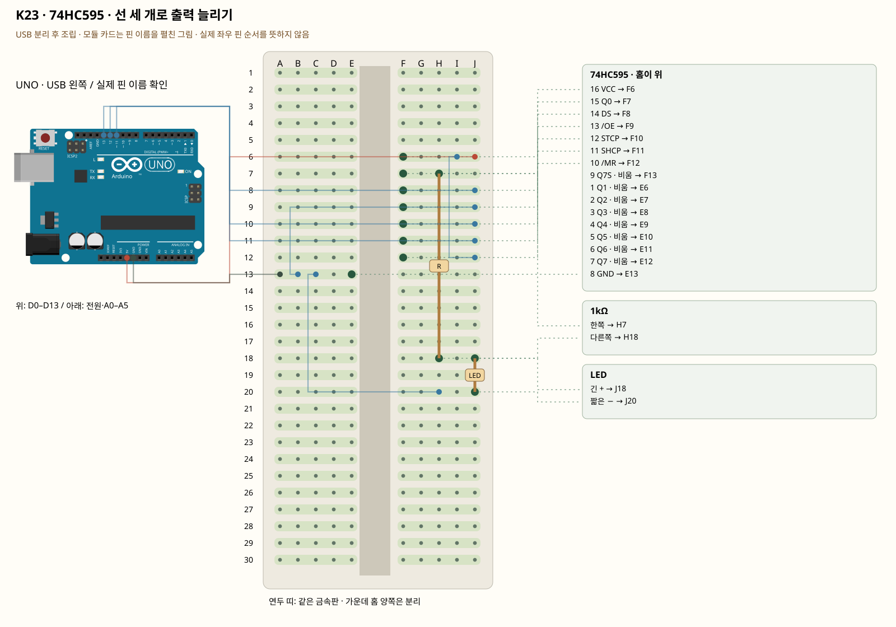

# K23 · 74HC595 · 선 세 개로 출력 늘리기

이 단품 회로는 P01~P04와 동시에 꽂지 않는 별도 배선입니다. 같은 키트 부품을 재사용하며 이전 회로의 모든 선을 먼저 제거합니다.

시프트 레지스터는 데이터를 한 비트씩 받은 뒤 한 번에 출력으로 옮깁니다. DS는 데이터, SHCP는 데이터를 밀어 넣는 시계, STCP는 출력에 반영하는 래치입니다. 처음에는 Q0 LED 한 개로 순서를 확인합니다.

**실물·전원 조건:** 실물 표시와 코드의 핀을 대조합니다.

## 부품 방향

칩의 반달 홈·점이 위로 보이게 빵판 가운데 홈을 가로질러 E6~E13·F6~F13에 꽂습니다. 위에서 본 1번은 왼쪽 위, 아래로1~8·오른쪽 아래9부터 위로16입니다. 부품을 꽂기 전 모든 다리가 바깥으로 벌어지거나 접히지 않았는지 확인합니다.

## 각 핀의 연결

| 부품 | 다리/핀 | 빵판 구멍 | 같은 금속판 | 전기적 도착점 |
|---|---|---|---|---|
| 74HC595 · 홈이 위 | 16 VCC | F6 | F6·G6·H6·I6·J6 | UNO 5V |
| 74HC595 · 홈이 위 | 15 Q0 | F7 | F7·G7·H7·I7·J7 | 표의 부품 사이 연결·외부전원 경로 확인 |
| 74HC595 · 홈이 위 | 14 DS | F8 | F8·G8·H8·I8·J8 | UNO D11 |
| 74HC595 · 홈이 위 | 13 /OE | F9 | F9·G9·H9·I9·J9 | UNO GND |
| 74HC595 · 홈이 위 | 12 STCP | F10 | F10·G10·H10·I10·J10 | UNO D12 |
| 74HC595 · 홈이 위 | 11 SHCP | F11 | F11·G11·H11·I11·J11 | UNO D13 |
| 74HC595 · 홈이 위 | 10 /MR | F12 | F12·G12·H12·I12·J12 | UNO 5V |
| 74HC595 · 홈이 위 | 9 Q7S · 비움 | F13 | F13·G13·H13·I13·J13 | 연결하지 않음 |
| 74HC595 · 홈이 위 | 1 Q1 · 비움 | E6 | A6·B6·C6·D6·E6 | 연결하지 않음 |
| 74HC595 · 홈이 위 | 2 Q2 · 비움 | E7 | A7·B7·C7·D7·E7 | 연결하지 않음 |
| 74HC595 · 홈이 위 | 3 Q3 · 비움 | E8 | A8·B8·C8·D8·E8 | 연결하지 않음 |
| 74HC595 · 홈이 위 | 4 Q4 · 비움 | E9 | A9·B9·C9·D9·E9 | 연결하지 않음 |
| 74HC595 · 홈이 위 | 5 Q5 · 비움 | E10 | A10·B10·C10·D10·E10 | 연결하지 않음 |
| 74HC595 · 홈이 위 | 6 Q6 · 비움 | E11 | A11·B11·C11·D11·E11 | 연결하지 않음 |
| 74HC595 · 홈이 위 | 7 Q7 · 비움 | E12 | A12·B12·C12·D12·E12 | 연결하지 않음 |
| 74HC595 · 홈이 위 | 8 GND | E13 | A13·B13·C13·D13·E13 | UNO GND |
| 1kΩ | 한쪽 | H7 | F7·G7·H7·I7·J7 | 표의 부품 사이 연결·외부전원 경로 확인 |
| 1kΩ | 다른쪽 | H18 | F18·G18·H18·I18·J18 | 표의 부품 사이 연결·외부전원 경로 확인 |
| LED | 긴 + | J18 | F18·G18·H18·I18·J18 | 표의 부품 사이 연결·외부전원 경로 확인 |
| LED | 짧은 − | J20 | F20·G20·H20·I20·J20 | UNO GND |

## 전선 연결 순서

| 순서 | 출발 | 도착 | 이유 |
|---|---|---|---|
| 1 | UNO 5V | 빵판 J6 | 부품에 5V 전원을 공급하는 연결입니다. 신호를 읽는 선과 역할이 다릅니다. 보드 쪽 연결점은 UNO 5V입니다. J6 위치는 F6·G6·H6·I6·J6와 같은 금속판입니다. F6에 놓인 74HC595 · 홈이 위의 16 VCC 지점과 이어집니다. |
| 2 | UNO GND | 빵판 A13 | GND는 보드의 0V 기준입니다. 부품과 보드의 기준을 맞추고 이 회로에 필요한 전류의 돌아가는 길을 연결합니다. 보드 쪽 연결점은 UNO GND입니다. A13 위치는 A13·B13·C13·D13·E13와 같은 금속판입니다. E13에 놓인 74HC595 · 홈이 위의 8 GND 지점과 이어집니다. |
| 3 | 빵판 B13 | 빵판 J9 | 서로 떨어진 연결 묶음을 이 점퍼선으로 이어 같은 전기 연결을 만듭니다. B13 위치는 A13·B13·C13·D13·E13와 같은 금속판입니다. E13에 놓인 74HC595 · 홈이 위의 8 GND 지점과 이어집니다. J9 위치는 F9·G9·H9·I9·J9와 같은 금속판입니다. F9에 놓인 74HC595 · 홈이 위의 13 /OE 지점과 이어집니다. |
| 4 | 빵판 I6 | 빵판 J12 | 서로 떨어진 연결 묶음을 이 점퍼선으로 이어 같은 전기 연결을 만듭니다. I6 위치는 F6·G6·H6·I6·J6와 같은 금속판입니다. F6에 놓인 74HC595 · 홈이 위의 16 VCC 지점과 이어집니다. J12 위치는 F12·G12·H12·I12·J12와 같은 금속판입니다. F12에 놓인 74HC595 · 홈이 위의 10 /MR 지점과 이어집니다. |
| 5 | UNO D11 | 빵판 J8 | UNO D11 핀은 코드에서 정한 디지털 입출력·통신 핀입니다. 빵판 줄 번호가 아니라 UNO 핀 번호와 코드가 일치해야 합니다. 보드 쪽 연결점은 UNO D11입니다. J8 위치는 F8·G8·H8·I8·J8와 같은 금속판입니다. F8에 놓인 74HC595 · 홈이 위의 14 DS 지점과 이어집니다. |
| 6 | UNO D12 | 빵판 J10 | UNO D12 핀은 코드에서 정한 디지털 입출력·통신 핀입니다. 빵판 줄 번호가 아니라 UNO 핀 번호와 코드가 일치해야 합니다. 보드 쪽 연결점은 UNO D12입니다. J10 위치는 F10·G10·H10·I10·J10와 같은 금속판입니다. F10에 놓인 74HC595 · 홈이 위의 12 STCP 지점과 이어집니다. |
| 7 | UNO D13 | 빵판 J11 | UNO D13 핀은 코드에서 정한 디지털 입출력·통신 핀입니다. 빵판 줄 번호가 아니라 UNO 핀 번호와 코드가 일치해야 합니다. 보드 쪽 연결점은 UNO D13입니다. J11 위치는 F11·G11·H11·I11·J11와 같은 금속판입니다. F11에 놓인 74HC595 · 홈이 위의 11 SHCP 지점과 이어집니다. |
| 8 | 빵판 C13 | 빵판 H20 | 서로 떨어진 연결 묶음을 이 점퍼선으로 이어 같은 전기 연결을 만듭니다. C13 위치는 A13·B13·C13·D13·E13와 같은 금속판입니다. E13에 놓인 74HC595 · 홈이 위의 8 GND 지점과 이어집니다. H20 위치는 F20·G20·H20·I20·J20와 같은 금속판입니다. J20에 놓인 LED의 짧은 − 지점과 이어집니다. |

모듈을 펼친 핀 그림과 실물 커넥터 순서를 혼동하지 않습니다.

## 저장·컴파일·실행

라이브러리: 추가 설치 없음. [단품 참조 스케치](../reference-sketches/K23/K23.ino). 코드가 없는 전원·정리 항목은 실행 스케치가 없습니다. K18/K19는 외부전원이 없어 오늘 구동하지 않습니다. 모터 명령 차단 확인은 P04를 사용합니다. 기존 단품 코드는 시리얼9600이며 P 프로파일115200과 구분합니다.

예상 결과: Q0에 연결한 LED가 1초마다 켜졌다 꺼집니다.

한 값 수정: 각 출력에 개별 저항을 추가 준비해 Q1~Q7로 이동하는 불빛을 만듭니다.

오류 해결: /OE는 LOW, /MR은 HIGH여야 합니다. 16 VCC와 8 GND를 뒤집지 않습니다.

## Claude에 줄 구현 조건

위의 핀·전원·저항·비움 핀을 고정하고 이 회로 하나의 코드를 작성합니다. 단품의 기존 핀 번호를 다른 프로파일과 합치지 않습니다.
실물 모델이 필요한 IR·화염 소자·도트매트릭스는 핀표 확인 전 해당 입력/출력을 비활성으로 만들고 상태 null과 이유를 보냅니다. 모터·미확인 릴레이를 켜진 상태로 시작하지 않습니다. 실제 값과 원시값의 단위를 구별합니다. 목요일 양방향 규약을 붙일 때는 `PROTOCOL.md`를 따르고 상태·명령 목록을 먼저 제시합니다.

- [핀표·공식 설명](../assets/reference/1.pdf)
