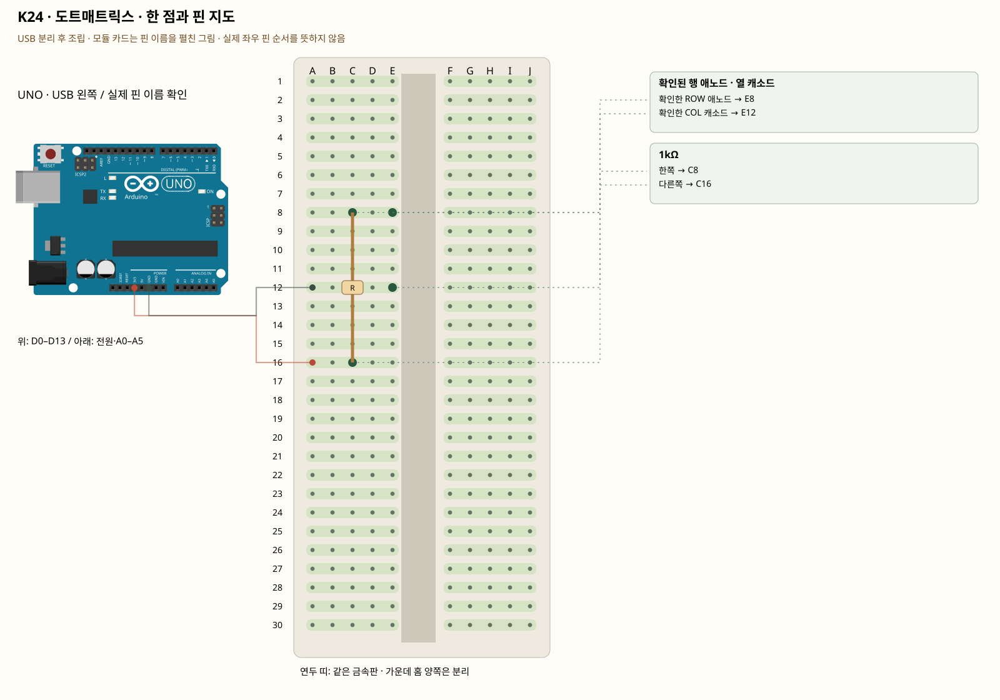

# K24 · 도트매트릭스 · 한 점과 핀 지도

이 단품 회로는 P01~P04와 동시에 꽂지 않는 별도 배선입니다. 같은 키트 부품을 재사용하며 이전 회로의 모든 선을 먼저 제거합니다.

8×8 표시기는 64개 LED를 행과 열로 묶습니다. 키트 사진은 핀16개짜리 맨 부품이며 MAX7219 통신 모듈이 아닙니다. 핀 번호·행열·극성이 확인돼야 전체 화면 스캔을 만들 수 있습니다. 외형이 같은 1088·1388 부품의 서로 다른 핀표를 섞지 않습니다.

**실물·전원 조건:** 상품 사진의 SH13888A 글자만으로 공급된 부품의 제조사·행열 핀표·역전압 정격을 확정할 수 없습니다. 이 실습은 해당 부품의 핀표와 허용전압을 확보한 후 진행하는 조건부 한 점 회로입니다. 자료가 없으면 부품 식별·핀 지도 작성까지만 하고 전원을 연결하지 않습니다. 모든 핀을 추측한 완성 배선도로 제공하지 않습니다.

## 부품 방향

부품 핀의 이름을 먼저 확인합니다. 모듈 그림은 핀 이름을 읽기 위한 펼친 그림이며, 실물 커넥터의 좌우 순서를 뜻하지 않습니다. 표시가 다른 부품은 연결 전에 해당 모델 핀표와 대조합니다.

## 각 핀의 연결

| 부품 | 다리/핀 | 빵판 구멍 | 같은 금속판 | 전기적 도착점 |
|---|---|---|---|---|
| 확인된 행 애노드 · 열 캐소드 | 확인한 ROW 애노드 | E8 | A8·B8·C8·D8·E8 | 1kΩ 경유 UNO 3V3 |
| 확인된 행 애노드 · 열 캐소드 | 확인한 COL 캐소드 | E12 | A12·B12·C12·D12·E12 | UNO GND |
| 1kΩ | 한쪽 | C8 | A8·B8·C8·D8·E8 | 표의 부품 사이 연결·외부전원 경로 확인 |
| 1kΩ | 다른쪽 | C16 | A16·B16·C16·D16·E16 | UNO 3V3 |

## 전선 연결 순서

| 순서 | 출발 | 도착 | 이유 |
|---|---|---|---|
| 1 | UNO 3V3 | 빵판 A16 | 부품에 3.3V 전원을 공급하는 연결입니다. 신호를 읽는 선과 역할이 다릅니다. 보드 쪽 연결점은 UNO 3V3입니다. A16 위치는 A16·B16·C16·D16·E16와 같은 금속판입니다. C16에 놓인 1kΩ의 다른쪽 지점과 이어집니다. |
| 2 | UNO GND | 빵판 A12 | GND는 보드의 0V 기준입니다. 부품과 보드의 기준을 맞추고 이 회로에 필요한 전류의 돌아가는 길을 연결합니다. 보드 쪽 연결점은 UNO GND입니다. A12 위치는 A12·B12·C12·D12·E12와 같은 금속판입니다. E12에 놓인 확인된 행 애노드 · 열 캐소드의 확인한 COL 캐소드 지점과 이어집니다. |

모듈을 펼친 핀 그림과 실물 커넥터 순서를 혼동하지 않습니다. 상품 사진의 SH13888A 글자만으로 공급된 부품의 제조사·행열 핀표·역전압 정격을 확정할 수 없습니다. 이 실습은 해당 부품의 핀표와 허용전압을 확보한 후 진행하는 조건부 한 점 회로입니다. 자료가 없으면 부품 식별·핀 지도 작성까지만 하고 전원을 연결하지 않습니다. 모든 핀을 추측한 완성 배선도로 제공하지 않습니다.

## 저장·컴파일·실행

라이브러리: 추가 설치 없음. [단품 참조 스케치](../reference-sketches/K24/K24.ino). 코드가 없는 전원·정리 항목은 실행 스케치가 없습니다. K18/K19는 외부전원이 없어 오늘 구동하지 않습니다. 모터 명령 차단 확인은 P04를 사용합니다. 기존 단품 코드는 시리얼9600이며 P 프로파일115200과 구분합니다.

예상 결과: 자료에서 확인한 행·열의 교차점 LED 한 개가 켜집니다.

한 값 수정: 공식 핀표에 각 핀의 행·열을 적고, 전원을 끈 뒤 다른 확인된 한 쌍으로 옮겨 위치를 비교합니다.

오류 해결: 불이 안 들어오면 무작정 극성을 바꾸지 말고 부품 모델·핀표의 앞/뒤 방향을 확인합니다.

## Claude에 줄 구현 조건

위의 핀·전원·저항·비움 핀을 고정하고 이 회로 하나의 코드를 작성합니다. 단품의 기존 핀 번호를 다른 프로파일과 합치지 않습니다. 상품 사진의 SH13888A 글자만으로 공급된 부품의 제조사·행열 핀표·역전압 정격을 확정할 수 없습니다. 이 실습은 해당 부품의 핀표와 허용전압을 확보한 후 진행하는 조건부 한 점 회로입니다. 자료가 없으면 부품 식별·핀 지도 작성까지만 하고 전원을 연결하지 않습니다. 모든 핀을 추측한 완성 배선도로 제공하지 않습니다.
실물 모델이 필요한 IR·화염 소자·도트매트릭스는 핀표 확인 전 해당 입력/출력을 비활성으로 만들고 상태 null과 이유를 보냅니다. 모터·미확인 릴레이를 켜진 상태로 시작하지 않습니다. 실제 값과 원시값의 단위를 구별합니다. 목요일 양방향 규약을 붙일 때는 `PROTOCOL.md`를 따르고 상태·명령 목록을 먼저 제시합니다.
