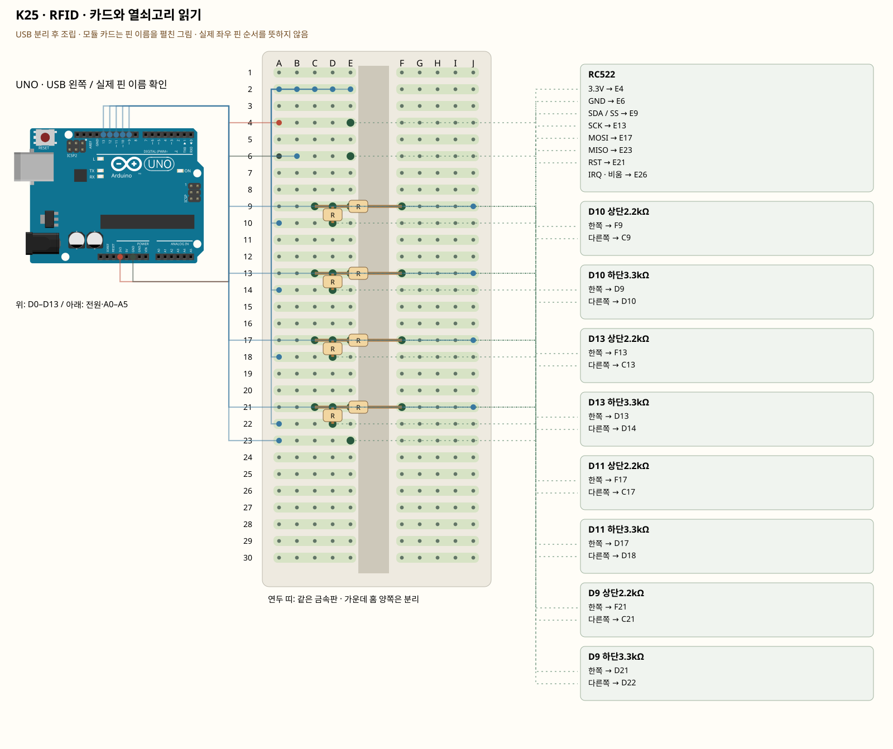

# K25 · RFID · 카드와 열쇠고리 읽기

이 단품 회로는 P01~P04와 동시에 꽂지 않는 별도 배선입니다. 같은 키트 부품을 재사용하며 이전 회로의 모든 선을 먼저 제거합니다.

SPI는 SCK·MOSI·MISO·SS로 통신합니다. RC522의 SDA 표시는 이 SPI 실습에서는 SS입니다. UNO의 A4 I2C에 연결하지 않습니다. UNO 출력5V는 2.2kΩ·3.3kΩ 분압으로 약3.0V로 낮춥니다. 카드 UID는 비밀번호가 아니며 보안 인증을 대신하지 못합니다.

**실물·전원 조건:** 2.2kΩ 4개와3.3kΩ 4개 또는 SPI에 맞는 5V→3.3V 레벨 변환기가 필요합니다. 구성표는 저항 값별 수량을 보장하지 않습니다. 부족하면 추가 준비 후 진행합니다. RC522 전원에5V를 넣거나 UNO의5V출력 네 선을 직결하지 않습니다. MISO3.3V는 UNO의 입력으로만 연결합니다.

## 부품 방향

부품 핀의 이름을 먼저 확인합니다. 모듈 그림은 핀 이름을 읽기 위한 펼친 그림이며, 실물 커넥터의 좌우 순서를 뜻하지 않습니다. 표시가 다른 부품은 연결 전에 해당 모델 핀표와 대조합니다.

## 각 핀의 연결

| 부품 | 다리/핀 | 빵판 구멍 | 같은 금속판 | 전기적 도착점 |
|---|---|---|---|---|
| RC522 | 3.3V | E4 | A4·B4·C4·D4·E4 | UNO 3V3 |
| RC522 | GND | E6 | A6·B6·C6·D6·E6 | UNO GND |
| RC522 | SDA / SS | E9 | A9·B9·C9·D9·E9 | D10 상단2.2kΩ 경유 UNO D10, D10 하단3.3kΩ 경유 UNO GND |
| RC522 | SCK | E13 | A13·B13·C13·D13·E13 | D13 상단2.2kΩ 경유 UNO D13, D13 하단3.3kΩ 경유 UNO GND |
| RC522 | MOSI | E17 | A17·B17·C17·D17·E17 | D11 상단2.2kΩ 경유 UNO D11, D11 하단3.3kΩ 경유 UNO GND |
| RC522 | MISO | E23 | A23·B23·C23·D23·E23 | UNO D12 |
| RC522 | RST | E21 | A21·B21·C21·D21·E21 | D9 상단2.2kΩ 경유 UNO D9, D9 하단3.3kΩ 경유 UNO GND |
| RC522 | IRQ · 비움 | E26 | A26·B26·C26·D26·E26 | 연결하지 않음 |
| D10 상단2.2kΩ | 한쪽 | F9 | F9·G9·H9·I9·J9 | UNO D10 |
| D10 상단2.2kΩ | 다른쪽 | C9 | A9·B9·C9·D9·E9 | D10 하단3.3kΩ 경유 UNO GND |
| D10 하단3.3kΩ | 한쪽 | D9 | A9·B9·C9·D9·E9 | D10 상단2.2kΩ 경유 UNO D10 |
| D10 하단3.3kΩ | 다른쪽 | D10 | A10·B10·C10·D10·E10 | UNO GND |
| D13 상단2.2kΩ | 한쪽 | F13 | F13·G13·H13·I13·J13 | UNO D13 |
| D13 상단2.2kΩ | 다른쪽 | C13 | A13·B13·C13·D13·E13 | D13 하단3.3kΩ 경유 UNO GND |
| D13 하단3.3kΩ | 한쪽 | D13 | A13·B13·C13·D13·E13 | D13 상단2.2kΩ 경유 UNO D13 |
| D13 하단3.3kΩ | 다른쪽 | D14 | A14·B14·C14·D14·E14 | UNO GND |
| D11 상단2.2kΩ | 한쪽 | F17 | F17·G17·H17·I17·J17 | UNO D11 |
| D11 상단2.2kΩ | 다른쪽 | C17 | A17·B17·C17·D17·E17 | D11 하단3.3kΩ 경유 UNO GND |
| D11 하단3.3kΩ | 한쪽 | D17 | A17·B17·C17·D17·E17 | D11 상단2.2kΩ 경유 UNO D11 |
| D11 하단3.3kΩ | 다른쪽 | D18 | A18·B18·C18·D18·E18 | UNO GND |
| D9 상단2.2kΩ | 한쪽 | F21 | F21·G21·H21·I21·J21 | UNO D9 |
| D9 상단2.2kΩ | 다른쪽 | C21 | A21·B21·C21·D21·E21 | D9 하단3.3kΩ 경유 UNO GND |
| D9 하단3.3kΩ | 한쪽 | D21 | A21·B21·C21·D21·E21 | D9 상단2.2kΩ 경유 UNO D9 |
| D9 하단3.3kΩ | 다른쪽 | D22 | A22·B22·C22·D22·E22 | UNO GND |

## 전선 연결 순서

| 순서 | 출발 | 도착 | 이유 |
|---|---|---|---|
| 1 | UNO 3V3 | 빵판 A4 | 부품에 3.3V 전원을 공급하는 연결입니다. 신호를 읽는 선과 역할이 다릅니다. 보드 쪽 연결점은 UNO 3V3입니다. A4 위치는 A4·B4·C4·D4·E4와 같은 금속판입니다. E4에 놓인 RC522의 3.3V 지점과 이어집니다. |
| 2 | UNO GND | 빵판 A6 | GND는 보드의 0V 기준입니다. 부품과 보드의 기준을 맞추고 이 회로에 필요한 전류의 돌아가는 길을 연결합니다. 보드 쪽 연결점은 UNO GND입니다. A6 위치는 A6·B6·C6·D6·E6와 같은 금속판입니다. E6에 놓인 RC522의 GND 지점과 이어집니다. |
| 3 | 빵판 B6 | 빵판 A2 | 서로 떨어진 연결 묶음을 이 점퍼선으로 이어 같은 전기 연결을 만듭니다. B6 위치는 A6·B6·C6·D6·E6와 같은 금속판입니다. E6에 놓인 RC522의 GND 지점과 이어집니다. A2 위치는 A2·B2·C2·D2·E2와 같은 금속판입니다. |
| 4 | UNO D12 | 빵판 A23 | UNO D12 핀은 코드에서 정한 디지털 입출력·통신 핀입니다. 빵판 줄 번호가 아니라 UNO 핀 번호와 코드가 일치해야 합니다. 보드 쪽 연결점은 UNO D12입니다. A23 위치는 A23·B23·C23·D23·E23와 같은 금속판입니다. E23에 놓인 RC522의 MISO 지점과 이어집니다. |
| 5 | UNO D10 | 빵판 J9 | UNO D10 핀은 코드에서 정한 디지털 입출력·통신 핀입니다. 빵판 줄 번호가 아니라 UNO 핀 번호와 코드가 일치해야 합니다. 보드 쪽 연결점은 UNO D10입니다. J9 위치는 F9·G9·H9·I9·J9와 같은 금속판입니다. F9에 놓인 D10 상단2.2kΩ의 한쪽 지점과 이어집니다. UNO의 5V 출력을 먼저 2.2kΩ 저항으로 보냅니다. |
| 6 | 빵판 A10 | 빵판 B2 | 서로 떨어진 연결 묶음을 이 점퍼선으로 이어 같은 전기 연결을 만듭니다. A10 위치는 A10·B10·C10·D10·E10와 같은 금속판입니다. D10에 놓인 D10 하단3.3kΩ의 다른쪽 지점과 이어집니다. B2 위치는 A2·B2·C2·D2·E2와 같은 금속판입니다. 분압 하단 3.3kΩ을 GND에 연결해 신호를 약3.0V로 낮춥니다. 3.3V 전원의 허용범위를 별도 확인합니다. |
| 7 | UNO D13 | 빵판 J13 | UNO D13 핀은 코드에서 정한 디지털 입출력·통신 핀입니다. 빵판 줄 번호가 아니라 UNO 핀 번호와 코드가 일치해야 합니다. 보드 쪽 연결점은 UNO D13입니다. J13 위치는 F13·G13·H13·I13·J13와 같은 금속판입니다. F13에 놓인 D13 상단2.2kΩ의 한쪽 지점과 이어집니다. UNO의 5V 출력을 먼저 2.2kΩ 저항으로 보냅니다. |
| 8 | 빵판 A14 | 빵판 C2 | 서로 떨어진 연결 묶음을 이 점퍼선으로 이어 같은 전기 연결을 만듭니다. A14 위치는 A14·B14·C14·D14·E14와 같은 금속판입니다. D14에 놓인 D13 하단3.3kΩ의 다른쪽 지점과 이어집니다. C2 위치는 A2·B2·C2·D2·E2와 같은 금속판입니다. 분압 하단 3.3kΩ을 GND에 연결해 신호를 약3.0V로 낮춥니다. 3.3V 전원의 허용범위를 별도 확인합니다. |
| 9 | UNO D11 | 빵판 J17 | UNO D11 핀은 코드에서 정한 디지털 입출력·통신 핀입니다. 빵판 줄 번호가 아니라 UNO 핀 번호와 코드가 일치해야 합니다. 보드 쪽 연결점은 UNO D11입니다. J17 위치는 F17·G17·H17·I17·J17와 같은 금속판입니다. F17에 놓인 D11 상단2.2kΩ의 한쪽 지점과 이어집니다. UNO의 5V 출력을 먼저 2.2kΩ 저항으로 보냅니다. |
| 10 | 빵판 A18 | 빵판 D2 | 서로 떨어진 연결 묶음을 이 점퍼선으로 이어 같은 전기 연결을 만듭니다. A18 위치는 A18·B18·C18·D18·E18와 같은 금속판입니다. D18에 놓인 D11 하단3.3kΩ의 다른쪽 지점과 이어집니다. D2 위치는 A2·B2·C2·D2·E2와 같은 금속판입니다. 분압 하단 3.3kΩ을 GND에 연결해 신호를 약3.0V로 낮춥니다. 3.3V 전원의 허용범위를 별도 확인합니다. |
| 11 | UNO D9 | 빵판 J21 | UNO D9 핀은 코드에서 정한 디지털 입출력·통신 핀입니다. 빵판 줄 번호가 아니라 UNO 핀 번호와 코드가 일치해야 합니다. 보드 쪽 연결점은 UNO D9입니다. J21 위치는 F21·G21·H21·I21·J21와 같은 금속판입니다. F21에 놓인 D9 상단2.2kΩ의 한쪽 지점과 이어집니다. UNO의 5V 출력을 먼저 2.2kΩ 저항으로 보냅니다. |
| 12 | 빵판 A22 | 빵판 E2 | 서로 떨어진 연결 묶음을 이 점퍼선으로 이어 같은 전기 연결을 만듭니다. A22 위치는 A22·B22·C22·D22·E22와 같은 금속판입니다. D22에 놓인 D9 하단3.3kΩ의 다른쪽 지점과 이어집니다. E2 위치는 A2·B2·C2·D2·E2와 같은 금속판입니다. 분압 하단 3.3kΩ을 GND에 연결해 신호를 약3.0V로 낮춥니다. 3.3V 전원의 허용범위를 별도 확인합니다. |

모듈을 펼친 핀 그림과 실물 커넥터 순서를 혼동하지 않습니다. 2.2kΩ 4개와3.3kΩ 4개 또는 SPI에 맞는 5V→3.3V 레벨 변환기가 필요합니다. 구성표는 저항 값별 수량을 보장하지 않습니다. 부족하면 추가 준비 후 진행합니다. RC522 전원에5V를 넣거나 UNO의5V출력 네 선을 직결하지 않습니다. MISO3.3V는 UNO의 입력으로만 연결합니다.

## 저장·컴파일·실행

라이브러리: MFRC522 1.4.12. [단품 참조 스케치](../reference-sketches/K25/K25.ino). 코드가 없는 전원·정리 항목은 실행 스케치가 없습니다. K18/K19는 외부전원이 없어 오늘 구동하지 않습니다. 모터 명령 차단 확인은 P04를 사용합니다. 기존 단품 코드는 시리얼9600이며 P 프로파일115200과 구분합니다.

예상 결과: 카드·열쇠고리를 한 개씩 가까이 대면 서로의 UID가 출력됩니다.

한 값 수정: 특정 UID를 표시용 이름에 연결해 인사 문구를 바꿉니다. 실제 출입 보안에는 쓰지 않습니다.

오류 해결: 아무 값도 없으면 3.3V·공통 GND·네 개 분압과 SPI핀부터 확인합니다. 모듈 헤더 납땜 여부도 확인합니다.

## Claude에 줄 구현 조건

위의 핀·전원·저항·비움 핀을 고정하고 이 회로 하나의 코드를 작성합니다. 단품의 기존 핀 번호를 다른 프로파일과 합치지 않습니다. 2.2kΩ 4개와3.3kΩ 4개 또는 SPI에 맞는 5V→3.3V 레벨 변환기가 필요합니다. 구성표는 저항 값별 수량을 보장하지 않습니다. 부족하면 추가 준비 후 진행합니다. RC522 전원에5V를 넣거나 UNO의5V출력 네 선을 직결하지 않습니다. MISO3.3V는 UNO의 입력으로만 연결합니다.
실물 모델이 필요한 IR·화염 소자·도트매트릭스는 핀표 확인 전 해당 입력/출력을 비활성으로 만들고 상태 null과 이유를 보냅니다. 모터·미확인 릴레이를 켜진 상태로 시작하지 않습니다. 실제 값과 원시값의 단위를 구별합니다. 목요일 양방향 규약을 붙일 때는 `PROTOCOL.md`를 따르고 상태·명령 목록을 먼저 제시합니다.

- [핀표·공식 설명](https://github.com/miguelbalboa/rfid)
- [핀표·공식 설명](../assets/reference/12.jpg)
