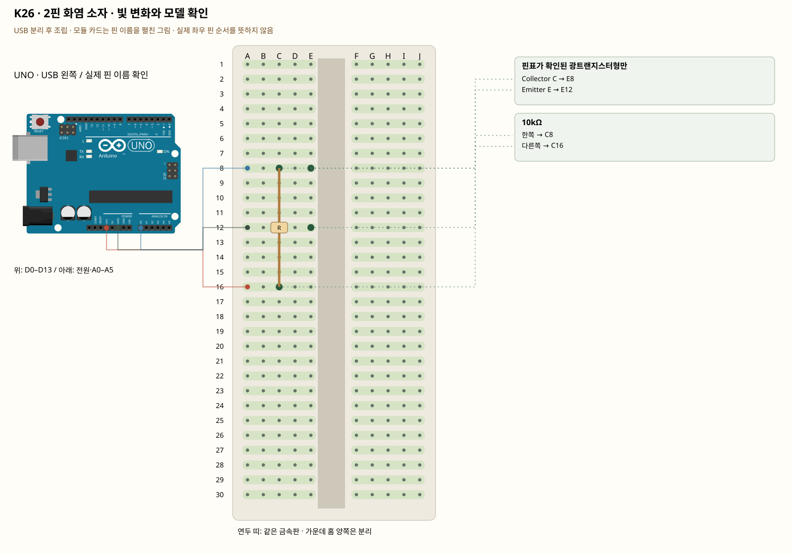

# K26 · 2핀 화염 소자 · 빛 변화와 모델 확인

이 단품 회로는 P01~P04와 동시에 꽂지 않는 별도 배선입니다. 같은 키트 부품을 재사용하며 이전 회로의 모든 선을 먼저 제거합니다.

판매처의 부품은 2핀 감지 소자입니다. 디지털 모듈의 VCC·GND·DO 세 핀을 가진 것처럼 연결하지 않습니다. 광트랜지스터형인지 광다이오드형인지에 따라 동작과 극성·회로가 달라집니다. 이름만 보고 임의로 전원을 넣지 않는 것도 부품 사용의 한 단계입니다.

**실물·전원 조건:** 이 회로는 C·E가 확인되고 해당 전압을 허용하는 광트랜지스터일 때만 사용합니다. 상품 사진은 정확한 모델·극성을 제공하지 않으므로 현물 각인·공급사 자료 확인이 먼저입니다. 광다이오드형이나 미확인 소자는 식별 기록까지만 진행합니다. 불·라이터를 쓰지 않습니다.

## 부품 방향

부품 핀의 이름을 먼저 확인합니다. 모듈 그림은 핀 이름을 읽기 위한 펼친 그림이며, 실물 커넥터의 좌우 순서를 뜻하지 않습니다. 표시가 다른 부품은 연결 전에 해당 모델 핀표와 대조합니다.

## 각 핀의 연결

| 부품 | 다리/핀 | 빵판 구멍 | 같은 금속판 | 전기적 도착점 |
|---|---|---|---|---|
| 핀표가 확인된 광트랜지스터형만 | Collector C | E8 | A8·B8·C8·D8·E8 | UNO A0, 10kΩ 경유 UNO 3V3 |
| 핀표가 확인된 광트랜지스터형만 | Emitter E | E12 | A12·B12·C12·D12·E12 | UNO GND |
| 10kΩ | 한쪽 | C8 | A8·B8·C8·D8·E8 | UNO A0 |
| 10kΩ | 다른쪽 | C16 | A16·B16·C16·D16·E16 | UNO 3V3 |

## 전선 연결 순서

| 순서 | 출발 | 도착 | 이유 |
|---|---|---|---|
| 1 | UNO 3V3 | 빵판 A16 | 부품에 3.3V 전원을 공급하는 연결입니다. 신호를 읽는 선과 역할이 다릅니다. 보드 쪽 연결점은 UNO 3V3입니다. A16 위치는 A16·B16·C16·D16·E16와 같은 금속판입니다. C16에 놓인 10kΩ의 다른쪽 지점과 이어집니다. |
| 2 | UNO A0 | 빵판 A8 | UNO A0 핀은 이 예제에서 센서 출력 전압을 읽는 입력입니다. 전원선과 별도로 측정 지점이 이 핀에 닿아야 합니다. 보드 쪽 연결점은 UNO A0입니다. A8 위치는 A8·B8·C8·D8·E8와 같은 금속판입니다. E8에 놓인 핀표가 확인된 광트랜지스터형만의 Collector C, C8에 놓인 10kΩ의 한쪽 지점과 이어집니다. |
| 3 | UNO GND | 빵판 A12 | GND는 보드의 0V 기준입니다. 부품과 보드의 기준을 맞추고 이 회로에 필요한 전류의 돌아가는 길을 연결합니다. 보드 쪽 연결점은 UNO GND입니다. A12 위치는 A12·B12·C12·D12·E12와 같은 금속판입니다. E12에 놓인 핀표가 확인된 광트랜지스터형만의 Emitter E 지점과 이어집니다. |

모듈을 펼친 핀 그림과 실물 커넥터 순서를 혼동하지 않습니다. 이 회로는 C·E가 확인되고 해당 전압을 허용하는 광트랜지스터일 때만 사용합니다. 상품 사진은 정확한 모델·극성을 제공하지 않으므로 현물 각인·공급사 자료 확인이 먼저입니다. 광다이오드형이나 미확인 소자는 식별 기록까지만 진행합니다. 불·라이터를 쓰지 않습니다.

## 저장·컴파일·실행

라이브러리: 추가 설치 없음. [단품 참조 스케치](../reference-sketches/K26/K26.ino). 코드가 없는 전원·정리 항목은 실행 스케치가 없습니다. K18/K19는 외부전원이 없어 오늘 구동하지 않습니다. 모터 명령 차단 확인은 P04를 사용합니다. 기존 단품 코드는 시리얼9600이며 P 프로파일115200과 구분합니다.

예상 결과: 핀표·정격이 맞는 광트랜지스터형에서 적외선 광량에 따라 값이 변합니다.

한 값 수정: 불꽃 대신 적외선 리모컨을 눌러 가까이 댔을 때의 변화를 비교합니다. 변화가 작으면 센서 파장·샘플링도 함께 확인합니다.

오류 해결: 반응이 없다고 불을 붙이거나 다리를 바꾸지 않습니다. 다른 광소자면 그 제조사 응용 회로로 바꿉니다.

## Claude에 줄 구현 조건

위의 핀·전원·저항·비움 핀을 고정하고 이 회로 하나의 코드를 작성합니다. 단품의 기존 핀 번호를 다른 프로파일과 합치지 않습니다. 이 회로는 C·E가 확인되고 해당 전압을 허용하는 광트랜지스터일 때만 사용합니다. 상품 사진은 정확한 모델·극성을 제공하지 않으므로 현물 각인·공급사 자료 확인이 먼저입니다. 광다이오드형이나 미확인 소자는 식별 기록까지만 진행합니다. 불·라이터를 쓰지 않습니다.
실물 모델이 필요한 IR·화염 소자·도트매트릭스는 핀표 확인 전 해당 입력/출력을 비활성으로 만들고 상태 null과 이유를 보냅니다. 모터·미확인 릴레이를 켜진 상태로 시작하지 않습니다. 실제 값과 원시값의 단위를 구별합니다. 목요일 양방향 규약을 붙일 때는 `PROTOCOL.md`를 따르고 상태·명령 목록을 먼저 제시합니다.
