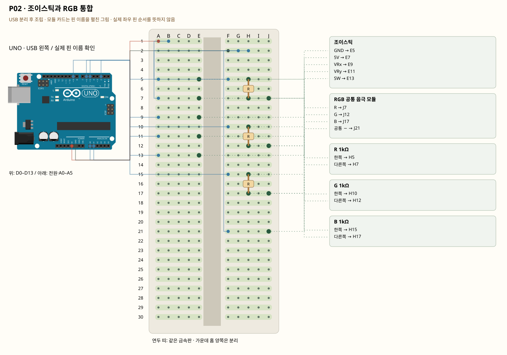

# P02 · 조이스틱과 RGB 통합

P01을 모두 해체한 뒤 만드는 교체 회로입니다. 암–수 10개 범위에 맞추기 위해 조이스틱과 RGB만 함께 연결합니다. 소리·수위는 K08·K07에서 따로 연결합니다. 연결하지 않은 센서의 떠 있는 값을 실제 측정처럼 전송하지 않습니다.

**조건:** RGB의 공통 −와 채널 이름을 확인한 조건입니다. 공통 +형은 H2–F21 GND 점퍼를 제거하고 빈 C1–F21 점퍼로 5V에 연결한 뒤 COMMON_ANODE=true로 변경합니다. 양쪽 점퍼를 동시에 꽂지 않습니다. 암–수 점퍼 9개와 1kΩ 저항 3개를 확인합니다.



[조건부 가지까지 포함한 전체 설계 그림](../diagrams/P02.svg). 흐린 점선은 오늘 연결하지 않습니다.

[부품 배치 그림](../diagrams/P02-01-placement.svg) · [신호선까지 연결](../diagrams/P02-02-signals.svg) · [전원 분배까지 전체 그림](../diagrams/P02-03-complete.svg)

모든 한 선의 중간 그림은 `index.html`에서 이 회로를 고르고 이전/다음으로 확인합니다. 그림의 조건부 연결은 오늘 통전 허가가 아닙니다.

## 준비물

조이스틱, RGB LED 모듈, 고정저항.

이 펼친 배선에 필요한 선은 **암–수 9개, 수–수 11개**입니다. SG90의 암 커넥터에는 수–수 선을 사용합니다. 외부전원 연결 부품은 이 계산과 별도이며 현재 없습니다. 키트의 암–수 10개 범위에 맞췄으며 수–수 실제 수량과 길이는 실물에서 확인합니다. 저항 종류별 실제 수량도 포장과 대조합니다. 부족하면 완료 표시하지 말고 해당 가지를 연결하기 전에 강사에게 알립니다.

라이브러리: 추가 설치 없음.

## 코드와 보드 핀 대응

| 코드 이름 | UNO 핀 |
|---|---|
| JOY_X | A0 |
| JOY_Y | A1 |
| JOY_SW | D2 |
| RED | D5 |
| GREEN | D6 |
| BLUE | D9 |

## 부품의 각 핀·구멍·전기 연결

| 부품 | 핀/다리 | 구멍 | 같은 금속판 | UNO 또는 저항 경유 연결 |
|---|---|---|---|---|
| 조이스틱 | GND | E5 | A5·B5·C5·D5·E5 | UNO GND |
| 조이스틱 | 5V | E7 | A7·B7·C7·D7·E7 | UNO 5V |
| 조이스틱 | VRx | E9 | A9·B9·C9·D9·E9 | UNO A0 |
| 조이스틱 | VRy | E11 | A11·B11·C11·D11·E11 | UNO A1 |
| 조이스틱 | SW | E13 | A13·B13·C13·D13·E13 | UNO D2 |
| RGB 공통 음극 모듈 | R | J7 | F7·G7·H7·I7·J7 | R 1kΩ 경유 UNO D5 |
| RGB 공통 음극 모듈 | G | J12 | F12·G12·H12·I12·J12 | G 1kΩ 경유 UNO D6 |
| RGB 공통 음극 모듈 | B | J17 | F17·G17·H17·I17·J17 | B 1kΩ 경유 UNO D9 |
| RGB 공통 음극 모듈 | 공통 − | J21 | F21·G21·H21·I21·J21 | UNO GND |
| R 1kΩ | 한쪽 | H5 | F5·G5·H5·I5·J5 | UNO D5 |
| R 1kΩ | 다른쪽 | H7 | F7·G7·H7·I7·J7 | 표의 부품 사이 연결·외부전원 경로 확인 |
| G 1kΩ | 한쪽 | H10 | F10·G10·H10·I10·J10 | UNO D6 |
| G 1kΩ | 다른쪽 | H12 | F12·G12·H12·I12·J12 | 표의 부품 사이 연결·외부전원 경로 확인 |
| B 1kΩ | 한쪽 | H15 | F15·G15·H15·I15·J15 | UNO D9 |
| B 1kΩ | 다른쪽 | H17 | F17·G17·H17·I17·J17 | 표의 부품 사이 연결·외부전원 경로 확인 |

## 한 선씩 연결

| 순서 | 출발 | 도착 | 역할 |
|---|---|---|---|
| 1 | UNO A0 | 빵판 A9 | VRx를 읽습니다. |
| 2 | UNO A1 | 빵판 A11 | VRy를 읽습니다. |
| 3 | UNO D2 | 빵판 A13 | 조이스틱 누름 입력입니다. |
| 4 | UNO D5 | 빵판 F5 | PWM R. 저항을 거칩니다. |
| 5 | UNO D6 | 빵판 F10 | PWM G. 저항을 거칩니다. |
| 6 | UNO D9 | 빵판 F15 | PWM B. 저항을 거칩니다. |
| 7 | UNO 5V | 빵판 A1 | UNO 전원을 분배 묶음에 한 선으로 연결합니다. USB는 아직 분리합니다. |
| 8 | 빵판 B1 | 빵판 A7 | 분배 묶음에서 이 부품의 전원 또는 기준 GND로 연결합니다. |
| 9 | UNO GND | 빵판 F2 | UNO 전원을 분배 묶음에 한 선으로 연결합니다. USB는 아직 분리합니다. |
| 10 | 빵판 G2 | 빵판 A5 | 분배 묶음에서 이 부품의 전원 또는 기준 GND로 연결합니다. |
| 11 | 빵판 H2 | 빵판 F21 | 분배 묶음에서 이 부품의 전원 또는 기준 GND로 연결합니다. |


## 오늘의 준비·연결 순서

1. 폴더 `my-kit`를 만들고 이 자료를 풉니다. `.md`는 설명, `.svg`는 확대 가능한 그림, `.ino`는 보드 프로그램입니다. `index.html`은 더블클릭해 오프라인으로 열 수 있습니다.
2. 화면과 부품 사진을 대조합니다. USB를 빼고, 이전 프로파일 부품·선을 모두 해체합니다. 다른 P/K 회로의 선을 남겨 합치지 않습니다.
3. 지정한 부품을 놓고 신호선을 하나씩 연결합니다. 그림의 모듈 핀은 펼친 표기입니다. 모듈을 그림처럼 빵판에 억지로 꽂지 말고 암–수 선으로 실제 핀 이름을 연결합니다. 부품 자체의 핀 간격·왼쪽 순서는 실물과 모델 핀표를 따릅니다.
4. 전원 분배 묶음과 GND를 연결합니다. 조건부 전원·신호는 보류합니다. A~E와 F~J의 같은 숫자 줄은 서로 다른 금속판입니다. 실제 전원 레일은 이 그림에서 쓰지 않습니다.
5. 핀표와 코드의 `pins.h`를 대조합니다. 저항 값·극성·전원 단락·비어 있어야 할 핀을 확인합니다. 멀티미터가 있으면 **모든 전원을 분리한 빈 빵판**에서 연결 묶음을 확인합니다. 전원 연결 상태에서 저항/연속성 모드를 쓰지 않습니다.
6. PC에 Arduino IDE를 열고 `firmware/Pxx/Pxx.ino`를 엽니다. 같은 폴더의 `pins.h`, `protocol.h`도 유지합니다. Arduino Uno와 실제 COM 포트를 선택하고 필요한 라이브러리를 설치합니다. 검증 → 업로드 후 시리얼 모니터를 **115200**, 줄 끝을 **새 줄**로 설정합니다. 기존 단품 K 예제는 **9600**입니다.
7. `1 STATUS`를 보내고 실제 숫자를 확인합니다. 그다음 이 프로파일의 출력 명령을 하나만 실행합니다. 시리얼 모니터와 PC 연결 프로그램은 같은 COM 포트를 동시에 열지 않습니다.
8. 사진·회로 ID·코드·예상/실제 결과를 저장합니다. 수업 끝에는 USB를 빼고, 목요일 전에도 다시 전원 분리 상태에서 전체 배선을 점검합니다. 다른 회로 실습을 했다면 목요일 사용할 P01로 복원합니다.

## 동작과 완료의 구별

컴파일 성공은 문법·라이브러리 조합 확인입니다. 업로드 성공은 보드 전송, 수신 JSON은 보드 프로그램 응답입니다. LED 실제 발광·모터 실제 각도는 별도 관찰입니다. 자동 자료 검사는 실물 정격·납땜·실제 핀 순서·전류·노이즈를 보증하지 않습니다.

## 실행과 확인

스케치: [firmware/P02/P02.ino](../firmware/P02/P02.ino). 다음 줄을 하나씩 보내며 실제 결과를 기록합니다.

```text
1 STATUS
2 RGB 30 0 0
3 RGB 0 30 0
4 RGB 0 0 30
5 STOP
```

조이스틱 X/Y와 누름은 손으로 움직였을 때 실제 값이 변해야 합니다. RGB 명령은 지정한 채널의 밝기를 바꿉니다. 소리·수위는 이 회로에 연결하지 않으므로 측정 필드도 보내지 않습니다.

## 오류 해결

1. 포트가 없으면 데이터 USB 케이블·보드 선택·실제 COM을 확인합니다. 다른 프로그램이 포트를 열고 있으면 닫습니다.
2. 센서가0/1023에 고정되면 VCC/GND/신호의 위치와 코드 핀부터 비교합니다. 입력 선을 뺀 상태의 흔들리는 값은 센서 측정이 아닙니다.
3. LCD가 안 되면 lcd_ready·A4/A5·VCC·GND·실물 I2C 백팩과 대비 조절을 확인합니다. 실패를 숨기고 가짜 값을 표시하지 않습니다.
4. 출력 응답은 왔지만 실물이 안 움직이면 전원을 분리하고 해당 핀·극성·저항·드라이버·전원 조건을 점검합니다. 현재 조건부 차단을 임의로 해제하지 않습니다.

## 학생 설명·변경 활동

먼저 강사가 한 선과 한 명령을 시연합니다. 함께 STATUS까지 확인한 뒤, 학생은 허용된 값 하나를 바꾸고 예상과 실제를 비교합니다. 필수는 실제 배선과 입력/출력 확인이며 추가 도전은 자동 판단 또는 PC 명령 기능입니다. 마지막에 사용한 핀 하나와 GND가 필요한 이유를 자기 말로 설명합니다.
