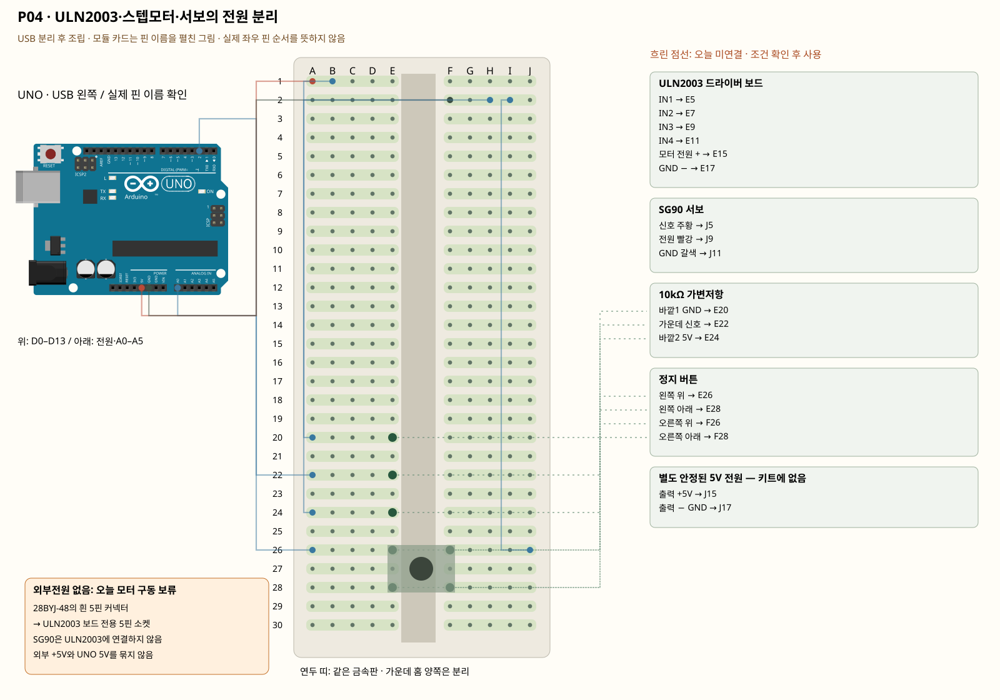

# P04 · ULN2003·스텝모터·서보의 전원 분리

스텝모터 흰색 5핀 커넥터는 ULN2003 전용 소켓에 꽂습니다. 모터 다섯 선을 빵판에 임의로 풀어 꽂지 않습니다. 외부전원 없는 현재는 핀과 전원 경로 설명, 컴파일, 구동 차단 응답 확인까지만 진행합니다.

**조건:** 학생 보유품은 고급키트뿐이며 별도 5V 전원은 없습니다. 그림의 외부전원과 연결선은 향후 조건부 설계입니다. 오늘 J15/J17에는 실제 전원을 연결하지 않고, 모터·서보 전원선도 보류합니다. MOTOR_POWER_CONFIRMED=false를 유지합니다. 9V 클립은 5V 전원·변환기가 아니며 드라이버/서보에 연결하지 않습니다. 28BYJ-48의 5V 표시와 ULN2003 보드 단자 표시·점퍼 기능을 실물에서 확인해야 합니다.



[조건부 가지까지 포함한 전체 설계 그림](../diagrams/P04.svg). 흐린 점선은 오늘 연결하지 않습니다.

[부품 배치 그림](../diagrams/P04-01-placement.svg) · [신호선까지 연결](../diagrams/P04-02-signals.svg) · [전원 분배까지 전체 그림](../diagrams/P04-03-complete.svg)

모든 한 선의 중간 그림은 `index.html`에서 이 회로를 고르고 이전/다음으로 확인합니다. 그림의 조건부 연결은 오늘 통전 허가가 아닙니다.

## 준비물

ULN2003 모터 드라이버, 28BYJ-48 스텝모터, SG90 서보모터, 10kΩ 가변저항, 택트 스위치와 캡.

이 펼친 배선에 필요한 선은 **암–수 6개, 수–수 20개**입니다. SG90의 암 커넥터에는 수–수 선을 사용합니다. 외부전원 연결 부품은 이 계산과 별도이며 현재 없습니다. 키트의 암–수 10개 범위에 맞췄으며 수–수 실제 수량과 길이는 실물에서 확인합니다. 저항 종류별 실제 수량도 포장과 대조합니다. 부족하면 완료 표시하지 말고 해당 가지를 연결하기 전에 강사에게 알립니다.

라이브러리: Servo 1.3.0.

## 코드와 보드 핀 대응

| 코드 이름 | UNO 핀 |
|---|---|
| IN1 | D8 |
| IN2 | D9 |
| IN3 | D10 |
| IN4 | D11 |
| SERVO | D6 |
| POT | A0 |
| BUTTON | D2 |

## 부품의 각 핀·구멍·전기 연결

| 부품 | 핀/다리 | 구멍 | 같은 금속판 | UNO 또는 저항 경유 연결 |
|---|---|---|---|---|
| ULN2003 드라이버 보드 | IN1 | E5 | A5·B5·C5·D5·E5 | 【오늘 미연결】 UNO D8 |
| ULN2003 드라이버 보드 | IN2 | E7 | A7·B7·C7·D7·E7 | 【오늘 미연결】 UNO D9 |
| ULN2003 드라이버 보드 | IN3 | E9 | A9·B9·C9·D9·E9 | 【오늘 미연결】 UNO D10 |
| ULN2003 드라이버 보드 | IN4 | E11 | A11·B11·C11·D11·E11 | 【오늘 미연결】 UNO D11 |
| ULN2003 드라이버 보드 | 모터 전원 + | E15 | A15·B15·C15·D15·E15 | 【오늘 미연결】 표의 부품 사이 연결·외부전원 경로 확인 |
| ULN2003 드라이버 보드 | GND − | E17 | A17·B17·C17·D17·E17 | 【오늘 미연결】 UNO GND |
| SG90 서보 | 신호 주황 | J5 | F5·G5·H5·I5·J5 | 【오늘 미연결】 UNO D6 |
| SG90 서보 | 전원 빨강 | J9 | F9·G9·H9·I9·J9 | 【오늘 미연결】 표의 부품 사이 연결·외부전원 경로 확인 |
| SG90 서보 | GND 갈색 | J11 | F11·G11·H11·I11·J11 | 【오늘 미연결】 UNO GND |
| 10kΩ 가변저항 | 바깥1 GND | E20 | A20·B20·C20·D20·E20 | UNO GND |
| 10kΩ 가변저항 | 가운데 신호 | E22 | A22·B22·C22·D22·E22 | UNO A0 |
| 10kΩ 가변저항 | 바깥2 5V | E24 | A24·B24·C24·D24·E24 | UNO 5V |
| 정지 버튼 | 왼쪽 위 | E26 | A26·B26·C26·D26·E26 | UNO D2 |
| 정지 버튼 | 왼쪽 아래 | E28 | A28·B28·C28·D28·E28 | UNO D2 |
| 정지 버튼 | 오른쪽 위 | F26 | F26·G26·H26·I26·J26 | UNO GND |
| 정지 버튼 | 오른쪽 아래 | F28 | F28·G28·H28·I28·J28 | UNO GND |
| 별도 안정된 5V 전원 — 키트에 없음 | 출력 +5V | J15 | F15·G15·H15·I15·J15 | 【오늘 미연결】 표의 부품 사이 연결·외부전원 경로 확인 |
| 별도 안정된 5V 전원 — 키트에 없음 | 출력 − GND | J17 | F17·G17·H17·I17·J17 | 【오늘 미연결】 UNO GND |

## 한 선씩 연결

| 순서 | 출발 | 도착 | 역할 |
|---|---|---|---|
| 1 | UNO D8 | 빵판 A5 | 조건부 설계의 연결 위치입니다. 현재는 이 선/핀을 꽂지 않습니다. 제어: UNO D8 → ULN2003 IN1. |
| 2 | UNO D9 | 빵판 A7 | 조건부 설계의 연결 위치입니다. 현재는 이 선/핀을 꽂지 않습니다. 제어: UNO D9 → ULN2003 IN2. |
| 3 | UNO D10 | 빵판 A9 | 조건부 설계의 연결 위치입니다. 현재는 이 선/핀을 꽂지 않습니다. 제어: UNO D10 → ULN2003 IN3. |
| 4 | UNO D11 | 빵판 A11 | 조건부 설계의 연결 위치입니다. 현재는 이 선/핀을 꽂지 않습니다. 제어: UNO D11 → ULN2003 IN4. |
| 5 | UNO D6 | 빵판 F5 | 조건부 설계의 연결 위치입니다. 현재는 이 선/핀을 꽂지 않습니다. 서보 목표 신호입니다. ULN2003을 거치지 않습니다. |
| 6 | UNO A0 | 빵판 A22 | 가변저항 입력입니다. |
| 7 | UNO D2 | 빵판 A26 | INPUT_PULLUP 정지 버튼입니다. |
| 8 | 빵판 B15 | 빵판 F15 | 조건부 설계의 연결 위치입니다. 현재는 이 선/핀을 꽂지 않습니다. 조건부 외부 +5V: 드라이버 전원 +와 외부전원 +를 잇습니다. |
| 9 | 빵판 C15 | 빵판 F9 | 조건부 설계의 연결 위치입니다. 현재는 이 선/핀을 꽂지 않습니다. 조건부 외부 +5V: 서보 빨강 선으로 분기합니다. UNO 5V와 묶지 않습니다. |
| 10 | 빵판 B17 | 빵판 F17 | 조건부 설계의 연결 위치입니다. 현재는 이 선/핀을 꽂지 않습니다. 외부전원 −와 드라이버 GND를 잇습니다. |
| 11 | 빵판 C17 | 빵판 F11 | 조건부 설계의 연결 위치입니다. 현재는 이 선/핀을 꽂지 않습니다. 서보 갈색 GND는 외부전원 −로 갑니다. |
| 12 | UNO 5V | 빵판 A1 | UNO 전원을 분배 묶음에 한 선으로 연결합니다. USB는 아직 분리합니다. |
| 13 | 빵판 B1 | 빵판 A24 | 분배 묶음에서 이 부품의 전원 또는 기준 GND로 연결합니다. |
| 14 | UNO GND | 빵판 F2 | UNO 전원을 분배 묶음에 한 선으로 연결합니다. USB는 아직 분리합니다. |
| 15 | 빵판 G2 | 빵판 A17 | 조건부 설계의 연결 위치입니다. 현재는 이 선/핀을 꽂지 않습니다. 분배 묶음에서 이 부품의 전원 또는 기준 GND로 연결합니다. |
| 16 | 빵판 H2 | 빵판 A20 | 분배 묶음에서 이 부품의 전원 또는 기준 GND로 연결합니다. |
| 17 | 빵판 I2 | 빵판 J26 | 분배 묶음에서 이 부품의 전원 또는 기준 GND로 연결합니다. |


## 오늘의 준비·연결 순서

1. 폴더 `my-kit`를 만들고 이 자료를 풉니다. `.md`는 설명, `.svg`는 확대 가능한 그림, `.ino`는 보드 프로그램입니다. `index.html`은 더블클릭해 오프라인으로 열 수 있습니다.
2. 화면과 부품 사진을 대조합니다. USB를 빼고, 이전 프로파일 부품·선을 모두 해체합니다. 다른 P/K 회로의 선을 남겨 합치지 않습니다.
3. 지정한 부품을 놓고 신호선을 하나씩 연결합니다. 그림의 모듈 핀은 펼친 표기입니다. 모듈을 그림처럼 빵판에 억지로 꽂지 말고 암–수 선으로 실제 핀 이름을 연결합니다. 부품 자체의 핀 간격·왼쪽 순서는 실물과 모델 핀표를 따릅니다.
4. 전원 분배 묶음과 GND를 연결합니다. 조건부 전원·신호는 보류합니다. A~E와 F~J의 같은 숫자 줄은 서로 다른 금속판입니다. 실제 전원 레일은 이 그림에서 쓰지 않습니다.
5. 핀표와 코드의 `pins.h`를 대조합니다. 저항 값·극성·전원 단락·비어 있어야 할 핀을 확인합니다. 멀티미터가 있으면 **모든 전원을 분리한 빈 빵판**에서 연결 묶음을 확인합니다. 전원 연결 상태에서 저항/연속성 모드를 쓰지 않습니다.
6. PC에 Arduino IDE를 열고 `firmware/Pxx/Pxx.ino`를 엽니다. 같은 폴더의 `pins.h`, `protocol.h`도 유지합니다. Arduino Uno와 실제 COM 포트를 선택하고 필요한 라이브러리를 설치합니다. 검증 → 업로드 후 시리얼 모니터를 **115200**, 줄 끝을 **새 줄**로 설정합니다. 기존 단품 K 예제는 **9600**입니다.
7. `1 STATUS`를 보내고 실제 숫자를 확인합니다. 그다음 이 프로파일의 출력 명령을 하나만 실행합니다. 시리얼 모니터와 PC 연결 프로그램은 같은 COM 포트를 동시에 열지 않습니다.
8. 사진·회로 ID·코드·예상/실제 결과를 저장합니다. 수업 끝에는 USB를 빼고, 목요일 전에도 다시 전원 분리 상태에서 전체 배선을 점검합니다. 다른 회로 실습을 했다면 목요일 사용할 P01로 복원합니다.

## 동작과 완료의 구별

컴파일 성공은 문법·라이브러리 조합 확인입니다. 업로드 성공은 보드 전송, 수신 JSON은 보드 프로그램 응답입니다. LED 실제 발광·모터 실제 각도는 별도 관찰입니다. 자동 자료 검사는 실물 정격·납땜·실제 핀 순서·전류·노이즈를 보증하지 않습니다.

## 실행과 확인

스케치: [firmware/P04/P04.ino](../firmware/P04/P04.ino). 다음 줄을 하나씩 보내며 실제 결과를 기록합니다.

```text
1 STATUS
2 ARM 1
3 STOP
```

현재 기본 설정에서는 motor_power_confirmed=false, armed=false입니다. ARM 1은 power_or_stop 오류여야 합니다. 오늘은 모터가 돌지 않는 것이 정상입니다. 외부전원을 추후 확인한 조건에서만 MOTOR_POWER_CONFIRMED=true로 컴파일합니다. ARM 후 기본 목표90도, SERVO는30~150도, STEP은-128~128 반스텝 요청입니다. 이는 실제 각도 측정이 아닙니다. PING을1초 이내 간격으로 보내야 하며 유효 명령이2초간 없거나 정지 버튼을 누르면 코일 해제·서보 신호 중단입니다. STOP은 전원 차단이 아니며 서보 하중을 잡아주지 않습니다.

## 오류 해결

1. 포트가 없으면 데이터 USB 케이블·보드 선택·실제 COM을 확인합니다. 다른 프로그램이 포트를 열고 있으면 닫습니다.
2. 센서가0/1023에 고정되면 VCC/GND/신호의 위치와 코드 핀부터 비교합니다. 입력 선을 뺀 상태의 흔들리는 값은 센서 측정이 아닙니다.
3. LCD가 안 되면 lcd_ready·A4/A5·VCC·GND·실물 I2C 백팩과 대비 조절을 확인합니다. 실패를 숨기고 가짜 값을 표시하지 않습니다.
4. 출력 응답은 왔지만 실물이 안 움직이면 전원을 분리하고 해당 핀·극성·저항·드라이버·전원 조건을 점검합니다. 현재 조건부 차단을 임의로 해제하지 않습니다.

## 학생 설명·변경 활동

먼저 강사가 한 선과 한 명령을 시연합니다. 함께 STATUS까지 확인한 뒤, 학생은 허용된 값 하나를 바꾸고 예상과 실제를 비교합니다. 필수는 실제 배선과 입력/출력 확인이며 추가 도전은 자동 판단 또는 PC 명령 기능입니다. 마지막에 사용한 핀 하나와 GND가 필요한 이유를 자기 말로 설명합니다.
