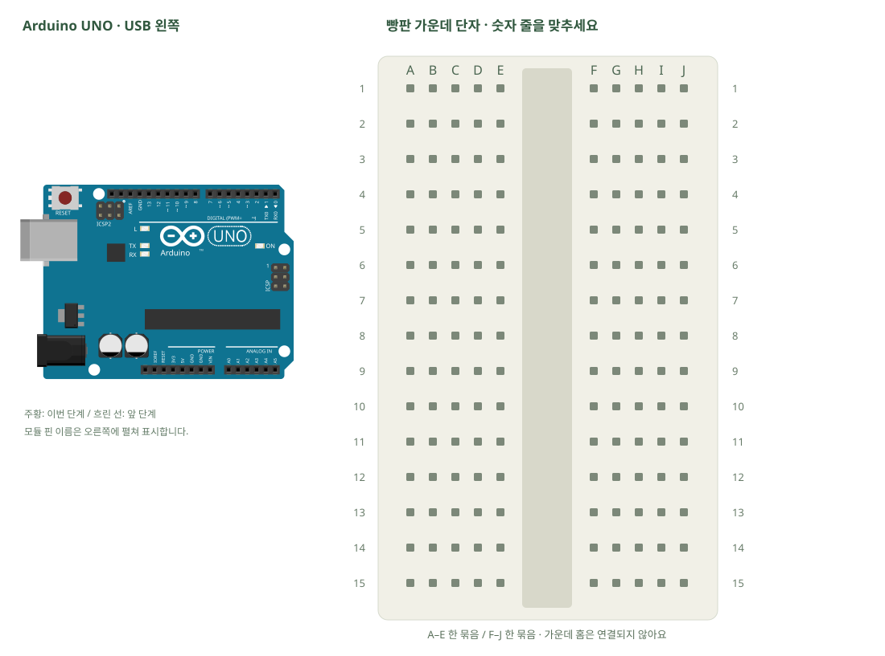

# 처음 연결 · 설치와 업로드

[실물 사진과 한 단계씩 바뀌는 배선도 열기](../kit/guide/index.html?lab=K00#workbench)



그림을 확대하고 한 선씩 보려면 위 실습실을 여세요. 부품별 추가 준비 조건은 아래에서 먼저 확인합니다.

## 무엇을 하는 부품인가요?

스케치는 UNO에 넣는 프로그램이고 .ino가 파일 확장자입니다. 업로드는 PC의 코드를 보드로 보내는 과정입니다. 컴파일은 실행할 수 있는 형태로 바꾸면서 문법을 검사하는 과정입니다.

## 준비와 방향

필요 부품: UNO 호환보드, USB A–B 케이블. 실물 사진은 위 실습 화면에서 각각 확대할 수 있습니다.

아직 빵판을 연결하지 않습니다. Arduino 공식 사이트 → Software → Arduino IDE 2 설치 → 보드 USB 연결 → 보드 선택에서 Arduino Uno → 연결된 COM 포트 선택 → 새 스케치 → 코드 붙여넣기 → 저장(K00/K00.ino) → ✓ 검증 → → 업로드 → 시리얼 모니터 9600 순서입니다. UNO R4나 XIAO를 선택하지 않습니다.

USB를 먼저 뽑습니다. 같은 숫자의 A~E, F~J는 각각 하나의 연결 묶음이고 가운데 홈을 사이에 둔 두 묶음은 떨어져 있습니다.

## 부품을 놓으세요

외부 부품은 연결하지 않습니다. 보드 USB부터 확인합니다.

## 왜 이 위치에 연결하나요?

- 글자·숫자는 위치 주소입니다. 지정 구멍을 고른 이유는 연결할 부품 다리와 같은 금속판을 쓰거나, 서로 떨어진 묶음을 부품으로 잇기 위해서입니다.
- 빈 대체 구멍은 같은 다섯 구멍 묶음에서 고릅니다. 한 부품의 위치를 다른 줄로 옮기면 그 다리와 연결된 선도 함께 옮겨야 합니다. 선 색이나 화면상의 선 교차만으로 전기 연결이 생기지는 않습니다.

[구멍 안의 연결 구조·전류 경로·틀린 배선을 그림으로 비교하기](../kit/guide/index.html?lab=K00#breadboard-basics)


## 선을 한 개씩 연결하세요

| 순서 | 출발 | 도착 | 연결 이유 |
|---:|---|---|---|


그림과 표는 같은 연결 데이터로 생성합니다. 선 색이 달라도 양 끝 이름이 같으면 같은 연결입니다. 한 단계를 완료한 뒤 다음으로 이동하고, 마지막에는 전체 연결표로 빠진 선을 확인합니다.

## 저장과 실행

Arduino IDE에서 새 스케치를 만들고 아래 코드를 붙여넣습니다. 파일은 `K00/K00.ino`로 저장합니다. 보드는 Arduino Uno, 포트는 실제 연결된 COM, 시리얼 모니터는 9600으로 맞춥니다. 검증 버튼은 코드의 문법을 검사하고, 업로드 버튼은 연결된 보드로 프로그램을 보냅니다.

이 예제는 추가 라이브러리 설치가 필요하지 않습니다.

```cpp
// 처음 연결 · 설치와 업로드
// 보드: Arduino Uno / 시리얼 모니터: 9600 baud
// USB를 뽑고 배선한 뒤, 아래 연결표와 코드의 핀 번호를 대조하세요.

void setup() {
  pinMode(LED_BUILTIN, OUTPUT); // 보드 위 L 표시 LED를 출력으로 사용합니다.
  Serial.begin(9600); // 도구 → 시리얼 모니터도 같은 속도로 맞춥니다.
}
void loop() {
  digitalWrite(LED_BUILTIN, HIGH); // 보드 안 LED를 켭니다. 외부 배선은 없습니다.
  Serial.println("UNO ready");
  delay(500); // 밀리초: 1000이 1초입니다.
  digitalWrite(LED_BUILTIN, LOW);
  delay(500);
}

```

## 예상 결과와 직접 바꾸기

보드의 L LED가 0.5초씩 켜지고 꺼집니다. 시리얼 창에 UNO ready가 반복됩니다.

delay 두 곳을 200으로 바꾸고 다시 업로드합니다.

바꾸기 전 예상과 바꾼 뒤 실제 결과를 나눠 적습니다. 실행하지 못했다면 이유와 다음 확인 항목을 적습니다. 예시 출력은 내 보드의 실제 측정 기록이 아니므로 자신의 값·사진으로 남깁니다.

## 잘 안될 때

포트가 없다면 데이터 케이블·다른 USB 포트부터 확인합니다. 업로드 중 포트를 쓰는 다른 프로그램을 닫습니다.

코드에 적힌 핀과 연결표부터 비교합니다. 회로를 고칠 때는 USB와 외부 전원을 모두 분리합니다. 프로그램의 컴파일 성공과 실제 부품의 동작은 별도로 확인합니다. 고친 선·코드·결과를 함께 기록하면 다음에 같은 문제를 찾아낼 수 있습니다.
