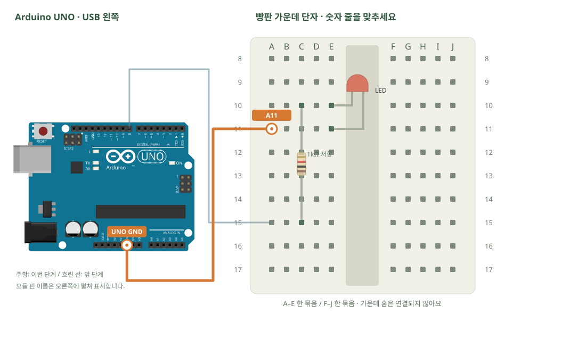

# 빵판 읽기 · 저항과 LED

[실물 사진과 한 단계씩 바뀌는 배선도 열기](../kit/guide/index.html?lab=K01#workbench)



그림을 확대하고 한 선씩 보려면 위 실습실을 여세요. 부품별 추가 준비 조건은 아래에서 먼저 확인합니다.

## 무엇을 하는 부품인가요?

빵판은 구멍 안의 금속으로 부품을 연결합니다. 같은 숫자의 A~E는 한 묶음, F~J는 다른 한 묶음입니다. 옆 숫자 줄끼리는 이어지지 않습니다. 전압은 두 점 사이의 차이, 전류는 회로를 따라 흐르는 양, 저항은 그 흐름을 제한하는 부품입니다. 5V → LED → GND 경로에는 반드시 저항을 둡니다.

## 준비와 방향

필요 부품: 브레드보드 · 빵판, 양쪽 수 핀 점퍼선, 빨강·노랑·초록 LED, 고정저항. 실물 사진은 위 실습 화면에서 각각 확대할 수 있습니다.

USB는 왼쪽. 빵판 숫자가 작은 쪽을 위로 맞춥니다. 저항 C10–C15, LED 긴 다리 E10·짧은 다리 E11입니다. 그림은 빵판 가운데 단자 부분이며 긴 전원 레일은 사용하지 않습니다. 1kΩ은 갈색-검정-빨강(4띠) 또는 갈색-검정-검정-갈색-갈색(5띠)입니다. 판매처 사진은 외형이므로 실제 값은 색띠로 확인합니다.

USB를 먼저 뽑습니다. 같은 숫자의 A~E, F~J는 각각 하나의 연결 묶음이고 가운데 홈을 사이에 둔 두 묶음은 떨어져 있습니다.

## 부품을 놓으세요

1. **1kΩ 저항**: 한쪽 → C15, 다른쪽 → C10
2. **LED**: 긴 다리 + → E10, 짧은 다리 − → E11

## 왜 이 위치에 연결하나요?

- D8 → A15·C15 금속판 → 저항 → C10·E10 금속판 → LED → E11·A11 금속판 → GND가 켜질 때의 전류 경로입니다.
- A15는 C15의 저항 다리와 연결하려고 골랐습니다. 빈 B15·D15·E15로 바꿔도 같은 회로입니다. A16으로 바꾸면 다른 묶음이 되어 끊깁니다.
- C10과 E10은 이미 이어져 있어 별도 점퍼선이 필요 없습니다. E10과 E11은 떨어져 있어 LED의 두 다리를 서로 다른 지점에 놓을 수 있습니다.

[구멍 안의 연결 구조·전류 경로·틀린 배선을 그림으로 비교하기](../kit/guide/index.html?lab=K01#breadboard-basics)

## 빵판의 연결 원리

## 구멍보다 구멍 안의 금속판을 보세요

브레드보드(빵판)는 납땜하지 않고 회로를 조립하는 판입니다. 플라스틱 구멍 아래의 금속 접점이 부품 다리를 잡고 전기를 연결합니다. 구멍에 꽂았다는 사실만으로 모든 부품이 이어지는 것은 아닙니다.

가운데 단자 부분에서 **A10·B10·C10·D10·E10은 한 금속판**입니다. **F10·G10·H10·I10·J10은 다른 금속판**입니다. A10과 A11은 다른 줄, E10과 F10은 가운데 홈 건너편이므로 안에서 이어져 있지 않습니다. 글자·숫자는 위치를 찾는 주소이며 특별한 전기 기능을 갖지는 않습니다. 판을 돌려 놓아도 내부 금속판의 연결 구조 자체가 바뀌는 것은 아닙니다.

## 왜 A15에 꽂나요? 다른 구멍은 안 되나요?

첫 LED 회로의 저항 한쪽이 C15에 있어서 같은 묶음의 A15에 출력선을 꽂습니다. 다른 부품이 차지하지 않은 B15·D15·E15도 같은 연결을 만들 수 있습니다. A16은 다른 금속판이므로 같은 대체 위치가 아닙니다. 구멍 하나의 숫자를 외우기보다 **어떤 부품 다리와 같은 금속판이어야 하는지**를 확인하세요. 이처럼 전선으로 이어져 같은 전기 연결을 이루는 지점을 노드라고 합니다.

## LED가 켜지는 전체 길

8번 출력 HIGH → A15와 C15의 금속판 → 저항 → C10과 E10의 금속판 → LED 긴 다리 → LED → 짧은 다리 E11과 A11의 금속판 → GND.

전류 방향은 관습적으로 높은 전위에서 낮은 전위 쪽으로 설명합니다. 출력이 HIGH일 때 위 길에 전압 차이가 생깁니다. GND는 이 회로의 0V 기준이며 언제나 건물 접지와 같은 뜻은 아닙니다. 선 한 곳이 끊어져 닫힌 길이 없으면 LED가 켜지지 않습니다. 빵판 자체는 전기를 만들지 않습니다.

## 저항은 왜 다른 줄을 잇나요?

저항의 두 끝 C15와 C10은 서로 다른 금속판입니다. 두 묶음을 저항을 거쳐 연결해야 전류가 제한됩니다. 양끝을 C10과 E10에 놓으면 같은 금속판이 저항 양끝을 바로 이어 저항을 우회합니다. LED 회로에서 저항을 우회하면 과전류로 LED나 출력 핀을 손상시킬 수 있습니다. 저항은 방향이 없고, LED는 극성이 있습니다. 이 예제의 1kΩ은 5V와 빨강 LED의 약2V 차이에 대해 대략3mA가 흐르는 시작값입니다. 실제 LED 전압과 밝기는 제품에 따라 다릅니다.

## 헷갈리는 세 가지 실패

1. **단선:** GND 선을 빼면 돌아가는 길이 끊깁니다. 예제 LED는 켜지지 않습니다.
2. **저항 우회:** 저항 양끝이 같은 연결 묶음이면 금속판이 저항을 건너뜁니다. 저항을 달았다는 모양만으로 전류가 제한되지 않습니다.
3. **전원 단락:** 5V와 GND를 부품 없이 같은 금속판에 연결하면 큰 전류가 흐를 수 있습니다. 이것은 실제 전원으로 시험하지 않습니다. USB와 외부 전원을 분리한 상태에서 배선을 고칩니다.

## 전원 레일과 가운데 홈

큰 빵판 가장자리의 긴 줄은 전원을 여러 곳에 나누기 위한 전원 레일입니다. +·−와 빨강·파랑 선은 사람이 구분하기 위한 표시입니다. + 표시에 선을 꽂아도 전원과 연결하지 않았다면5V가 되지 않습니다. 좌우 레일이나 중간이 끊긴 레일이 자동으로 이어진다고 가정하지 않습니다. 현재 키트 그림은 혼동을 줄이기 위해 가운데 단자만 사용합니다.

가운데 홈은 좌우 금속판을 떨어뜨립니다. 74HC595 같은 칩을 홈에 걸쳐 놓아 양쪽 다리가 서로 바로 연결되지 않게 합니다. 홈을 사이에 두고 같은 숫자 줄을 잇고 싶다면 별도 점퍼선이 필요합니다.

## 센서의 신호와 전원, 모터의 공통 GND

전원선은 부품이 동작할 에너지를 공급하고 신호선은 상태나 명령을 주고받습니다. 센서의 VCC·GND만 연결해도 A0로 가는 측정선이 빠지면 측정값을 제대로 읽을 수 없습니다. A0 측정선은 센서 전원 공급을 대신하지 않습니다.

서보는 외부5V 전원의 +와 −로 모터 전류가 흐릅니다. UNO의 D9는 회전 명령 신호만 보냅니다. 외부 전원의 −와 UNO GND를 연결하는 이유는 신호 HIGH/LOW를 같은 기준으로 읽기 위해서입니다. 외부+5V와 USB로 켜진 UNO5V를 임의로 묶는다는 뜻이 아닙니다.

## 전원이 없는 상태에서 확인하기

멀티미터가 있다면 USB·외부 전원을 모두 빼고 연속성 모드에서 A10–E10, A10–A11, E10–F10을 비교합니다. 첫 쌍은 연결, 나머지는 분리되어야 합니다. 이미 부품이나 점퍼선이 꽂혀 있으면 우회 경로가 생기므로 빈 빵판부터 확인합니다. 멀티미터가 없는 경우 화면의 연결 모형으로 먼저 구분하고 실물의 글자·숫자·홈과 대조합니다.

공식 참고: [Adafruit Breadboards](https://learn.adafruit.com/breadboards-for-beginners/breadboards), [Breadboard Usage](https://learn.adafruit.com/breadboards-for-beginners/breadboard-usage).


## 선을 한 개씩 연결하세요

| 순서 | 출발 | 도착 | 연결 이유 |
|---:|---|---|---|
| 1 | UNO D8 | A15 | UNO D8 핀은 코드에서 정한 디지털 입출력·통신 핀입니다. 빵판 줄 번호가 아니라 UNO 핀 번호와 코드가 일치해야 합니다. 보드 쪽 연결점은 UNO D8입니다. A15 위치는 A15·B15·C15·D15·E15와 같은 금속판입니다. C15에 놓인 1kΩ 저항의 한쪽 지점과 이어집니다. A15와 C15는 같은 묶음입니다. 출력이 저항으로 들어갑니다. |
| 2 | UNO GND | A11 | GND는 보드의 0V 기준입니다. 부품과 보드의 기준을 맞추고 이 회로에 필요한 전류의 돌아가는 길을 연결합니다. 보드 쪽 연결점은 UNO GND입니다. A11 위치는 A11·B11·C11·D11·E11와 같은 금속판입니다. E11에 놓인 LED의 짧은 다리 − 지점과 이어집니다. A11과 E11이 이어져 LED의 짧은 다리가 GND로 돌아갑니다. |

그림과 표는 같은 연결 데이터로 생성합니다. 선 색이 달라도 양 끝 이름이 같으면 같은 연결입니다. 한 단계를 완료한 뒤 다음으로 이동하고, 마지막에는 전체 연결표로 빠진 선을 확인합니다.

## 저장과 실행

Arduino IDE에서 새 스케치를 만들고 아래 코드를 붙여넣습니다. 파일은 `K01/K01.ino`로 저장합니다. 보드는 Arduino Uno, 포트는 실제 연결된 COM, 시리얼 모니터는 9600으로 맞춥니다. 검증 버튼은 코드의 문법을 검사하고, 업로드 버튼은 연결된 보드로 프로그램을 보냅니다.

이 예제는 추가 라이브러리 설치가 필요하지 않습니다.

```cpp
// 빵판 읽기 · 저항과 LED
// 보드: Arduino Uno / 시리얼 모니터: 9600 baud
// USB를 뽑고 배선한 뒤, 아래 연결표와 코드의 핀 번호를 대조하세요.

const int LED_PIN = 8; // UNO에서 8이라고 적힌 소켓입니다.
void setup() {
  pinMode(LED_PIN, OUTPUT); // 전압을 내보내는 역할로 정합니다.
}
void loop() {
  digitalWrite(LED_PIN, HIGH); // 8번에 HIGH를 내보내 LED를 켭니다.
  delay(1000); // 켜진 상태를 1초 유지합니다.
  digitalWrite(LED_PIN, LOW); // 8번을 LOW로 바꿔 LED를 끕니다.
  delay(1000);
}

```

## 예상 결과와 직접 바꾸기

외부 LED가 1초씩 켜졌다 꺼집니다.

켜진 시간은 200ms, 꺼진 시간은 800ms로 바꿉니다.

바꾸기 전 예상과 바꾼 뒤 실제 결과를 나눠 적습니다. 실행하지 못했다면 이유와 다음 확인 항목을 적습니다. 예시 출력은 내 보드의 실제 측정 기록이 아니므로 자신의 값·사진으로 남깁니다.

## 잘 안될 때

안 켜지면 LED 극성 → 저항 값 → C10/E10 같은 줄 → GND 순으로 확인합니다. 저항을 제거해 고치지 않습니다.

코드에 적힌 핀과 연결표부터 비교합니다. 회로를 고칠 때는 USB와 외부 전원을 모두 분리합니다. 프로그램의 컴파일 성공과 실제 부품의 동작은 별도로 확인합니다. 고친 선·코드·결과를 함께 기록하면 다음에 같은 문제를 찾아낼 수 있습니다.
