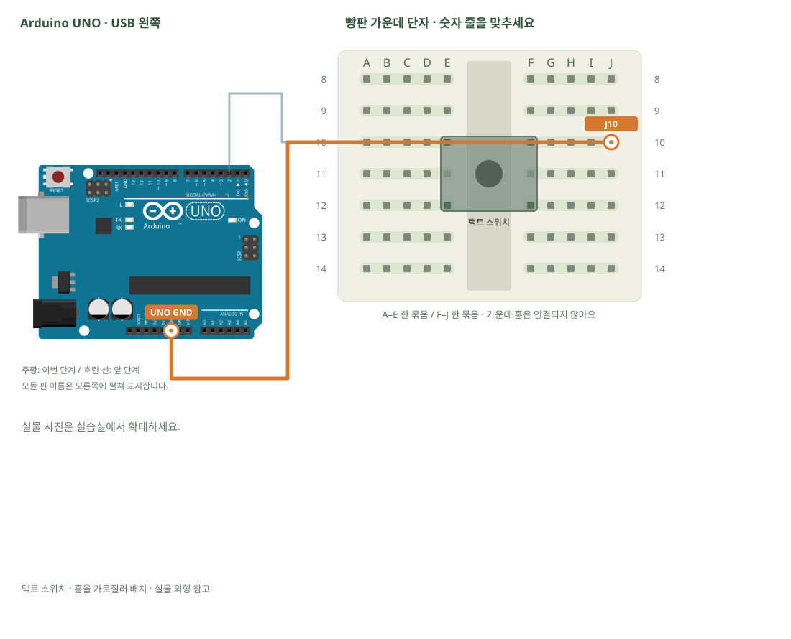

# 택트 스위치 · 누르면 값 바꾸기

[실물 사진과 한 단계씩 바뀌는 배선도 열기](../kit/guide/index.html?lab=K02#workbench)



그림을 확대하고 한 선씩 보려면 위 실습실을 여세요. 부품별 추가 준비 조건은 아래에서 먼저 확인합니다.

## 무엇을 하는 부품인가요?

입력은 사람이 누른 상태를 컴퓨터가 읽는 것입니다. INPUT_PULLUP은 내부 저항으로 기본값을 HIGH로 유지합니다. 버튼을 누르면 GND와 연결되어 LOW가 됩니다. 떠 있는 입력을 읽으면 손을 대지 않아도 값이 흔들릴 수 있습니다.

## 준비와 방향

필요 부품: 택트 스위치와 캡, 브레드보드 · 빵판. 실물 사진은 위 실습 화면에서 각각 확대할 수 있습니다.

버튼 네 다리가 가운데 홈을 가로지르도록 E10·E12와 F10·F12에 놓습니다. 이 그림은 같은 쪽 세로 두 다리가 원래 연결되고, 누르면 좌우가 이어지는 버튼 기준입니다. 다른 형태는 전원이 없는 상태에서 연속성 측정으로 같은 다리를 먼저 확인합니다.

USB를 먼저 뽑습니다. 같은 숫자의 A~E, F~J는 각각 하나의 연결 묶음이고 가운데 홈을 사이에 둔 두 묶음은 떨어져 있습니다.

## 부품을 놓으세요

1. **택트 스위치 · 홈을 가로질러 배치**: 왼쪽 위 → E10, 왼쪽 아래 → E12, 오른쪽 위 → F10, 오른쪽 아래 → F12

## 왜 이 위치에 연결하나요?

- 글자·숫자는 위치 주소입니다. 지정 구멍을 고른 이유는 연결할 부품 다리와 같은 금속판을 쓰거나, 서로 떨어진 묶음을 부품으로 잇기 위해서입니다.
- 빈 대체 구멍은 같은 다섯 구멍 묶음에서 고릅니다. 한 부품의 위치를 다른 줄로 옮기면 그 다리와 연결된 선도 함께 옮겨야 합니다. 선 색이나 화면상의 선 교차만으로 전기 연결이 생기지는 않습니다.

[구멍 안의 연결 구조·전류 경로·틀린 배선을 그림으로 비교하기](../kit/guide/index.html?lab=K02#breadboard-basics)


## 선을 한 개씩 연결하세요

| 순서 | 출발 | 도착 | 연결 이유 |
|---:|---|---|---|
| 1 | UNO D2 | A10 | UNO D2 핀은 코드에서 정한 디지털 입출력·통신 핀입니다. 빵판 줄 번호가 아니라 UNO 핀 번호와 코드가 일치해야 합니다. 보드 쪽 연결점은 UNO D2입니다. A10 위치는 A10·B10·C10·D10·E10와 같은 금속판입니다. E10에 놓인 택트 스위치 · 홈을 가로질러 배치의 왼쪽 위 지점과 이어집니다. |
| 2 | UNO GND | J10 | GND는 보드의 0V 기준입니다. 부품과 보드의 기준을 맞추고 이 회로에 필요한 전류의 돌아가는 길을 연결합니다. 보드 쪽 연결점은 UNO GND입니다. J10 위치는 F10·G10·H10·I10·J10와 같은 금속판입니다. F10에 놓인 택트 스위치 · 홈을 가로질러 배치의 오른쪽 위 지점과 이어집니다. |

그림과 표는 같은 연결 데이터로 생성합니다. 선 색이 달라도 양 끝 이름이 같으면 같은 연결입니다. 한 단계를 완료한 뒤 다음으로 이동하고, 마지막에는 전체 연결표로 빠진 선을 확인합니다.

## 저장과 실행

Arduino IDE에서 새 스케치를 만들고 아래 코드를 붙여넣습니다. 파일은 `K02/K02.ino`로 저장합니다. 보드는 Arduino Uno, 포트는 실제 연결된 COM, 시리얼 모니터는 9600으로 맞춥니다. 검증 버튼은 코드의 문법을 검사하고, 업로드 버튼은 연결된 보드로 프로그램을 보냅니다.

이 예제는 추가 라이브러리 설치가 필요하지 않습니다.

```cpp
// 택트 스위치 · 누르면 값 바꾸기
// 보드: Arduino Uno / 시리얼 모니터: 9600 baud
// USB를 뽑고 배선한 뒤, 아래 연결표와 코드의 핀 번호를 대조하세요.

const int SENSOR_PIN = 2; // 연결표의 신호 핀과 같습니다.
void setup() {
  pinMode(SENSOR_PIN, INPUT_PULLUP); // 내부 저항으로 미연결 때 HIGH를 유지합니다.
  Serial.begin(9600);
}
void loop() {
  bool closed = digitalRead(SENSOR_PIN) == LOW; // GND와 붙으면 LOW입니다.
  Serial.println(closed ? "closed" : "open"); // 조건에 따라 표시할 글자를 고릅니다.
  delay(50);
}

```

## 예상 결과와 직접 바꾸기

누르지 않으면 open, 누르면 closed입니다.

digitalRead가 LOW일 때 보드 내장 LED를 켜 봅니다.

바꾸기 전 예상과 바꾼 뒤 실제 결과를 나눠 적습니다. 실행하지 못했다면 이유와 다음 확인 항목을 적습니다. 예시 출력은 내 보드의 실제 측정 기록이 아니므로 자신의 값·사진으로 남깁니다.

## 잘 안될 때

항상 closed면 버튼을 90도 잘못 놓았거나 내부에서 원래 붙어 있는 다리 두 개를 골랐을 수 있습니다. USB를 빼고 다리 연결을 확인합니다.

코드에 적힌 핀과 연결표부터 비교합니다. 회로를 고칠 때는 USB와 외부 전원을 모두 분리합니다. 프로그램의 컴파일 성공과 실제 부품의 동작은 별도로 확인합니다. 고친 선·코드·결과를 함께 기록하면 다음에 같은 문제를 찾아낼 수 있습니다.
