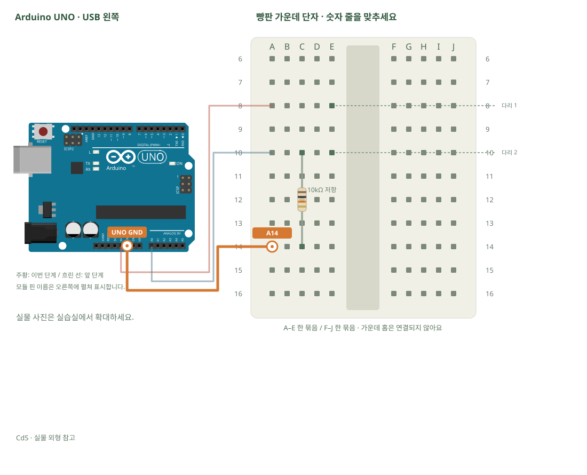

# 조도 센서 · 밝기와 저항

[실물 사진과 한 단계씩 바뀌는 배선도 열기](../kit/guide/index.html?lab=K05#workbench)



그림을 확대하고 한 선씩 보려면 위 실습실을 여세요. 부품별 추가 준비 조건은 아래에서 먼저 확인합니다.

## 무엇을 하는 부품인가요?

CdS는 빛에 따라 저항이 바뀝니다. 저항 변화 자체를 analogRead로 읽을 수 없어 고정저항과 나눠 걸리는 전압을 읽습니다. 이것을 전압 분배라고 합니다. 이 회로에서는 밝아지면 값이 대체로 커집니다.

## 준비와 방향

필요 부품: 조도 센서 · CdS, 고정저항. 실물 사진은 위 실습 화면에서 각각 확대할 수 있습니다.

부품 핀의 이름을 먼저 확인합니다. 모듈 그림은 핀 이름을 읽기 위한 펼친 그림이며, 실물 커넥터의 좌우 순서를 뜻하지 않습니다. 표시가 다른 부품은 연결 전에 해당 모델 핀표와 대조합니다.

USB를 먼저 뽑습니다. 같은 숫자의 A~E, F~J는 각각 하나의 연결 묶음이고 가운데 홈을 사이에 둔 두 묶음은 떨어져 있습니다.

## 부품을 놓으세요

1. **CdS**: 다리 1 → E8, 다리 2 → E10
2. **10kΩ 저항**: 한쪽 → C10, 다른쪽 → C14

## 선을 한 개씩 연결하세요

| 순서 | 출발 | 도착 | 연결 이유 |
|---:|---|---|---|
| 1 | UNO 5V | A8 | 그림의 양 끝 이름을 확인하고 USB를 뺀 상태에서 연결합니다. |
| 2 | UNO A0 | A10 | 그림의 양 끝 이름을 확인하고 USB를 뺀 상태에서 연결합니다. |
| 3 | UNO GND | A14 | 그림의 양 끝 이름을 확인하고 USB를 뺀 상태에서 연결합니다. |

그림과 표는 같은 연결 데이터로 생성합니다. 선 색이 달라도 양 끝 이름이 같으면 같은 연결입니다. 한 단계를 완료한 뒤 다음으로 이동하고, 마지막에는 전체 연결표로 빠진 선을 확인합니다.

## 저장과 실행

Arduino IDE에서 새 스케치를 만들고 아래 코드를 붙여넣습니다. 파일은 `K05/K05.ino`로 저장합니다. 보드는 Arduino Uno, 포트는 실제 연결된 COM, 시리얼 모니터는 9600으로 맞춥니다. 검증 버튼은 코드의 문법을 검사하고, 업로드 버튼은 연결된 보드로 프로그램을 보냅니다.

이 예제는 추가 라이브러리 설치가 필요하지 않습니다.

```cpp
// 조도 센서 · 밝기와 저항
// 보드: Arduino Uno / 시리얼 모니터: 9600 baud
// USB를 뽑고 배선한 뒤, 아래 연결표와 코드의 핀 번호를 대조하세요.

// setup()은 업로드·리셋 직후 한 번만 실행합니다.
void setup() {
  Serial.begin(9600); // PC에 값을 보여 줄 통신 속도입니다.
}
// loop()는 전원이 들어온 동안 계속 반복합니다.
void loop() {
  int value = analogRead(A0); // UNO는 입력 전압을 0~1023 값으로 읽습니다.
  Serial.print("light=");
  Serial.println(value); // 숫자 뒤에서 줄을 바꿉니다.

  delay(200); // 값이 너무 빠르게 지나가지 않게 0.2초 기다립니다.
}

```

## 예상 결과와 직접 바꾸기

손으로 가리거나 조명을 가까이 했을 때 숫자가 변합니다.

밝을 때·가렸을 때 값을 기록하고 그 사이를 경계값으로 정합니다.

바꾸기 전 예상과 바꾼 뒤 실제 결과를 나눠 적습니다. 실행하지 못했다면 이유와 다음 확인 항목을 적습니다. 예시 출력은 내 보드의 실제 측정 기록이 아니므로 자신의 값·사진으로 남깁니다.

## 잘 안될 때

값이 흔들리면 A10이 CdS와 저항 사이인지 확인합니다. 다른 교실에서 같은 경계값이 통할 것으로 가정하지 않습니다.

코드에 적힌 핀과 연결표부터 비교합니다. 회로를 고칠 때는 USB와 외부 전원을 모두 분리합니다. 프로그램의 컴파일 성공과 실제 부품의 동작은 별도로 확인합니다. 고친 선·코드·결과를 함께 기록하면 다음에 같은 문제를 찾아낼 수 있습니다.
