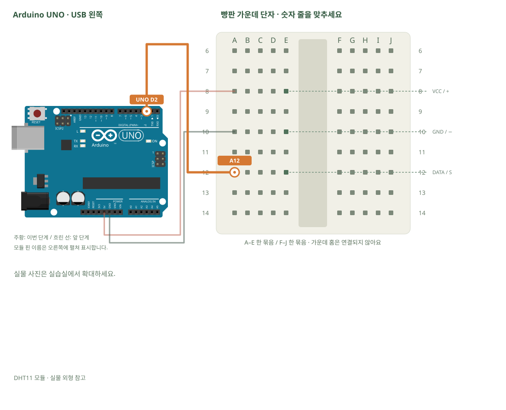

# DHT11 · 온도와 습도

[실물 사진과 한 단계씩 바뀌는 배선도 열기](../kit/guide/index.html?lab=K09#workbench)



그림을 확대하고 한 선씩 보려면 위 실습실을 여세요. 부품별 추가 준비 조건은 아래에서 먼저 확인합니다.

## 무엇을 하는 부품인가요?

DHT11은 약속된 디지털 신호로 온도와 습도를 보냅니다. 단순 analogRead 대신 센서 전용 라이브러리로 읽습니다. 읽기 실패는 0°C로 처리하지 않고 실패로 표시합니다.

## 준비와 방향

필요 부품: DHT11 온습도 모듈. 실물 사진은 위 실습 화면에서 각각 확대할 수 있습니다.

부품 핀의 이름을 먼저 확인합니다. 모듈 그림은 핀 이름을 읽기 위한 펼친 그림이며, 실물 커넥터의 좌우 순서를 뜻하지 않습니다. 표시가 다른 부품은 연결 전에 해당 모델 핀표와 대조합니다.

USB를 먼저 뽑습니다. 같은 숫자의 A~E, F~J는 각각 하나의 연결 묶음이고 가운데 홈을 사이에 둔 두 묶음은 떨어져 있습니다.

## 부품을 놓으세요

1. **DHT11 모듈**: VCC / + → E8, GND / − → E10, DATA / S → E12

## 선을 한 개씩 연결하세요

| 순서 | 출발 | 도착 | 연결 이유 |
|---:|---|---|---|
| 1 | UNO 5V | A8 | 부품의 전원 핀을 놓은 줄과 UNO 5V를 연결합니다. 선 색보다 양 끝을 확인합니다. |
| 2 | UNO GND | A10 | 부품의 GND 핀을 놓은 줄과 UNO GND를 연결합니다. 선 색보다 양 끝을 확인합니다. |
| 3 | UNO D2 | A12 | 부품의 DATA 핀을 놓은 줄과 UNO D2를 연결합니다. 선 색보다 양 끝을 확인합니다. |

그림과 표는 같은 연결 데이터로 생성합니다. 선 색이 달라도 양 끝 이름이 같으면 같은 연결입니다. 한 단계를 완료한 뒤 다음으로 이동하고, 마지막에는 전체 연결표로 빠진 선을 확인합니다.

## 저장과 실행

Arduino IDE에서 새 스케치를 만들고 아래 코드를 붙여넣습니다. 파일은 `K09/K09.ino`로 저장합니다. 보드는 Arduino Uno, 포트는 실제 연결된 COM, 시리얼 모니터는 9600으로 맞춥니다. 검증 버튼은 코드의 문법을 검사하고, 업로드 버튼은 연결된 보드로 프로그램을 보냅니다.

라이브러리 관리자 설치: DHT sensor library 1.4.7 · Adafruit Unified Sensor 1.1.15.

```cpp
// DHT11 · 온도와 습도
// 보드: Arduino Uno / 시리얼 모니터: 9600 baud
// USB를 뽑고 배선한 뒤, 아래 연결표와 코드의 핀 번호를 대조하세요.

#include <DHT.h> // 라이브러리 관리자에서 DHT sensor library by Adafruit 설치
DHT dht(2, DHT11); // 첫 값은 DATA 핀, 두 번째는 센서 종류입니다.
void setup() { Serial.begin(9600); dht.begin(); }
void loop() {
  delay(2000); // DHT11을 너무 자주 읽지 않습니다.
  float temperature = dht.readTemperature();
  float humidity = dht.readHumidity();
  if (isnan(temperature) || isnan(humidity)) { // NaN은 읽기에 실패한 값입니다.
    Serial.println("DHT read failed");
    return; // 이번 loop 실행만 끝내고 다음 읽기를 기다립니다.
  }
  Serial.print("temperature_c="); Serial.print(temperature);
  Serial.print(", humidity_pct="); Serial.println(humidity);
}

```

## 예상 결과와 직접 바꾸기

2초마다 temperature_c와 humidity_pct가 출력됩니다.

손 가까이 두었을 때 변화와 반복 측정의 차이를 기록합니다.

바꾸기 전 예상과 바꾼 뒤 실제 결과를 나눠 적습니다. 실행하지 못했다면 이유와 다음 확인 항목을 적습니다. 예시 출력은 내 보드의 실제 측정 기록이 아니므로 자신의 값·사진으로 남깁니다.

## 잘 안될 때

DHT.h 없음은 라이브러리 설치 문제, read failed는 센서 종류·배선·간격 문제로 나눠 확인합니다.

코드에 적힌 핀과 연결표부터 비교합니다. 회로를 고칠 때는 USB와 외부 전원을 모두 분리합니다. 프로그램의 컴파일 성공과 실제 부품의 동작은 별도로 확인합니다. 고친 선·코드·결과를 함께 기록하면 다음에 같은 문제를 찾아낼 수 있습니다.
