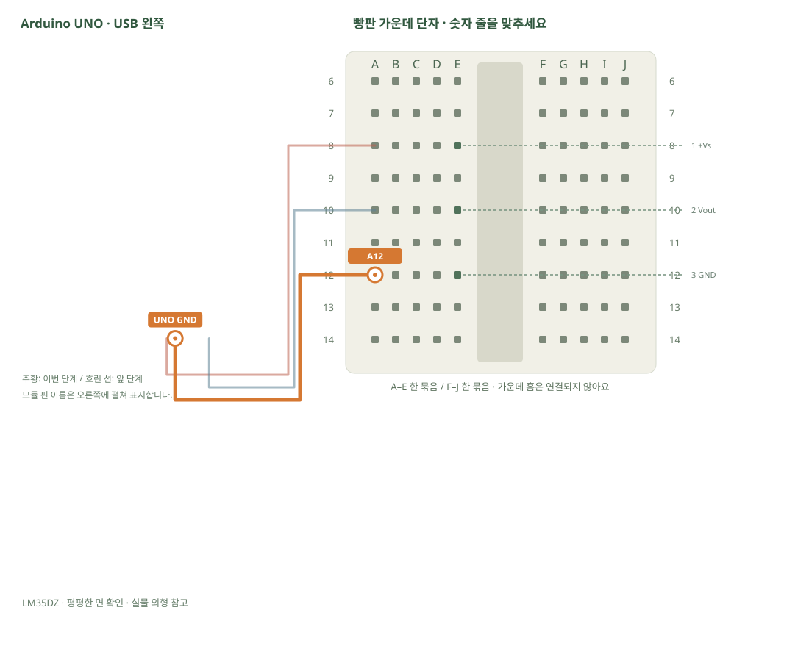

# LM35DZ · 전압을 섭씨로

[실물 사진과 한 단계씩 바뀌는 배선도 열기](../kit/guide/index.html?lab=K10#workbench)



그림을 확대하고 한 선씩 보려면 위 실습실을 여세요. 부품별 추가 준비 조건은 아래에서 먼저 확인합니다.

## 무엇을 하는 부품인가요?

LM35DZ는 온도 1°C마다 약 0.01V를 냅니다. analogRead 숫자를 먼저 전압으로 바꾸고, 다시 100을 곱해 섭씨로 바꿉니다. UNO의 5V가 정확히 5.000V는 아니므로 정밀 측정값으로 사용하려면 전원·기준전압을 확인해야 합니다.

## 준비와 방향

필요 부품: LM35DZ 온도 센서. 실물 사진은 위 실습 화면에서 각각 확대할 수 있습니다.

LM35DZ의 평평한 글자 면을 정면으로, 다리를 아래로 봤을 때 왼쪽부터 1(+Vs)·2(Vout)·3(GND)입니다. 각 다리를 E8·E10·E12의 다른 줄로 벌립니다. 판매처 도면 assets/reference/6.png는 BOTTOM VIEW(아래에서 본 그림)라는 점을 함께 확인합니다.

USB를 먼저 뽑습니다. 같은 숫자의 A~E, F~J는 각각 하나의 연결 묶음이고 가운데 홈을 사이에 둔 두 묶음은 떨어져 있습니다.

## 부품을 놓으세요

1. **LM35DZ · 평평한 면 확인**: 1 +Vs → E8, 2 Vout → E10, 3 GND → E12

## 선을 한 개씩 연결하세요

| 순서 | 출발 | 도착 | 연결 이유 |
|---:|---|---|---|
| 1 | UNO 5V | A8 | 부품의 +Vs 핀을 놓은 줄과 UNO 5V를 연결합니다. 선 색보다 양 끝을 확인합니다. |
| 2 | UNO A0 | A10 | 부품의 Vout 핀을 놓은 줄과 UNO A0를 연결합니다. 선 색보다 양 끝을 확인합니다. |
| 3 | UNO GND | A12 | 부품의 GND 핀을 놓은 줄과 UNO GND를 연결합니다. 선 색보다 양 끝을 확인합니다. |

그림과 표는 같은 연결 데이터로 생성합니다. 선 색이 달라도 양 끝 이름이 같으면 같은 연결입니다. 한 단계를 완료한 뒤 다음으로 이동하고, 마지막에는 전체 연결표로 빠진 선을 확인합니다.

## 저장과 실행

Arduino IDE에서 새 스케치를 만들고 아래 코드를 붙여넣습니다. 파일은 `K10/K10.ino`로 저장합니다. 보드는 Arduino Uno, 포트는 실제 연결된 COM, 시리얼 모니터는 9600으로 맞춥니다. 검증 버튼은 코드의 문법을 검사하고, 업로드 버튼은 연결된 보드로 프로그램을 보냅니다.

이 예제는 추가 라이브러리 설치가 필요하지 않습니다.

```cpp
// LM35DZ · 전압을 섭씨로
// 보드: Arduino Uno / 시리얼 모니터: 9600 baud
// USB를 뽑고 배선한 뒤, 아래 연결표와 코드의 핀 번호를 대조하세요.

void setup() { Serial.begin(9600); }
void loop() {
  int raw = analogRead(A0); // 0~1023의 ADC 값
  float volts = raw * (5.0 / 1023.0); // 기준전압을 5.0V로 두는 근삿값
  float celsius = volts * 100.0; // 10mV/°C = 0.01V/°C
  Serial.print("raw="); Serial.print(raw);
  Serial.print(", temperature_c="); Serial.println(celsius, 1);
  delay(500);
}

```

## 예상 결과와 직접 바꾸기

실내 온도 근처 값이 출력되고 손가락으로 몸체를 잡으면 천천히 변합니다.

raw·volts·celsius를 함께 출력해 계산 단계를 설명합니다.

바꾸기 전 예상과 바꾼 뒤 실제 결과를 나눠 적습니다. 실행하지 못했다면 이유와 다음 확인 항목을 적습니다. 예시 출력은 내 보드의 실제 측정 기록이 아니므로 자신의 값·사진으로 남깁니다.

## 잘 안될 때

값이 비정상적이거나 부품이 뜨거워지면 즉시 USB를 분리합니다. LM35DZ와 외형이 비슷한 트랜지스터를 혼동하지 않습니다.

코드에 적힌 핀과 연결표부터 비교합니다. 회로를 고칠 때는 USB와 외부 전원을 모두 분리합니다. 프로그램의 컴파일 성공과 실제 부품의 동작은 별도로 확인합니다. 고친 선·코드·결과를 함께 기록하면 다음에 같은 문제를 찾아낼 수 있습니다.
