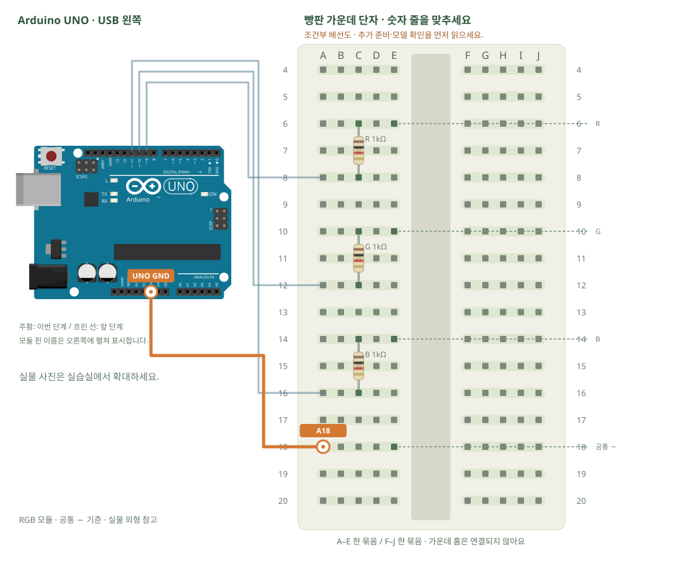

# RGB LED · 세 가지 빛 섞기

[실물 사진과 한 단계씩 바뀌는 배선도 열기](../kit/guide/index.html?lab=K11#workbench)



그림을 확대하고 한 선씩 보려면 위 실습실을 여세요. 부품별 추가 준비 조건은 아래에서 먼저 확인합니다.

## 무엇을 하는 부품인가요?

RGB는 세 LED를 한 부품에 넣은 것입니다. 채널별로 저항을 달고 PWM 출력으로 밝기를 바꿉니다. PWM은 출력 전압을 연속으로 낮추는 대신 켜진 시간 비율을 바꿉니다. 공통 −와 공통 +는 켜는 값이 반대입니다.

## 준비와 방향

필요 부품: RGB LED 모듈, 고정저항. 실물 사진은 위 실습 화면에서 각각 확대할 수 있습니다.

부품 핀의 이름을 먼저 확인합니다. 모듈 그림은 핀 이름을 읽기 위한 펼친 그림이며, 실물 커넥터의 좌우 순서를 뜻하지 않습니다. 표시가 다른 부품은 연결 전에 해당 모델 핀표와 대조합니다.

**연결 전 확인:** 그림은 R·G·B·−가 확인되는 공통 음극 모듈 기준입니다. 공통 +라면 공통 핀을 5V로 바꾸고 COMMON_ANODE를 true로 바꿉니다. 표시와 저항 유무를 확인하기 전에는 전원을 연결하지 않습니다.

## 부품을 놓으세요

1. **RGB 모듈 · 공통 − 기준**: R → E6, G → E10, B → E14, 공통 − → E18
2. **R 1kΩ**: 한쪽 → C6, 다른쪽 → C8
3. **G 1kΩ**: 한쪽 → C10, 다른쪽 → C12
4. **B 1kΩ**: 한쪽 → C14, 다른쪽 → C16

## 선을 한 개씩 연결하세요

| 순서 | 출발 | 도착 | 연결 이유 |
|---:|---|---|---|
| 1 | UNO D9 | A8 | 그림의 양 끝 이름을 확인하고 USB를 뺀 상태에서 연결합니다. |
| 2 | UNO D10 | A12 | 그림의 양 끝 이름을 확인하고 USB를 뺀 상태에서 연결합니다. |
| 3 | UNO D11 | A16 | 그림의 양 끝 이름을 확인하고 USB를 뺀 상태에서 연결합니다. |
| 4 | UNO GND | A18 | 그림의 양 끝 이름을 확인하고 USB를 뺀 상태에서 연결합니다. |

그림과 표는 같은 연결 데이터로 생성합니다. 선 색이 달라도 양 끝 이름이 같으면 같은 연결입니다. 한 단계를 완료한 뒤 다음으로 이동하고, 마지막에는 전체 연결표로 빠진 선을 확인합니다.

## 저장과 실행

Arduino IDE에서 새 스케치를 만들고 아래 코드를 붙여넣습니다. 파일은 `K11/K11.ino`로 저장합니다. 보드는 Arduino Uno, 포트는 실제 연결된 COM, 시리얼 모니터는 9600으로 맞춥니다. 검증 버튼은 코드의 문법을 검사하고, 업로드 버튼은 연결된 보드로 프로그램을 보냅니다.

이 예제는 추가 라이브러리 설치가 필요하지 않습니다.

```cpp
// RGB LED · 세 가지 빛 섞기
// 보드: Arduino Uno / 시리얼 모니터: 9600 baud
// USB를 뽑고 배선한 뒤, 아래 연결표와 코드의 핀 번호를 대조하세요.

const int R = 9, G = 10, B = 11; // ~ 표시 PWM 핀입니다.
const bool COMMON_ANODE = false; // 공통 -면 false. 공통 +형은 배선도 함께 바꿔야 합니다.
void color(byte red, byte green, byte blue) {
  analogWrite(R, COMMON_ANODE ? 255-red : red);
  analogWrite(G, COMMON_ANODE ? 255-green : green);
  analogWrite(B, COMMON_ANODE ? 255-blue : blue);
}
void setup() { pinMode(R, OUTPUT); pinMode(G, OUTPUT); pinMode(B, OUTPUT); }
void loop() {
  color(255,0,0); delay(800); // 빨강
  color(0,255,0); delay(800); // 초록
  color(0,0,255); delay(800); // 파랑
  color(120,40,160); delay(800); // 섞은 색
}

```

## 예상 결과와 직접 바꾸기

빨강·초록·파랑·섞은 색이 차례로 켜집니다.

색 세 숫자를 바꿔 자신만의 상태 표시 색을 만듭니다.

바꾸기 전 예상과 바꾼 뒤 실제 결과를 나눠 적습니다. 실행하지 못했다면 이유와 다음 확인 항목을 적습니다. 예시 출력은 내 보드의 실제 측정 기록이 아니므로 자신의 값·사진으로 남깁니다.

## 잘 안될 때

어떤 색만 안 켜지면 해당 채널의 저항과 PWM 핀을 확인합니다.

코드에 적힌 핀과 연결표부터 비교합니다. 회로를 고칠 때는 USB와 외부 전원을 모두 분리합니다. 프로그램의 컴파일 성공과 실제 부품의 동작은 별도로 확인합니다. 고친 선·코드·결과를 함께 기록하면 다음에 같은 문제를 찾아낼 수 있습니다.
