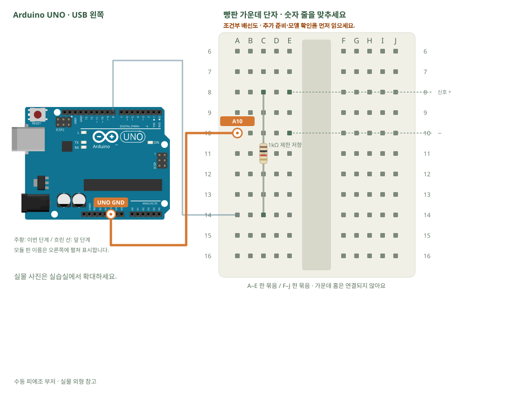

# 부저 · 짧은 소리 만들기

[실물 사진과 한 단계씩 바뀌는 배선도 열기](../kit/guide/index.html?lab=K12#workbench)



그림을 확대하고 한 선씩 보려면 위 실습실을 여세요. 부품별 추가 준비 조건은 아래에서 먼저 확인합니다.

## 무엇을 하는 부품인가요?

수동 피에조 부저는 주파수를 넣어야 소리가 납니다. tone(pin,주파수,시간)에서 주파수는 음 높이, 시간은 소리 길이입니다. 능동 부저는 전원을 주면 정해진 소리가 나며 정격 전류에 따라 드라이버가 필요합니다.

## 준비와 방향

필요 부품: 2핀 부저, 고정저항. 실물 사진은 위 실습 화면에서 각각 확대할 수 있습니다.

부품 핀의 이름을 먼저 확인합니다. 모듈 그림은 핀 이름을 읽기 위한 펼친 그림이며, 실물 커넥터의 좌우 순서를 뜻하지 않습니다. 표시가 다른 부품은 연결 전에 해당 모델 핀표와 대조합니다.

**연결 전 확인:** 수동 피에조형과 정격을 확인한 부품만 이 그림을 사용합니다. 능동형·자기형·모델 미상은 GPIO 직결하지 않고 해당 정격에 맞는 트랜지스터·보호회로를 준비합니다. 사진 속 두 부품을 같은 종류로 가정하지 않습니다.

## 부품을 놓으세요

1. **수동 피에조 부저**: 신호 + → E8, − → E10
2. **1kΩ 제한 저항**: 한쪽 → C8, 다른쪽 → C14

## 왜 이 위치에 연결하나요?

- 글자·숫자는 위치 주소입니다. 지정 구멍을 고른 이유는 연결할 부품 다리와 같은 금속판을 쓰거나, 서로 떨어진 묶음을 부품으로 잇기 위해서입니다.
- 빈 대체 구멍은 같은 다섯 구멍 묶음에서 고릅니다. 한 부품의 위치를 다른 줄로 옮기면 그 다리와 연결된 선도 함께 옮겨야 합니다. 선 색이나 화면상의 선 교차만으로 전기 연결이 생기지는 않습니다.

[구멍 안의 연결 구조·전류 경로·틀린 배선을 그림으로 비교하기](../kit/guide/index.html?lab=K12#breadboard-basics)


## 선을 한 개씩 연결하세요

| 순서 | 출발 | 도착 | 연결 이유 |
|---:|---|---|---|
| 1 | UNO D8 | A14 | UNO D8 핀은 코드에서 정한 디지털 입출력·통신 핀입니다. 빵판 줄 번호가 아니라 UNO 핀 번호와 코드가 일치해야 합니다. 보드 쪽 연결점은 UNO D8입니다. A14 위치는 A14·B14·C14·D14·E14와 같은 금속판입니다. C14에 놓인 1kΩ 제한 저항의 다른쪽 지점과 이어집니다. |
| 2 | UNO GND | A10 | GND는 보드의 0V 기준입니다. 부품과 보드의 기준을 맞추고 이 회로에 필요한 전류의 돌아가는 길을 연결합니다. 보드 쪽 연결점은 UNO GND입니다. A10 위치는 A10·B10·C10·D10·E10와 같은 금속판입니다. E10에 놓인 수동 피에조 부저의 − 지점과 이어집니다. |

그림과 표는 같은 연결 데이터로 생성합니다. 선 색이 달라도 양 끝 이름이 같으면 같은 연결입니다. 한 단계를 완료한 뒤 다음으로 이동하고, 마지막에는 전체 연결표로 빠진 선을 확인합니다.

## 저장과 실행

Arduino IDE에서 새 스케치를 만들고 아래 코드를 붙여넣습니다. 파일은 `K12/K12.ino`로 저장합니다. 보드는 Arduino Uno, 포트는 실제 연결된 COM, 시리얼 모니터는 9600으로 맞춥니다. 검증 버튼은 코드의 문법을 검사하고, 업로드 버튼은 연결된 보드로 프로그램을 보냅니다.

이 예제는 추가 라이브러리 설치가 필요하지 않습니다.

```cpp
// 부저 · 짧은 소리 만들기
// 보드: Arduino Uno / 시리얼 모니터: 9600 baud
// USB를 뽑고 배선한 뒤, 아래 연결표와 코드의 핀 번호를 대조하세요.

void setup() { pinMode(8, OUTPUT); }
void loop() {
  tone(8, 1000, 150); // 8번 핀에서 1000Hz를 150ms 냅니다.
  delay(1000); // 다음 소리까지 기다립니다.
  noTone(8); // 소리 출력을 멈춥니다.
}

```

## 예상 결과와 직접 바꾸기

확인된 수동 피에조에서 작은 삐 소리가 주기적으로 납니다.

주파수를 500·1500으로 바꿔 음 높이를 비교합니다.

바꾸기 전 예상과 바꾼 뒤 실제 결과를 나눠 적습니다. 실행하지 못했다면 이유와 다음 확인 항목을 적습니다. 예시 출력은 내 보드의 실제 측정 기록이 아니므로 자신의 값·사진으로 남깁니다.

## 잘 안될 때

소리가 없다고 저항을 빼거나 능동 자기 부저를 직접 연결하지 않습니다.

코드에 적힌 핀과 연결표부터 비교합니다. 회로를 고칠 때는 USB와 외부 전원을 모두 분리합니다. 프로그램의 컴파일 성공과 실제 부품의 동작은 별도로 확인합니다. 고친 선·코드·결과를 함께 기록하면 다음에 같은 문제를 찾아낼 수 있습니다.
