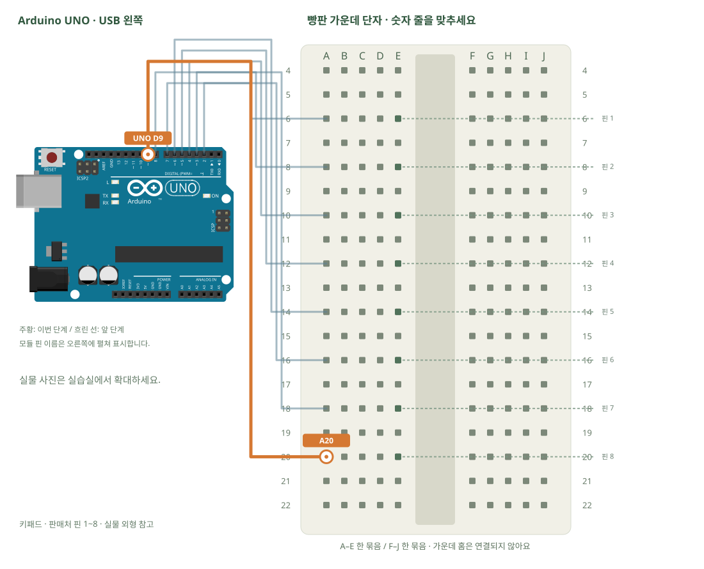

# 4×4 키패드 · 행과 열

[실물 사진과 한 단계씩 바뀌는 배선도 열기](../kit/guide/index.html?lab=K14#workbench)



그림을 확대하고 한 선씩 보려면 위 실습실을 여세요. 부품별 추가 준비 조건은 아래에서 먼저 확인합니다.

## 무엇을 하는 부품인가요?

버튼 하나는 한 행과 한 열을 이어 줍니다. 행 하나만 LOW로 만들고 어느 열이 LOW가 되는지 읽으면 누른 위치를 찾습니다. 다른 행은 입력 상태로 둬 동시에 여러 버튼을 눌러도 HIGH와 LOW 출력이 서로 충돌하지 않게 합니다.

## 준비와 방향

필요 부품: 4×4 키패드. 실물 사진은 위 실습 화면에서 각각 확대할 수 있습니다.

판매처 핀표를 먼저 펼칩니다. 핀1은 사진 표의 아래쪽, 핀8은 위쪽이며 윗줄 버튼 S1은 핀4와5를 잇습니다. 실제 키패드가 다르면 도통 검사로 행·열을 확인합니다.

USB를 먼저 뽑습니다. 같은 숫자의 A~E, F~J는 각각 하나의 연결 묶음이고 가운데 홈을 사이에 둔 두 묶음은 떨어져 있습니다.

## 부품을 놓으세요

1. **키패드 · 판매처 핀 1~8**: 핀 1 → E6, 핀 2 → E8, 핀 3 → E10, 핀 4 → E12, 핀 5 → E14, 핀 6 → E16, 핀 7 → E18, 핀 8 → E20

## 왜 이 위치에 연결하나요?

- 글자·숫자는 위치 주소입니다. 지정 구멍을 고른 이유는 연결할 부품 다리와 같은 금속판을 쓰거나, 서로 떨어진 묶음을 부품으로 잇기 위해서입니다.
- 빈 대체 구멍은 같은 다섯 구멍 묶음에서 고릅니다. 한 부품의 위치를 다른 줄로 옮기면 그 다리와 연결된 선도 함께 옮겨야 합니다. 선 색이나 화면상의 선 교차만으로 전기 연결이 생기지는 않습니다.

[구멍 안의 연결 구조·전류 경로·틀린 배선을 그림으로 비교하기](../kit/guide/index.html?lab=K14#breadboard-basics)


## 선을 한 개씩 연결하세요

| 순서 | 출발 | 도착 | 연결 이유 |
|---:|---|---|---|
| 1 | UNO D2 | A6 | UNO D2 핀은 코드에서 정한 디지털 입출력·통신 핀입니다. 빵판 줄 번호가 아니라 UNO 핀 번호와 코드가 일치해야 합니다. 보드 쪽 연결점은 UNO D2입니다. A6 위치는 A6·B6·C6·D6·E6와 같은 금속판입니다. E6에 놓인 키패드 · 판매처 핀 1~8의 핀 1 지점과 이어집니다. |
| 2 | UNO D3 | A8 | UNO D3 핀은 코드에서 정한 디지털 입출력·통신 핀입니다. 빵판 줄 번호가 아니라 UNO 핀 번호와 코드가 일치해야 합니다. 보드 쪽 연결점은 UNO D3입니다. A8 위치는 A8·B8·C8·D8·E8와 같은 금속판입니다. E8에 놓인 키패드 · 판매처 핀 1~8의 핀 2 지점과 이어집니다. |
| 3 | UNO D4 | A10 | UNO D4 핀은 코드에서 정한 디지털 입출력·통신 핀입니다. 빵판 줄 번호가 아니라 UNO 핀 번호와 코드가 일치해야 합니다. 보드 쪽 연결점은 UNO D4입니다. A10 위치는 A10·B10·C10·D10·E10와 같은 금속판입니다. E10에 놓인 키패드 · 판매처 핀 1~8의 핀 3 지점과 이어집니다. |
| 4 | UNO D5 | A12 | UNO D5 핀은 코드에서 정한 디지털 입출력·통신 핀입니다. 빵판 줄 번호가 아니라 UNO 핀 번호와 코드가 일치해야 합니다. 보드 쪽 연결점은 UNO D5입니다. A12 위치는 A12·B12·C12·D12·E12와 같은 금속판입니다. E12에 놓인 키패드 · 판매처 핀 1~8의 핀 4 지점과 이어집니다. |
| 5 | UNO D6 | A14 | UNO D6 핀은 코드에서 정한 디지털 입출력·통신 핀입니다. 빵판 줄 번호가 아니라 UNO 핀 번호와 코드가 일치해야 합니다. 보드 쪽 연결점은 UNO D6입니다. A14 위치는 A14·B14·C14·D14·E14와 같은 금속판입니다. E14에 놓인 키패드 · 판매처 핀 1~8의 핀 5 지점과 이어집니다. |
| 6 | UNO D7 | A16 | UNO D7 핀은 코드에서 정한 디지털 입출력·통신 핀입니다. 빵판 줄 번호가 아니라 UNO 핀 번호와 코드가 일치해야 합니다. 보드 쪽 연결점은 UNO D7입니다. A16 위치는 A16·B16·C16·D16·E16와 같은 금속판입니다. E16에 놓인 키패드 · 판매처 핀 1~8의 핀 6 지점과 이어집니다. |
| 7 | UNO D8 | A18 | UNO D8 핀은 코드에서 정한 디지털 입출력·통신 핀입니다. 빵판 줄 번호가 아니라 UNO 핀 번호와 코드가 일치해야 합니다. 보드 쪽 연결점은 UNO D8입니다. A18 위치는 A18·B18·C18·D18·E18와 같은 금속판입니다. E18에 놓인 키패드 · 판매처 핀 1~8의 핀 7 지점과 이어집니다. |
| 8 | UNO D9 | A20 | UNO D9 핀은 코드에서 정한 디지털 입출력·통신 핀입니다. 빵판 줄 번호가 아니라 UNO 핀 번호와 코드가 일치해야 합니다. 보드 쪽 연결점은 UNO D9입니다. A20 위치는 A20·B20·C20·D20·E20와 같은 금속판입니다. E20에 놓인 키패드 · 판매처 핀 1~8의 핀 8 지점과 이어집니다. |

그림과 표는 같은 연결 데이터로 생성합니다. 선 색이 달라도 양 끝 이름이 같으면 같은 연결입니다. 한 단계를 완료한 뒤 다음으로 이동하고, 마지막에는 전체 연결표로 빠진 선을 확인합니다.

## 저장과 실행

Arduino IDE에서 새 스케치를 만들고 아래 코드를 붙여넣습니다. 파일은 `K14/K14.ino`로 저장합니다. 보드는 Arduino Uno, 포트는 실제 연결된 COM, 시리얼 모니터는 9600으로 맞춥니다. 검증 버튼은 코드의 문법을 검사하고, 업로드 버튼은 연결된 보드로 프로그램을 보냅니다.

이 예제는 추가 라이브러리 설치가 필요하지 않습니다.

```cpp
// 4×4 키패드 · 행과 열
// 보드: Arduino Uno / 시리얼 모니터: 9600 baud
// USB를 뽑고 배선한 뒤, 아래 연결표와 코드의 핀 번호를 대조하세요.

// 판매처 표: 윗줄 버튼은 핀4, 다음줄3, 다음줄2, 맨아래줄1입니다.
const byte rows[4] = {5,4,3,2}; // 물리핀4,3,2,1 → UNO D5,D4,D3,D2
const byte cols[4] = {6,7,8,9}; // 물리핀5,6,7,8 → UNO D6,D7,D8,D9
const char keys[4][4] = {{'1','2','3','A'},{'4','5','6','B'},
                         {'7','8','9','C'},{'*','0','#','D'}};
char previous = 0;
void setup() {
  Serial.begin(9600);
  for (byte c=0;c<4;c++) pinMode(cols[c], INPUT_PULLUP);
  for (byte r=0;r<4;r++) pinMode(rows[r], INPUT); // 선택하지 않은 행은 출력하지 않습니다.
}
void loop() {
  char found = 0;
  for (byte r=0;r<4;r++) {
    digitalWrite(rows[r], LOW); pinMode(rows[r], OUTPUT);
    delayMicroseconds(20); // 입력이 안정될 짧은 시간
    for (byte c=0;c<4;c++) if (digitalRead(cols[c])==LOW) found=keys[r][c];
    pinMode(rows[r], INPUT); // 읽은 행을 다시 해제합니다.
  }
  if (found && found!=previous) Serial.println(found);
  previous=found; delay(30); // 누르고 있는 동안 무한히 같은 글자를 찍지 않습니다.
}

```

## 예상 결과와 직접 바꾸기

각 버튼을 누를 때 대응 글자가 한 번 출력됩니다. 동시 입력 인증 장치로 사용하지 않습니다.

네 자리 입력을 모아 #을 누르면 확인하는 기능을 만듭니다.

바꾸기 전 예상과 바꾼 뒤 실제 결과를 나눠 적습니다. 실행하지 못했다면 이유와 다음 확인 항목을 적습니다. 예시 출력은 내 보드의 실제 측정 기록이 아니므로 자신의 값·사진으로 남깁니다.

## 잘 안될 때

버튼 이름이 뒤집히면 rows·cols 순서를 판매처 표와 비교합니다.

코드에 적힌 핀과 연결표부터 비교합니다. 회로를 고칠 때는 USB와 외부 전원을 모두 분리합니다. 프로그램의 컴파일 성공과 실제 부품의 동작은 별도로 확인합니다. 고친 선·코드·결과를 함께 기록하면 다음에 같은 문제를 찾아낼 수 있습니다.
