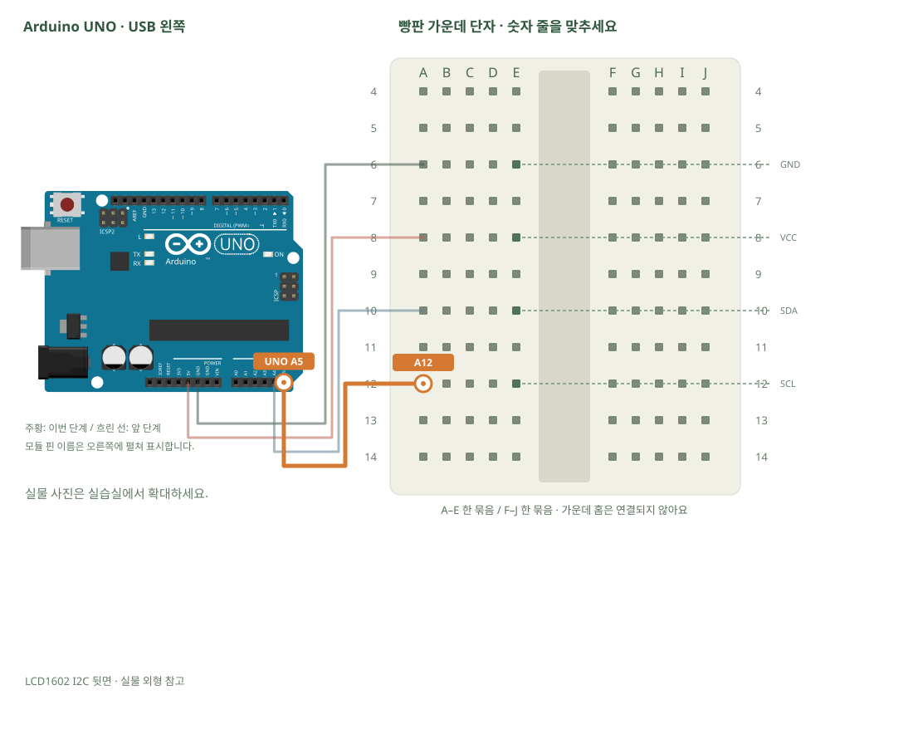

# LCD1602 · 화면에 값 보여 주기

[실물 사진과 한 단계씩 바뀌는 배선도 열기](../kit/guide/index.html?lab=K15#workbench)



그림을 확대하고 한 선씩 보려면 위 실습실을 여세요. 부품별 추가 준비 조건은 아래에서 먼저 확인합니다.

## 무엇을 하는 부품인가요?

I2C는 SDA(데이터)와 SCL(시계) 두 신호로 장치를 연결하는 방식입니다. UNO에서 SDA는 A4, SCL은 A5입니다. 오늘 LCD는 뒤에 I2C 변환 기판이 붙은 모델입니다. 한글 폰트를 바로 표시할 수 있는 화면은 아니어서 짧은 영문과 숫자로 시작합니다.

## 준비와 방향

필요 부품: LCD1602 · I2C 모듈. 실물 사진은 위 실습 화면에서 각각 확대할 수 있습니다.

부품 핀의 이름을 먼저 확인합니다. 모듈 그림은 핀 이름을 읽기 위한 펼친 그림이며, 실물 커넥터의 좌우 순서를 뜻하지 않습니다. 표시가 다른 부품은 연결 전에 해당 모델 핀표와 대조합니다.

USB를 먼저 뽑습니다. 같은 숫자의 A~E, F~J는 각각 하나의 연결 묶음이고 가운데 홈을 사이에 둔 두 묶음은 떨어져 있습니다.

## 부품을 놓으세요

1. **LCD1602 I2C 뒷면**: GND → E6, VCC → E8, SDA → E10, SCL → E12

## 왜 이 위치에 연결하나요?

- 글자·숫자는 위치 주소입니다. 지정 구멍을 고른 이유는 연결할 부품 다리와 같은 금속판을 쓰거나, 서로 떨어진 묶음을 부품으로 잇기 위해서입니다.
- 빈 대체 구멍은 같은 다섯 구멍 묶음에서 고릅니다. 한 부품의 위치를 다른 줄로 옮기면 그 다리와 연결된 선도 함께 옮겨야 합니다. 선 색이나 화면상의 선 교차만으로 전기 연결이 생기지는 않습니다.

[구멍 안의 연결 구조·전류 경로·틀린 배선을 그림으로 비교하기](../kit/guide/index.html?lab=K15#breadboard-basics)


## 선을 한 개씩 연결하세요

| 순서 | 출발 | 도착 | 연결 이유 |
|---:|---|---|---|
| 1 | UNO GND | A6 | GND는 보드의 0V 기준입니다. 부품과 보드의 기준을 맞추고 이 회로에 필요한 전류의 돌아가는 길을 연결합니다. 보드 쪽 연결점은 UNO GND입니다. A6 위치는 A6·B6·C6·D6·E6와 같은 금속판입니다. E6에 놓인 LCD1602 I2C 뒷면의 GND 지점과 이어집니다. |
| 2 | UNO 5V | A8 | 부품에 5V 전원을 공급하는 연결입니다. 신호를 읽는 선과 역할이 다릅니다. 보드 쪽 연결점은 UNO 5V입니다. A8 위치는 A8·B8·C8·D8·E8와 같은 금속판입니다. E8에 놓인 LCD1602 I2C 뒷면의 VCC 지점과 이어집니다. |
| 3 | UNO A4 | A10 | A4는 이 LCD 회로에서 I2C의 SDA 데이터 신호를 주고받습니다. 5V 전원선과 역할이 다르므로 따로 연결합니다. 보드 쪽 연결점은 UNO A4입니다. A10 위치는 A10·B10·C10·D10·E10와 같은 금속판입니다. E10에 놓인 LCD1602 I2C 뒷면의 SDA 지점과 이어집니다. |
| 4 | UNO A5 | A12 | A5는 이 LCD 회로에서 I2C의 SCL 시계 신호를 주고받습니다. 5V 전원선과 역할이 다르므로 따로 연결합니다. 보드 쪽 연결점은 UNO A5입니다. A12 위치는 A12·B12·C12·D12·E12와 같은 금속판입니다. E12에 놓인 LCD1602 I2C 뒷면의 SCL 지점과 이어집니다. |

그림과 표는 같은 연결 데이터로 생성합니다. 선 색이 달라도 양 끝 이름이 같으면 같은 연결입니다. 한 단계를 완료한 뒤 다음으로 이동하고, 마지막에는 전체 연결표로 빠진 선을 확인합니다.

## 저장과 실행

Arduino IDE에서 새 스케치를 만들고 아래 코드를 붙여넣습니다. 파일은 `K15/K15.ino`로 저장합니다. 보드는 Arduino Uno, 포트는 실제 연결된 COM, 시리얼 모니터는 9600으로 맞춥니다. 검증 버튼은 코드의 문법을 검사하고, 업로드 버튼은 연결된 보드로 프로그램을 보냅니다.

라이브러리 관리자 설치: hd44780 by Bill Perry 1.3.2.

```cpp
// LCD1602 · 화면에 값 보여 주기
// 보드: Arduino Uno / 시리얼 모니터: 9600 baud
// USB를 뽑고 배선한 뒤, 아래 연결표와 코드의 핀 번호를 대조하세요.

#include <Wire.h>
#include <hd44780.h>
#include <hd44780ioClass/hd44780_I2Cexp.h>
hd44780_I2Cexp lcd; // 지원되는 I2C 백팩의 주소·핀 연결을 자동 탐색합니다.
void setup() {
  Serial.begin(9600);
  int status = lcd.begin(16, 2); // 가로 16글자, 세로 2줄
  if (status) { Serial.println("LCD init failed"); while (true) {} }
  lcd.backlight(); lcd.print("My first circuit");
}
void loop() {
  lcd.setCursor(0, 1); // 첫째 칸, 둘째 줄. 번호는 0부터 시작합니다.
  lcd.print("sec: "); lcd.print(millis()/1000);
  delay(200);
}

```

## 예상 결과와 직접 바꾸기

첫 줄에 My first circuit, 둘째 줄에 켜진 뒤 지난 초가 보입니다.

가변저항 실습을 추가해 둘째 줄에 A0 값을 표시합니다.

바꾸기 전 예상과 바꾼 뒤 실제 결과를 나눠 적습니다. 실행하지 못했다면 이유와 다음 확인 항목을 적습니다. 예시 출력은 내 보드의 실제 측정 기록이 아니므로 자신의 값·사진으로 남깁니다.

## 잘 안될 때

백라이트만 켜지면 뒤의 대비 조절 나사를 조금씩 돌립니다. init failed면 GND·전원·SDA·SCL과 I2Cexp의 I2CexpDiag 예제로 확인합니다.

코드에 적힌 핀과 연결표부터 비교합니다. 회로를 고칠 때는 USB와 외부 전원을 모두 분리합니다. 프로그램의 컴파일 성공과 실제 부품의 동작은 별도로 확인합니다. 고친 선·코드·결과를 함께 기록하면 다음에 같은 문제를 찾아낼 수 있습니다.
