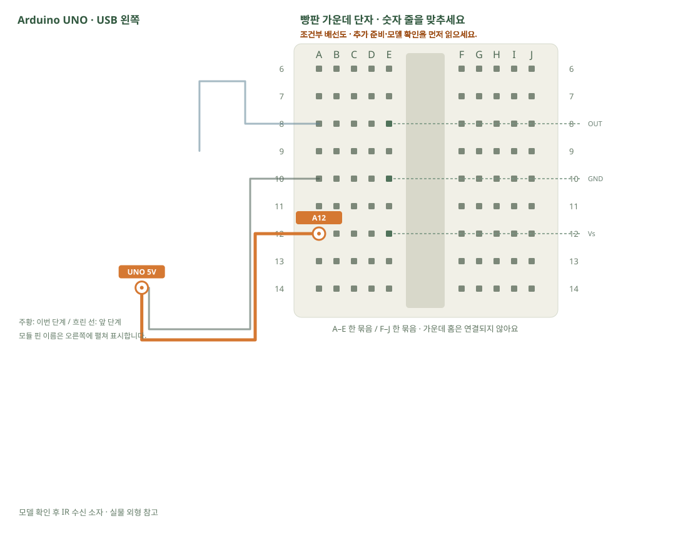

# 적외선 리모컨 · 버튼 코드 읽기

[실물 사진과 한 단계씩 바뀌는 배선도 열기](../kit/guide/index.html?lab=K16#workbench)



그림을 확대하고 한 선씩 보려면 위 실습실을 여세요. 부품별 추가 준비 조건은 아래에서 먼저 확인합니다.

## 무엇을 하는 부품인가요?

리모컨은 빠르게 깜빡이는 적외선으로 코드를 보냅니다. 수신 소자는 이 신호를 읽기 쉬운 디지털 신호로 바꿉니다. 송신 리모컨과 수신 소자를 함께 사용해야 합니다. 일반적인 빛 센서의 analogRead와 다릅니다.

## 준비와 방향

필요 부품: 적외선 리모컨, 적외선 수신 소자. 실물 사진은 위 실습 화면에서 각각 확대할 수 있습니다.

부품 핀의 이름을 먼저 확인합니다. 모듈 그림은 핀 이름을 읽기 위한 펼친 그림이며, 실물 커넥터의 좌우 순서를 뜻하지 않습니다. 표시가 다른 부품은 연결 전에 해당 모델 핀표와 대조합니다.

**연결 전 확인:** 판매처 사진만으로 수신 소자의 모델과 핀 순서를 확정할 수 없습니다. 몸체 글자를 읽고 해당 제조사의 자료에서 OUT·GND·Vs와 5V 허용 여부를 확인해야 이 배선을 사용할 수 있습니다. TSOP38238의 핀1 OUT·2 GND·3 Vs를 다른 부품에 적용하지 않습니다.

## 부품을 놓으세요

1. **모델 확인 후 IR 수신 소자**: OUT → E8, GND → E10, Vs → E12

## 선을 한 개씩 연결하세요

| 순서 | 출발 | 도착 | 연결 이유 |
|---:|---|---|---|
| 1 | UNO D2 | A8 | 부품의 OUT 핀을 놓은 줄과 UNO D2를 연결합니다. 선 색보다 양 끝을 확인합니다. |
| 2 | UNO GND | A10 | 부품의 GND 핀을 놓은 줄과 UNO GND를 연결합니다. 선 색보다 양 끝을 확인합니다. |
| 3 | UNO 5V | A12 | 부품의 Vs 핀을 놓은 줄과 UNO 5V를 연결합니다. 선 색보다 양 끝을 확인합니다. |

그림과 표는 같은 연결 데이터로 생성합니다. 선 색이 달라도 양 끝 이름이 같으면 같은 연결입니다. 한 단계를 완료한 뒤 다음으로 이동하고, 마지막에는 전체 연결표로 빠진 선을 확인합니다.

## 저장과 실행

Arduino IDE에서 새 스케치를 만들고 아래 코드를 붙여넣습니다. 파일은 `K16/K16.ino`로 저장합니다. 보드는 Arduino Uno, 포트는 실제 연결된 COM, 시리얼 모니터는 9600으로 맞춥니다. 검증 버튼은 코드의 문법을 검사하고, 업로드 버튼은 연결된 보드로 프로그램을 보냅니다.

라이브러리 관리자 설치: IRremote 4.7.1.

```cpp
// 적외선 리모컨 · 버튼 코드 읽기
// 보드: Arduino Uno / 시리얼 모니터: 9600 baud
// USB를 뽑고 배선한 뒤, 아래 연결표와 코드의 핀 번호를 대조하세요.

#include <IRremote.hpp> // IRremote 4.x의 API입니다.
void setup() {
  Serial.begin(9600);
  IrReceiver.begin(2, DISABLE_LED_FEEDBACK); // OUT → D2
}
void loop() {
  if (IrReceiver.decode()) { // 받은 신호가 있을 때만 읽습니다.
    IrReceiver.printIRResultShort(&Serial); // 프로토콜·주소·명령을 표시합니다.
    IrReceiver.resume(); // 다음 신호를 받을 수 있게 준비합니다.
  }
}

```

## 예상 결과와 직접 바꾸기

리모컨을 향해 버튼을 누르면 protocol·address·command가 출력됩니다.

한 버튼의 command를 기록하고 그 값일 때 내장 LED를 켭니다.

바꾸기 전 예상과 바꾼 뒤 실제 결과를 나눠 적습니다. 실행하지 못했다면 이유와 다음 확인 항목을 적습니다. 예시 출력은 내 보드의 실제 측정 기록이 아니므로 자신의 값·사진으로 남깁니다.

## 잘 안될 때

전원이 맞는데 값이 없으면 리모컨 배터리·수신 방향·OUT 연결·라이브러리 버전을 확인합니다.

코드에 적힌 핀과 연결표부터 비교합니다. 회로를 고칠 때는 USB와 외부 전원을 모두 분리합니다. 프로그램의 컴파일 성공과 실제 부품의 동작은 별도로 확인합니다. 고친 선·코드·결과를 함께 기록하면 다음에 같은 문제를 찾아낼 수 있습니다.
