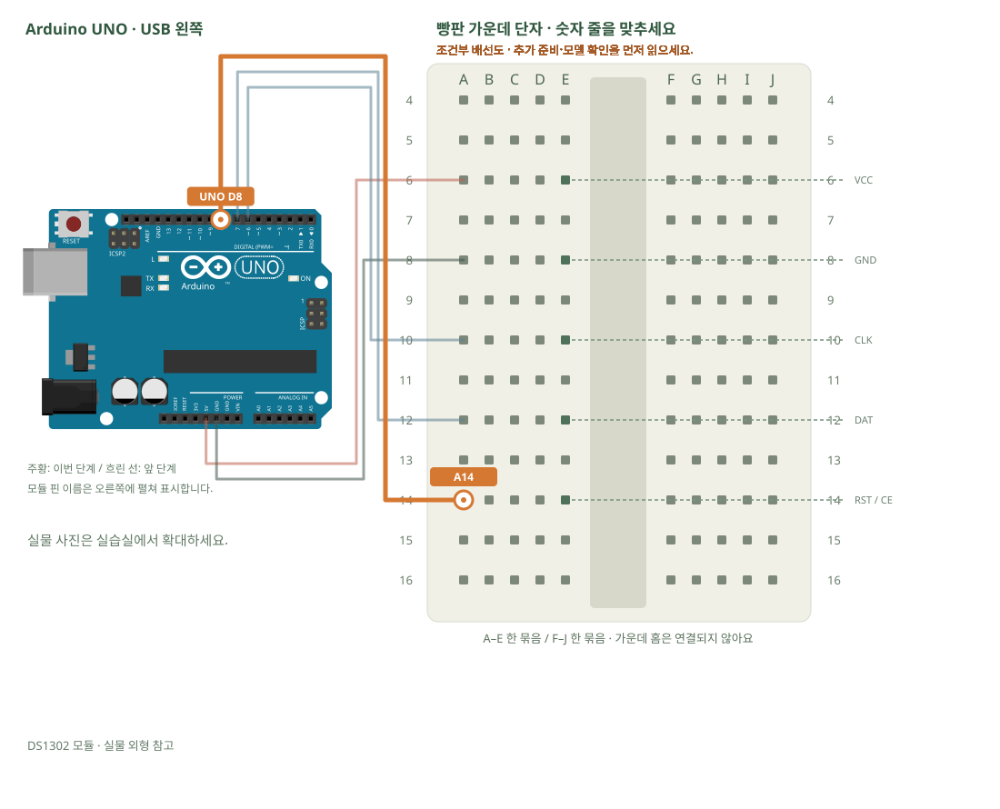

# RTC · 껐다 켜도 시간 기억

[실물 사진과 한 단계씩 바뀌는 배선도 열기](../kit/guide/index.html?lab=K17#workbench)



그림을 확대하고 한 선씩 보려면 위 실습실을 여세요. 부품별 추가 준비 조건은 아래에서 먼저 확인합니다.

## 무엇을 하는 부품인가요?

millis는 전원을 켠 뒤 흐른 시간이고 달력 시간이 아닙니다. RTC는 별도 시계를 유지합니다. DS1302는 CLK·DAT·RST 세 신호를 쓰며 I2C RTC와 코드가 다릅니다. 통신의 날짜가 유효한지 먼저 확인합니다.

## 준비와 방향

필요 부품: DS1302 시계 모듈. 실물 사진은 위 실습 화면에서 각각 확대할 수 있습니다.

부품 핀의 이름을 먼저 확인합니다. 모듈 그림은 핀 이름을 읽기 위한 펼친 그림이며, 실물 커넥터의 좌우 순서를 뜻하지 않습니다. 표시가 다른 부품은 연결 전에 해당 모델 핀표와 대조합니다.

**연결 전 확인:** 모듈의 코인 전지 종류와 충전 회로를 먼저 확인합니다. 충전 기능이 있는 모듈에 비충전식 CR2032가 장착돼 있으면 5V 연결을 진행하지 않습니다. 전지·충전 회로를 확인할 수 없다면 전지를 분리한 뒤 허용 사양을 확인해 USB 전원 상태에서만 시험합니다. 배터리를 임의로 교체·충전하지 않습니다.

## 부품을 놓으세요

1. **DS1302 모듈**: VCC → E6, GND → E8, CLK → E10, DAT → E12, RST / CE → E14

## 왜 이 위치에 연결하나요?

- 글자·숫자는 위치 주소입니다. 지정 구멍을 고른 이유는 연결할 부품 다리와 같은 금속판을 쓰거나, 서로 떨어진 묶음을 부품으로 잇기 위해서입니다.
- 빈 대체 구멍은 같은 다섯 구멍 묶음에서 고릅니다. 한 부품의 위치를 다른 줄로 옮기면 그 다리와 연결된 선도 함께 옮겨야 합니다. 선 색이나 화면상의 선 교차만으로 전기 연결이 생기지는 않습니다.

[구멍 안의 연결 구조·전류 경로·틀린 배선을 그림으로 비교하기](../kit/guide/index.html?lab=K17#breadboard-basics)


## 선을 한 개씩 연결하세요

| 순서 | 출발 | 도착 | 연결 이유 |
|---:|---|---|---|
| 1 | UNO 5V | A6 | 부품에 5V 전원을 공급하는 연결입니다. 신호를 읽는 선과 역할이 다릅니다. 보드 쪽 연결점은 UNO 5V입니다. A6 위치는 A6·B6·C6·D6·E6와 같은 금속판입니다. E6에 놓인 DS1302 모듈의 VCC 지점과 이어집니다. |
| 2 | UNO GND | A8 | GND는 보드의 0V 기준입니다. 부품과 보드의 기준을 맞추고 이 회로에 필요한 전류의 돌아가는 길을 연결합니다. 보드 쪽 연결점은 UNO GND입니다. A8 위치는 A8·B8·C8·D8·E8와 같은 금속판입니다. E8에 놓인 DS1302 모듈의 GND 지점과 이어집니다. |
| 3 | UNO D6 | A10 | UNO D6 핀은 코드에서 정한 디지털 입출력·통신 핀입니다. 빵판 줄 번호가 아니라 UNO 핀 번호와 코드가 일치해야 합니다. 보드 쪽 연결점은 UNO D6입니다. A10 위치는 A10·B10·C10·D10·E10와 같은 금속판입니다. E10에 놓인 DS1302 모듈의 CLK 지점과 이어집니다. |
| 4 | UNO D7 | A12 | UNO D7 핀은 코드에서 정한 디지털 입출력·통신 핀입니다. 빵판 줄 번호가 아니라 UNO 핀 번호와 코드가 일치해야 합니다. 보드 쪽 연결점은 UNO D7입니다. A12 위치는 A12·B12·C12·D12·E12와 같은 금속판입니다. E12에 놓인 DS1302 모듈의 DAT 지점과 이어집니다. |
| 5 | UNO D8 | A14 | UNO D8 핀은 코드에서 정한 디지털 입출력·통신 핀입니다. 빵판 줄 번호가 아니라 UNO 핀 번호와 코드가 일치해야 합니다. 보드 쪽 연결점은 UNO D8입니다. A14 위치는 A14·B14·C14·D14·E14와 같은 금속판입니다. E14에 놓인 DS1302 모듈의 RST / CE 지점과 이어집니다. |

그림과 표는 같은 연결 데이터로 생성합니다. 선 색이 달라도 양 끝 이름이 같으면 같은 연결입니다. 한 단계를 완료한 뒤 다음으로 이동하고, 마지막에는 전체 연결표로 빠진 선을 확인합니다.

## 저장과 실행

Arduino IDE에서 새 스케치를 만들고 아래 코드를 붙여넣습니다. 파일은 `K17/K17.ino`로 저장합니다. 보드는 Arduino Uno, 포트는 실제 연결된 COM, 시리얼 모니터는 9600으로 맞춥니다. 검증 버튼은 코드의 문법을 검사하고, 업로드 버튼은 연결된 보드로 프로그램을 보냅니다.

라이브러리 관리자 설치: Rtc by Makuna 2.5.0.

```cpp
// RTC · 껐다 켜도 시간 기억
// 보드: Arduino Uno / 시리얼 모니터: 9600 baud
// USB를 뽑고 배선한 뒤, 아래 연결표와 코드의 핀 번호를 대조하세요.

#include <ThreeWire.h>
#include <RtcDS1302.h>
ThreeWire bus(7, 6, 8); // 순서: IO(DAT), SCLK(CLK), CE(RST)
RtcDS1302<ThreeWire> rtc(bus);
void setup() {
  Serial.begin(9600); rtc.Begin();
  rtc.SetIsWriteProtected(false); rtc.SetIsRunning(true);
  // 처음 시간을 넣을 때만 true로 바꾸고, 설정 후 다시 false로 업로드합니다.
  const bool SET_TIME_ONCE = false;
  if (SET_TIME_ONCE) rtc.SetDateTime(RtcDateTime(__DATE__, __TIME__));
  // 일부 DS1302 모듈의 충전 회로는 별도 하드웨어입니다. 코드로 배터리 안전을 보장하지 않습니다.
}
void loop() {
  if (!rtc.IsDateTimeValid()) { Serial.println("Set RTC time first"); delay(1000); return; }
  RtcDateTime t = rtc.GetDateTime();
  char text[24];
  snprintf(text, sizeof(text), "%04u-%02u-%02u %02u:%02u:%02u",
           t.Year(),t.Month(),t.Day(),t.Hour(),t.Minute(),t.Second());
  Serial.println(text); delay(1000);
}

```

## 예상 결과와 직접 바꾸기

설정 후 날짜와 시각이 1초마다 나옵니다. PC 컴파일 시각이므로 정확한 표준시 동기화는 아닙니다.

시각을 한 번 설정한 후 SET_TIME_ONCE=false로 다시 업로드하고 리셋해 비교합니다.

바꾸기 전 예상과 바꾼 뒤 실제 결과를 나눠 적습니다. 실행하지 못했다면 이유와 다음 확인 항목을 적습니다. 예시 출력은 내 보드의 실제 측정 기록이 아니므로 자신의 값·사진으로 남깁니다.

## 잘 안될 때

재업로드할 때 과거 컴파일 시각으로 돌아가면 SET_TIME_ONCE가 true인지 확인합니다.

코드에 적힌 핀과 연결표부터 비교합니다. 회로를 고칠 때는 USB와 외부 전원을 모두 분리합니다. 프로그램의 컴파일 성공과 실제 부품의 동작은 별도로 확인합니다. 고친 선·코드·결과를 함께 기록하면 다음에 같은 문제를 찾아낼 수 있습니다.
