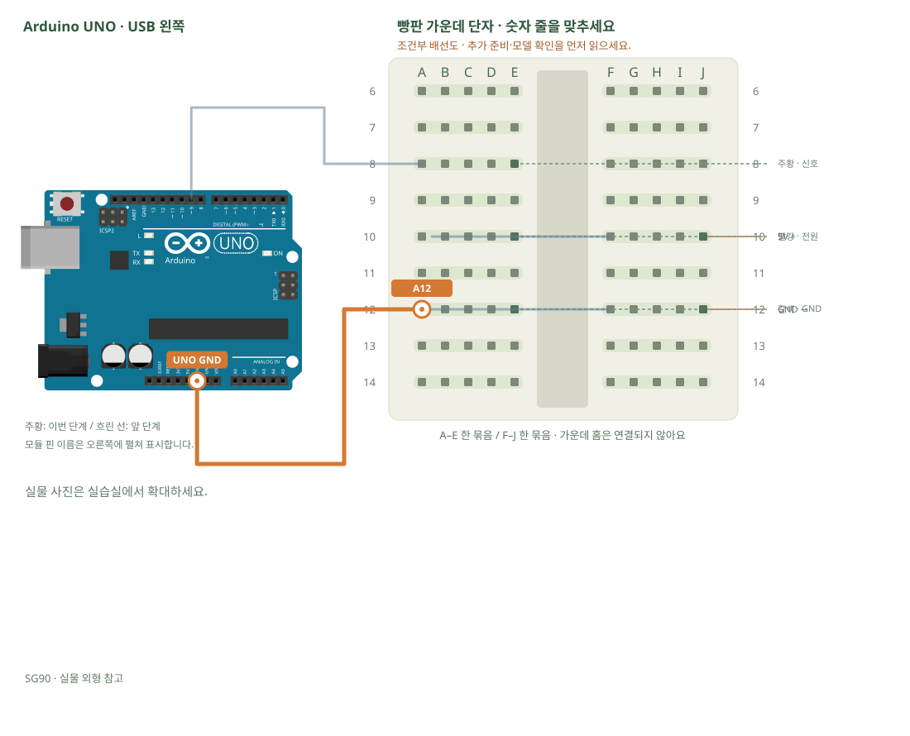

# 서보모터 · 각도 지정

[실물 사진과 한 단계씩 바뀌는 배선도 열기](../kit/guide/index.html?lab=K18#workbench)



그림을 확대하고 한 선씩 보려면 위 실습실을 여세요. 부품별 추가 준비 조건은 아래에서 먼저 확인합니다.

## 무엇을 하는 부품인가요?

서보는 신호 펄스로 목표 각도를 받습니다. 주황 선은 신호이고 빨강 선으로 전원을 받습니다. 모터는 순간 전류가 커서 UNO가 리셋될 수 있으므로 별도 안정된 5V 전원을 사용합니다. 공통 GND는 신호를 같은 기준으로 읽게 합니다.

## 준비와 방향

필요 부품: SG90 서보모터. 실물 사진은 위 실습 화면에서 각각 확대할 수 있습니다.

부품 핀의 이름을 먼저 확인합니다. 모듈 그림은 핀 이름을 읽기 위한 펼친 그림이며, 실물 커넥터의 좌우 순서를 뜻하지 않습니다. 표시가 다른 부품은 연결 전에 해당 모델 핀표와 대조합니다.

**연결 전 확인:** 별도 안정된 5V 전원과 적절한 연결 부품은 판매처 37개 구성표에 없습니다. 준비 전에는 전원 연결 단계를 진행하지 않습니다. 모터에 9V를 넣거나 UNO의 신호 핀·3.3V 핀에서 전원을 공급하지 않습니다. 외부 +5V를 UNO 5V에 병렬 연결하지 않습니다.

## 부품을 놓으세요

1. **SG90**: 주황 · 신호 → E8, 빨강 · 전원 → E10, 갈색 · GND → E12
2. **별도 안정된 5V 전원 · 추가 준비**: 5V + → J10, GND − → J12

## 왜 이 위치에 연결하나요?

- 주황 신호선은 E8에 펼쳐 꽂습니다. UNO D9가 A8로 들어오면 A8·B8·C8·D8·E8의 금속판을 통해 서보 신호선에 닿습니다. 여기서 빵판 D8과 UNO D8은 다른 주소입니다. 코드는 UNO D9를 사용합니다.
- 외부 +5V J10 → 같은 오른쪽 줄 F10 → 점퍼선 B10 → 같은 왼쪽 줄 E10 → 빨강 전원선으로 이어집니다. E10과 F10은 홈 때문에 자동으로 연결되지 않으므로 B10–F10 점퍼선이 필요합니다.
- 갈색 GND E12는 왼쪽 줄 B12·A12와 이어집니다. B12–F12 선은 외부 전원의 −인 J12와 연결하고, UNO GND–A12 선은 제어 신호의 기준을 맞춥니다. 모터 전류는 외부 전원으로 돌아갑니다.
- 외부 +5V를 UNO 5V 핀에 연결하지 않습니다. UNO D9는 신호선이며 모터 전원을 공급하는 핀이 아닙니다.

[구멍 안의 연결 구조·전류 경로·틀린 배선을 그림으로 비교하기](../kit/guide/index.html?lab=K18#breadboard-basics)


## 선을 한 개씩 연결하세요

| 순서 | 출발 | 도착 | 연결 이유 |
|---:|---|---|---|
| 1 | UNO D9 | A8 | UNO D9 핀은 코드에서 정한 디지털 입출력·통신 핀입니다. 빵판 줄 번호가 아니라 UNO 핀 번호와 코드가 일치해야 합니다. 보드 쪽 연결점은 UNO D9입니다. A8 위치는 A8·B8·C8·D8·E8와 같은 금속판입니다. E8에 놓인 SG90의 주황 · 신호 지점과 이어집니다. |
| 2 | B10 | F10 | 같은 숫자라도 가운데 홈 양쪽은 떨어져 있습니다. 이 점퍼선으로 두 금속판을 이어야 회로가 연결됩니다. B10 위치는 A10·B10·C10·D10·E10와 같은 금속판입니다. E10에 놓인 SG90의 빨강 · 전원 지점과 이어집니다. F10 위치는 F10·G10·H10·I10·J10와 같은 금속판입니다. J10에 놓인 별도 안정된 5V 전원 · 추가 준비의 5V + 지점과 이어집니다. |
| 3 | B12 | F12 | 같은 숫자라도 가운데 홈 양쪽은 떨어져 있습니다. 이 점퍼선으로 두 금속판을 이어야 회로가 연결됩니다. B12 위치는 A12·B12·C12·D12·E12와 같은 금속판입니다. E12에 놓인 SG90의 갈색 · GND 지점과 이어집니다. F12 위치는 F12·G12·H12·I12·J12와 같은 금속판입니다. J12에 놓인 별도 안정된 5V 전원 · 추가 준비의 GND − 지점과 이어집니다. |
| 4 | UNO GND | A12 | 외부 전원과 UNO의 0V 기준을 맞춰 제어 신호를 읽게 합니다. 모터의 전원 전류는 별도 외부 전원 경로를 이용하며 UNO 신호 핀에서 공급하지 않습니다. 보드 쪽 연결점은 UNO GND입니다. A12 위치는 A12·B12·C12·D12·E12와 같은 금속판입니다. E12에 놓인 SG90의 갈색 · GND 지점과 이어집니다. |

그림과 표는 같은 연결 데이터로 생성합니다. 선 색이 달라도 양 끝 이름이 같으면 같은 연결입니다. 한 단계를 완료한 뒤 다음으로 이동하고, 마지막에는 전체 연결표로 빠진 선을 확인합니다.

## 저장과 실행

Arduino IDE에서 새 스케치를 만들고 아래 코드를 붙여넣습니다. 파일은 `K18/K18.ino`로 저장합니다. 보드는 Arduino Uno, 포트는 실제 연결된 COM, 시리얼 모니터는 9600으로 맞춥니다. 검증 버튼은 코드의 문법을 검사하고, 업로드 버튼은 연결된 보드로 프로그램을 보냅니다.

라이브러리 관리자 설치: Servo 1.3.0.

```cpp
// 서보모터 · 각도 지정
// 보드: Arduino Uno / 시리얼 모니터: 9600 baud
// USB를 뽑고 배선한 뒤, 아래 연결표와 코드의 핀 번호를 대조하세요.

#include <Servo.h> // Arduino AVR 기본 Servo 라이브러리
Servo arm;
void setup() { arm.attach(9); } // 주황 신호선 → D9
void loop() {
  arm.write(70); delay(1000); // 무리한 양 끝 각도 대신 좁은 범위부터 확인합니다.
  arm.write(110); delay(1000);
}

```

## 예상 결과와 직접 바꾸기

외부 전원이 준비되면 70°와 110° 사이를 오갑니다. 실제 기계 각도는 제품마다 다릅니다.

80°와100°로 범위를 줄이고 5°씩 부드럽게 이동하도록 바꿉니다.

바꾸기 전 예상과 바꾼 뒤 실제 결과를 나눠 적습니다. 실행하지 못했다면 이유와 다음 확인 항목을 적습니다. 예시 출력은 내 보드의 실제 측정 기록이 아니므로 자신의 값·사진으로 남깁니다.

## 잘 안될 때

떨림·리셋·이상음은 즉시 전원을 끄고 전류 용량·공통 GND·기계 간섭을 확인합니다.

코드에 적힌 핀과 연결표부터 비교합니다. 회로를 고칠 때는 USB와 외부 전원을 모두 분리합니다. 프로그램의 컴파일 성공과 실제 부품의 동작은 별도로 확인합니다. 고친 선·코드·결과를 함께 기록하면 다음에 같은 문제를 찾아낼 수 있습니다.
