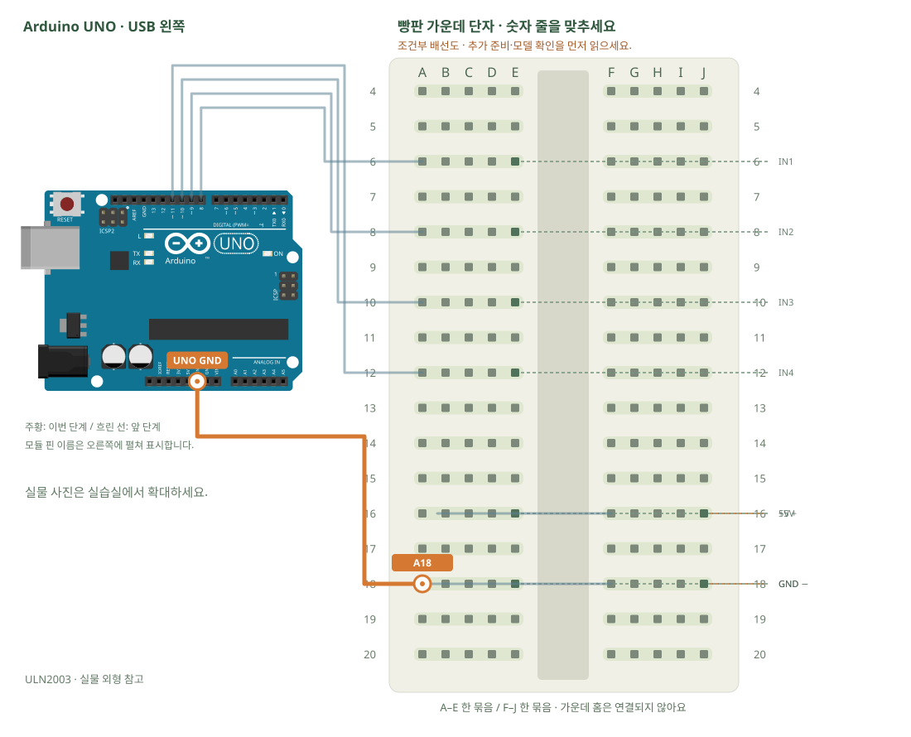

# 스텝모터 · 드라이버로 순서 제어

[실물 사진과 한 단계씩 바뀌는 배선도 열기](../kit/guide/index.html?lab=K19#workbench)



그림을 확대하고 한 선씩 보려면 위 실습실을 여세요. 부품별 추가 준비 조건은 아래에서 먼저 확인합니다.

## 무엇을 하는 부품인가요?

스텝모터는 코일을 순서대로 켜서 조금씩 회전합니다. UNO는 제어 순서만 보내고 ULN2003이 모터 전류를 다룹니다. 28BYJ-48의 기어비와 1회전 스텝 수에는 차이가 있어 코드 상수를 실제 회전과 비교해야 합니다.

## 준비와 방향

필요 부품: ULN2003 모터 드라이버, 28BYJ-48 스텝모터. 실물 사진은 위 실습 화면에서 각각 확대할 수 있습니다.

모터는 빵판에 꽂지 않습니다. 흰 커넥터의 걸쇠 방향을 맞춰 ULN2003 전용 5핀 소켓에 꽂습니다. 억지로 거꾸로 꽂지 않습니다. UNO D8~D11은 IN1~IN4에 차례로 연결하되 코드 생성자 순서는 8,10,9,11입니다.

**연결 전 확인:** 정격 5V 모터와 별도 5V 전원이 필요합니다. 외부 전원과 UNO는 GND만 공통으로 연결합니다. 모터 정격·드라이버 전원 단자의 +/−가 확인되기 전에는 켜지 않습니다.

## 부품을 놓으세요

1. **ULN2003**: IN1 → E6, IN2 → E8, IN3 → E10, IN4 → E12, +5V → E16, GND → E18
2. **외부 안정된 5V 전원 · 추가 준비**: 5V + → J16, GND − → J18

## 왜 이 위치에 연결하나요?

- 글자·숫자는 위치 주소입니다. 지정 구멍을 고른 이유는 연결할 부품 다리와 같은 금속판을 쓰거나, 서로 떨어진 묶음을 부품으로 잇기 위해서입니다.
- 빈 대체 구멍은 같은 다섯 구멍 묶음에서 고릅니다. 한 부품의 위치를 다른 줄로 옮기면 그 다리와 연결된 선도 함께 옮겨야 합니다. 선 색이나 화면상의 선 교차만으로 전기 연결이 생기지는 않습니다.

[구멍 안의 연결 구조·전류 경로·틀린 배선을 그림으로 비교하기](../kit/guide/index.html?lab=K19#breadboard-basics)


## 선을 한 개씩 연결하세요

| 순서 | 출발 | 도착 | 연결 이유 |
|---:|---|---|---|
| 1 | UNO D8 | A6 | UNO D8 핀은 코드에서 정한 디지털 입출력·통신 핀입니다. 빵판 줄 번호가 아니라 UNO 핀 번호와 코드가 일치해야 합니다. 보드 쪽 연결점은 UNO D8입니다. A6 위치는 A6·B6·C6·D6·E6와 같은 금속판입니다. E6에 놓인 ULN2003의 IN1 지점과 이어집니다. |
| 2 | UNO D9 | A8 | UNO D9 핀은 코드에서 정한 디지털 입출력·통신 핀입니다. 빵판 줄 번호가 아니라 UNO 핀 번호와 코드가 일치해야 합니다. 보드 쪽 연결점은 UNO D9입니다. A8 위치는 A8·B8·C8·D8·E8와 같은 금속판입니다. E8에 놓인 ULN2003의 IN2 지점과 이어집니다. |
| 3 | UNO D10 | A10 | UNO D10 핀은 코드에서 정한 디지털 입출력·통신 핀입니다. 빵판 줄 번호가 아니라 UNO 핀 번호와 코드가 일치해야 합니다. 보드 쪽 연결점은 UNO D10입니다. A10 위치는 A10·B10·C10·D10·E10와 같은 금속판입니다. E10에 놓인 ULN2003의 IN3 지점과 이어집니다. |
| 4 | UNO D11 | A12 | UNO D11 핀은 코드에서 정한 디지털 입출력·통신 핀입니다. 빵판 줄 번호가 아니라 UNO 핀 번호와 코드가 일치해야 합니다. 보드 쪽 연결점은 UNO D11입니다. A12 위치는 A12·B12·C12·D12·E12와 같은 금속판입니다. E12에 놓인 ULN2003의 IN4 지점과 이어집니다. |
| 5 | B16 | F16 | 같은 숫자라도 가운데 홈 양쪽은 떨어져 있습니다. 이 점퍼선으로 두 금속판을 이어야 회로가 연결됩니다. B16 위치는 A16·B16·C16·D16·E16와 같은 금속판입니다. E16에 놓인 ULN2003의 +5V 지점과 이어집니다. F16 위치는 F16·G16·H16·I16·J16와 같은 금속판입니다. J16에 놓인 외부 안정된 5V 전원 · 추가 준비의 5V + 지점과 이어집니다. |
| 6 | B18 | F18 | 같은 숫자라도 가운데 홈 양쪽은 떨어져 있습니다. 이 점퍼선으로 두 금속판을 이어야 회로가 연결됩니다. B18 위치는 A18·B18·C18·D18·E18와 같은 금속판입니다. E18에 놓인 ULN2003의 GND 지점과 이어집니다. F18 위치는 F18·G18·H18·I18·J18와 같은 금속판입니다. J18에 놓인 외부 안정된 5V 전원 · 추가 준비의 GND − 지점과 이어집니다. |
| 7 | UNO GND | A18 | 외부 전원과 UNO의 0V 기준을 맞춰 제어 신호를 읽게 합니다. 모터의 전원 전류는 별도 외부 전원 경로를 이용하며 UNO 신호 핀에서 공급하지 않습니다. 보드 쪽 연결점은 UNO GND입니다. A18 위치는 A18·B18·C18·D18·E18와 같은 금속판입니다. E18에 놓인 ULN2003의 GND 지점과 이어집니다. |

그림과 표는 같은 연결 데이터로 생성합니다. 선 색이 달라도 양 끝 이름이 같으면 같은 연결입니다. 한 단계를 완료한 뒤 다음으로 이동하고, 마지막에는 전체 연결표로 빠진 선을 확인합니다.

## 저장과 실행

Arduino IDE에서 새 스케치를 만들고 아래 코드를 붙여넣습니다. 파일은 `K19/K19.ino`로 저장합니다. 보드는 Arduino Uno, 포트는 실제 연결된 COM, 시리얼 모니터는 9600으로 맞춥니다. 검증 버튼은 코드의 문법을 검사하고, 업로드 버튼은 연결된 보드로 프로그램을 보냅니다.

라이브러리 관리자 설치: Stepper 1.1.3.

```cpp
// 스텝모터 · 드라이버로 순서 제어
// 보드: Arduino Uno / 시리얼 모니터: 9600 baud
// USB를 뽑고 배선한 뒤, 아래 연결표와 코드의 핀 번호를 대조하세요.

#include <Stepper.h>
const int STEPS_PER_REV = 2048; // 4상 구동의 시작값. 실제 모터로 회전량을 확인합니다.
Stepper motor(STEPS_PER_REV, 8, 10, 9, 11); // 라이브러리의 코일 순서에 맞춘 핀 순서
void releaseCoils() {
  for (int p=8;p<=11;p++) digitalWrite(p, LOW); // 대기 중 코일 발열을 줄입니다.
}
void setup() { motor.setSpeed(8); } // 분당 회전수의 시작값
void loop() {
  motor.step(256); releaseCoils(); delay(1000);
  motor.step(-256); releaseCoils(); delay(1000);
}

```

## 예상 결과와 직접 바꾸기

모터의 흰 5핀 커넥터를 드라이버 전용 소켓에 꽂은 뒤, 축이 조금씩 정·역회전합니다.

한 바퀴가 되도록 스텝 수를 관찰해 기록합니다.

바꾸기 전 예상과 바꾼 뒤 실제 결과를 나눠 적습니다. 실행하지 못했다면 이유와 다음 확인 항목을 적습니다. 예시 출력은 내 보드의 실제 측정 기록이 아니므로 자신의 값·사진으로 남깁니다.

## 잘 안될 때

LED만 켜지고 축이 떨리면 전원·모터 플러그·8,10,9,11 순서를 확인합니다.

코드에 적힌 핀과 연결표부터 비교합니다. 회로를 고칠 때는 USB와 외부 전원을 모두 분리합니다. 프로그램의 컴파일 성공과 실제 부품의 동작은 별도로 확인합니다. 고친 선·코드·결과를 함께 기록하면 다음에 같은 문제를 찾아낼 수 있습니다.
