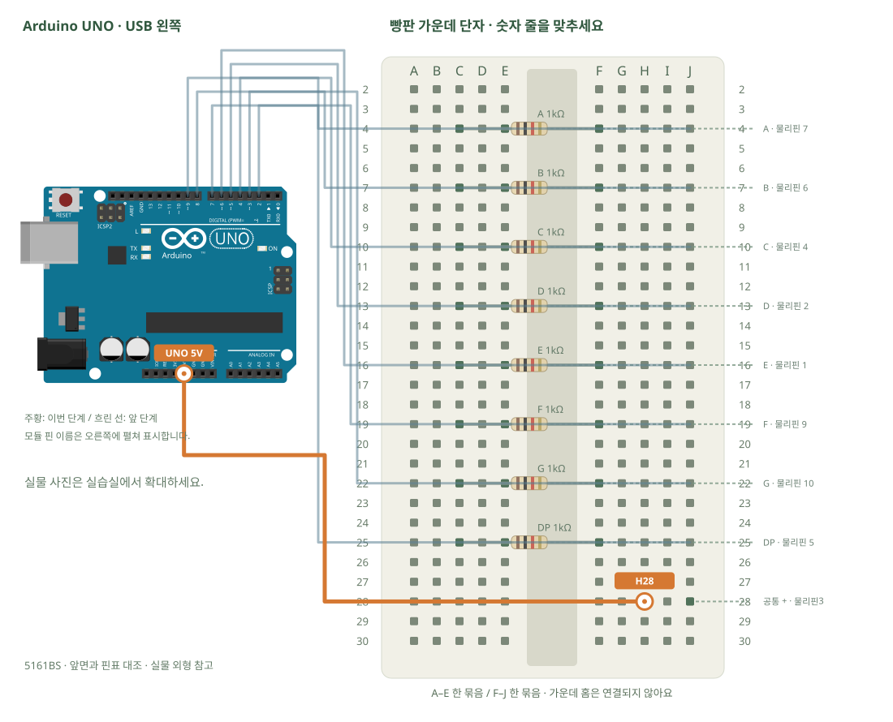

# 1자리 FND · 숫자 표시

[실물 사진과 한 단계씩 바뀌는 배선도 열기](../kit/guide/index.html?lab=K21#workbench)



그림을 확대하고 한 선씩 보려면 위 실습실을 여세요. 부품별 추가 준비 조건은 아래에서 먼저 확인합니다.

## 무엇을 하는 부품인가요?

FND의 한 막대를 세그먼트라고 합니다. 5161BS는 공통 +를 쓰므로 세그먼트 쪽을 LOW로 만들면 켜집니다. 막대 7개와 점에 각각 저항을 달아야 합니다. 앞에서 본 핀 번호와 뒤에서 본 번호를 섞지 않습니다.

## 준비와 방향

필요 부품: 1자리 FND · 5161BS, 고정저항. 실물 사진은 위 실습 화면에서 각각 확대할 수 있습니다.

판매처 5161BS 핀표를 확대합니다. 앞면 기준 아래줄은 왼쪽부터1~5, 윗줄은 왼쪽부터10~6입니다. 표시기를 빵판 바깥에 두고 각 핀에 암–수 선을 연결해 그림의 지정 구멍으로 펼쳐 꽂습니다. 본체의 핀 간격을 그림의 줄 간격으로 오해하지 않습니다. 공통핀8은 이번에는 비워 둡니다.

USB를 먼저 뽑습니다. 같은 숫자의 A~E, F~J는 각각 하나의 연결 묶음이고 가운데 홈을 사이에 둔 두 묶음은 떨어져 있습니다.

## 부품을 놓으세요

1. **5161BS · 앞면과 핀표 대조**: A · 물리핀 7 → E4, B · 물리핀 6 → E7, C · 물리핀 4 → E10, D · 물리핀 2 → E13, E · 물리핀 1 → E16, F · 물리핀 9 → E19, G · 물리핀 10 → E22, DP · 물리핀 5 → E25, 공통 + · 물리핀3 → J28, 공통 + · 물리핀8 · 비움 → J29
2. **A 1kΩ**: 한쪽 → C4, 다른쪽 → F4
3. **B 1kΩ**: 한쪽 → C7, 다른쪽 → F7
4. **C 1kΩ**: 한쪽 → C10, 다른쪽 → F10
5. **D 1kΩ**: 한쪽 → C13, 다른쪽 → F13
6. **E 1kΩ**: 한쪽 → C16, 다른쪽 → F16
7. **F 1kΩ**: 한쪽 → C19, 다른쪽 → F19
8. **G 1kΩ**: 한쪽 → C22, 다른쪽 → F22
9. **DP 1kΩ**: 한쪽 → C25, 다른쪽 → F25

## 선을 한 개씩 연결하세요

| 순서 | 출발 | 도착 | 연결 이유 |
|---:|---|---|---|
| 1 | UNO D2 | J4 | 그림의 양 끝 이름을 확인하고 USB를 뺀 상태에서 연결합니다. |
| 2 | UNO D3 | J7 | 그림의 양 끝 이름을 확인하고 USB를 뺀 상태에서 연결합니다. |
| 3 | UNO D4 | J10 | 그림의 양 끝 이름을 확인하고 USB를 뺀 상태에서 연결합니다. |
| 4 | UNO D5 | J13 | 그림의 양 끝 이름을 확인하고 USB를 뺀 상태에서 연결합니다. |
| 5 | UNO D6 | J16 | 그림의 양 끝 이름을 확인하고 USB를 뺀 상태에서 연결합니다. |
| 6 | UNO D7 | J19 | 그림의 양 끝 이름을 확인하고 USB를 뺀 상태에서 연결합니다. |
| 7 | UNO D8 | J22 | 그림의 양 끝 이름을 확인하고 USB를 뺀 상태에서 연결합니다. |
| 8 | UNO D9 | J25 | 그림의 양 끝 이름을 확인하고 USB를 뺀 상태에서 연결합니다. |
| 9 | UNO 5V | H28 | 그림의 양 끝 이름을 확인하고 USB를 뺀 상태에서 연결합니다. |

그림과 표는 같은 연결 데이터로 생성합니다. 선 색이 달라도 양 끝 이름이 같으면 같은 연결입니다. 한 단계를 완료한 뒤 다음으로 이동하고, 마지막에는 전체 연결표로 빠진 선을 확인합니다.

## 저장과 실행

Arduino IDE에서 새 스케치를 만들고 아래 코드를 붙여넣습니다. 파일은 `K21/K21.ino`로 저장합니다. 보드는 Arduino Uno, 포트는 실제 연결된 COM, 시리얼 모니터는 9600으로 맞춥니다. 검증 버튼은 코드의 문법을 검사하고, 업로드 버튼은 연결된 보드로 프로그램을 보냅니다.

이 예제는 추가 라이브러리 설치가 필요하지 않습니다.

```cpp
// 1자리 FND · 숫자 표시
// 보드: Arduino Uno / 시리얼 모니터: 9600 baud
// USB를 뽑고 배선한 뒤, 아래 연결표와 코드의 핀 번호를 대조하세요.

const byte pins[8] = {2,3,4,5,6,7,8,9}; // A,B,C,D,E,F,G,DP 순서
const byte patterns[10] = {0x3F,0x06,0x5B,0x4F,0x66,0x6D,0x7D,0x07,0x7F,0x6F};
void setup() { for (byte p:pins) { digitalWrite(p,HIGH); pinMode(p,OUTPUT); } }
void loop() {
  for (byte number=0;number<10;number++) {
    for (byte s=0;s<8;s++) {
      bool lit = (patterns[number] >> s) & 1; // 해당 막대를 켤지 비트에서 읽습니다.
      digitalWrite(pins[s], lit ? LOW : HIGH); // 공통 애노드는 LOW가 켜짐입니다.
    }
    delay(800);
  }
}

```

## 예상 결과와 직접 바꾸기

0~9가 순서대로 표시됩니다.

키패드에서 받은 숫자를 표시하도록 바꿉니다.

바꾸기 전 예상과 바꾼 뒤 실제 결과를 나눠 적습니다. 실행하지 못했다면 이유와 다음 확인 항목을 적습니다. 예시 출력은 내 보드의 실제 측정 기록이 아니므로 자신의 값·사진으로 남깁니다.

## 잘 안될 때

이상한 모양이면 A~G와 물리핀 대응을 다시 봅니다. 공통 캐소드형 예제의 HIGH 켜짐을 적용하지 않습니다.

코드에 적힌 핀과 연결표부터 비교합니다. 회로를 고칠 때는 USB와 외부 전원을 모두 분리합니다. 프로그램의 컴파일 성공과 실제 부품의 동작은 별도로 확인합니다. 고친 선·코드·결과를 함께 기록하면 다음에 같은 문제를 찾아낼 수 있습니다.
