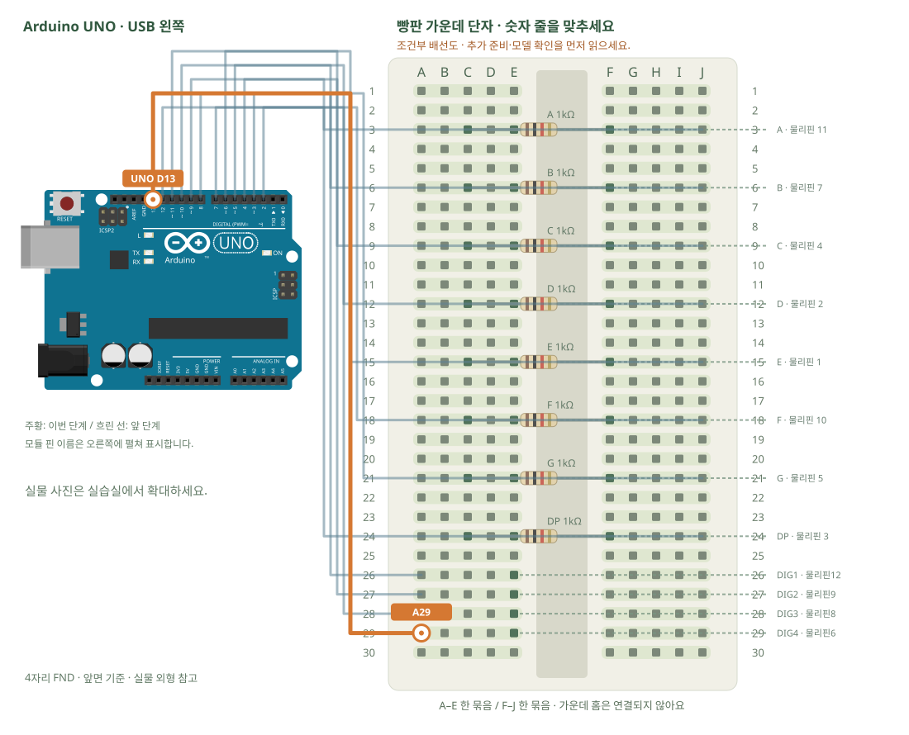

# 4자리 FND · 빠르게 번갈아 켜기

[실물 사진과 한 단계씩 바뀌는 배선도 열기](../kit/guide/index.html?lab=K22#workbench)



그림을 확대하고 한 선씩 보려면 위 실습실을 여세요. 부품별 추가 준비 조건은 아래에서 먼저 확인합니다.

## 무엇을 하는 부품인가요?

여러 자리를 아주 빠르게 번갈아 켜면 눈에는 함께 보입니다. 이를 다중화라고 합니다. 이 예제는 공통 핀 전류를 낮추기 위해 한 번에 한 자리의 한 막대만 켭니다. 드라이버 없이 모든 막대를 한꺼번에 켜지 않습니다.

## 준비와 방향

필요 부품: 4자리 FND · HS410561K-32, 고정저항. 실물 사진은 위 실습 화면에서 각각 확대할 수 있습니다.

판매처 HS410561K-32의 FRONT VIEW 핀표를 확인합니다. A11·B7·C4·D2·E1·F10·G5·DP3, DIG1=12·DIG2=9·DIG3=8·DIG4=6입니다. 표시기를 바깥에 두고 암–수 선으로 각 핀을 그림의 구멍에 펼쳐 연결합니다.

**연결 전 확인:** 막대마다 1kΩ 저항 8개가 필요합니다. 구성표는 저항 종류별 수량을 밝히지 않으므로 실제 수량을 먼저 셉니다. 부족하면 같은 값을 추가 준비하고, 임의로 저항을 생략하지 않습니다. 이 펼친 배선 방식에는 암–수 점퍼선12개가 필요합니다. 기본10개보다2개가 더 필요하므로 추가 준비합니다.

## 부품을 놓으세요

1. **4자리 FND · 앞면 기준**: A · 물리핀 11 → E3, B · 물리핀 7 → E6, C · 물리핀 4 → E9, D · 물리핀 2 → E12, E · 물리핀 1 → E15, F · 물리핀 10 → E18, G · 물리핀 5 → E21, DP · 물리핀 3 → E24, DIG1 · 물리핀12 → E26, DIG2 · 물리핀9 → E27, DIG3 · 물리핀8 → E28, DIG4 · 물리핀6 → E29
2. **A 1kΩ**: 한쪽 → C3, 다른쪽 → F3
3. **B 1kΩ**: 한쪽 → C6, 다른쪽 → F6
4. **C 1kΩ**: 한쪽 → C9, 다른쪽 → F9
5. **D 1kΩ**: 한쪽 → C12, 다른쪽 → F12
6. **E 1kΩ**: 한쪽 → C15, 다른쪽 → F15
7. **F 1kΩ**: 한쪽 → C18, 다른쪽 → F18
8. **G 1kΩ**: 한쪽 → C21, 다른쪽 → F21
9. **DP 1kΩ**: 한쪽 → C24, 다른쪽 → F24

## 선을 한 개씩 연결하세요

| 순서 | 출발 | 도착 | 연결 이유 |
|---:|---|---|---|
| 1 | UNO D2 | J3 | 그림의 양 끝 이름을 확인하고 USB를 뺀 상태에서 연결합니다. |
| 2 | UNO D3 | J6 | 그림의 양 끝 이름을 확인하고 USB를 뺀 상태에서 연결합니다. |
| 3 | UNO D4 | J9 | 그림의 양 끝 이름을 확인하고 USB를 뺀 상태에서 연결합니다. |
| 4 | UNO D5 | J12 | 그림의 양 끝 이름을 확인하고 USB를 뺀 상태에서 연결합니다. |
| 5 | UNO D6 | J15 | 그림의 양 끝 이름을 확인하고 USB를 뺀 상태에서 연결합니다. |
| 6 | UNO D7 | J18 | 그림의 양 끝 이름을 확인하고 USB를 뺀 상태에서 연결합니다. |
| 7 | UNO D8 | J21 | 그림의 양 끝 이름을 확인하고 USB를 뺀 상태에서 연결합니다. |
| 8 | UNO D9 | J24 | 그림의 양 끝 이름을 확인하고 USB를 뺀 상태에서 연결합니다. |
| 9 | UNO D10 | A26 | 그림의 양 끝 이름을 확인하고 USB를 뺀 상태에서 연결합니다. |
| 10 | UNO D11 | A27 | 그림의 양 끝 이름을 확인하고 USB를 뺀 상태에서 연결합니다. |
| 11 | UNO D12 | A28 | 그림의 양 끝 이름을 확인하고 USB를 뺀 상태에서 연결합니다. |
| 12 | UNO D13 | A29 | 그림의 양 끝 이름을 확인하고 USB를 뺀 상태에서 연결합니다. |

그림과 표는 같은 연결 데이터로 생성합니다. 선 색이 달라도 양 끝 이름이 같으면 같은 연결입니다. 한 단계를 완료한 뒤 다음으로 이동하고, 마지막에는 전체 연결표로 빠진 선을 확인합니다.

## 저장과 실행

Arduino IDE에서 새 스케치를 만들고 아래 코드를 붙여넣습니다. 파일은 `K22/K22.ino`로 저장합니다. 보드는 Arduino Uno, 포트는 실제 연결된 COM, 시리얼 모니터는 9600으로 맞춥니다. 검증 버튼은 코드의 문법을 검사하고, 업로드 버튼은 연결된 보드로 프로그램을 보냅니다.

이 예제는 추가 라이브러리 설치가 필요하지 않습니다.

```cpp
// 4자리 FND · 빠르게 번갈아 켜기
// 보드: Arduino Uno / 시리얼 모니터: 9600 baud
// USB를 뽑고 배선한 뒤, 아래 연결표와 코드의 핀 번호를 대조하세요.

const byte segments[8]={2,3,4,5,6,7,8,9};
const byte digits[4]={10,11,12,13};
const byte patterns[10]={0x3F,0x06,0x5B,0x4F,0x66,0x6D,0x7D,0x07,0x7F,0x6F};
const byte values[4]={1,2,3,4};
void blank() {
  for (byte p:digits) { digitalWrite(p,LOW); pinMode(p,INPUT); } // 선택하지 않은 공통 핀은 떠 있게 합니다.
  for (byte p:segments) digitalWrite(p,HIGH); // 모든 막대도 끕니다.
}
void setup() {
  for (byte p:segments) { digitalWrite(p,HIGH); pinMode(p,OUTPUT); }
  for (byte p:digits) { digitalWrite(p,LOW); pinMode(p,INPUT); }
}
void loop() {
  for (byte d=0;d<4;d++) for (byte s=0;s<7;s++) {
    blank();
    if ((patterns[values[d]] >> s) & 1) {
      digitalWrite(segments[s],LOW);
      pinMode(digits[d],OUTPUT); digitalWrite(digits[d],HIGH);
      delayMicroseconds(250); // 한 번에 한 LED만 켜는 낮은 듀티 예제입니다.
    }
  }
  blank();
}

```

## 예상 결과와 직접 바꾸기

1234가 희미하게 표시됩니다. 카메라에는 줄무늬·깜빡임이 보일 수 있습니다.

values 배열을 자신의 네 자리 숫자로 바꿉니다.

바꾸기 전 예상과 바꾼 뒤 실제 결과를 나눠 적습니다. 실행하지 못했다면 이유와 다음 확인 항목을 적습니다. 예시 출력은 내 보드의 실제 측정 기록이 아니므로 자신의 값·사진으로 남깁니다.

## 잘 안될 때

어두운 것은 낮은 듀티 때문일 수 있습니다. 저항을 빼 밝게 만들지 않습니다. 밝은 완성품은 별도 표시기 드라이버로 설계합니다.

코드에 적힌 핀과 연결표부터 비교합니다. 회로를 고칠 때는 USB와 외부 전원을 모두 분리합니다. 프로그램의 컴파일 성공과 실제 부품의 동작은 별도로 확인합니다. 고친 선·코드·결과를 함께 기록하면 다음에 같은 문제를 찾아낼 수 있습니다.
