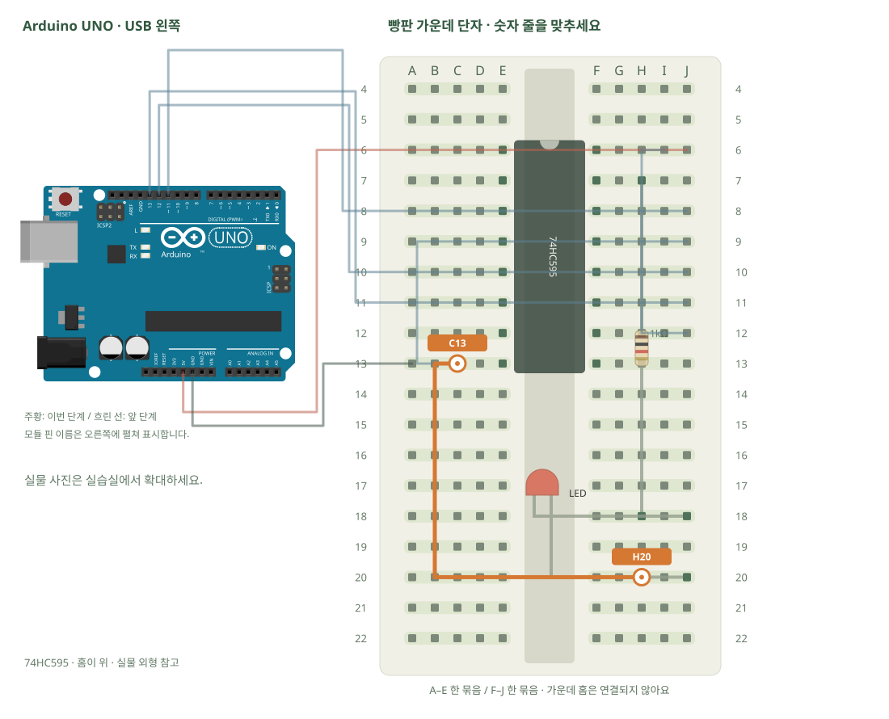

# 74HC595 · 선 세 개로 출력 늘리기

[실물 사진과 한 단계씩 바뀌는 배선도 열기](../kit/guide/index.html?lab=K23#workbench)



그림을 확대하고 한 선씩 보려면 위 실습실을 여세요. 부품별 추가 준비 조건은 아래에서 먼저 확인합니다.

## 무엇을 하는 부품인가요?

시프트 레지스터는 데이터를 한 비트씩 받은 뒤 한 번에 출력으로 옮깁니다. DS는 데이터, SHCP는 데이터를 밀어 넣는 시계, STCP는 출력에 반영하는 래치입니다. 처음에는 Q0 LED 한 개로 순서를 확인합니다.

## 준비와 방향

필요 부품: 74HC595, 빨강·노랑·초록 LED, 고정저항. 실물 사진은 위 실습 화면에서 각각 확대할 수 있습니다.

칩의 반달 홈·점이 위로 보이게 빵판 가운데 홈을 가로질러 E6~E13·F6~F13에 꽂습니다. 위에서 본 1번은 왼쪽 위, 아래로1~8·오른쪽 아래9부터 위로16입니다. 부품을 꽂기 전 모든 다리가 바깥으로 벌어지거나 접히지 않았는지 확인합니다.

USB를 먼저 뽑습니다. 같은 숫자의 A~E, F~J는 각각 하나의 연결 묶음이고 가운데 홈을 사이에 둔 두 묶음은 떨어져 있습니다.

## 부품을 놓으세요

1. **74HC595 · 홈이 위**: 16 VCC → F6, 15 Q0 → F7, 14 DS → F8, 13 /OE → F9, 12 STCP → F10, 11 SHCP → F11, 10 /MR → F12, 9 Q7S · 비움 → F13, 1 Q1 · 비움 → E6, 2 Q2 · 비움 → E7, 3 Q3 · 비움 → E8, 4 Q4 · 비움 → E9, 5 Q5 · 비움 → E10, 6 Q6 · 비움 → E11, 7 Q7 · 비움 → E12, 8 GND → E13
2. **1kΩ**: 한쪽 → H7, 다른쪽 → H18
3. **LED**: 긴 + → J18, 짧은 − → J20

## 선을 한 개씩 연결하세요

| 순서 | 출발 | 도착 | 연결 이유 |
|---:|---|---|---|
| 1 | UNO 5V | J6 | 그림의 양 끝 이름을 확인하고 USB를 뺀 상태에서 연결합니다. |
| 2 | UNO GND | A13 | 그림의 양 끝 이름을 확인하고 USB를 뺀 상태에서 연결합니다. |
| 3 | B13 | J9 | 그림의 양 끝 이름을 확인하고 USB를 뺀 상태에서 연결합니다. |
| 4 | I6 | J12 | 그림의 양 끝 이름을 확인하고 USB를 뺀 상태에서 연결합니다. |
| 5 | UNO D11 | J8 | 그림의 양 끝 이름을 확인하고 USB를 뺀 상태에서 연결합니다. |
| 6 | UNO D12 | J10 | 그림의 양 끝 이름을 확인하고 USB를 뺀 상태에서 연결합니다. |
| 7 | UNO D13 | J11 | 그림의 양 끝 이름을 확인하고 USB를 뺀 상태에서 연결합니다. |
| 8 | C13 | H20 | 그림의 양 끝 이름을 확인하고 USB를 뺀 상태에서 연결합니다. |

그림과 표는 같은 연결 데이터로 생성합니다. 선 색이 달라도 양 끝 이름이 같으면 같은 연결입니다. 한 단계를 완료한 뒤 다음으로 이동하고, 마지막에는 전체 연결표로 빠진 선을 확인합니다.

## 저장과 실행

Arduino IDE에서 새 스케치를 만들고 아래 코드를 붙여넣습니다. 파일은 `K23/K23.ino`로 저장합니다. 보드는 Arduino Uno, 포트는 실제 연결된 COM, 시리얼 모니터는 9600으로 맞춥니다. 검증 버튼은 코드의 문법을 검사하고, 업로드 버튼은 연결된 보드로 프로그램을 보냅니다.

이 예제는 추가 라이브러리 설치가 필요하지 않습니다.

```cpp
// 74HC595 · 선 세 개로 출력 늘리기
// 보드: Arduino Uno / 시리얼 모니터: 9600 baud
// USB를 뽑고 배선한 뒤, 아래 연결표와 코드의 핀 번호를 대조하세요.

const int DATA=11, LATCH=12, CLOCK=13;
void setup() { pinMode(DATA,OUTPUT); pinMode(LATCH,OUTPUT); pinMode(CLOCK,OUTPUT); }
void writeByte(byte value) {
  digitalWrite(LATCH,LOW); // 8비트를 준비하는 동안 출력을 고정합니다.
  shiftOut(DATA,CLOCK,MSBFIRST,value); // 상위 비트부터 보냅니다.
  digitalWrite(LATCH,HIGH); // 준비한 값을 Q0~Q7에 반영합니다.
}
void loop() { writeByte(1); delay(1000); writeByte(0); delay(1000); }

```

## 예상 결과와 직접 바꾸기

Q0에 연결한 LED가 1초마다 켜졌다 꺼집니다.

각 출력에 개별 저항을 추가 준비해 Q1~Q7로 이동하는 불빛을 만듭니다.

바꾸기 전 예상과 바꾼 뒤 실제 결과를 나눠 적습니다. 실행하지 못했다면 이유와 다음 확인 항목을 적습니다. 예시 출력은 내 보드의 실제 측정 기록이 아니므로 자신의 값·사진으로 남깁니다.

## 잘 안될 때

/OE는 LOW, /MR은 HIGH여야 합니다. 16 VCC와 8 GND를 뒤집지 않습니다.

코드에 적힌 핀과 연결표부터 비교합니다. 회로를 고칠 때는 USB와 외부 전원을 모두 분리합니다. 프로그램의 컴파일 성공과 실제 부품의 동작은 별도로 확인합니다. 고친 선·코드·결과를 함께 기록하면 다음에 같은 문제를 찾아낼 수 있습니다.
