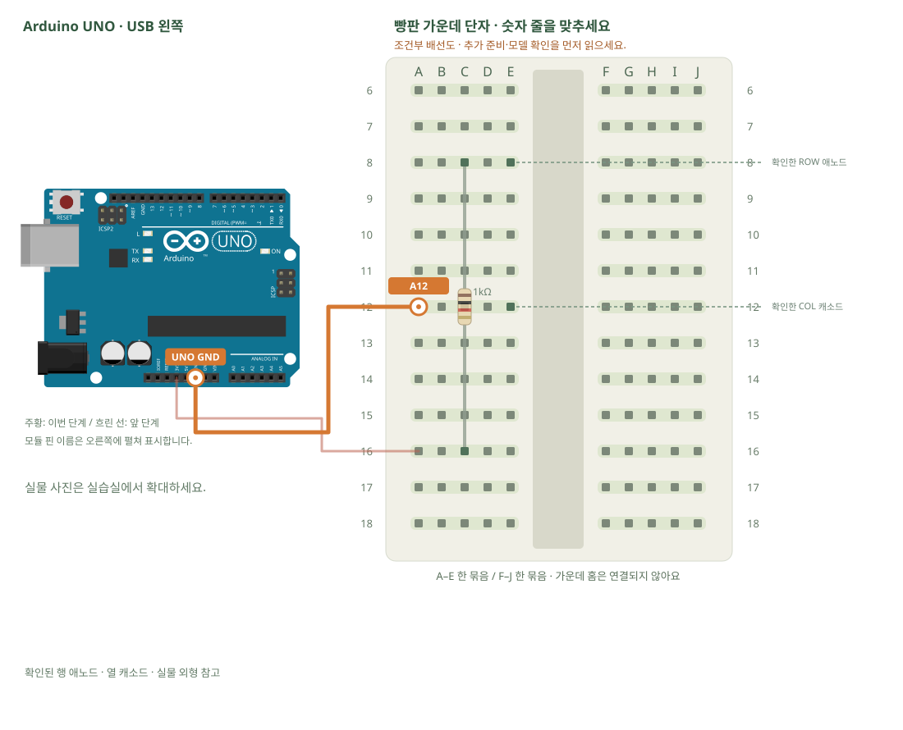

# 도트매트릭스 · 한 점과 핀 지도

[실물 사진과 한 단계씩 바뀌는 배선도 열기](../kit/guide/index.html?lab=K24#workbench)



그림을 확대하고 한 선씩 보려면 위 실습실을 여세요. 부품별 추가 준비 조건은 아래에서 먼저 확인합니다.

## 무엇을 하는 부품인가요?

8×8 표시기는 64개 LED를 행과 열로 묶습니다. 키트 사진은 핀16개짜리 맨 부품이며 MAX7219 통신 모듈이 아닙니다. 핀 번호·행열·극성이 확인돼야 전체 화면 스캔을 만들 수 있습니다. 외형이 같은 1088·1388 부품의 서로 다른 핀표를 섞지 않습니다.

## 준비와 방향

필요 부품: 8×8 도트매트릭스, 고정저항. 실물 사진은 위 실습 화면에서 각각 확대할 수 있습니다.

부품 핀의 이름을 먼저 확인합니다. 모듈 그림은 핀 이름을 읽기 위한 펼친 그림이며, 실물 커넥터의 좌우 순서를 뜻하지 않습니다. 표시가 다른 부품은 연결 전에 해당 모델 핀표와 대조합니다.

**연결 전 확인:** 상품 사진의 SH13888A 글자만으로 공급된 부품의 제조사·행열 핀표·역전압 정격을 확정할 수 없습니다. 이 실습은 해당 부품의 핀표와 허용전압을 확보한 후 진행하는 조건부 한 점 회로입니다. 자료가 없으면 부품 식별·핀 지도 작성까지만 하고 전원을 연결하지 않습니다. 모든 핀을 추측한 완성 배선도로 제공하지 않습니다.

## 부품을 놓으세요

1. **확인된 행 애노드 · 열 캐소드**: 확인한 ROW 애노드 → E8, 확인한 COL 캐소드 → E12
2. **1kΩ**: 한쪽 → C8, 다른쪽 → C16

## 왜 이 위치에 연결하나요?

- 글자·숫자는 위치 주소입니다. 지정 구멍을 고른 이유는 연결할 부품 다리와 같은 금속판을 쓰거나, 서로 떨어진 묶음을 부품으로 잇기 위해서입니다.
- 빈 대체 구멍은 같은 다섯 구멍 묶음에서 고릅니다. 한 부품의 위치를 다른 줄로 옮기면 그 다리와 연결된 선도 함께 옮겨야 합니다. 선 색이나 화면상의 선 교차만으로 전기 연결이 생기지는 않습니다.

[구멍 안의 연결 구조·전류 경로·틀린 배선을 그림으로 비교하기](../kit/guide/index.html?lab=K24#breadboard-basics)


## 선을 한 개씩 연결하세요

| 순서 | 출발 | 도착 | 연결 이유 |
|---:|---|---|---|
| 1 | UNO 3V3 | A16 | 부품에 3.3V 전원을 공급하는 연결입니다. 신호를 읽는 선과 역할이 다릅니다. 보드 쪽 연결점은 UNO 3V3입니다. A16 위치는 A16·B16·C16·D16·E16와 같은 금속판입니다. C16에 놓인 1kΩ의 다른쪽 지점과 이어집니다. |
| 2 | UNO GND | A12 | GND는 보드의 0V 기준입니다. 부품과 보드의 기준을 맞추고 이 회로에 필요한 전류의 돌아가는 길을 연결합니다. 보드 쪽 연결점은 UNO GND입니다. A12 위치는 A12·B12·C12·D12·E12와 같은 금속판입니다. E12에 놓인 확인된 행 애노드 · 열 캐소드의 확인한 COL 캐소드 지점과 이어집니다. |

그림과 표는 같은 연결 데이터로 생성합니다. 선 색이 달라도 양 끝 이름이 같으면 같은 연결입니다. 한 단계를 완료한 뒤 다음으로 이동하고, 마지막에는 전체 연결표로 빠진 선을 확인합니다.

## 저장과 실행

Arduino IDE에서 새 스케치를 만들고 아래 코드를 붙여넣습니다. 파일은 `K24/K24.ino`로 저장합니다. 보드는 Arduino Uno, 포트는 실제 연결된 COM, 시리얼 모니터는 9600으로 맞춥니다. 검증 버튼은 코드의 문법을 검사하고, 업로드 버튼은 연결된 보드로 프로그램을 보냅니다.

이 예제는 추가 라이브러리 설치가 필요하지 않습니다.

```cpp
// 도트매트릭스 · 한 점과 핀 지도
// 보드: Arduino Uno / 시리얼 모니터: 9600 baud
// USB를 뽑고 배선한 뒤, 아래 연결표와 코드의 핀 번호를 대조하세요.

// 이 단계는 3.3V + 1kΩ으로 확인된 한 점을 켜는 전원 회로입니다.
// 프로그램으로 16핀을 임의 순회하지 않습니다.
void setup() { Serial.begin(9600); Serial.println("Check the documented row/column pair"); }
void loop() {} // 표시기의 행·열 핀표가 확인되기 전에는 디지털 핀을 연결하지 않습니다.

```

## 예상 결과와 직접 바꾸기

자료에서 확인한 행·열의 교차점 LED 한 개가 켜집니다.

공식 핀표에 각 핀의 행·열을 적고, 전원을 끈 뒤 다른 확인된 한 쌍으로 옮겨 위치를 비교합니다.

바꾸기 전 예상과 바꾼 뒤 실제 결과를 나눠 적습니다. 실행하지 못했다면 이유와 다음 확인 항목을 적습니다. 예시 출력은 내 보드의 실제 측정 기록이 아니므로 자신의 값·사진으로 남깁니다.

## 잘 안될 때

불이 안 들어오면 무작정 극성을 바꾸지 말고 부품 모델·핀표의 앞/뒤 방향을 확인합니다.

코드에 적힌 핀과 연결표부터 비교합니다. 회로를 고칠 때는 USB와 외부 전원을 모두 분리합니다. 프로그램의 컴파일 성공과 실제 부품의 동작은 별도로 확인합니다. 고친 선·코드·결과를 함께 기록하면 다음에 같은 문제를 찾아낼 수 있습니다.
