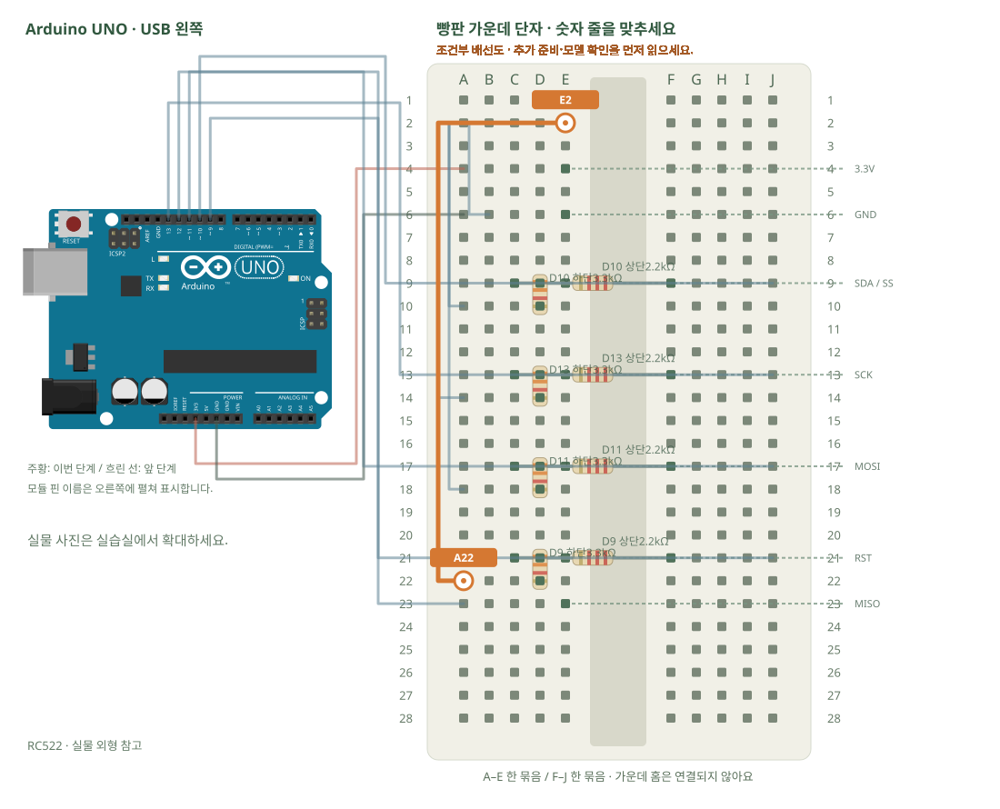

# RFID · 카드와 열쇠고리 읽기

[실물 사진과 한 단계씩 바뀌는 배선도 열기](../kit/guide/index.html?lab=K25#workbench)



그림을 확대하고 한 선씩 보려면 위 실습실을 여세요. 부품별 추가 준비 조건은 아래에서 먼저 확인합니다.

## 무엇을 하는 부품인가요?

SPI는 SCK·MOSI·MISO·SS로 통신합니다. RC522의 SDA 표시는 이 SPI 실습에서는 SS입니다. UNO의 A4 I2C에 연결하지 않습니다. UNO 출력5V는 2.2kΩ·3.3kΩ 분압으로 약3.0V로 낮춥니다. 카드 UID는 비밀번호가 아니며 보안 인증을 대신하지 못합니다.

## 준비와 방향

필요 부품: RFID RC522, RFID 카드, RFID 열쇠고리, 고정저항. 실물 사진은 위 실습 화면에서 각각 확대할 수 있습니다.

부품 핀의 이름을 먼저 확인합니다. 모듈 그림은 핀 이름을 읽기 위한 펼친 그림이며, 실물 커넥터의 좌우 순서를 뜻하지 않습니다. 표시가 다른 부품은 연결 전에 해당 모델 핀표와 대조합니다.

**연결 전 확인:** 2.2kΩ 4개와3.3kΩ 4개 또는 SPI에 맞는 5V→3.3V 레벨 변환기가 필요합니다. 구성표는 저항 값별 수량을 보장하지 않습니다. 부족하면 추가 준비 후 진행합니다. RC522 전원에5V를 넣거나 UNO의5V출력 네 선을 직결하지 않습니다. MISO3.3V는 UNO의 입력으로만 연결합니다.

## 부품을 놓으세요

1. **RC522**: 3.3V → E4, GND → E6, SDA / SS → E9, SCK → E13, MOSI → E17, MISO → E23, RST → E21, IRQ · 비움 → E26
2. **D10 상단2.2kΩ**: 한쪽 → F9, 다른쪽 → C9
3. **D10 하단3.3kΩ**: 한쪽 → D9, 다른쪽 → D10
4. **D13 상단2.2kΩ**: 한쪽 → F13, 다른쪽 → C13
5. **D13 하단3.3kΩ**: 한쪽 → D13, 다른쪽 → D14
6. **D11 상단2.2kΩ**: 한쪽 → F17, 다른쪽 → C17
7. **D11 하단3.3kΩ**: 한쪽 → D17, 다른쪽 → D18
8. **D9 상단2.2kΩ**: 한쪽 → F21, 다른쪽 → C21
9. **D9 하단3.3kΩ**: 한쪽 → D21, 다른쪽 → D22

## 선을 한 개씩 연결하세요

| 순서 | 출발 | 도착 | 연결 이유 |
|---:|---|---|---|
| 1 | UNO 3V3 | A4 | 그림의 양 끝 이름을 확인하고 USB를 뺀 상태에서 연결합니다. |
| 2 | UNO GND | A6 | 그림의 양 끝 이름을 확인하고 USB를 뺀 상태에서 연결합니다. |
| 3 | B6 | A2 | 그림의 양 끝 이름을 확인하고 USB를 뺀 상태에서 연결합니다. |
| 4 | UNO D12 | A23 | 그림의 양 끝 이름을 확인하고 USB를 뺀 상태에서 연결합니다. |
| 5 | UNO D10 | J9 | UNO의 5V 출력을 먼저 2.2kΩ 저항으로 보냅니다. |
| 6 | A10 | B2 | 분압 하단 3.3kΩ을 GND에 연결해 신호를 약3.0V로 낮춥니다. 3.3V 전원의 허용범위를 별도 확인합니다. |
| 7 | UNO D13 | J13 | UNO의 5V 출력을 먼저 2.2kΩ 저항으로 보냅니다. |
| 8 | A14 | C2 | 분압 하단 3.3kΩ을 GND에 연결해 신호를 약3.0V로 낮춥니다. 3.3V 전원의 허용범위를 별도 확인합니다. |
| 9 | UNO D11 | J17 | UNO의 5V 출력을 먼저 2.2kΩ 저항으로 보냅니다. |
| 10 | A18 | D2 | 분압 하단 3.3kΩ을 GND에 연결해 신호를 약3.0V로 낮춥니다. 3.3V 전원의 허용범위를 별도 확인합니다. |
| 11 | UNO D9 | J21 | UNO의 5V 출력을 먼저 2.2kΩ 저항으로 보냅니다. |
| 12 | A22 | E2 | 분압 하단 3.3kΩ을 GND에 연결해 신호를 약3.0V로 낮춥니다. 3.3V 전원의 허용범위를 별도 확인합니다. |

그림과 표는 같은 연결 데이터로 생성합니다. 선 색이 달라도 양 끝 이름이 같으면 같은 연결입니다. 한 단계를 완료한 뒤 다음으로 이동하고, 마지막에는 전체 연결표로 빠진 선을 확인합니다.

## 저장과 실행

Arduino IDE에서 새 스케치를 만들고 아래 코드를 붙여넣습니다. 파일은 `K25/K25.ino`로 저장합니다. 보드는 Arduino Uno, 포트는 실제 연결된 COM, 시리얼 모니터는 9600으로 맞춥니다. 검증 버튼은 코드의 문법을 검사하고, 업로드 버튼은 연결된 보드로 프로그램을 보냅니다.

라이브러리 관리자 설치: MFRC522 1.4.12.

```cpp
// RFID · 카드와 열쇠고리 읽기
// 보드: Arduino Uno / 시리얼 모니터: 9600 baud
// USB를 뽑고 배선한 뒤, 아래 연결표와 코드의 핀 번호를 대조하세요.

#include <SPI.h>
#include <MFRC522.h>
MFRC522 reader(10,9); // SS, RST
void setup() { Serial.begin(9600); SPI.begin(); reader.PCD_Init(); }
void loop() {
  if (!reader.PICC_IsNewCardPresent() || !reader.PICC_ReadCardSerial()) return;
  Serial.print("UID:");
  for (byte i=0;i<reader.uid.size;i++) {
    Serial.print(' ');
    if (reader.uid.uidByte[i]<16) Serial.print('0'); // 두 자리 16진수로 맞춥니다.
    Serial.print(reader.uid.uidByte[i],HEX);
  }
  Serial.println(); reader.PICC_HaltA(); reader.PCD_StopCrypto1();
}

```

## 예상 결과와 직접 바꾸기

카드·열쇠고리를 한 개씩 가까이 대면 서로의 UID가 출력됩니다.

특정 UID를 표시용 이름에 연결해 인사 문구를 바꿉니다. 실제 출입 보안에는 쓰지 않습니다.

바꾸기 전 예상과 바꾼 뒤 실제 결과를 나눠 적습니다. 실행하지 못했다면 이유와 다음 확인 항목을 적습니다. 예시 출력은 내 보드의 실제 측정 기록이 아니므로 자신의 값·사진으로 남깁니다.

## 잘 안될 때

아무 값도 없으면 3.3V·공통 GND·네 개 분압과 SPI핀부터 확인합니다. 모듈 헤더 납땜 여부도 확인합니다.

코드에 적힌 핀과 연결표부터 비교합니다. 회로를 고칠 때는 USB와 외부 전원을 모두 분리합니다. 프로그램의 컴파일 성공과 실제 부품의 동작은 별도로 확인합니다. 고친 선·코드·결과를 함께 기록하면 다음에 같은 문제를 찾아낼 수 있습니다.
