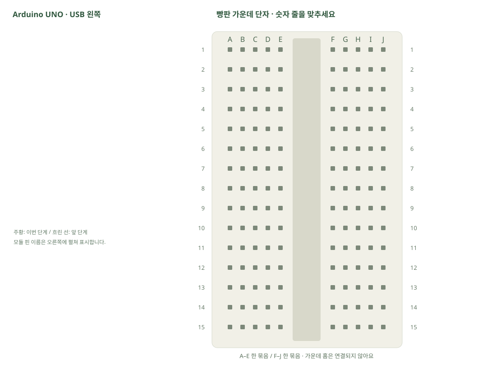

# 전원·케이블·정리

[실물 사진과 한 단계씩 바뀌는 배선도 열기](../kit/guide/index.html?lab=K27#workbench)



그림을 확대하고 한 선씩 보려면 위 실습실을 여세요. 부품별 추가 준비 조건은 아래에서 먼저 확인합니다.

## 무엇을 하는 부품인가요?

USB 케이블은 코드 업로드·시리얼 통신·전원 공급에 사용합니다. 점퍼선은 핀과 구멍을 연결합니다. 9V 클립은 전압을5V로 바꾸지 않습니다. 정리할 때는 전원을 먼저 분리하고 다른 회로로 넘어가기 전에 이전 선을 모두 제거합니다.

## 준비와 방향

필요 부품: 9V 배터리 클립, 보관 케이스, 양쪽 수 핀 점퍼선, 암–수 점퍼선. 실물 사진은 위 실습 화면에서 각각 확대할 수 있습니다.

9V 클립은 오늘 기본 USB 실습에 사용하지 않습니다. 배터리도 별도 품목입니다. 외부 전원 학습 시에는 보드 DC 입력의 허용 범위·플러그 극성부터 확인합니다. 사용하지 않는 보조품도 이 목록에 남겨 실제 구성품과 대조할 수 있게 했습니다.

USB를 먼저 뽑습니다. 같은 숫자의 A~E, F~J는 각각 하나의 연결 묶음이고 가운데 홈을 사이에 둔 두 묶음은 떨어져 있습니다.

## 부품을 놓으세요

외부 부품은 연결하지 않습니다. 보드 USB부터 확인합니다.

## 선을 한 개씩 연결하세요

| 순서 | 출발 | 도착 | 연결 이유 |
|---:|---|---|---|


그림과 표는 같은 연결 데이터로 생성합니다. 선 색이 달라도 양 끝 이름이 같으면 같은 연결입니다. 한 단계를 완료한 뒤 다음으로 이동하고, 마지막에는 전체 연결표로 빠진 선을 확인합니다.

## 저장과 실행

Arduino IDE에서 새 스케치를 만들고 아래 코드를 붙여넣습니다. 파일은 `K27/K27.ino`로 저장합니다. 보드는 Arduino Uno, 포트는 실제 연결된 COM, 시리얼 모니터는 9600으로 맞춥니다. 검증 버튼은 코드의 문법을 검사하고, 업로드 버튼은 연결된 보드로 프로그램을 보냅니다.

이 예제는 추가 라이브러리 설치가 필요하지 않습니다.

```cpp
// 이 항목은 코드 대신 부품·전원·정리 절차를 확인합니다.
```

## 예상 결과와 직접 바꾸기

보드·빵판 전원을 분리하고 부품·케이블 수량을 처음 사진과 대조합니다.

자신의 완성 회로 사진과 연결표·코드·실제 결과를 같은 폴더에 저장합니다.

바꾸기 전 예상과 바꾼 뒤 실제 결과를 나눠 적습니다. 실행하지 못했다면 이유와 다음 확인 항목을 적습니다. 예시 출력은 내 보드의 실제 측정 기록이 아니므로 자신의 값·사진으로 남깁니다.

## 잘 안될 때

9V를5V·3.3V핀·센서에 넣지 않습니다. 전원 레일이나 부품에 꽂힌 선을 잡아당기지 말고 커넥터를 잡습니다.

코드에 적힌 핀과 연결표부터 비교합니다. 회로를 고칠 때는 USB와 외부 전원을 모두 분리합니다. 프로그램의 컴파일 성공과 실제 부품의 동작은 별도로 확인합니다. 고친 선·코드·결과를 함께 기록하면 다음에 같은 문제를 찾아낼 수 있습니다.
