# 대시보드 디자인 사례 20선

공식 공개 자료를 읽고 만든 수업용 관찰·적용 해설입니다. 자료 확인일2026-10-28. 축소 화면·과거 UI·편집 예·분석 패널을 구별합니다. 화면의 권리는 각 제공자에게 있으며 현재 UI나 실제 센서 측정값을 보장하지 않습니다.

강사는 C01·C03·C07·C13·C18을 중심으로 설명하고, 학생은 나머지를 탐색해2~3개를 고릅니다. 20개를 모두 같은 깊이로 설명하느라 개인 스케치 시간을 줄이지 않습니다.

## C01 · Home Assistant · 집 안 상태와 조작

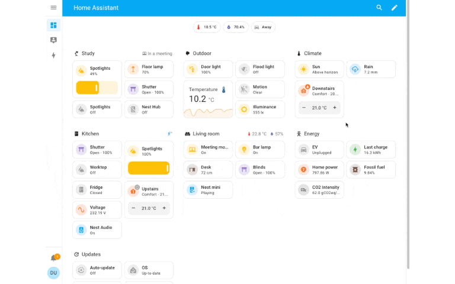

분야: 스마트공간

사용자 판단: 방·장치의 상태를 살피고 필요한 조작을 선택한다.

화면 구성: 장치별 카드와 제어를 가까이 둔 구성

배울 원칙: 상태 이름과 조작 위치를 함께 읽는다.

P01 적용: 밝기·LED 상태 옆에 켜기/끄기를 배치한다.

적용 범위: 장치 카드가 많아지면 공간·목적별로 묶는다.

학생 질문: 사용자가 조작 전에 알아야 할 상태는 무엇인가?

[공식 출처](https://www.home-assistant.io/dashboards/) · [출처 원본 이미지](https://www.home-assistant.io/images/dashboards/section_view_rearrange_cards.gif)

## C02 · Home Assistant · 에너지 흐름

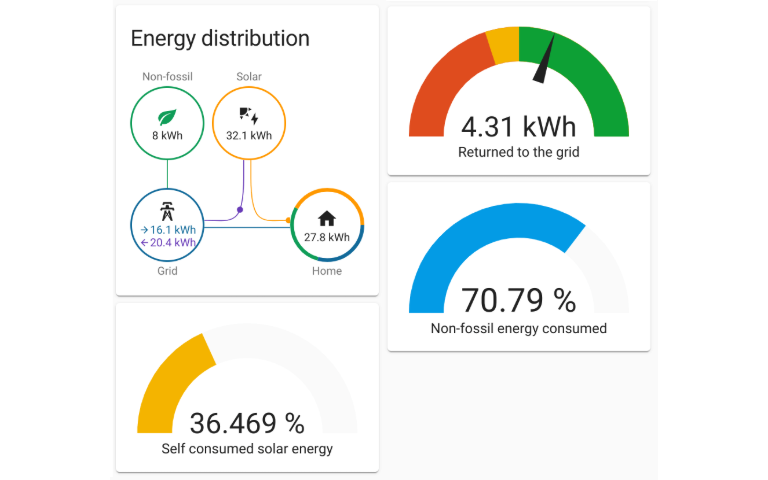

분야: 스마트공간

사용자 판단: 에너지의 공급·소비 관계를 한눈에 파악한다.

화면 구성: 흐름을 나타내는 연결 구조와 합계

배울 원칙: 서로 관계있는 값을 선과 묶음으로 설명한다.

P01 적용: 센서→보드→화면→LED의 흐름을 설계에 붙인다.

적용 범위: 2021년 공식 소개 화면이다. 우리 키트는 전력량 계측기가 아니므로 전력 수치를 만들지 않는다.

학생 질문: 시간에 따른 변화와 장치 사이 흐름은 어떻게 다른가?

[공식 출처](https://www.home-assistant.io/blog/2021/08/04/home-energy-management/) · [출처 원본 이미지](https://www.home-assistant.io/images/blog/2021-08-energy/sidebar-widgets.png)

## C03 · ThingsBoard · 스마트 오피스

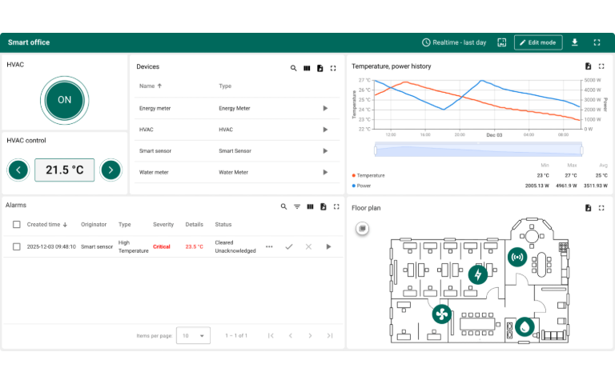

분야: 스마트공간

사용자 판단: 여러 공간과 장치의 상태를 위치와 함께 살핀다.

화면 구성: 공간 도면과 상태 정보의 결합

배울 원칙: 실제 위치가 중요한 정보에 공간 배치를 쓴다.

P01 적용: 책상 위 센서의 위치를 간단한 그림으로 표시한다.

적용 범위: 도면은 위치 설명이다. 키트에 없는 재실·공조 기능을 붙이지 않는다.

학생 질문: 이 화면에서 도면이 숫자 목록보다 도움이 되는 이유는?

[공식 출처](https://thingsboard.io/iot-hub/solution-templates/smart-office/) · [출처 원본 이미지](https://iot-hub.thingsboard.io/api/resources/96c30d30-68e9-11f1-992c-0f4d95fca092)

## C04 · ThingsBoard · 공기질 지도

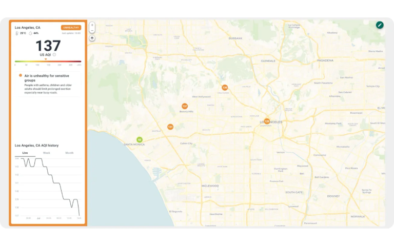

분야: 환경·현장

사용자 판단: 어느 지역에 주의가 필요한지 찾는다.

화면 구성: 지도 위치와 상태 수준의 함께 보기

배울 원칙: 색 범례와 상태 이름으로 공간 차이를 설명한다.

P01 적용: 온습도·밝기마다 이름·단위·상태 설명을 붙인다.

적용 범위: P01에는 미세먼지·CO₂ 센서가 없다. 공기질을 실제로 측정했다고 쓰지 않는다.

학생 질문: 경고색만으로 충분한가? 어떤 문구를 더할까?

[공식 출처](https://thingsboard.io/use-cases/air-quality-monitoring/) · [출처 원본 이미지](https://thingsboard.io/_astro/aiq-1.DXUpPGI3_Z2u2M98.webp)

## C05 · ThingsBoard · 스마트 농장

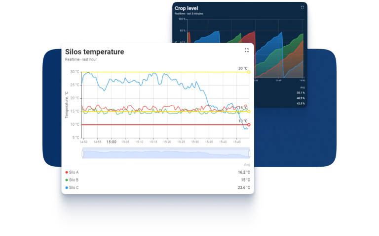

분야: 환경·현장

사용자 판단: 현장 측정값을 보고 관리가 필요한 곳을 찾는다.

화면 구성: 모니터링 카드와 관리 화면의 구분

배울 원칙: 관찰할 값과 조작할 기능을 구별한다.

P01 적용: 책상 환경판의 입력 카드와 LED 제어 영역을 나눈다.

적용 범위: 물주기·밸브·토양수분은 별도 장치가 필요한 사례 기능이다.

학생 질문: 값을 본 뒤 사용자가 할 행동이 어디에 있는가?

[공식 출처](https://thingsboard.io/smart-farming-demo/) · [출처 원본 이미지](https://thingsboard.io/images/usecases/smart-farming/customizable-dashboard.webp)

## C06 · ThingsBoard · 현장 차량 관제

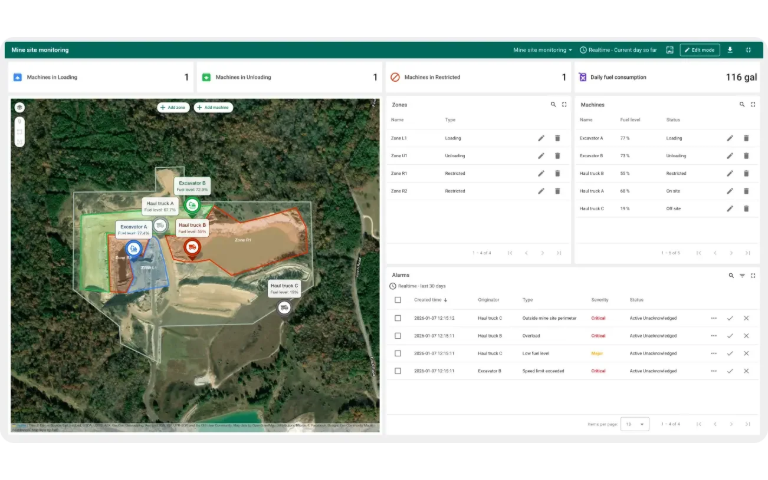

분야: 환경·현장

사용자 판단: 장비 위치·운행 상태·구역의 관계를 파악한다.

화면 구성: 위치 지도와 요약·알림의 조합

배울 원칙: 전체 위치를 보고 관심 장치로 좁혀 간다.

P01 적용: 전체 입력 요약에서 특정 센서의 자세한 설명으로 이동하게 한다.

적용 범위: 키트에는 GPS가 없다. 위치값을 센서 실측처럼 넣지 않는다.

학생 질문: 전체 상황과 한 장치의 상세를 어떻게 나눌까?

[공식 출처](https://thingsboard.io/use-cases/site-fleet-tracking/) · [출처 원본 이미지](https://thingsboard.io/_astro/site-fleet-tracking-1.Bbf6oyRI_ZmQFRr.webp)

## C07 · Grafana · Node Exporter Full

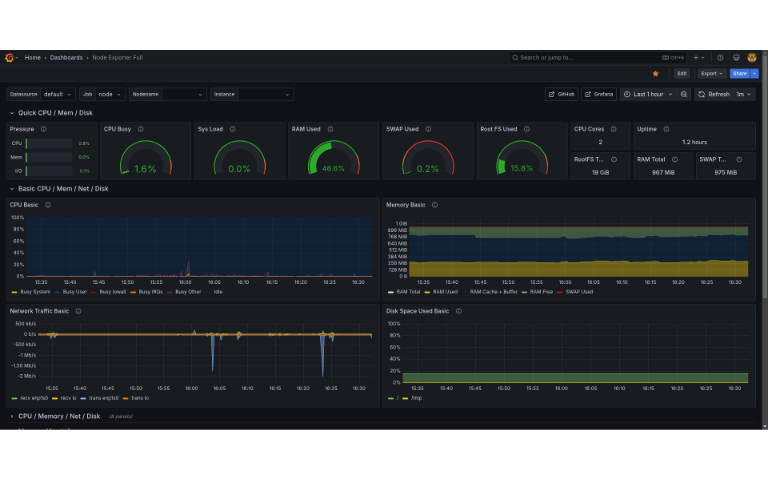

분야: 시스템 운영

사용자 판단: 서버의 여러 자원 상태를 함께 비교한다.

화면 구성: 반복되는 지표 패널과 시계열

배울 원칙: 같은 종류의 정보에는 같은 카드 규칙을 적용한다.

P01 적용: 센서 이름·값·단위·시각의 순서를 일관되게 맞춘다.

적용 범위: 많은 패널을 그대로 가져오면 초심자 화면이 복잡해진다. 핵심만 고른다.

학생 질문: 첫 화면에서 꼭 필요한 세 값은 무엇인가?

[공식 출처](https://grafana.com/grafana/dashboards/1860-node-exporter-full/) · [출처 원본 이미지](https://grafana.com/api/dashboards/1860/images/18451/image)

## C08 · Grafana Canvas · 상태를 관계로 배치

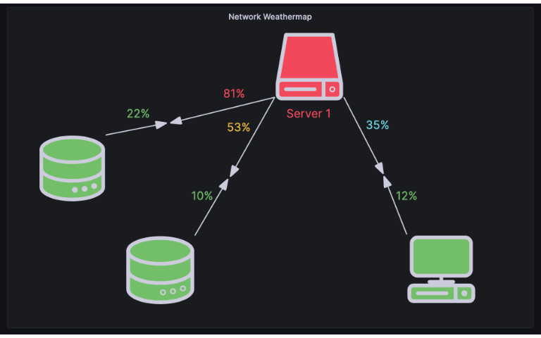

분야: 환경·현장

사용자 판단: 장치나 요소의 관계 속에서 상태를 이해한다.

화면 구성: 자유 배치 요소와 연결 표현

배울 원칙: 표보다 관계·배치가 중요할 때 도식이 유용하다.

P01 적용: 센서·UNO·LED를 상자로 두고 데이터 흐름을 설명한다.

적용 범위: 이 사례 이미지는 Canvas 편집·구성 예다. 완성된 전체 관제 화면과 구별한다.

학생 질문: 우리 작품에서는 표와 도식 중 무엇이 더 필요한가?

[공식 출처](https://grafana.com/docs/grafana/latest/visualizations/panels-visualizations/visualizations/canvas/) · [출처 원본 이미지](https://grafana.com/media/docs/grafana/canvas-server-element-9-4-0.png)

## C09 · Datadog · 경영 관점의 요약

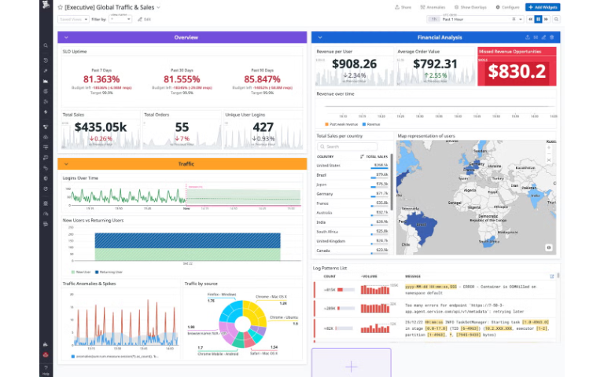

분야: 업무·분석

사용자 판단: 여러 지표를 사업의 질문과 연결해 읽는다.

화면 구성: 요약 지표·변화·설명의 단계

배울 원칙: 모든 패널을 사용자의 질문과 연결한다.

P01 적용: 지금 어두운가→어떻게 변했나→LED를 켤까 순서로 배치한다.

적용 범위: 이 구성은 공식 예시의 경영 맥락이다. 지표 이름만 센서명으로 바꾸지 않는다.

학생 질문: 각 카드가 답하는 질문을 한 문장씩 말할 수 있나?

[공식 출처](https://www.datadoghq.com/blog/datadog-executive-dashboards/) · [출처 원본 이미지](https://web-assets.dd-static.net/42588/1776293847-datadog-executive-dashboards-executive-dashboard.png?format=auto&fit=bounds&quality=75&disable=upscale&width=1400&dpr=1)

## C10 · Amazon CloudWatch · 묶어서 보는 지표

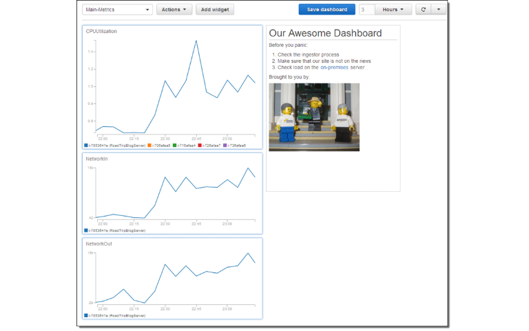

분야: 시스템 운영

사용자 판단: 서로 관련된 시스템 지표를 한 판에서 비교한다.

화면 구성: 여러 차트와 설명을 위젯으로 묶기

배울 원칙: 같이 읽어야 할 지표를 같은 영역에 둔다.

P01 적용: 온도·습도를 묶고 밝기·LED 판단을 별도 묶음으로 둔다.

적용 범위: 2015년 공식 소개의 과거 UI 사례다. 현재 콘솔 사용법으로 안내하지 않는다.

학생 질문: 모든 차트를 같은 크기로 둘 필요가 있을까?

[공식 출처](https://aws.amazon.com/blogs/aws/cloudwatch-dashboards-create-use-customized-metrics-views/) · [출처 원본 이미지](https://media.amazonwebservices.com/blog/2015/cd_my_dashboard_1.png)

## C11 · Azure Monitor · 지표 탐색

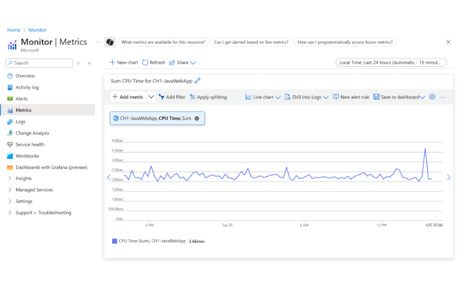

분야: 시스템 운영

사용자 판단: 자원·지표·기간을 지정해 변화를 분석한다.

화면 구성: 범위와 차트가 연결된 분석 화면

배울 원칙: 어느 대상·기간의 값인지 드러낸다.

P01 적용: 현재 탭의 최근60개라는 그래프 범위를 명시한다.

적용 범위: 지표 탐색 화면 사례다. 기간을 바꿨다는 사실만으로 장기 저장이 생기지 않는다.

학생 질문: 차트에서 대상·단위·기간을 어디에 둘까?

[공식 출처](https://learn.microsoft.com/en-us/azure/azure-monitor/metrics/analyze-metrics) · [출처 원본 이미지](https://learn.microsoft.com/en-us/azure/azure-monitor/metrics/media/analyze-metrics/metrics-explorer-example.png)

## C12 · Elastic Kibana · 탐색형 대시보드

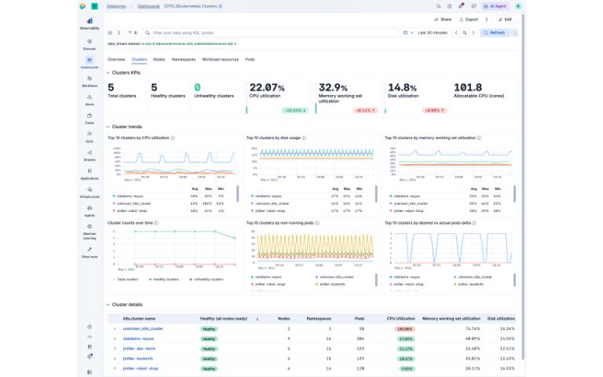

분야: 시스템 운영

사용자 판단: 여러 시각화를 함께 보고 관심 범위로 좁힌다.

화면 구성: 다양한 시각화와 공통 필터

배울 원칙: 필터가 어느 패널에 적용되는지 일관되게 한다.

P01 적용: 기간 선택을 추가한다면 카드·그래프의 범위를 설명한다.

적용 범위: 우리 예제에 아직 없는 필터·저장은 새로 구현하고 확인해야 한다.

학생 질문: 필터를 바꿨는데 카드와 차트가 다른 범위면?

[공식 출처](https://www.elastic.co/docs/explore-analyze/dashboards) · [출처 원본 이미지](https://www.elastic.co/docs/explore-analyze/images/kibana-dashboard-overview.png)

## C13 · Power BI · 소매 분석

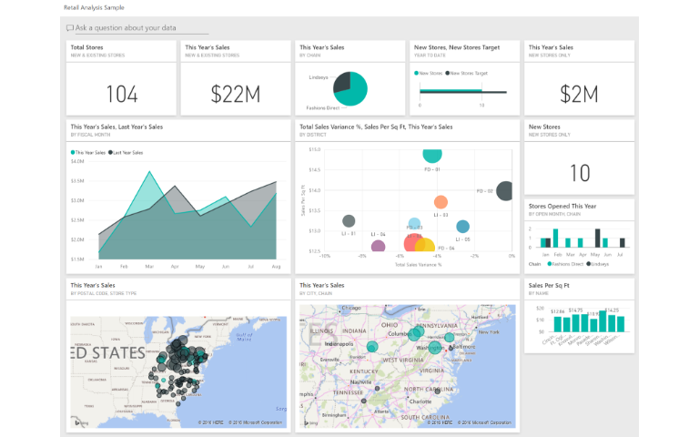

분야: 업무·분석

사용자 판단: 판매 현황과 지역·매장 차이를 비교한다.

화면 구성: 요약 수치와 비교 시각화의 조합

배울 원칙: 전체 요약 뒤에 원인을 살필 비교를 배치한다.

P01 적용: 현재 센서값을 먼저, 변화 그래프와 관찰 메모를 뒤에 둔다.

적용 범위: 서로 다른 단위의 센서값을 매출처럼 한 합계로 묶지 않는다.

학생 질문: 전체 요약과 세부 비교가 각각 답하는 것은?

[공식 출처](https://learn.microsoft.com/en-us/power-bi/create-reports/sample-retail-analysis) · [출처 원본 이미지](https://learn.microsoft.com/en-us/power-bi/create-reports/media/sample-retail-analysis/retail1.png)

## C14 · Power BI · 인사 현황

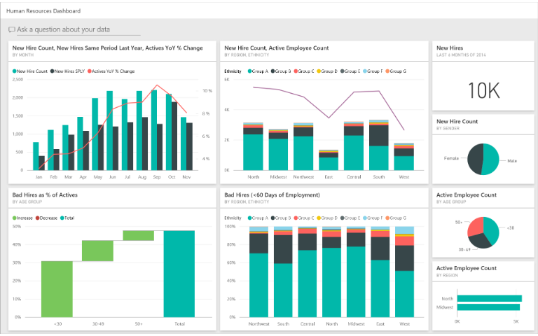

분야: 업무·분석

사용자 판단: 전체 규모와 집단별 변화를 나누어 읽는다.

화면 구성: 집계 카드와 구성 비율

배울 원칙: 수치가 전체인지 부분인지 명확히 표시한다.

P01 적용: 전체 수신 개수와 현재값을 다른 이름으로 표시한다.

적용 범위: 학생 개인 정보나 실제 인사 자료는 필요 없다. 공식 샘플을 관찰한다.

학생 질문: 현재값·누적 개수·비율을 어떻게 다르게 표시할까?

[공식 출처](https://learn.microsoft.com/en-us/power-bi/create-reports/sample-human-resources) · [출처 원본 이미지](https://learn.microsoft.com/en-us/power-bi/create-reports/media/sample-human-resources/hr-1.png)

## C15 · Power BI · 영업·마케팅

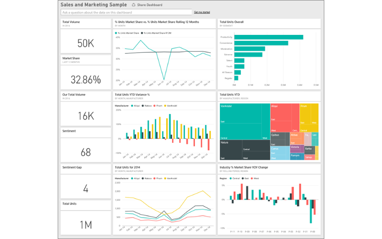

분야: 업무·분석

사용자 판단: 시장·기간·구성의 차이를 비교해 판단한다.

화면 구성: KPI와 추세·구성 비교

배울 원칙: 기준이나 비교 대상이 있어야 숫자 해석이 쉬워진다.

P01 적용: 현재 밝기와 켜짐/꺼짐 기준을 함께 설명한다.

적용 범위: 원시값을 임의의 성능 점수·정확도·백분율로 이름만 바꾸지 않는다.

학생 질문: 숫자 하나만 있을 때와 기준이 있을 때 판단은?

[공식 출처](https://learn.microsoft.com/en-us/power-bi/create-reports/sample-sales-and-marketing) · [출처 원본 이미지](https://learn.microsoft.com/en-us/power-bi/create-reports/media/sample-sales-and-marketing/sales1.png)

## C16 · Metabase · 질문을 묶은 대시보드

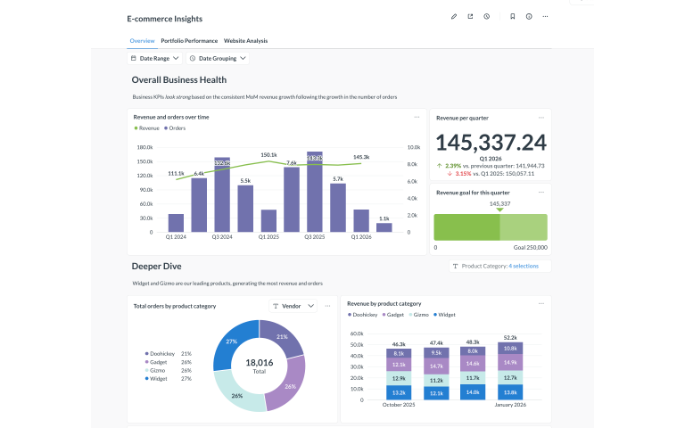

분야: 업무·분석

사용자 판단: 관련 질문의 답을 카드와 탭으로 함께 살핀다.

화면 구성: 질문 카드·필터·설명 텍스트

배울 원칙: 카드마다 사용자의 질문을 분명히 정한다.

P01 적용: 밝기는 얼마인가·LED는 켜졌나·값은 최신인가를 구역으로 만든다.

적용 범위: 필터가 있다면 적용 범위를 설명하고, 빈 결과도 설계한다.

학생 질문: 제목을 질문형으로 바꾸면 어떤 장점이 있나?

[공식 출처](https://www.metabase.com/docs/latest/dashboards/introduction) · [출처 원본 이미지](https://www.metabase.com/docs/latest/dashboards/images/interactive-dashboard.png)

## C17 · Apache Superset · 데이터 탐색

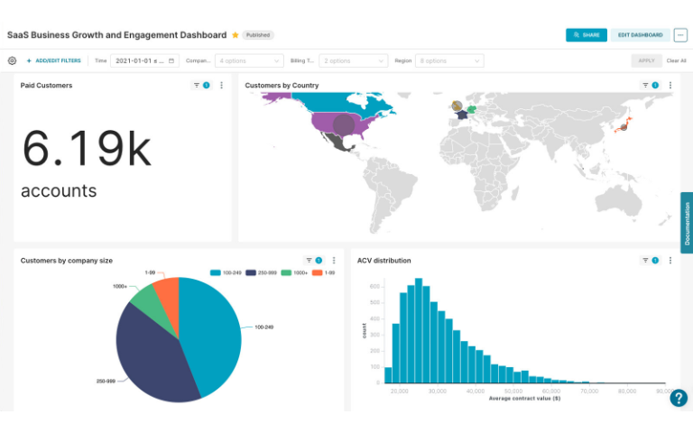

분야: 업무·분석

사용자 판단: 여러 차트를 조합해 데이터의 모양과 관계를 본다.

화면 구성: 탐색을 위한 여러 시각화의 배치

배울 원칙: 표현하려는 비교에 맞는 차트를 고른다.

P01 적용: 시간 변화는 선, 현재 수치는 카드, 관찰 기록은 표로 나눈다.

적용 범위: 공식 홈페이지의 제품 예시다. 많은 차트 수를 그대로 과제 목표로 삼지 않는다.

학생 질문: 우리 데이터에 지도·파이 차트가 꼭 필요한가?

[공식 출처](https://superset.apache.org/) · [출처 원본 이미지](https://superset.apache.org/img/hero-screenshot.jpg)

## C18 · Uptime Kuma · 서비스 상태

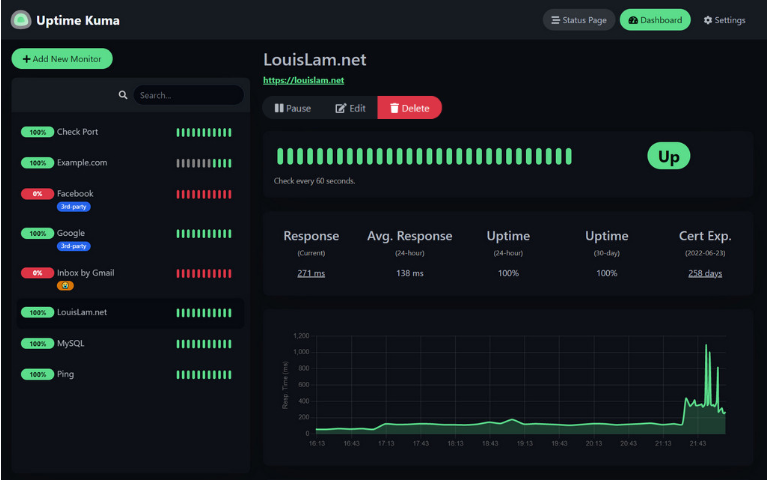

분야: 시스템 운영

사용자 판단: 장애·응답 변화와 서비스 상태를 빠르게 알아챈다.

화면 구성: 상태 요약·최근 이력·상세 정보

배울 원칙: 현재 상태와 최근 사건을 함께 보여 준다.

P01 적용: USB 상태·마지막 정상 수신·최근 그래프를 함께 둔다.

적용 범위: 가용성 비율을 만들려면 측정 기간·규칙이 필요하다. 임의99%를 넣지 않는다.

학생 질문: 지금 정상이라는 말과 지난 한 시간 정상은 같은가?

[공식 출처](https://github.com/louislam/uptime-kuma) · [출처 원본 이미지](https://user-images.githubusercontent.com/1336778/212262296-e6205815-ad62-488c-83ec-a5b0d0689f7c.jpg)

## C19 · Vercel · 웹 방문 분석

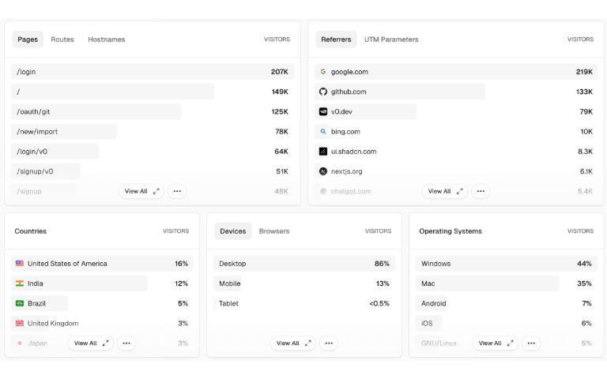

분야: 웹·서비스

사용자 판단: 어떤 페이지·유입 경로가 관찰되는지 비교한다.

화면 구성: 간결한 패널과 항목별 분류

배울 원칙: 간격·타이포·정렬로 정보 밀도를 조절한다.

P01 적용: 핵심 카드를 크게 두고 부가 정보는 표·상세에 둔다.

적용 범위: 공식 페이지의 패널 예다. 센서 화면에 분석 추적 코드를 추가할 필요는 없다.

학생 질문: 여백을 늘리면 무엇이 더 잘 구별되는가?

[공식 출처](https://vercel.com/docs/analytics) · [출처 원본 이미지](https://vercel.com/vc-ap-vercel-docs/_next/image?url=https%3A%2F%2F7nyt0uhk7sse4zvn.public.blob.vercel-storage.com%2Ffront%2Fdocs%2Fobservability%2Fpanels-light-mode.png&w=3840&q=75)

## C20 · Cloudflare · 웹 분석

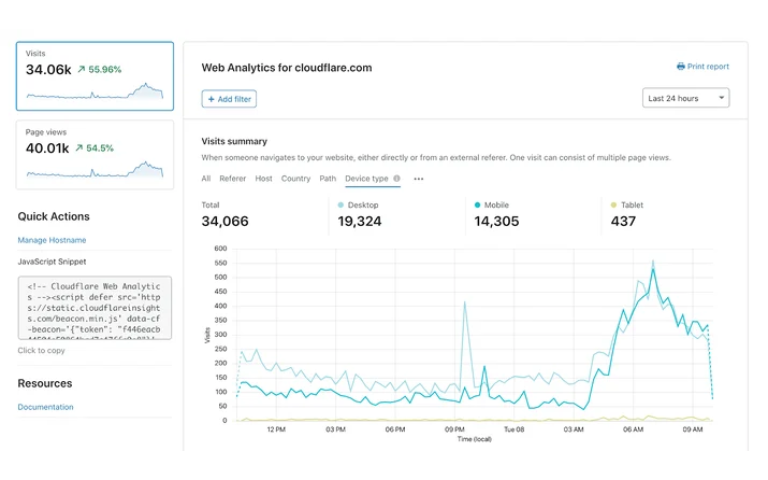

분야: 웹·서비스

사용자 판단: 방문·유입·변화와 같은 관찰 대상을 한 화면에서 살핀다.

화면 구성: 기간 요약과 변화·분류 패널

배울 원칙: 수치의 의미와 조회 범위를 함께 제시한다.

P01 적용: 수신 개수·수신 시각·밝기 변화의 범위를 구별한다.

적용 범위: 공식 소개 글의 공개 화면이며 과거 UI일 수 있다. 현재 제품 설치 실습은 아니다.

학생 질문: 같은 숫자라도 집계 정의가 다르면 왜 비교하면 안 될까?

[공식 출처](https://blog.cloudflare.com/privacy-first-web-analytics/) · [출처 원본 이미지](https://blog.cloudflare.com/_image?href=https%3A%2F%2Fblog.cloudflare.com%2F_emdash%2Fapi%2Fmedia%2Ffile%2F01KW446Q7XMTR03TCMQ9PGJV3T.png&w=715&h=392&f=webp&fit=cover&position=center)
