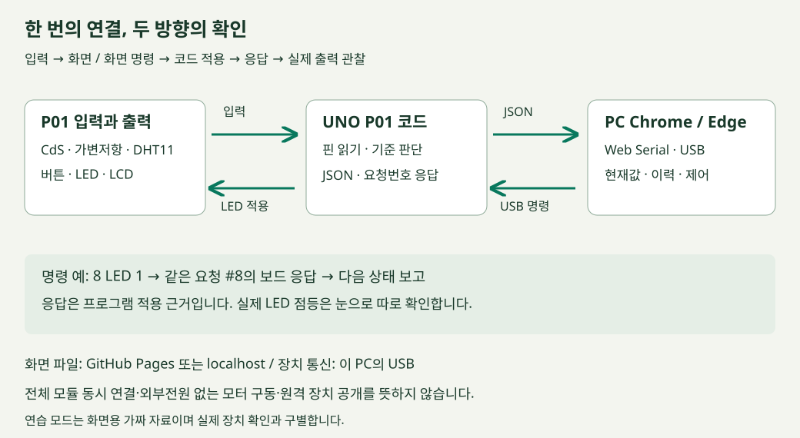

# 공통 연결 · 센서에서 웹으로, 웹에서 LED로

## 목적

모두 같은 **내 책상 환경 대시보드**를 한 번 연결합니다. 이 공통 연결이 개인 작품의 출발점입니다. 새 서버나 DB를 설치하지 않고 PC Chrome/Edge의 Web Serial로 브라우저와 UNO가 직접 USB 통신합니다. 기존 API·DB 예제는 보존된 심화 자료이고 오늘 필수 경로와 섞지 않습니다.

흐름은 `센서 → P01 UNO → USB JSON → 웹 현재값·그래프`, 반대 방향은 `웹 버튼 → USB 명령 → UNO 코드 적용 → 요청번호 응답 → 웹 문구`입니다. GitHub Pages는 화면 파일을 제공하며 내 UNO가 인터넷에 공개되는 것은 아닙니다. 이 예제는 측정값을 원격 서버로 보내지 않습니다.

## 준비와 파일

[P01 화면 열기](../kit/uno-dashboard/index.html), [실행 안내](../kit/uno-dashboard/README.md)를 엽니다. ZIP을 풀면 `kit/uno-dashboard` 안에 `index.html`(화면), `style.css`(꾸밈), `dashboard.js`(수신과 제어), `firmware/P01`(보드 코드)이 있습니다. `.html`은 웹 문서, `.css`는 스타일, `.js`는 브라우저 동작입니다. 공개 HTTPS 또는 localhost에서 실행합니다. Web Serial 지원과 장치 권한이 필요합니다.

## 함께 따라 하기

1. 강사는 경로와 파일을 보여주고 학생은 연습 데이터로 화면을 엽니다.

이어서, P01 업로드·라이브러리·보드·포트를 확인합니다. 이전 전자회로 시간의 배선은 준비되어 있다는 제작 가정이며 미완성자는 연습 모드로 합류한 뒤 배선 도움을 받습니다. 업로드 후 시리얼 모니터를 닫습니다.

이어서, USB 연결 버튼을 누르고 UNO 포트를 선택해 정상 P01 수신을 확인합니다. 가변저항을 돌리고 CdS를 가립니다.

이어서, LED 켜기·끄기, 보드 응답과 실제 LED를 비교합니다.

이어서, 기준값 전송·자동 모드·STOP을 시험합니다.

이어서, USB 중단 표시를 보고 채팅에 진행 상태를 남깁니다.

## 예상 결과와 확인

`pot_raw`, `light_raw`는 0~1023, 온습도는 °C·% 또는 `null`, LED는 보드 보고 상태입니다. 코드가 시작된 직후 DHT 값이 없을 수 있습니다. LCD는 밝기·LED를 표시하며 화면에서 임의 문장을 보내는 기능은 없습니다. 버튼 현재 상태는 매초 읽으므로 짧은 누름 횟수를 정확히 세지 않습니다. 연습 모드는 실제 USB와 분리되고 ‘실제 측정 아님’을 표시합니다.

## 오류와 복구

포트를 못 열면 시리얼 모니터·기존 Python 연결·다른 웹 탭을 닫습니다. 계속 안 되면 케이블·드라이버·지원 브라우저·권한을 확인합니다. 값이 안 오면 P01 코드와 115200인지 확인합니다. LED 응답만 있고 점등이 없으면 전원을 끄고 D8·저항·극성·공통 GND를 점검합니다. 설치 문제가 있으면 연습 모드로 디자인 제작을 이어가고 실제 연결 미확인을 제출물에 적습니다.

## 한 장으로 보는 왕복 연결

준비된 회로는 [P01 전체 배선 그림](../kit/uno-dashboard/P01-wiring.svg)으로 다시 봅니다. 전체 그림은 확대해 확인하고 한 선씩 연결하는 순서는 앞 전자회로 실습실의 P01을 사용합니다. 전원이 연결된 상태에서 배선을 바꾸지 않습니다.

| 부품·역할 | UNO 연결 | 화면에서 확인할 것 |
| --- | --- | --- |
| LED 출력 | D8, 1kΩ 저항, 극성·GND는 배선도 기준 | 명령 응답과 실제 점등 |
| 누름 버튼 입력 | D2, INPUT_PULLUP | 눌림/놓임 현재 상태 |
| 가변저항 입력 | 가운데 A0, 양끝은 그림 기준5V/GND | 손잡이 회전 시0~1023변화 |
| CdS 분압 입력 | A1, 10kΩ와 연결 위치는 그림 기준 | 가릴 때 raw 감소 여부 |
| DHT11 입력 | D4, 전원·신호·GND | 온도 °C·습도 % 또는 null |
| I2C LCD 출력 | SDA A4, SCL A5,5V/GND | 초기화 응답, 보드의 밝기·LED 표시 |

### 무슨 단계에서 멈췄는지 나누기

업로드 실패면 아직 웹 문제가 아닐 수 있습니다. 업로드는 됐지만 JSON이 안 오면 P01·115200·포트를 봅니다. JSON은 오는데 카드만 안 바뀌면 필드·DOM id를 봅니다. ACK는 오는데 실제 LED가 안 켜지면 극성·저항·D8·GND를 봅니다. 한 번에 여러 곳을 바꾸지 말고 각 단계의 관찰을 적습니다.

수업 합류 메모는 `지금 단계 / 관찰한 문구 / 다음 확인`으로 씁니다. ‘안 돼요’ 대신 ‘업로드 완료, USB 선택 성공, 정상 P01 데이터 대기에서 멈춤’이면 원인을 좁힐 수 있습니다.
