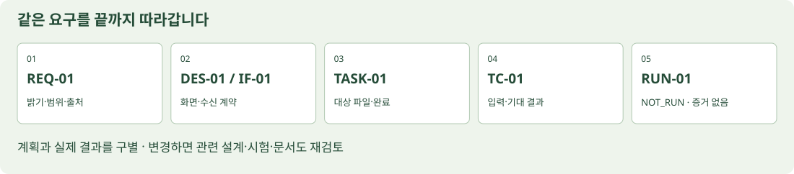

# 프로젝트 실무 · 팀·표준·개발 산출물

한 페이지의 전체 해설은 [index.html](index.html)에서 읽습니다. 문서의 정의·범위와 교재의 적용 예를 구별합니다. 실무 팀의 구조를 배우되 오늘은 개인 기획·자기 점검을 수행합니다.

## 프로젝트는 팀이 어떤 결과를 약속하는 일인가

### 프로젝트·제품·운영을 먼저 구별하기

프로젝트는 정한 목표와 제약 안에서 결과를 만들기 위해 조직한 일입니다. 시작과 종료 판단이 있고, 사람·시간·비용·장비를 배분합니다. 제품은 그 결과로 제공하고 계속 개선하는 대상이며, 운영은 사용자가 계속 쓸 수 있도록 유지하는 활동입니다. 이 문단은 수업을 위한 개념 설명입니다. [ISO 21502:2020](https://www.iso.org/standard/74947.html)은 프로젝트 관리의 지침을, [ISO/IEC/IEEE 12207:2026](https://www.iso.org/standard/90219.html)은 소프트웨어의 구상부터 운영·유지보수·종료까지 적용할 생애주기 프로세스를 다룹니다.

예를 들어 ‘작업실 상태 안내 화면을 첫 버전으로 제공한다’는 프로젝트가 될 수 있습니다. 배포 뒤 센서 연결 문제를 지원하고 버그를 고치는 일은 운영·유지보수로 이어집니다. 발표가 끝났다는 사실과 사용자가 인수했다는 사실, 서비스가 안정적으로 운영된다는 사실은 구별해야 합니다.

| 개념 | 실제로 정할 질문 | 작업실 예 |
| --- | --- | --- |
| 문제 | 누가 어떤 상황에서 곤란한가 | 지난 센서값을 현재값으로 오해할 수 있음 |
| 목표 | 무엇이 달라져야 하는가 | 현재 수신 여부를 구별해 판단하도록 함 |
| 산출물 | 무엇을 만들어 전달하는가 | 화면·코드·설계·시험 기록·실행 안내 |
| 성과 | 전달 뒤 실제로 어떤 변화가 있었나 | 사용자가 오래된 값을 잘 구별했는지 관찰 필요 |
| 범위 | 어디까지 만들고 무엇을 제외하나 | P01과 개인 PC, 원격 관제·모터·장기 DB는 제외 |
| 제약 | 바꿀 수 없는 조건은 무엇인가 | 고급키트만 보유, 외부전원 없음, USB 사용 |

### 실무에서 누가 프로젝트를 시작하고 판단하나

기업 프로젝트의 출발은 고객 요청, 내부 업무 문제, 제품 개선, 법규·계약 대응 등 다양합니다. 일을 요청한 사람, 비용을 배정하는 사람, 실제 사용하는 사람, 개발을 수행하는 사람이 같지 않을 수 있습니다. 그래서 개발자는 ‘누가 요청했나’뿐 아니라 ‘누가 사용하고, 누가 우선순위를 정하며, 누가 결과를 받아들이나’를 확인합니다.

스폰서 또는 사업 책임자는 조직 차원의 필요·자원·중요한 의사결정을 연결하는 역할의 예입니다. 발주 담당자는 계약과 인수 조건을 관리할 수 있고, 현장 사용자는 실제 업무 흐름을 알려 줍니다. 이런 명칭과 권한은 조직마다 다릅니다. 팀 표에 직함만 적지 말고 해당 프로젝트에서 내릴 수 있는 결정을 적어야 합니다.

| 판단 | 확인할 상대 | 남길 근거 |
| --- | --- | --- |
| 이 문제를 해결할 가치가 있나 | 사업·업무 책임자와 실제 사용자 | 문제 근거·목표·기대 성과 |
| 이번 버전에 무엇을 넣나 | 제품·프로젝트의 범위 결정자 | 포함·제외·우선순위·수용 기준 |
| 기술적으로 어떻게 만들까 | 기술 책임자와 구현 담당 | 구조·대안·선택 이유·위험 |
| 어느 결과를 인수할까 | 사전에 정한 인수 권한자 | 기준별 증거·미해결 문제·판정 |

### 착수 문서에서 빠지기 쉬운 것

착수 문서는 일을 시작할 공통 이해를 만드는 문서입니다. ‘프로젝트 개요서’, ‘프로젝트 헌장’, ‘프로젝트 브리프’ 등 이름은 다를 수 있습니다. 이 수업의 양식은 문제·사용자·목표·범위·제약·완료 조건·결정권자·주요 위험을 한 문서로 정리합니다. 모든 조직이 같은 이름과 파일 형식을 써야 한다는 의미는 아닙니다.

나쁜 예는 ‘AI와 IoT를 이용한 스마트 작업실 구현’입니다. 기술 이름은 있지만 누가 무엇을 확인하고 어떤 결과를 받는지 알기 어렵습니다. 더 나은 시작은 ‘집에서 쓰는 사용자가 P01의 현재 밝기와 수신 상태를 읽고 LED를 제어한다. 실측·연습·미수신과 명령 결과를 구별한다’입니다. 기능과 확인할 장면이 드러납니다.

#### 이 수업의 일관된 예제

프로젝트 예제 이름은 **작업실 상태 안내 화면 개선**입니다. 이미 제공한 P01을 기반으로 목적과 정보 배치를 다듬고, 동작 계약과 시험 근거를 정리하는 가상의 기획 예입니다. 요구·설계·시험 문장을 채운 예시이며 실제 고객 승인이나 실물 시험 결과가 아닙니다. 시험 결과의 시작 상태는 `NOT_RUN`으로 둡니다.

#### 직접 작성하고 확인

자신의 프로젝트에 대해 사용자 한 사람, 실제 문제, 원하는 변화, 전달할 결과, 이번에 제외할 기능을 각각 적습니다. 다음으로 범위를 결정할 사람과 인수할 사람을 적습니다. 개인 수업에서 외부 권한자를 정할 수 없다면 ‘개인 기획안·외부 인수 미확인’으로 표시합니다.

풀이 예: ‘조명을 제어한다’만 쓰면 실제 전등인지 키트 LED인지 모호합니다. ‘키트 LED로 조명 제어를 표현한다’고 한정하면 실물 범위와 완료 조건을 맞추기 쉽습니다. 인터뷰·효과·수익을 조사하지 않았다면 확인된 사실처럼 채우지 않습니다.


## 팀은 직함보다 책임과 결정권으로 구성한다

### 역할과 사람 수는 다르다

역할은 프로젝트에 필요한 책임의 묶음입니다. 한 사람이 여러 역할을 맡을 수 있고, 하나의 전문 영역을 여러 사람이 나눌 수도 있습니다. 따라서 아래 표는 전원을 별도 인원으로 채용하라는 조직도가 아닙니다. 업무·위험·규모에 맞춰 조합하는 실무 역할의 예입니다.

코드만 나누면 요구의 우선순위, 인터페이스 변경, 시험 기준, 배포·장애 대응이 공백으로 남기 쉽습니다. 작은 팀일수록 역할을 겸하는 사실과 중요한 검토·결정이 누구에게 있는지를 명시해야 합니다.

| 역할 | 주로 책임지는 일 | 주로 내리거나 제안할 판단 | 다른 사람에게 넘기는 것 |
| --- | --- | --- | --- |
| 사업 책임자·스폰서 | 사업 필요·자원·상위 의사결정 지원 | 계속할지, 중요한 범위를 바꿀지 | 목적·제약·중요 결정 |
| 고객·업무 책임자·사용자 대표 | 실제 업무와 인수 조건 확인 | 어떤 업무 결과가 필요한지 | 사용 상황·우선순위 근거·피드백 |
| 프로젝트 관리자 | 범위·일정·의존성·위험·관계자 조정 | 일정·자원·변경의 조정안 | 계획·위험·결정·현황 |
| 제품 관리자·Product Owner 관점 | 사용자 가치와 할 일의 순서 | 어떤 문제를 먼저 해결할지 | 목표·백로그·수용 기준 |
| 분석·기획 담당(BA) | 문제를 구현·검증 가능한 요구로 구체화 | 용어·업무 규칙·예외를 정리 | 요구 명세·업무 흐름·연결표 |
| 기술 리드·아키텍트 | 구조·인터페이스·기술 위험·품질 방향 | 대안 선택과 기술 변경의 영향 | 구조 설명·계약·결정 기록 |
| UX·UI 디자이너 | 사용자 흐름·정보·상태·조작 설계 | 사용성·접근성 관점의 개선 | 화면안·상태표·설계 근거 |
| 프런트엔드 개발 | 브라우저 화면·입력·상태 처리 | UI 구현과 사용자 상호작용 | 화면 코드·실행법·구성요소 시험 |
| 백엔드 개발 | 서버 업무 규칙·API·저장·권한 | 데이터·거래·서버 오류 처리 | API 계약·서버 코드·운영 정보 |
| 임베디드·하드웨어 담당 | 센서·회로·전원·보드 코드 | 핀·프로토콜·구동 조건 | 배선·BOM·펌웨어·측정/구동 근거 |
| 데이터·AI 담당 | 데이터·모델·평가·추론 조건 | 데이터 적합성·성능/오류 해석 | 데이터 명세·평가·모델/실행 조건 |
| QA·시험 담당 | 위험과 요구에 맞춘 품질 확인 | 시험 범위·결함·재시험 의견 | 계획·케이스·실제 결과·결함 기록 |
| 운영·DevOps·SRE 관점 | 배포·설정·관찰·복구·지속 운용 | 배포 가능성과 운영 위험 | 배포 절차·런북·장애 대응 기록 |
| 보안·개인정보 관점 | 접근·비밀·수집·보관·공개 범위 | 위험과 필요한 통제 검토 | 데이터 흐름·권한·위험·검토 근거 |

이 표는 일반적인 업무 구분입니다. ISO가 이 직함·인원·부서 구성을 일률적으로 지정했다는 뜻은 아닙니다. 또 프로젝트 관리자(Project Manager)와 제품 관리자(Product Manager)는 모두 PM으로 줄여 쓰기도 하므로 첫 회의에서 어느 책임을 말하는지 풀어 써야 합니다.


### 규모에 따른 가상 구성 예

| 구성 예 | 역할을 묶는 방법 | 공백이 생기기 쉬운 일 | 정할 운영 규칙 |
| --- | --- | --- | --- |
| 3인 소규모 팀 | 가: 기획·일정·사용자 확인 / 나: 화면·UX / 다: 보드·연결·통합 | 시험·배포·문서가 ‘공동’으로만 남음 | 기능별 작성자와 검토자, 통합 담당을 별도로 지정 |
| 5인 제품 팀 | 제품·프로젝트 조정 / UX·화면 / 서버·데이터 / 장치·통합 / QA·운영 관점 | API와 펌웨어 변경이 한쪽 문서에만 반영 | 공통 인터페이스와 변경 리뷰를 하나의 원본에서 관리 |
| 전문 인력이 나뉜 조직 | 기획·설계·개발·QA·보안·운영의 전문 책임 | 부서 사이에서 인수 조건과 오류 책임이 불분명 | 요청→검토→결정→전달 경로와 서비스 책임자를 명시 |

팀이 커졌다고 모든 결정을 회의에서 만장일치로 내릴 필요는 없습니다. 결정할 사람과 필요한 의견을 구별하면 기다림을 줄일 수 있습니다. 반대로 작은 팀이므로 검토를 생략해도 된다고 단정하지 않습니다. 검토를 못 했으면 그 사실과 남은 위험을 기록합니다.

### RACI로 ‘다 같이’를 구체화하기

RACI는 일이나 결정에 참여하는 책임을 표로 정리하는 방법입니다. **R(Responsible)**은 수행, **A(Accountable)**는 최종 책임, **C(Consulted)**는 사전에 의견을 구할 대상, **I(Informed)**는 결과를 알릴 대상을 뜻합니다. 여기서는 작업 한 행에 A를 하나로 정하고 R을 비워 두지 않는 규칙을 사용합니다. 이는 이 수업의 운영 규칙이며 모든 ISO 문서가 같은 RACI 형식을 의무화한다는 뜻은 아닙니다.

| 일·결정 | 기획·제품 책임 | 기술 책임 | 구현 담당 | 시험·검토 관점 |
| --- | --- | --- | --- | --- |
| 이번 버전 범위 확정 | A/R | C | C | C |
| 장치 인터페이스 변경 | C | A | R | C |
| 화면 구현 | C | A | R | C |
| 시험 수행·결과 기록 | I | C | C | A/R |
| 공개 배포 판단 | 사전에 지정한 인수 권한과 연결 | 기술 가능·복구 의견 | 실행 담당 지정 | 미해결 위험 의견 |

마지막 행처럼 결정권이 아직 정해지지 않은 부분은 억지로 A를 채우지 말고 해결할 항목으로 남깁니다. 작성, 검토, 승인 또는 인수는 서로 다른 행위입니다. ‘문서를 읽었다’는 사실이 제품 인수의 권한을 자동으로 주지는 않습니다.

### Scrum을 쓸 때의 책임과 일반 직함

[Scrum Guide 2020](https://scrumguides.org/scrum-guide.html)은 Scrum Team의 책임을 Product Owner, Scrum Master, Developers로 구분합니다. Product Owner는 제품 가치와 백로그의 효과적 관리에 책임을 지고, Scrum Master는 Scrum의 확립과 팀 효과성을 돕습니다. Developers는 사용 가능한 증분을 만드는 책임을 맡습니다. Developers를 프런트엔드 프로그래머만으로 좁히지 않습니다.

일반 조직의 PM·디자이너·QA 직함과 이 책임을 일대일로 기계적으로 바꾸지 않습니다. Product Backlog와 Product Goal, Sprint Backlog와 Sprint Goal, Increment와 Definition of Done의 관계도 구별합니다. 이 자료는 Scrum 전 과정을 도입하는 수업이 아니라 팀 책임과 완료 개념을 이해하는 참고입니다.

### 오늘은 개인이 여러 관점으로 확인한다

Zoom 개인 수업에서는 실제 짝이나 팀을 새로 구성했다고 가정하지 않습니다. 한 학생이 작성자→개발자→검토자의 관점으로 바꾸어 자신의 문서를 읽습니다. 실제 팀을 구성하게 되면 같은 역할표의 빈 담당자 칸을 실제 사람과 권한으로 바꿀 수 있습니다.

직접 수행: 한 기능을 고르고 작성자, 구현자, 검토자, 최종 판단을 각각 적습니다. 개인이면 자신의 역할 겸임을 표시하고 외부 검토는 미확인으로 남깁니다. 풀이: ‘모두 담당’보다 ‘인터페이스 원본은 기술 책임 관점에서 관리하고, 화면·보드 변경이 있으면 같은 변경 요청에 연결’처럼 전달 관계를 적어야 누락을 찾기 쉽습니다.


## 개발 과정과 협업은 어떻게 이어지는가

### 단계와 프로세스는 같은 말이 아니다

기획→설계→개발→시험→배포는 진행을 설명하는 익숙한 순서입니다. 실제로는 요구 확인·위험 관리·검토·변경·시험이 여러 단계에 걸쳐 반복됩니다. [ISO/IEC/IEEE 12207:2026](https://www.iso.org/standard/90219.html)은 생애주기 프로세스의 공통 틀을 다루며 하나의 개발 방법론을 강제하지 않습니다. 순차적인 계획, 작은 단위의 반복, 점진적 제공을 상황에 맞춰 조합할 수 있습니다.

기능을 작게 쪼개 반복 개발한다고 요구·설계·시험 근거가 없어지는 것은 아닙니다. 파일 한 개의 표로 관리해도 ‘무엇을 왜 바꾸고 어떻게 확인했나’를 이어 설명할 수 있어야 합니다.

| 활동 | 시작에 필요한 것 | 만들어야 할 판단·결과 | 다음 사람이 확인할 점 |
| --- | --- | --- | --- |
| 문제 탐색 | 사용자 상황과 관찰·가정 | 문제·목표·후보·근거 | 실제 사실과 추측이 나뉘었나 |
| 범위·요구 | 해결할 목표·제약 | 포함/제외·요구·수용 기준 | 구현하고 시험할 만큼 구체적인가 |
| 설계 | 요구와 품질·운영 조건 | 화면·구조·데이터·인터페이스·대안 선택 | 부품과 경계, 실패 동작이 일치하나 |
| 구현·통합 | 합의한 계약과 작업 단위 | 코드·설정·변경·검토 기록 | 다른 모듈과 약속한 형식으로 동작하나 |
| 시험·평가 | 시험 대상 버전·입력·기대 결과 | 실제 결과·결함·판정·남은 위험 | 목표와 기준을 실제로 확인했나 |
| 배포·인수 | 증거·미해결 문제·설치/복구 조건 | 릴리스·인수 판단·인계 | 누가 어떤 범위를 받아들였나 |
| 운영·개선 | 운영자·설정·관찰·지원 경로 | 장애·변경·재시험·지원 기록 | 다시 시작하고 고칠 수 있나 |


### 백로그·WBS·일정·이슈를 구별하기

백로그는 할 일을 가치·필요·우선순위로 관리하는 목록입니다. WBS는 목표 결과를 관리 가능한 작업 범위로 나누는 구조입니다. 일정은 순서·의존성·사람의 가용성을 반영한 실행 계획입니다. 이슈는 처리할 작업·질문·문제를 기록하는 단위로 쓸 수 있습니다. 이 설명은 교재의 실무 구분이며 같은 도구에서도 조직별 운영 방식이 다를 수 있습니다.

‘대시보드 개발’은 너무 큰 작업입니다. ‘수신 상태의 이름과 표시 위치를 바꾸고, 기존 DOM id와 통신을 유지하며, 정상·중단 상태를 확인한다’면 파일·범위·완료를 정하기 쉽습니다. 걸리는 시간은 가정과 실제 기록을 구별합니다. 선행 작업이 없는 것처럼 날짜만 채우지 않습니다.

### 완료 기준을 서로 다르게 쓰지 않기

| 개념 | 어떤 질문인가 | 예 |
| --- | --- | --- |
| 요구의 수용 기준 | 이 기능을 받았다고 판단할 조건인가 | 정상 수신이 멎으면 기존 P01 화면 정책에 따라 현재값을 비움 |
| 작업의 완료 조건 | 이 작업 단위가 끝났나 | 대상 파일 수정·자기 검토·지정 케이스 결과·실행 안내 반영 |
| 공통 품질 완료 기준(DoD 관점) | 제공 가능한 결과에 공통으로 적용할 품질 조건인가 | 변경 검토·요구 연결·필요 시험·알려진 제한과 문서 갱신 |
| 배포·인수 판단 | 남은 위험을 포함해 제공하고 받아들일 수 있나 | 미해결 결함·환경·복구·범위와 권한자의 판단 기록 |

Scrum의 Definition of Done은 Increment가 요구된 품질 기준을 충족한 상태를 설명합니다. 팀이 준비 조건을 별도로 정할 수는 있지만 Definition of Ready를 Scrum Guide가 정한 공식 산출물·책무로 소개하지 않습니다. 수용 기준 한 개를 통과해도 다른 품질·배포 조건이 남을 수 있습니다.

### 하루의 협업은 상태보다 막힌 이유를 공유한다

상태 보고는 ‘80% 완료’만으로 부족할 수 있습니다. 무엇이 실행됐고, 무엇이 막혔고, 누구의 어떤 결정이 필요한지 적습니다. 팀이 사용하는 도구는 GitHub Issues·보드·문서·Notion 등 달라도 됩니다. 같은 요구의 최신 원본을 정하고 다른 곳에서는 링크로 참조하면 버전이 엇갈리는 일을 줄일 수 있습니다.

변경 제안은 Issue나 변경 요청으로 남기고, 수정안은 PR 같은 검토 단위로 묶을 수 있습니다. 코드 리뷰는 이름만 바뀐 파일을 보는 것이 아니라 목적·변경·영향·시험·제한을 검토하는 과정입니다. 비밀키·개인 인터뷰 원본은 저장소 공개 범위에 맞춰 분리합니다.

#### 좋은 작업 지시의 예

```text
TASK-01 / 관련 REQ-01, REQ-02 / 연결 설계 DES-01
목표: 현재값 카드에 출처와 수신 상태가 함께 보이게 배치한다.
대상: index.html, style.css. 기존 id·data-command·스크립트 연결 유지.
범위: 표시 구조와 문구. 핀·펌웨어·통신 프로토콜 변경은 별도 결정.
완료: 정상·연습·수신 중단의 표시를 비교하고 TC-01, TC-02 결과 기록.
전달: 바꾼 파일, 수정 이유, 실제 확인 범위와 미확인을 적는다.
```

#### 직접 수행과 풀이

자신의 큰 작업 하나를 다른 사람이 한 번에 착수할 수 있는 작업 둘로 나눕니다. 각 작업에 입력 자료, 대상 파일, 결과, 의존성, 완료 조건을 붙입니다. 풀이 예: ‘디자인 완료’와 ‘센서 완료’만 나누면 통합의 책임이 없습니다. 인터페이스의 원본과 통합 확인 담당을 별도로 적어야 합니다.


## 프로젝트에서 참고할 표준과 그 안의 내용

### 표준은 서로 다른 질문에 답한다

표준은 모두 같은 양식집이 아닙니다. 관리의 지침, 생애주기 프로세스, 요구·설계·시험·문서의 내용, 제품 품질 모델, 조직의 관리체계를 구별합니다. 프로젝트의 위험·계약·조직 규칙·산업 조건에 따라 적용 범위가 달라집니다. 이 수업은 공식 공개 설명으로 범위와 개념을 확인하고 교재의 적용 예로 연결합니다. 유료 본문 전체의 번역·조항별 적합성 심사·인증을 수행하는 자료는 아닙니다.

확인 기준일은2026-10-28입니다. 발행판, 이전판, 개발 중인 DIS(국제표준안)를 구별합니다. 계약에서 특정 판을 요구했다면 그 판과 적용 범위를 별도로 확인합니다. 아래 문서 이름은 실무·수업의 예이며 모든 표준이 모든 프로젝트에 같은 파일명과 장수를 의무화한다는 뜻은 아닙니다.

| 영역 | 기준 | 이 수업에서 남길 근거 |
| --- | --- | --- |
| 프로젝트 관리 | [ISO 21502:2020](https://www.iso.org/standard/74947.html) | 착수 개요, 역할·결정권, 일정·위험·변경·현황·종료 기록 |
| 소프트웨어 생애주기 | [ISO/IEC/IEEE 12207:2026](https://www.iso.org/standard/90219.html) | 개발·통합·시험·운영 계획, 책임과 상태, 변경·구성·문서 관리 기록 |
| 시스템 생애주기 | [ISO/IEC/IEEE 15288:2023](https://www.iso.org/standard/81702.html) | 시스템 범위, 구조·인터페이스, 통합·검증·운영·인계 계획 |
| 요구공학 | [ISO/IEC/IEEE 29148:2018](https://www.iso.org/standard/72089.html) | 문제·사용 상황, 요구 명세, 수용 기준, 요구의 출처·우선순위·변경·추적표 |
| 아키텍처 설명 | [ISO/IEC/IEEE 42010:2022](https://www.iso.org/standard/74393.html) | 구조 설명, 데이터·동작·배치 관점의 그림, 제약·선택 이유·대안·연결 |
| 생애주기 정보 항목·문서 | [ISO/IEC/IEEE 15289:2019](https://www.iso.org/standard/74909.html) | 계획·명세·설명·절차·보고·기록 등의 내용과 원본·버전 관리 |
| 제품 품질 모델 | [ISO/IEC 25010:2023](https://www.iso.org/standard/78176.html) | 품질 목표, 측정 조건·대상·지표, 품질 위험과 시험 근거 |
| 시험 프로세스와 시험 문서 | [ISO/IEC/IEEE 29119-2:2021 · 29119-3:2021](https://www.iso.org/standard/79428.html) | 시험 계획, 케이스·절차, 실제 실행·결함·결과 보고 |
| 사용성·사람 중심 설계·접근성 | [ISO 9241-11:2018 · 9241-210:2019 · WCAG 2.2](https://www.iso.org/standard/63500.html) | 사용 상황·화면 흐름·상태·접근성·사용 후 관찰 기록 |
| 조직의 품질·정보보호 관리체계 | [ISO 9001:2026 · ISO/IEC 27001:2022](https://www.iso.org/standard/9001) | 조직 정책과 프로젝트의 책임·검토·위험·접근·변경·기록의 연결 |

### ISO 21502:2020 · 프로젝트 관리

#### 무엇을 다루는가

조직의 종류·프로젝트 규모·제공 방식에 폭넓게 적용할 프로젝트 관리 지침입니다.

#### 그 안에서 살펴볼 내용

- 프로젝트의 조직·책임과 관리 관점
- 목적·범위·일정·자원·위험·관계자와 변경을 연결하는 관리 실무
- 시작·진행·통제·종료를 조직의 상황에 맞춰 운용

**산출물로 연결:** 착수 개요, 역할·결정권, 일정·위험·변경·현황·종료 기록

**교재의 적용 예:** 범위를 누가 결정하고, 변경 시 일정·시험 영향은 누가 검토하며, 어떤 결과를 인수할지 개요서에 연결합니다.

**범위와 구별:** 프로젝트 관리 지침입니다. 특정 직함·팀 인원·개발 방법·모든 산출물의 단일 양식을 지정한 것으로 쓰지 않습니다.

[공식 소개](https://www.iso.org/standard/74947.html)

### ISO/IEC/IEEE 12207:2026 · 소프트웨어 생애주기

#### 무엇을 다루는가

소프트웨어의 획득·공급·개발·운영·유지보수·종료 등에 적용할 프로세스의 공통 틀입니다.

#### 그 안에서 살펴볼 내용

- 프로세스·활동·작업을 생애주기에 적용
- 병행·반복·재귀·점진 적용과 다양한 개발 접근
- 조직·프로젝트에서 프로세스를 정의·관리·개선

**산출물로 연결:** 개발·통합·시험·운영 계획, 책임과 상태, 변경·구성·문서 관리 기록

**교재의 적용 예:** 기획 문서만 만들고 끝내지 않고 통합·시험·배포·운영 담당과 인계 조건을 함께 정합니다.

**범위와 구별:** 2026판이2017판을 대체했습니다. 특정 생애주기 모델이나 개발 방법론을 요구하지 않으며 개별 문서 내용은15289 같은 문서 표준과 연결합니다.

[공식 소개](https://www.iso.org/standard/90219.html)

### ISO/IEC/IEEE 15288:2023 · 시스템 생애주기

#### 무엇을 다루는가

사람이 만드는 시스템과 그 구성 요소의 생애주기를 설명·수행할 프로세스 틀입니다.

#### 그 안에서 살펴볼 내용

- 획득자·공급자·다른 이해관계자 사이의 정보 교환
- 시스템의 정의·개발·사용·지원·종료를 고려
- 소프트웨어뿐 아니라 여러 요소의 경계와 관계를 검토

**산출물로 연결:** 시스템 범위, 구조·인터페이스, 통합·검증·운영·인계 계획

**교재의 적용 예:** UNO·센서·전원·USB·브라우저·사용자의 경계를 그려 어느 연결을 누가 확인할지 정합니다.

**범위와 구별:** 단품 코드 실행을 전체 시스템·실물·사용 목적 검증으로 확대하지 않습니다. 시스템 경계를 먼저 정해 적용합니다.

[공식 소개](https://www.iso.org/standard/81702.html)

### ISO/IEC/IEEE 29148:2018 · 요구공학

#### 무엇을 다루는가

요구를 도출·분석·명세·검토·관리하는 과정과 요구 관련 정보 항목의 내용을 다룹니다. 공개 용어3.1.19는 필요와 관련 제약·조건을 표현하는 진술로 requirement를 설명합니다.

#### 그 안에서 살펴볼 내용

- 사용자 필요를 명확한 요구로 표현
- 개별 요구와 요구 집합의 품질을 검토
- 요구 관련 문서의 목적·내용·관리와 다른 생애주기 과정 연결

**산출물로 연결:** 문제·사용 상황, 요구 명세, 수용 기준, 요구의 출처·우선순위·변경·추적표

**교재의 적용 예:** “빠르고 편리하게”를 그대로 넘기지 않고 입력·조건·관찰할 결과와 검사 방법을 정합니다.

**범위와 구별:** 확인 시점에2018판은 발행 상태이고 새 DIS는 개발 중입니다. 개발 중 초안을 이미 발행된 대체판으로 표시하지 않습니다.

[공식 소개](https://www.iso.org/standard/72089.html)

### ISO/IEC/IEEE 42010:2022 · 아키텍처 설명

#### 무엇을 다루는가

아키텍처를 표현하는 설명(Architecture Description)의 구조와 표현, 관련 개념 사이의 관계를 다룹니다.

#### 그 안에서 살펴볼 내용

- 이해관계자와 관심사에 맞춰 구조를 설명
- 관점·뷰·모델 종류와 관련 개념의 관계
- 설명 프레임워크·언어·관점 등의 적합성 범위

**산출물로 연결:** 구조 설명, 데이터·동작·배치 관점의 그림, 제약·선택 이유·대안·연결

**교재의 적용 예:** 사용자는 현재값의 신뢰, 개발자는 통신 형식, 운영자는 재연결을 궁금해합니다. 한 그림만으로 모두 설명되는지 검토합니다.

**범위와 구별:** 제품 자체의 요구나 특정 설계 도구·표기·문서 파일 형식을 정하는 표준과 구별합니다. 상자 그림 한 장만으로 전체 적합성을 주장하지 않습니다.

[공식 소개](https://www.iso.org/standard/74393.html)

### ISO/IEC/IEEE 15289:2019 · 생애주기 정보 항목·문서

#### 무엇을 다루는가

시스템·소프트웨어 생애주기와 서비스 관리에서 나오는 정보 항목의 목적과 내용을 다룹니다.

#### 그 안에서 살펴볼 내용

- 일반 문서 유형과 개별 정보 항목의 목적·내용
- 생애주기 프로세스에서 필요한 정보를 구체화
- 프로젝트의 상황에 맞춰 문서화의 범위를 관리

**산출물로 연결:** 계획·명세·설명·절차·보고·기록 등의 내용과 원본·버전 관리

**교재의 적용 예:** 파일 수를 늘리기보다 각 문서의 독자·목적·내용·관리 책임을 정합니다. 작을 때 합치고 독립 검토·버전이 필요하면 나눕니다.

**범위와 구별:** 2019 발행판과 개발 중 DIS를 구별합니다. 조직의 품질·서비스 관리체계 인증 표준과 동일하지 않습니다. 아래 양식은 교재의 축약 예입니다.

[공식 소개](https://www.iso.org/standard/74909.html)

### ISO/IEC 25010:2023 · 제품 품질 모델

#### 무엇을 다루는가

ICT·소프트웨어 제품의 품질을 명세·측정·평가하는 데 참고할 아홉 특성과 세부 특성의 모델입니다.

#### 그 안에서 살펴볼 내용

- 기능 적합성·성능 효율성·호환성
- 상호작용 역량·신뢰성·보안성
- 유지보수성·유연성·안전성

**산출물로 연결:** 품질 목표, 측정 조건·대상·지표, 품질 위험과 시험 근거

**교재의 적용 예:** 기능이 있다는 사실 외에 연결 중단·복구, 조작 이해, 수정의 영향, 실행 환경과 출력 위험을 따로 검토합니다.

**범위와 구별:** 2011판의 여덟 특성 목록을2023판으로 표시하지 않습니다. 이 모델의 소개는 제품 안전 인증·보안 보증·전체 품질 판정을 대신하지 않습니다.

[공식 소개](https://www.iso.org/standard/78176.html)

### ISO/IEC/IEEE 29119-2:2021 · 29119-3:2021 · 시험 프로세스와 시험 문서

#### 무엇을 다루는가

2부는 시험을 관장·관리·실행하는 프로세스를,3부는 그 과정의 출력인 시험 문서를 다룹니다.

#### 그 안에서 살펴볼 내용

- 시험 범위·책임·환경·진행을 관리
- 시험 설계·실행·결과와 관련 정보 기록
- 계획·케이스·실제 결과·결함과 보고를 구별

**산출물로 연결:** 시험 계획, 케이스·절차, 실제 실행·결함·결과 보고

**교재의 적용 예:** 기대 결과를 미리 적고 실행 버전·실제 관찰·증거를 남깁니다. 케이스 문서를 만든 사실을 PASS로 바꾸지 않습니다.

**범위와 구별:** 모든 개발 생애주기에 적용할 수 있는 틀입니다. 이 수업 양식이나 NOT_RUN 등의 이름을 표준의 유일한 형식이라고 설명하지 않습니다.

[공식 소개](https://www.iso.org/standard/79428.html) · [함께 볼 공식 자료](https://www.iso.org/standard/79429.html)

### ISO 9241-11:2018 · 9241-210:2019 · WCAG 2.2 · 사용성·사람 중심 설계·접근성

#### 무엇을 다루는가

사용자의 사용 결과, 사람 중심 설계 과정, 웹 접근성의 성공 기준은 서로 관련되지만 같은 표준·같은 판정은 아닙니다.

#### 그 안에서 살펴볼 내용

- 사용자·과업·맥락과 효과성·효율성·만족도
- 사용자 이해·참여·평가·반복과 전체 경험
- 색·대비·키보드·초점·의미 있는 요소를 실제로 확인

**산출물로 연결:** 사용 상황·화면 흐름·상태·접근성·사용 후 관찰 기록

**교재의 적용 예:** 목요일 대시보드의 정의·세부 해설을 프로젝트 화면 요구와 시험으로 연결합니다.

**범위와 구별:** 일부 화면 검사로 전체 ISO·WCAG 적합성을 주장하지 않습니다. 상세 해설은 앞 대시보드 수업 자료를 연결합니다.

[공식 소개](https://www.iso.org/standard/63500.html)

[대시보드 수업의 정의·전체 해설](https://zeusk302-png.github.io/kdigital-physical-ai/downloads/2026-10-29/studio/kit/uno-dashboard/standards-lab.html)

### ISO 9001:2026 · ISO/IEC 27001:2022 · 조직의 품질·정보보호 관리체계

#### 무엇을 다루는가

9001은 조직의 품질경영시스템을,27001은 정보보호 관리체계를 수립·유지·개선하는 요구를 다룹니다.

#### 그 안에서 살펴볼 내용

- 조직의 책임·프로세스·위험·검토·개선
- 프로젝트가 조직의 품질·정보보호 절차와 연결
- 인증 범위·제품 시험·개인 과제의 적용 범위 구별

**산출물로 연결:** 조직 정책과 프로젝트의 책임·검토·위험·접근·변경·기록의 연결

**교재의 적용 예:** 누가 비밀키와 접근권한을 관리하고 공개 가능한 증거를 정하는지 적습니다. 실제 조직의 절차가 있으면 그것을 확인합니다.

**범위와 구별:** 확인 시점의9001 최신판은2026판입니다. 조직 인증이 특정 앱의 모든 버그·보안·안전 문제를 없앴다는 뜻은 아닙니다.27001의2024 amendment 존재도 별도 확인 대상입니다.

[공식 소개](https://www.iso.org/standard/9001) · [함께 볼 공식 자료](https://www.iso.org/standard/27001)

### 요구공학: 좋은 요구는 어떤 문장인가

[29148의 공개 용어](https://www.iso.org/obp/ui?_escaped_fragment_=iso%3Astd%3Aiso-iec-ieee%3A29148%3Aed-2%3Av1%3Aen)는 requirement를 필요와 관련 제약·조건을 표현하는 진술로 설명합니다. 필요를 듣는 일과 요구를 정밀하게 쓰는 일, 올바른 요구인지 확인하는 일, 변경을 관리하는 일을 함께 봅니다.

교재의 검토 질문은 다음과 같습니다. 이 요구가 왜 필요한지 근거가 있는가? 서로 다른 뜻으로 읽히지 않는가? 한 항목에 여러 독립된 조건이 뭉치지 않았는가? 구현 가능한 조건인가? 실제 확인할 방법이 있는가? 다른 요구와 충돌하지 않는가? 이는 원문 전체의 요구 품질 목록을 복제한 것이 아니라 학생 문서를 검토하는 질문입니다.

나쁜 예는 ‘빠르고 안정적이고 예쁜 대시보드’입니다. 개선 예는 ‘정상 P01 자료가 더 이상 들어오지 않아 최신 조건을 벗어나면 현재값을 숨기고 마지막 정상 수신 시각과 과거 기록을 구별한다’입니다. 수치·시점은 기존 코드 또는 합의한 요구를 근거로 정해야 합니다. 임의의 ISO 합격 수치를 만들지 않습니다.

### 아키텍처: 그림의 독자와 질문을 정한다

아키텍처 설명은 아키텍처를 표현하는 작업 결과입니다. 이해관계자는 관심이 있는 사람·조직이고, 관심사는 그 사람이 중요하게 여기는 문제입니다. 관점(viewpoint)은 어떤 관심사를 어떤 규칙으로 표현할지 정하는 틀, 뷰(view)는 그 관점에서 실제 대상을 설명한 결과로 이해할 수 있습니다. 이 설명은[42010 공식 범위](https://www.iso.org/standard/74393.html)와[ISO 공개 용어의 원 출처 표시](https://www.iso.org/obp/ui?_escaped_fragment_=iso%3Astd%3Aiso%3Ats%3A14812%3Aed-2%3Av1%3Aen)를 참고한 학습용 풀이입니다.

P01에서는 데이터 흐름도, 명령 상태표, 실행 장치 배치가 각각 다른 질문에 답합니다. ‘센서→보드→USB→브라우저’만 그리면 누가 실행하고, 요청이 실패하면 무엇을 보이며, 데이터가 어디 저장되는지는 빠질 수 있습니다. 필요에 맞게 여러 표현을 연결하고 선택한 이유를 남깁니다.

### 제품 품질:2023판의 아홉 특성을 과업으로 옮기기

아래 가운데 열과 예시는 교재의 설명입니다. 특성 이름만 붙이지 말고 실제 프로젝트에서 무엇을 어떤 조건으로 확인할지 정합니다.

| 특성 | 교재의 쉬운 풀이 | 작업실 예의 확인 방향 |
| --- | --- | --- |
| 기능 적합성 | 필요한 기능이 올바르고 적절하게 제공되는지 | 요구와 기능·시험을 연결한다 |
| 성능 효율성 | 시간·자원·처리 규모 조건에서의 동작 | 환경·입력·시간 단위·측정 방법을 정한다 |
| 호환성 | 다른 제품·요소와 함께 있거나 연동하는 조건 | 포트 독점과 인터페이스 형식·버전을 확인한다 |
| 상호작용 역량 | 사용자가 정보를 이해하고 조작하는 조건 | 원시값·연습 출처·오류와 다음 행동을 설명한다 |
| 신뢰성 | 정상·문제 상황에서 지속·회복하는 조건 | 중단·복구·값 없음과 이력을 구별해 시험한다 |
| 보안성 | 권한·정보 보호와 관련된 품질 | 누가 어떤 값·명령·비밀에 접근할지 정한다 |
| 유지보수성 | 분석·변경·시험을 지속하기 쉬운 조건 | 파일 역할·계약·변경·회귀 확인을 남긴다 |
| 유연성 | 다른 환경과 변화에 대응하는 조건 | 브라우저·장치 프로파일 변경의 범위를 적는다 |
| 안전성 | 위험한 결과를 줄이는 제품의 품질 관점 | 물리 출력·전원·중단의 한계와 별도 검증을 정한다 |


[25010 공식 소개](https://www.iso.org/standard/78176.html) · [공개 미리보기와 개정 설명](https://webstore.ansi.org/preview-pages/ISO/preview_ISO%2BIEC%2B25010-2023.pdf)

### 직접 선택하고 설명하기

자기 프로젝트에 필요한 기준 세 가지를 고르고 ‘이 기준의 적용 대상 / 내가 만들 산출물 / 실제 확인할 방법’을 적습니다. 풀이 예:29148은 요구를 구체화하고,42010은 구조 설명을,29119는 시험과 그 기록을 연결하는 데 참고할 수 있습니다. 조직 인증 표준의 번호만 붙이는 것으로 이 작업을 대신하지 않습니다.


## 단계별 산출물은 무엇을 왜 만드는가

### 산출물은 다음 사람이 판단하고 행동할 정보다

산출물은 문서만을 뜻하지 않습니다. 실행 코드·설정·그림·데이터·시험 결과·배포 패키지·결정 기록도 전달할 결과입니다. 문서는 그 결과의 목적·조건·의미·다음 행동을 설명합니다. 파일 개수나 페이지 수만 채우면 되지는 않습니다.

실무에서는 사업·계약·조직·산업의 절차에 따라 요구되는 산출물과 검토가 달라집니다. 여기서는 작은 소프트웨어·피지컬AI 프로젝트를 위한 예를 제공합니다. [ISO/IEC/IEEE 15289:2019](https://www.iso.org/standard/74909.html)의 정보 항목과 [29119-3:2021](https://www.iso.org/standard/79429.html)의 시험 문서를 참고하는 관점이며 표준 양식 전체를 복제한 것은 아닙니다.

### 먼저 여덟 묶음으로 시작한다

1. 문제·목표·범위와 인수 조건.
2. 역할·겸임·검토·결정권.
3. 요구·우선순위·수용 기준.
4. 화면·구조·인터페이스와 중요한 선택.
5. 작업·의존성·위험·변경.
6. 시험 계획·케이스·실제 결과·결함.
7. 요구에서 설계·작업·시험으로 가는 연결표.
8. 실행·릴리스·복구·인수인계와 다음 작업.

작을 때는 한 문서에 여러 묶음을 넣을 수 있습니다. 독자가 달라지거나 검토·버전·책임을 따로 관리해야 하면 분리합니다. 아래22개 양식을 모두 한 수업의 필수 제출물로 요구하는 것은 아닙니다. 데이터·AI 카드와 BOM은 선택한 시스템에 맞춰 적용합니다.

### 양식과 작성 예 내려받기

[양식22개·작성 예22개 ZIP](project-artifacts.zip) · [전체 교재 MD](PROJECT-HANDBOOK.md)

각 예시는 같은 ‘작업실 상태 안내 화면 개선’을 가리킵니다. 요구 REQ-01~04,설계 DES-01~03,계약 IF-01~02,작업 TASK-01~04,시험 TC-01~04가 이어집니다. 시험 결과는 모두 NOT_RUN입니다. 실제 장치를 시험한 결과나 고객 승인으로 읽지 않습니다.

| 문서 | 목적 | 작성 책임 관점 | 검토·결정 관점 | 파일 |
| --- | --- | --- | --- | --- |
| A01 착수 개요·범위 | 왜 시작하고 무엇을 전달할지 합의 | 기획·프로젝트 관점 | 사용자·사업·기술 관점 | [양식](templates/01-brief.md) · [작성 예](examples/01-brief.md) |
| A02 역할·책임·결정권 | 작업과 결정의 책임 공백을 없애기 | 프로젝트 조정 관점 | 각 역할·인수 권한자 | [양식](templates/02-roles-raci.md) · [작성 예](examples/02-roles-raci.md) |
| A03 요구 명세·수용 기준 | 필요를 구현·검증할 문장으로 바꾸기 | 기획·분석 관점 | 사용자·기술·시험 관점 | [양식](templates/03-requirements.md) · [작성 예](examples/03-requirements.md) |
| A04 백로그·작업·일정 | 요구를 착수 가능한 작업으로 나누기 | 프로젝트·기술 조정 관점 | 구현·시험 담당 | [양식](templates/04-backlog-wbs.md) · [작성 예](examples/04-backlog-wbs.md) |
| A05 사용자 흐름·화면·상태 | 정보·조작·실패의 의미를 설계 | UX·화면 관점 | 사용자·기술·접근성 관점 | [양식](templates/05-ui-flow.md) · [작성 예](examples/05-ui-flow.md) |
| A06 구조·경계·배치 설명 | 각 요소·연결·독자의 질문을 설명 | 기술 리드 관점 | 화면·장치·운영·사용자 관점 | [양식](templates/06-architecture.md) · [작성 예](examples/06-architecture.md) |
| A07 인터페이스·데이터 계약 | 모듈 사이의 이름·형식·의미를 고정 | 연결·데이터 책임 관점 | 화면·장치·시험 관점 | [양식](templates/07-interface-data.md) · [작성 예](examples/07-interface-data.md) |
| A08 의사결정·ADR | 중요한 선택의 맥락과 이유를 보존 | 해당 결정 책임 관점 | 영향받는 역할 | [양식](templates/08-decisions-adr.md) · [작성 예](examples/08-decisions-adr.md) |
| A09 시험 계획 | 누가 무엇을 어떤 조건으로 확인할지 정하기 | 시험·QA 관점 | 기획·기술·운영 관점 | [양식](templates/09-test-plan.md) · [작성 예](examples/09-test-plan.md) |
| A10 시험 케이스·절차 | 입력과 기대를 재현 가능한 단계로 쓰기 | 시험 설계 관점 | 구현·요구 담당 | [양식](templates/10-test-cases.md) · [작성 예](examples/10-test-cases.md) |
| A11 시험 실행·결과 보고 | 실제로 한 실행과 판단을 보존 | 시험 실행 관점 | 기술·인수 관점 | [양식](templates/11-test-report.md) · [작성 예](examples/11-test-report.md) |
| A12 요구 추적표 | 필요부터 시험과 변경까지 연결 | 분석·기술 조정 관점 | 기획·구현·시험 담당 | [양식](templates/12-traceability.md) · [작성 예](examples/12-traceability.md) |
| A13 위험 관리대장 | 불확실성을 사전에 다루기 | 프로젝트·위험 담당 | 영향받는 역할 | [양식](templates/13-risks.md) · [작성 예](examples/13-risks.md) |
| A14 변경 요청·영향·결정 | 변경의 이유와 영향·재시험을 함께 관리 | 변경 제안자·조정 관점 | 결정권자·영향받는 역할 | [양식](templates/14-change-requests.md) · [작성 예](examples/14-change-requests.md) |
| A15 결함·재현·재시험 | 기대와 실제 차이를 수정 가능한 기록으로 만들기 | 발견·시험 관점 | 구현·기술 담당 | [양식](templates/15-defects.md) · [작성 예](examples/15-defects.md) |
| A16 릴리스·배포 확인표 | 어떤 버전을 어떤 위험과 함께 제공하는지 명시 | 배포·프로젝트 관점 | 기술·QA·인수 권한자 | [양식](templates/16-release.md) · [작성 예](examples/16-release.md) |
| A17 실행·운영·복구 안내 | 다음 사람이 시작·문제 확인·복구하도록 돕기 | 구현·운영 관점 | 사용자·지원 담당 | [양식](templates/17-runbook.md) · [작성 예](examples/17-runbook.md) |
| A18 인수인계·다음 개발 요청 | 진행 상태와 다음 책임을 원본에 연결 | 프로젝트·기술 조정 관점 | 받는 담당·인수 권한자 | [양식](templates/18-handover.md) · [작성 예](examples/18-handover.md) |
| A19 데이터·AI 평가 카드 · 조건부 | 데이터와 모델 결과의 조건·한계를 남기기 | 데이터·AI 관점 | 사용자·시험·보안 관점 | [양식](templates/19-data-ai.md) · [작성 예](examples/19-data-ai.md) |
| A20 BOM·배선·전원·장치 인계 · 조건부 | 실제 구성·핀·전원·펌웨어를 코드와 맞추기 | 장치·임베디드 관점 | 통합·시험·사용자 관점 | [양식](templates/20-bom-wiring.md) · [작성 예](examples/20-bom-wiring.md) |
| A21 접근·비밀·데이터 위험 메모 | 수집·저장·공개·권한의 경계를 정하기 | 보안·개인정보 관점 | 기획·개발·운영 담당 | [양식](templates/21-security-privacy.md) · [작성 예](examples/21-security-privacy.md) |
| A22 회의·의견·결정·할 일 | 논의를 변경과 실행으로 연결 | 진행·기록 담당 | 참여자·결정 책임자 | [양식](templates/22-meetings.md) · [작성 예](examples/22-meetings.md) |

### 각 문서 안에 실제로 들어갈 내용

#### A01 · 착수 개요·범위

왜 시작하고 무엇을 전달할지 합의. 작성은 기획·프로젝트 관점,검토·결정은 사용자·사업·기술 관점의 관점에서 확인합니다.

| 항목 | 적을 내용 | 작업실 예의 일부 |
| --- | --- | --- |
| 사용자와 상황 | 누가 어디서 어떤 일을 하는가 | 집의 개인 PC에서 P01 상태를 확인하는 초보 사용자 |
| 문제와 근거 | 관찰 사실·출처·가정을 구별 | 오래된 값을 현재값으로 오해할 가능성은 검토할 가설. 실제 사용자 관찰은 아직 없음 |
| 목표 | 무엇이 달라져야 하나 | 현재·연습·수신 중단을 구별하고 LED 요청 결과를 읽는 화면 개선 |
| 범위·제외 | 이번 버전의 경계 | P01·직접 USB·표시/제어. 원격 관제·새 센서·모터·장기 DB 제외 |
| 완료·인수 | 기준·판단 권한 | REQ-01~04와 시험·실행 안내 연결. 실제 외부 인수 권한자 미정 |
| 제약·위험 | 사람·장비·환경 | 고급키트뿐, 외부전원 없음, Web Serial 지원·권한과 USB 독점 확인 필요 |

검토 기준: 이 항목을 읽은 사람이 다음 행동과 미확인 조건을 알 수 있어야 합니다. 관련 문서의 이름·단위·버전·ID가 일치하는지 대조합니다.

#### A02 · 역할·책임·결정권

작업과 결정의 책임 공백을 없애기. 작성은 프로젝트 조정 관점,검토·결정은 각 역할·인수 권한자의 관점에서 확인합니다.

| 항목 | 적을 내용 | 작업실 예의 일부 |
| --- | --- | --- |
| 참여자·역할 | 실제 담당자와 겸임 | 개인 수업 예. 기획·구현·검토 관점을 한 학생이 겸임, 외부 검토 미확인 |
| 범위 결정 | 누가 수행·최종 판단·의견·공유인가 | 기획 관점 A/R, 기술·사용자 관점 C. 실제 사업 권한은 별도 |
| IF-01 변경 | 계약을 바꿀 책임 | 기술 관점 A, 구현 관점 R, 기획·시험 관점 C |
| 시험과 기록 | 실행 책임·검토 | 시험 관점 R, 기술 관점 A, 구현 관점 C. 실제 독립 검토 미수행 |
| 배포·인수 | 최종 권한과 미정 항목 | 학생 자료의 공개 예시이며 실제 제품 배포·고객 인수 판단자는 미배정 |
| 운영 규칙 | 연락·충돌·결정 방법 | 결정은 A08에, 변경은 A14에 기록. 이견이 남으면 미해결과 다음 확인을 적음 |

검토 기준: 이 항목을 읽은 사람이 다음 행동과 미확인 조건을 알 수 있어야 합니다. 관련 문서의 이름·단위·버전·ID가 일치하는지 대조합니다.

#### A03 · 요구 명세·수용 기준

필요를 구현·검증할 문장으로 바꾸기. 작성은 기획·분석 관점,검토·결정은 사용자·기술·시험 관점의 관점에서 확인합니다.

| 항목 | 적을 내용 | 작업실 예의 일부 |
| --- | --- | --- |
| REQ-01 | 현재값·출처 요구 | 정상 P01의 light_raw를 밝기 원시값0~1023과 출처로 표시한다. lux로 이름을 바꾸지 않는다 |
| REQ-02 | 최신과 과거 요구 | 기존 브라우저 최신 정책(정상 수신 후4초 미만)을 벗어나면 현재값을 비우고 마지막 정상 수신과 이력을 구별한다 |
| REQ-03 | 명령 결과 요구 | 전송·해당 요청 응답·거절·2500ms 시간 초과의 적용 미확인을 구별하고 자동 재전송하지 않는다 |
| REQ-04 | 값 없음 요구 | 온습도 null은 값 없음으로 표시하고 숫자0으로 바꾸지 않는다. 정상 밝기는 별도로 표시한다 |
| 출처·우선순위 | 왜 필요하고 무엇이 먼저인가 | 제공 P01 코드·교재의 상태 의미에 기반한 예시. 네 요구는 이번 개선의 필수 범위 |
| 수용·연결 | 어떤 조건으로 받을 것인가 | 각 조건은 TC-01~04 기대 결과로 구체화. 실제 실행 결과와 인수는 미확인 |

검토 기준: 이 항목을 읽은 사람이 다음 행동과 미확인 조건을 알 수 있어야 합니다. 관련 문서의 이름·단위·버전·ID가 일치하는지 대조합니다.

#### A04 · 백로그·작업·일정

요구를 착수 가능한 작업으로 나누기. 작성은 프로젝트·기술 조정 관점,검토·결정은 구현·시험 담당의 관점에서 확인합니다.

| 항목 | 적을 내용 | 작업실 예의 일부 |
| --- | --- | --- |
| TASK-01 | 작업·요구·설계·파일 | REQ-01/02, DES-01. index.html·style.css의 정보 배치, 기존 id/data-command 유지 |
| TASK-02 | 선행·완료 | REQ-02, DES-02. 기존 중단·복구를 확인하고 TC-02 결과를 남김. TASK-01과 IF-01 확인 선행 |
| TASK-03 | 명령 작업 | REQ-03, DES-03. 명령 상태 문구와 IF-02의 요청번호 관계 확인, TC-03 기록 |
| TASK-04 | 부분 실패 작업 | REQ-04. null/0 표시 비교, TC-04 기록 |
| 우선순위·의존성 | 순서·담당·막힘 | 계약 확인→표시→상태/명령→시험·인계. 실제 담당·기간 추정은 작성자가 정함 |
| 완료 조건 | 결과와 확인 | 변경 파일·이유·해당 시험의 실제 결과/미확인·실행 안내 연결 |

검토 기준: 이 항목을 읽은 사람이 다음 행동과 미확인 조건을 알 수 있어야 합니다. 관련 문서의 이름·단위·버전·ID가 일치하는지 대조합니다.

#### A05 · 사용자 흐름·화면·상태

정보·조작·실패의 의미를 설계. 작성은 UX·화면 관점,검토·결정은 사용자·기술·접근성 관점의 관점에서 확인합니다.

| 항목 | 적을 내용 | 작업실 예의 일부 |
| --- | --- | --- |
| DES-01 | 핵심 화면·요구 | REQ-01/04. 상단 출처·수신 상태, 중앙 밝기 원시값·LED, 보조 온습도, 하단 이력·조작 |
| DES-02 | 수신 상태의 흐름 | 연결 전→정상 / 연습은 별도 출처. 온습도 실패와 전체 수신 중단 구별. 중단 후 현재값 비움·과거 이력 유지 |
| DES-03 | 명령 상태의 흐름 | 전송 전→대기→해당 요청 ACK/거절/시간 초과. 수신 상태와 명령 상태를 별도 축으로 표시 |
| 조작과 피드백 | 행동·결과·다음 행동 | LED 켜기·끄기, 자동·기준은 기존 지원 유지. 연결 해제를 STOP이라고 쓰지 않음 |
| 접근성 | 선택 기준·확인 | 색 외 문구, 키보드와 초점, 실제 글자 대비 확인 예정. 전체 WCAG 적합성 미확인 |
| 그림·연결 | 스케치 원본·버전 | 작성자는 sketch.png를 추가. 본 예는 배치 설명이며 실제 학생 그림은 없음 |

검토 기준: 이 항목을 읽은 사람이 다음 행동과 미확인 조건을 알 수 있어야 합니다. 관련 문서의 이름·단위·버전·ID가 일치하는지 대조합니다.

#### A06 · 구조·경계·배치 설명

각 요소·연결·독자의 질문을 설명. 작성은 기술 리드 관점,검토·결정은 화면·장치·운영·사용자 관점의 관점에서 확인합니다.

| 항목 | 적을 내용 | 작업실 예의 일부 |
| --- | --- | --- |
| 시스템 경계 | 무엇까지 책임지나 | 센서·P01 UNO·USB·개인 브라우저와 사용자. 공개 사이트는 화면 파일을 제공 |
| 데이터 흐름 | 입력→처리→출력 | 센서→UNO→줄 단위 JSON→dashboard.js→현재 카드·최근 이력 |
| 명령 흐름 | 출력 제어의 왕복 | 웹 버튼→요청번호 포함 명령→UNO→ACK/error→화면. 실제 점등은 별도 관찰 |
| 배치·저장 | 실행 장치·보관 | 브라우저에서 USB 처리. 기본 예의 최근60개 이력은 메모리, 원격 DB 저장 없음 |
| 관심사와 표현 | 누구의 어떤 질문인가 | 사용자: 최신인가 / 개발: 필드·타이밍 / 운영: 포트·복구. 흐름도·상태표·실행 안내를 연결 |
| 대안·제약 | 선택 이유·미해결 | ADR-01 직접 USB 우선. 원격 다중 장치 요구가 생기면 구조 재검토 |

검토 기준: 이 항목을 읽은 사람이 다음 행동과 미확인 조건을 알 수 있어야 합니다. 관련 문서의 이름·단위·버전·ID가 일치하는지 대조합니다.

#### A07 · 인터페이스·데이터 계약

모듈 사이의 이름·형식·의미를 고정. 작성은 연결·데이터 책임 관점,검토·결정은 화면·장치·시험 관점의 관점에서 확인합니다.

| 항목 | 적을 내용 | 작업실 예의 일부 |
| --- | --- | --- |
| IF-01 수신 | 전송 형식·프로파일 | 115200, LF로 끝나는 JSON 한 줄, v=1/type=state/profile=P01 |
| 필드와 단위 | 이름·형·범위·없음 | light_raw/pot_raw:0~1023, temperature_c/humidity_pct:숫자 또는 null, led:0/1, auto:boolean |
| 시간 의미 | 보드 시간·PC 수신 | ms는 보드 보고 값. 마지막 정상 수신은PC 시각. 오래된 값의 현재성을 구별 |
| IF-02 요청 | 명령·범위 | 요청번호1~65535 + LED 1/LED 0, LF. 기존 P01의 AUTO·THRESH·STOP 등 지원 명령은 원본 규약 참조 |
| 응답·실패 | 상관관계와 미확인 | v=1 ACK/error의 request가 대기 요청과 일치해야 처리.2500ms 응답 없음은 적용 미확인, 자동 재전송 없음 |
| 변경 원본 | 버전·호환·승인 | 기존 P01 계약 유지. 변경 시 A14에 영향·결정·재시험 기록 |

검토 기준: 이 항목을 읽은 사람이 다음 행동과 미확인 조건을 알 수 있어야 합니다. 관련 문서의 이름·단위·버전·ID가 일치하는지 대조합니다.

#### A08 · 의사결정·ADR

중요한 선택의 맥락과 이유를 보존. 작성은 해당 결정 책임 관점,검토·결정은 영향받는 역할의 관점에서 확인합니다.

| 항목 | 적을 내용 | 작업실 예의 일부 |
| --- | --- | --- |
| ADR-01 상태 | 제안·결정 여부 | 수업의 선택 예 / 실제 프로젝트 승인 아님 |
| 맥락 | 왜 지금 결정하나 | 개인 PC·고급키트로 표시·제어와 근거를 우선 확인 |
| 대안 | 선택지와 제약 | 브라우저 직접 USB / PC 중계+서버. 서버 경로는 설정·운영 범위 증가 |
| 선택과 이유 | 무엇을 왜 고르나 | 기본 실습은 직접 USB. 기존 제공 예제와 실제 준비물 범위에 맞춤 |
| 결과·재검토 | 얻는 것·포기·바뀔 조건 | Web Serial 지원·권한·포트 독점 제약. 원격·다중 사용자 요구면 재검토 |
| 연결 | 범위·설계·계약 | A01 범위, A06 구조, IF-01/02와 연결 |

검토 기준: 이 항목을 읽은 사람이 다음 행동과 미확인 조건을 알 수 있어야 합니다. 관련 문서의 이름·단위·버전·ID가 일치하는지 대조합니다.

#### A09 · 시험 계획

누가 무엇을 어떤 조건으로 확인할지 정하기. 작성은 시험·QA 관점,검토·결정은 기획·기술·운영 관점의 관점에서 확인합니다.

| 항목 | 적을 내용 | 작업실 예의 일부 |
| --- | --- | --- |
| 대상·버전 | 무엇을 시험하나 | 작업실 상태 안내 개선안 v0.1. 실제 실행 코드 버전은 실행 전에 기록 |
| 범위·제외 | 확인할 것과 못하는 것 | REQ-01~04의 화면·계약. 실물·보조 기술 전체·고객 인수는 별도 |
| 환경·입력 | 재현할 조건 | 지원 브라우저·개인 PC·연습 또는실제 USB를 구별. 원본 P01 장치 준비 여부 기록 |
| 케이스·판정 | 목록·시작/종료 조건 | TC-01~04. 사전 조건 미충족이면 BLOCKED. 기대와 실제·증거를 적은 뒤 판정 |
| 역할·위험 | 실행·검토·막힘 | 학생이 시험 관점 겸임. 실제 독립 검토 없음, 포트 제한 위험 RISK-01 |
| 증거·보고 | 결과 저장 위치 | A11 결과표와 공개 가능한evidence/ 파일. 아직 실행 증거 없음 |

검토 기준: 이 항목을 읽은 사람이 다음 행동과 미확인 조건을 알 수 있어야 합니다. 관련 문서의 이름·단위·버전·ID가 일치하는지 대조합니다.

#### A10 · 시험 케이스·절차

입력과 기대를 재현 가능한 단계로 쓰기. 작성은 시험 설계 관점,검토·결정은 구현·요구 담당의 관점에서 확인합니다.

| 항목 | 적을 내용 | 작업실 예의 일부 |
| --- | --- | --- |
| TC-01 / REQ-01 | 사전·단계·기대 | 연습 모드로 정상값을 보고 출처가 실제 측정으로 오해되지 않는지 확인. USB 실측은 별도 실행 |
| TC-02 / REQ-02 | 중단·복구·기대 | 정상 수신 뒤 수신을 멈춤. 최신 조건을 벗어나면 현재값은—, 마지막 수신·이력은 과거로 구별. 복구 후 새 상태 |
| TC-03 / REQ-03 | 요청과 응답·기대 | 보낸 요청번호·해당 응답·보고 상태를 대조. 재현 가능한 별도 입력으로 미응답을 확인하면2500ms 후 적용 미확인 |
| TC-04 / REQ-04 | 부분 실패·기대 | 온습도 null과 숫자0을 각 입력으로 비교. null은값 없음,0은숫자0. 정상 밝기는 별도 유지 |
| 입력 준비 | 현실적인 실행 경로 | 입력을 만들 수 없는 케이스는 실행 방법을 정하거나 BLOCKED로 기록. 장치 응답을 마음대로 재현했다고 쓰지 않음 |
| 초기 상태 | 결과표와 분리 | 모든 케이스 NOT_RUN. 실제 결과는 A11에 실행 번호·환경과 함께 기록 |

검토 기준: 이 항목을 읽은 사람이 다음 행동과 미확인 조건을 알 수 있어야 합니다. 관련 문서의 이름·단위·버전·ID가 일치하는지 대조합니다.

#### A11 · 시험 실행·결과 보고

실제로 한 실행과 판단을 보존. 작성은 시험 실행 관점,검토·결정은 기술·인수 관점의 관점에서 확인합니다.

| 항목 | 적을 내용 | 작업실 예의 일부 |
| --- | --- | --- |
| RUN-01 대상 | 버전·환경·시각 | 미실행. 실행 전에 실제 커밋·브라우저·장치·시각 입력 |
| TC-01 결과 | 실제·증거·판정 | NOT_RUN / 실제 관찰 없음 / 증거 없음 |
| TC-02 결과 | 실제·증거·판정 | NOT_RUN / 실제 관찰 없음 / 증거 없음 |
| TC-03 결과 | 실제·증거·판정 | NOT_RUN / 실제 관찰 없음 / 증거 없음 |
| TC-04 결과 | 실제·증거·판정 | NOT_RUN / 실제 관찰 없음 / 증거 없음 |
| 결론·제한 | 통과·실패·막힘·미확인 | 계획 예시만 작성됨. 실행 완료·실물 동작·사용자 인수로 보고할 수 없음 |

검토 기준: 이 항목을 읽은 사람이 다음 행동과 미확인 조건을 알 수 있어야 합니다. 관련 문서의 이름·단위·버전·ID가 일치하는지 대조합니다.

#### A12 · 요구 추적표

필요부터 시험과 변경까지 연결. 작성은 분석·기술 조정 관점,검토·결정은 기획·구현·시험 담당의 관점에서 확인합니다.

| 항목 | 적을 내용 | 작업실 예의 일부 |
| --- | --- | --- |
| REQ-01 연결 | 설계·계약·작업·시험 | DES-01 / IF-01 / TASK-01 / TC-01 / NOT_RUN |
| REQ-02 연결 | 설계·계약·작업·시험 | DES-02 / IF-01 / TASK-02 / TC-02 / NOT_RUN |
| REQ-03 연결 | 설계·계약·작업·시험 | DES-03 / IF-02 / TASK-03 / TC-03 / NOT_RUN |
| REQ-04 연결 | 설계·계약·작업·시험 | DES-01·02 / IF-01 / TASK-04 / TC-04 / NOT_RUN |
| 변경 영향 | 관련 기록 | 표시 단위·최신 시간·명령 정책 변경은요구·계약·코드·시험 영향 검토 후A14로 연결 |

검토 기준: 이 항목을 읽은 사람이 다음 행동과 미확인 조건을 알 수 있어야 합니다. 관련 문서의 이름·단위·버전·ID가 일치하는지 대조합니다.

#### A13 · 위험 관리대장

불확실성을 사전에 다루기. 작성은 프로젝트·위험 담당,검토·결정은 영향받는 역할의 관점에서 확인합니다.

| 항목 | 적을 내용 | 작업실 예의 일부 |
| --- | --- | --- |
| RISK-01 | 상황·영향 | Web Serial 지원·권한·포트 독점으로 실제 연결이 막힐 수 있음 |
| 대응·대체 | 예방·발생 시 조치 | 지원 PC·포트 사용을 사전 확인. 안 되면 연습 모드와화면 제작 진행, 실제 연결 미확인 기록 |
| RISK-02 | 물리 범위 | 외부전원 없음. 모터 기능을 이번 범위에 추가하면 장비·전원·구동 확인이 필요 |
| 담당·판단 시점 | 누가 언제 확인하나 | 실제 담당·시점 미배정. 학생은 실행 전에 자신의 준비 조건을 확인 |
| 상태·잔여 위험 | 대응 후 남는 것 | 예방 계획 작성. 실제 확인 전이므로 해소 완료로 표시하지 않음 |

검토 기준: 이 항목을 읽은 사람이 다음 행동과 미확인 조건을 알 수 있어야 합니다. 관련 문서의 이름·단위·버전·ID가 일치하는지 대조합니다.

#### A14 · 변경 요청·영향·결정

변경의 이유와 영향·재시험을 함께 관리. 작성은 변경 제안자·조정 관점,검토·결정은 결정권자·영향받는 역할의 관점에서 확인합니다.

| 항목 | 적을 내용 | 작업실 예의 일부 |
| --- | --- | --- |
| CR-01 상태 | 현재 결정 상태 | 단위 표시 변경을 검토하는 교육 예. 제안 상태, 실제 승인 없음 |
| 요청·이유 | 무엇을 왜 바꾸나 | 밝기 원시값을 %로 보여달라는 요청이 들어왔다고 가정 |
| 의미·대안 | 어떤 값으로 정의하나 | 단순0~1023 비율인지 물리 단위 보정인지 먼저 정의. lux로 이름만 바꾸는 안은 부적절 |
| 영향 | 어디를 고치고 재검토하나 | REQ-01·IF-01·DES-01·TASK-01·TC-01·그래프·실행 안내 |
| 결정·후속 | 누가 어떤 조건으로 결정하나 | 결정권자·정의·구현·재시험이 정해지기 전에는 기존raw 계약 유지 |

검토 기준: 이 항목을 읽은 사람이 다음 행동과 미확인 조건을 알 수 있어야 합니다. 관련 문서의 이름·단위·버전·ID가 일치하는지 대조합니다.

#### A15 · 결함·재현·재시험

기대와 실제 차이를 수정 가능한 기록으로 만들기. 작성은 발견·시험 관점,검토·결정은 구현·기술 담당의 관점에서 확인합니다.

| 항목 | 적을 내용 | 작업실 예의 일부 |
| --- | --- | --- |
| 기록 종류 | 실제 발견과 가정 구별 | 예방용 가상 결함 예. 실제 발생 확인 없음 |
| 재현 조건 | 버전·환경·입력·단계 | 정상값 수신 후 입력을 중단하는 상황을 가정. 실제 버전·재현은작성자가 실행 후기록 |
| 기대·차이 | 요구에 비춘 설명 | REQ-02는현재값 비움. 만약320이 계속현재로 보이면 불일치로 기록 |
| 영향·담당 | 왜 중요하고 누가 고치나 | 과거값으로 현재를 판단할 위험. 실제 담당·중요도 결정 미정 |
| 수정·재시험 | 패치·케이스·결과 | TC-02 연결. 실제 수정과 재시험 모두 NOT_RUN |

검토 기준: 이 항목을 읽은 사람이 다음 행동과 미확인 조건을 알 수 있어야 합니다. 관련 문서의 이름·단위·버전·ID가 일치하는지 대조합니다.

#### A16 · 릴리스·배포 확인표

어떤 버전을 어떤 위험과 함께 제공하는지 명시. 작성은 배포·프로젝트 관점,검토·결정은 기술·QA·인수 권한자의 관점에서 확인합니다.

| 항목 | 적을 내용 | 작업실 예의 일부 |
| --- | --- | --- |
| 버전·변경 | 대상·포함 요구 | 개선안 v0.1 계획 예. 실제 릴리스 아님. REQ-01~04 |
| 시험·결함 | 근거의 준비 상태 | TC-01~04 NOT_RUN. 미실행을 PASS로 표시하지 않음 |
| 배포·복구 | 설치·설정·되돌리기 | 원본 보관→새 폴더 실행→기능 확인,문제 시원본으로 복귀. 실제 운영배포 미수행 |
| 권한·판단 | 누가 무엇을 승인하나 | 실제 제품 공개·인수 권한자 미정. 개인 과제 전달과 구별 |
| 결론 | 출시 가능성과 제한 | 문서 예시 단계. 배포 가능 판정·고객 인수 완료 없음 |

검토 기준: 이 항목을 읽은 사람이 다음 행동과 미확인 조건을 알 수 있어야 합니다. 관련 문서의 이름·단위·버전·ID가 일치하는지 대조합니다.

#### A17 · 실행·운영·복구 안내

다음 사람이 시작·문제 확인·복구하도록 돕기. 작성은 구현·운영 관점,검토·결정은 사용자·지원 담당의 관점에서 확인합니다.

| 항목 | 적을 내용 | 작업실 예의 일부 |
| --- | --- | --- |
| 시작점 | 환경·파일·의존성 | 제공 P01 index.html·style.css·dashboard.js와 펌웨어. 실제 USB는 지원 브라우저·권한·준비된 회로 필요 |
| 실행 경로 | 무엇을 어디서 여나 | 앞 대시보드 공개 HTTPS 예제로 시작. 수정본은 같은 폴더에 보관하고 README의 localhost 경로 사용 |
| 포트 오류 | 원인 후보·순서 | 시리얼 모니터·다른 탭·프로그램의 포트 사용 확인 → 케이블·권한·지원 브라우저 → P01/115200 확인 |
| 중단·복구 | 값·명령·출력의 의미 | 중단은 현재값을 비우되 과거 기록 구별. 연결 해제는 STOP과 다르고 실제 출력 확인 필요 |
| 보관·복귀 | 버전·미해결·지원 | 원본 코드 보관, 변경 파일과 결함·결과 링크. 실제 운영 책임자·지원 경로는 프로젝트에서 지정 |

검토 기준: 이 항목을 읽은 사람이 다음 행동과 미확인 조건을 알 수 있어야 합니다. 관련 문서의 이름·단위·버전·ID가 일치하는지 대조합니다.

#### A18 · 인수인계·다음 개발 요청

진행 상태와 다음 책임을 원본에 연결. 작성은 프로젝트·기술 조정 관점,검토·결정은 받는 담당·인수 권한자의 관점에서 확인합니다.

| 항목 | 적을 내용 | 작업실 예의 일부 |
| --- | --- | --- |
| 현재 상태 | 작성·구현·실행·인수 분리 | 요구·설계·계획 작성 예.실제 개선 구현·실물 시험·고객 인수 미확인 |
| 원본 위치 | 문서·코드·설정 | A01~22·기존 P01 코드와 배선 링크. 변경본의 실제 커밋은 작성자가 기록 |
| 미해결 | 위험·결정·결함 | RISK-01 포트 환경,CR-01 단위정의,TC-01~04미실행 |
| 첫 작업 | 파일·범위·완료·시험 | TASK-01: index.html/style.css의 표시 배치.계약 유지,TC-01/02와실행 안내 연결 |
| 인수·책임 | 누가 무엇을 받았나 | 개인 작성예 전달.실제 수령자 검토·승인·인수 없음 |

검토 기준: 이 항목을 읽은 사람이 다음 행동과 미확인 조건을 알 수 있어야 합니다. 관련 문서의 이름·단위·버전·ID가 일치하는지 대조합니다.

#### A19 · 데이터·AI 평가 카드

데이터와 모델 결과의 조건·한계를 남기기. 작성은 데이터·AI 관점,검토·결정은 사용자·시험·보안 관점의 관점에서 확인합니다.

| 항목 | 적을 내용 | 작업실 예의 일부 |
| --- | --- | --- |
| 적용 여부 | AI 사용 범위 | 기본 P01 예는 모델 추론 없음. 선택 확장 시 별도 작성 |
| 데이터 | 출처·허용·표본·라벨 | 확장 학생이 실제 출처·수집 조건·사용 범위기록. 가상 통계 생성 금지 |
| 모델·환경 | 이름·버전·장치·입력 | YOLO 확장 시 실제 모델·실행 장치·입력 형식·설정기록 |
| 평가 | 기준·표본·실패·누수 | 시연한 장면과 성능 평가 구별, 평가 자료와 학습 자료의 관계 확인 |
| 현재 결과 | 확인·미확인 | 기본 예에서는 해당 없음. 확장 평가 NOT_RUN |

검토 기준: 이 항목을 읽은 사람이 다음 행동과 미확인 조건을 알 수 있어야 합니다. 관련 문서의 이름·단위·버전·ID가 일치하는지 대조합니다.

#### A20 · BOM·배선·전원·장치 인계

실제 구성·핀·전원·펌웨어를 코드와 맞추기. 작성은 장치·임베디드 관점,검토·결정은 통합·시험·사용자 관점의 관점에서 확인합니다.

| 항목 | 적을 내용 | 작업실 예의 일부 |
| --- | --- | --- |
| 구성 | 부품·수량·모델 | 고급키트의P01회로기준,실제 보유·수량은 배선 자료와 대조 |
| 핀 계약 | 입출력·연결 | LED D8,버튼D2,가변저항A0,CdS A1,DHT11 D4,I2C LCD A4/A5.원본 배선도 참조 |
| 전원 | 전원과제약 | 기본 P01 USB. 외부전원 없는 모터 P04 추가 금지 |
| 펌웨어·통신 | 코드·버전·속도 | P01 원본·115200 JSON, 단품 K 9600 텍스트와 혼동 금지 |
| 실물 확인 | 배선·입력·출력 증거 | 문서의 계획 예이며 실물 구동 증거 없음. 실제 확인 후 기록 |

검토 기준: 이 항목을 읽은 사람이 다음 행동과 미확인 조건을 알 수 있어야 합니다. 관련 문서의 이름·단위·버전·ID가 일치하는지 대조합니다.

#### A21 · 접근·비밀·데이터 위험 메모

수집·저장·공개·권한의 경계를 정하기. 작성은 보안·개인정보 관점,검토·결정은 기획·개발·운영 담당의 관점에서 확인합니다.

| 항목 | 적을 내용 | 작업실 예의 일부 |
| --- | --- | --- |
| 데이터 흐름 | 무엇이어디로가나 | 기본 P01 USB는 PC 브라우저 처리, 원격 DB 수집 기능 없음 |
| 수집·보관 | 필요한 값·기간·공개 | 개인 얼굴·음성 등 추가 수집 시 별도 허용·관리 검토. 공개 증거는 필요한 범위만 |
| 접근·비밀 | 권한·키·저장소 | 기본 예의 장치 권한 확인.새 서비스 키는 공개 저장소에 넣지 않고 관리 경로 정의 |
| 위험·검토 | 미확인·대응 | 외부 서비스·서버 확장 시 인증·권한·보관·삭제·공급망 등 별도 검토 |
| 표준 관계 | 관리체계·제품검사구별 | 27001 조직 관리체계를 참고할 수 있으나 개인 메모가 인증을 대신하지 않음 |

검토 기준: 이 항목을 읽은 사람이 다음 행동과 미확인 조건을 알 수 있어야 합니다. 관련 문서의 이름·단위·버전·ID가 일치하는지 대조합니다.

#### A22 · 회의·의견·결정·할 일

논의를 변경과 실행으로 연결. 작성은 진행·기록 담당,검토·결정은 참여자·결정 책임자의 관점에서 확인합니다.

| 항목 | 적을 내용 | 작업실 예의 일부 |
| --- | --- | --- |
| 회의·참여 | 실제와예시구별 | 개인 수업의 검토 메모 예. 실제 팀 회의 개최 기록 아님 |
| 안건·자료 | 무엇을보고결정하나 | REQ-02·DES-02·TC-02의중단 상태 표시의 일치 검토 |
| 의견·이견 | 대상·이유·영향 | 현재값과 이력의 의미가 혼동되지 않도록 문구·배치 확인 |
| 결정·미결 | 권한자·조건 | 실제 권한자의 결정 없음. 학생 자기 점검 결과는 실제 수행 후 기록 |
| 후속 작업 | 담당·기한·결과 | TASK-02와연결,실제 담당·시점 미정 |

검토 기준: 이 항목을 읽은 사람이 다음 행동과 미확인 조건을 알 수 있어야 합니다. 관련 문서의 이름·단위·버전·ID가 일치하는지 대조합니다.

### 예쁜 문서보다 연결을 확인한다

요구에 ‘중단 후 현재값을 숨김’이라고 쓰고 화면안에는 320이 그대로 남아 있으면 문서가 서로 맞지 않습니다. 인터페이스는 raw라고 했는데 그래프는 lux면 같은 데이터를 설명하지 못합니다. 시험의 기대만 채운 결과표를 PASS로 바꾸면 증거가 사라집니다. 이런 불일치를 고치는 일이 산출물 검토입니다.

직접 수행: 최소 여덟 묶음에서 자기 프로젝트에 필요한 원본을 정하고 실제 파일을 만듭니다. 양식을 모두 복사하는 것보다 요구 한 개가 설계·작업·시험·다음 개발에 연결되도록 채웁니다. 풀이: 문서가 아직 계획인 곳은 계획으로 남겨야 다음 담당자가 검증할 일을 알 수 있습니다.


## 요구·설계·작업·시험과 변경을 연결한다

### 추적성은 같은 항목의 연결을 잃지 않는 것

추적성은 왜 필요한 요구가 어떤 설계·구현·시험으로 이어졌는지 따라갈 수 있는 관계입니다. ID는 그 관계를 참조하기 위한 이름입니다. 파일이 많아도 연결이 없으면 변경의 영향을 찾기 어렵습니다. 반대로 작은 프로젝트는 한 표와 링크로 시작할 수 있습니다. 이 수업의 `REQ`, `DES`, `IF`, `TASK`, `TC` 이름은 교재의 예시 규칙입니다.

| 요구 | 설계·계약 | 작업 | 확인할 시험 | 예시의 실행 상태 |
| --- | --- | --- | --- | --- |
| REQ-01 현재 밝기를 이름·범위·출처와 구별 | DES-01 카드 / IF-01 P01 JSON | TASK-01 정보 배치 | TC-01 정상·연습 표시 | NOT_RUN |
| REQ-02 수신 중단 후 현재값과 이력 구별 | DES-02 수신 상태 / IF-01 | TASK-02 중단 상태 확인 | TC-02 수신 중단·복구 | NOT_RUN |
| REQ-03 전송·응답·미확인을 구별 | DES-03 명령 상태 / IF-02 요청·응답 | TASK-03 명령 문구 확인 | TC-03 요청번호·시간 초과 | NOT_RUN |
| REQ-04 온습도 값 없음을0과 구별 | DES-01·02 / IF-01 null | TASK-04 부분 실패 확인 | TC-04 null·숫자0 비교 | NOT_RUN |

이 표의 `NOT_RUN`은 실패가 아니라 아직 실행하지 않았다는 뜻입니다. 문서 연결이 모두 채워져도 실제 시험을 했다고 바꾸지 않습니다. 실행한 버전·환경·입력·관찰·증거를 기록한 뒤 해당 결과를 연결합니다.



### 입력이 바뀌면 어디까지 영향을 받나

예를 들어 누군가 밝기를 ‘%’로 바꾸자고 제안했다고 합시다. 0~1023 원시값을 단순 비율로 바꾼 값인지, 실제 조도의 보정 결과인지 먼저 정의해야 합니다. 요구·인터페이스·화면·그래프·문서·시험의 단위가 함께 바뀔 수 있습니다. 이름만 바꾸고 원시값에lux를 붙이는 수정은 측정 의미를 바꾸는 오류입니다.

P01의 현재 브라우저 예제는 정상 자료를 받은 뒤4초 미만일 때 최신으로 취급하고, 명령 응답은2500ms 뒤 미확인으로 처리합니다. 이 수치는 제공된 예제 코드의 정책입니다. ISO가 정한 수치가 아닙니다. 정책을 바꾸려면 요구·구현·시험의 기대값과 안내를 함께 검토합니다.

### 변경 요청과 결정 기록을 남기는 순서

1. 변경의 이유와 원래 요구를 적습니다. 문제인지 추가 아이디어인지도 구별합니다.
2. 영향을 받는 요구·화면·필드·코드·시험·일정·위험을 찾습니다.
3. 선택지와 비용·효과·제약을 비교하고 권한자가 결정합니다.
4. 결정 버전과 변경 대상, 구현·검토·재시험 담당을 적습니다.
5. 실제 변경과 재시험 결과를 연결하고 남은 문제를 전달합니다.

ADR(Architecture Decision Record)은 중요한 구조 선택의 맥락·선택지·결정·이유·결과를 남기는 기록 방식입니다. 모든 변수 이름을 ADR로 만들기보다 나중에 ‘왜 이 경로를 골랐나’를 다시 물을 선택에 씁니다. Issue는 논의와 작업의 진행을, ADR은 선택의 이유를, 요구 명세는 현재 합의한 조건을 담도록 원본의 역할을 정할 수 있습니다.

#### 교재의 결정 예: 직접 USB를 우선한다

맥락은 개인 PC와 UNO이며 서버·계정 없이 표시와 제어를 확인하려는 것입니다. 대안은 브라우저 직접 USB와 PC 중계+서버 경로입니다. 예제에서는 직접 USB를 선택하고 Web Serial 지원·권한·포트 독점이라는 제약을 남깁니다. 원격 여러 장치 관제가 필요해지면 다시 검토할 조건입니다. 이 기록은 모든 프로젝트에 직접 USB가 최선이라는 결론이 아닙니다.

### 위험·이슈·결함을 구별하기

위험은 앞으로 목표에 영향을 줄 수 있는 불확실성입니다. 이슈는 이미 해결이 필요한 사안으로 사용할 수 있는 넓은 말이고, 결함은 기대 또는 정한 요구와 실제 결과가 어긋난 문제입니다. 같은 표로 관리하더라도 종류·영향·담당·대응·재확인 상태를 구별합니다.

| 기록 예 | 종류 | 다음 조치 |
| --- | --- | --- |
| 학생 PC에서 포트 권한이 제한될 수 있음 | 위험 | 사전 확인, 연습 모드 대체, 실제 연결 미확인 표시 |
| 사용할 브라우저 버전을 아직 정하지 못함 | 이슈 | 환경 결정자·기한·확인 방법 정하기 |
| 중단 후에도 현재값320이 그대로 보임 | 재현됐다면 결함 | 버전·입력·실제/기대·증거·관련 요구 기록 후 수정·재시험 |

#### 직접 수행과 풀이

자신의 요구 한 개를 설계·작업·시험에 연결합니다. 이어서 그 요구의 조건 하나가 바뀌면 수정할 파일과 재시험할 항목을 적습니다. 풀이: 시험 ID만 적지 말고 왜 그 시험이 해당 요구를 확인하는지 설명해야 합니다. 같은 ID가 있어도 기대 결과가 다른 버전을 가리키면 연결이 맞지 않습니다.


## 기술 검증·시험·증거를 어떻게 남기는가

### 먼저 가장 불확실한 연결을 확인한다

기술 검증은 완성 제품을 급히 만드는 활동과 목적이 다릅니다. 계획이 틀어질 수 있는 가설을 골라 작은 실행으로 확인합니다. 예를 들어 USB 수신이 가능한지, 입력 변화가 화면까지 오는지, LED 요청의 응답을 구별할 수 있는지 같은 연결을 선택합니다. 화면 모양을 먼저 크게 완성해도 이 연결이 막히면 범위와 일정이 바뀔 수 있습니다.

오늘은 앞선 수업에서 실제 보유한 자료를 골라 진행합니다. P01이 준비됐으면 기존 [대시보드](https://zeusk302-png.github.io/kdigital-physical-ai/downloads/2026-10-29/studio/kit/uno-dashboard/index.html)와 [배선 자료](https://zeusk302-png.github.io/kdigital-physical-ai/downloads/2026-10-23/studio/kit/integration/index.html?lab=P01)를 사용합니다. 장치 준비가 안 됐으면 연습 모드나 소스 검토로 확인 가능한 범위만 수행하고 실물은 미확인으로 남깁니다. 새 서버·DB·유료 계정이나 외부전원 없는 모터를 필수로 만들지 않습니다.

### 검증과 타당성 확인의 질문

명세 검증(verification)은 정한 요구를 충족했는지 확인하는 질문입니다. 타당성 확인(validation)은 의도한 사용과 목적의 요구를 충족하는지 확인하는 질문입니다. 이 구분은 [ISO/IEC/IEEE 15288:2023](https://www.iso.org/standard/81702.html)의 생애주기 틀과 함께 이해할 수 있으며, 아래는 교재의 예입니다.

| 질문 | 예 | 필요한 근거 |
| --- | --- | --- |
| 정한 조건대로 만들었나 | 수신 중단 후 정한 시간 정책에 따라 현재값을 비우나 | 버전·입력·관찰·시간 조건·결과 |
| 실제 사용 목적을 돕나 | 초보 사용자가 현재값과 과거값을 구별해 판단하나 | 사용자·과업·상황과 실제 수행 관찰 |
| 실물 출력까지 확인했나 | 보드 응답 뒤 실제 LED가 켜졌나 | 실제 배선·장치·점등 관찰 |

소스 검토, 자동 시험, 브라우저 연습, 실제 USB, 실제 사용자 수행은 다른 근거입니다. 코드가 응답했다고 실물 출력이나 사용 목적을 모두 검증했다고 표현하지 않습니다.

### 시험 계획·케이스·결과·결함은 서로 다르다

시험 계획은 무엇을 어느 범위·환경·책임으로 확인할지 정합니다. 시험 케이스는 사전 조건·입력·단계·기대 결과를 정합니다. 시험 결과는 실제로 한 실행과 관찰·증거·판정입니다. 결함 기록은 기대와 어긋난 문제를 재현하고 수정·재시험하기 위한 기록입니다. [ISO/IEC/IEEE 29119-2:2021](https://www.iso.org/standard/79428.html)은 시험 프로세스를, [29119-3:2021](https://www.iso.org/standard/79429.html)은 그 과정에서 나오는 시험 문서를 다룹니다.

| 상태 | 교재에서 쓰는 뜻 | 기록할 것 |
| --- | --- | --- |
| NOT_RUN | 실행 전 | 예정 환경·단계·기대·담당 |
| PASS | 정한 조건에서 기대 결과와 일치 | 실제 관찰·실행 버전·증거 |
| FAIL | 기대와 어긋남 | 재현·차이·관련 결함 |
| BLOCKED | 선행 조건이 없어 실행 불가 | 막힌 조건·영향·대체 확인·다음 조치 |

이 네 상태 이름은 수업 기록 규칙입니다. PASS로 바꾸려면 실제 실행 결과가 필요합니다. 재시험하면 이전 기록을 지우기보다 실행 번호·버전을 나누어 수정 전후를 남깁니다.

### P01에서 선택할 시험의 예

TC-01은 정상 수신과 연습 데이터의 출처를 구별합니다. TC-02는 정상 수신을 멈추고 현재값·마지막 시각·과거 이력과 복구를 비교합니다. TC-03은 요청번호가 맞는 응답과 미응답을 구별합니다. TC-04는 온습도 null과 실제 숫자0을 구별합니다. 각 케이스는 어느 입력을 어떻게 만들었는지 적어야 재현할 수 있습니다.

시험을 위해 실제 장치 응답을 조작할 수 없는 학생에게 원인을 추측한 PASS를 요구하지 않습니다. 준비된 연습 화면에서 확인한 문구와 실제 보드에서 미확인인 범위를 나누어 제출합니다. 실물 오류를 고칠 때는 전원을 끄고 배선·극성·저항·공통 GND 등 앞선 회로 자료의 순서로 점검합니다.

### 데이터·AI 프로젝트라면 추가로 남길 것

웹캠 YOLO를 선택했다면 데이터 출처·사용 범위, 모델 이름·버전, 실행 장치, 입력 조건, 평가 방법과 실패 사례를 함께 적습니다. ‘한 번 사람을 맞혔다’는 시연과 다양한 입력에서의 성능 평가는 다릅니다. 학습 데이터와 평가 자료가 섞이면 평가 의미가 달라질 수 있습니다. 숫자를 적을 때 표본·단위·기준·환경·실행 여부를 함께 남깁니다.

개인 얼굴·음성 등 수집 대상이 생기면 무엇을 저장·공개하는지와 필요한 동의·관리 조건을 별도로 확인합니다. 이 수업의 기본 P01 예는 개인 PC USB 경로이며 원격 수집 기능을 있다고 가정하지 않습니다.

#### 직접 수행과 풀이

자신의 위험한 가설 하나를 고르고 ‘성공이라 볼 관찰 / 실패하면 바꿀 계획 / 실제 실행 방법’을 적습니다. 가능한 범위를 실행한 뒤 계획·실제·증거를 분리합니다. 풀이 예: USB가 안 열렸으면 웹 화면 디자인은 계속할 수 있지만 실제 장치 연결은 BLOCKED로 남깁니다. 실패 원인과 다음 확인이 있는 기록도 기획을 고치는 유효한 결과입니다.


## 검토·인수·운영과 다음 개발로 넘기기

### 발표·검토·인수는 서로 다른 결과다

발표는 프로젝트를 설명하고 시연하는 활동입니다. 검토는 정한 기준으로 내용·변경·위험을 살피는 활동입니다. 인수는 권한자가 합의한 조건과 증거를 보고 결과를 받아들이는 판단입니다. 발표 때 잘 동작한 한 장면만으로 모든 요구를 인수했다고 말하지 않습니다. 고객 프로젝트라면 계약·조직에서 정한 인수 권한과 절차를 확인해야 합니다.

개인 수업에서는 실제 고객 승인·타인의 검토·공동 작업을 꾸며 넣지 않습니다. 자기 점검은 자기 점검으로, 강사 의견은 강사 의견으로 기록하고 외부 인수는 미확인으로 둡니다. 실무 팀의 역할을 배우는 것과 오늘 실제 팀이 구성됐다는 것은 구별합니다.

### 검토 의견을 실행 가능한 수정으로 바꾸기

좋은 의견은 ‘별로다’가 아니라 대상·관찰·영향·수정 제안을 담습니다. 예: ‘REQ-02는 중단 후 현재값을 비운다고 했는데 DES-02의 중단 화면은320을 그대로 보여 줍니다. 과거값으로 오해할 수 있으니 현재/이력 표시를 구별하고 TC-02를 다시 확인해야 합니다.’ 이렇게 쓰면 요구·설계·시험이 같은 문제를 가리킵니다.

| 검토 단계 | 확인할 것 | 남길 것 |
| --- | --- | --- |
| 작성자 자기 점검 | 빈칸·용어·범위·참조·미확인 | 고친 부분·남은 질문 |
| 전문 관점 검토 | 사용자·기술·시험·운영·보안의 누락 | 대상·근거·영향·제안 |
| 결정 | 필수 수정·수용·보류와 이유 | 결정자·버전·조건 |
| 재확인 | 수정이 반영됐고 관련 시험이 맞나 | 수정 전후·결과·미해결 |

작은 팀에서 작성자와 검토자를 분리할 수 없다면 역할 겸임을 명시합니다. 외부 점검이 필요한 위험을 줄였다고 추정하지 않습니다. 오늘 개인 작성도 이 네 관점으로 읽고 수정하되 실제로 받은 피드백만 기록합니다.

### 배포 전후에 어떤 문서가 쓰이나

릴리스 기록은 어떤 버전과 변경을 제공하는지 설명합니다. 배포 절차는 설치·설정·확인·되돌리기를 설명합니다. 사용자 안내는 사용자의 과업과 오류 복구를 설명합니다. 운영 런북은 담당자가 재시작·장애 확인·복구를 수행하도록 돕습니다. 인수인계 문서는 이 원본들의 위치와 현재 상태·다음 책임을 연결합니다.

‘GitHub에 코드가 있다’는 사실만으로 받는 사람이 같은 실행을 할 수 있지는 않습니다. 실행 환경·설정·장치·라이브러리·비밀 값의 관리 방법·진입 파일·시험·알려진 제한이 필요합니다. 실제 배포를 안 했다면 배포 절차의 초안과 배포 성공 결과를 구별합니다.

#### 전달할 폴더의 예

```text
내프로젝트/
  README.md                 실행 시작점과 현재 상태
  docs/                     요구·설계·결정·시험 원본
  src/                      실제 수정한 코드
  evidence/                 공개 가능한 실행 근거
  release/                  버전·배포·복구·인수인계
```

폴더는 파일을 묶는 상자이고 `.md`는 텍스트로 작성한 문서입니다. 파일 탐색기에서 확장명을 표시해 `README.md.txt`로 잘못 저장하지 않았는지 확인합니다. ZIP은 이 폴더를 묶어 전달하는 파일입니다. 압축 안에서 바로 편집하지 말고 모두 풀어 새 폴더에서 실행 순서를 따라 확인합니다.

### AI에게 다음 개발을 요청할 때

AI에는 승인된 범위, 현재 코드, 요구·인터페이스, 수정할 파일, 유지할 계약, 완료·시험 조건을 줍니다. 실제 사용자 인터뷰·보드 응답·성능·검토 결과를 만들어 채우게 하지 않습니다. AI가 수정한 코드도 사람의 검토·실제 실행·기록이 필요합니다. 계정이 없으면 같은 전달문을 동료나 미래의 자신을 위한 작업 지시로 작성합니다.

```text
관련 REQ-01, REQ-02 / TASK-01을 수행한다.
기존 P01의 id·data-command·115200·JSON·명령/응답·시간 정책은 유지한다.
index.html과 style.css에서 정보 배치와 문구만 개선한다.
설계 DES-01과 테스트 TC-01, TC-02의 기대를 참고한다.
변경 파일·이유·확인 방법·실제 결과·미확인을 나누어 보고한다.
요구가 모호하면 임의로 새 센서·서버·실측값을 만들지 말고 쟁점을 적는다.
```

### 개인 수업에서 남길 최소 결과

모든 양식을 한 번에 채우는 것을 목표로 삼지 않습니다. 문제·범위, 역할·결정, 요구, 설계·계약, 작업·위험, 시험, 연결표, 실행·인계를 **여덟 묶음**으로 시작할 수 있습니다. 산출물이 복잡해지거나 검토·버전이 따로 필요해지면 제공한 개별 양식으로 나눕니다.

완료 확인은 문서 분량 대신 연결과 실행 가능성을 봅니다. 사용자는 누구인지, 이번 범위는 어디까지인지, 누가 결정하는지, 첫 작업은 무엇인지, 어떤 시험으로 확인하는지, 현재 확인한 사실과 다음에 남은 일이 무엇인지 설명할 수 있어야 합니다.

#### 직접 수행과 풀이

새 폴더에 자신의 전달물을 복사하고 README만 보고 첫 실행이나 첫 작업의 진입점을 찾습니다. 문서 속 ‘최신’이 서로 다른 버전을 가리키는지 확인합니다. 한 번의 자기 리뷰로 고친 요구·설계·시험·작업을 같은 결정에 연결합니다. 제출 위치는 강사가 안내하는 실제 경로를 사용하고 임의로 개인정보·코드·문서를 공개하지 않습니다.

풀이: 코드가 아직 없어도 첫 작업 지시가 구체적일 수 있습니다. 다만 이 상태를 ‘구현 완료’로 표시하지 않습니다. 코드는 동작하지만 실물·고객 인수가 남았다면 그 결과를 나누어 적어 다음 담당자가 무엇을 확인해야 하는지 알게 합니다.
