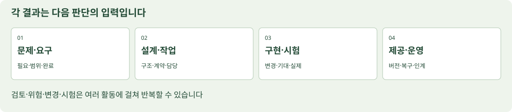

# 개발 과정과 협업은 어떻게 이어지는가

## 단계와 프로세스는 같은 말이 아니다

기획→설계→개발→시험→배포는 진행을 설명하는 익숙한 순서입니다. 실제로는 요구 확인·위험 관리·검토·변경·시험이 여러 단계에 걸쳐 반복됩니다. [ISO/IEC/IEEE 12207:2026](https://www.iso.org/standard/90219.html)은 생애주기 프로세스의 공통 틀을 다루며 하나의 개발 방법론을 강제하지 않습니다. 순차적인 계획, 작은 단위의 반복, 점진적 제공을 상황에 맞춰 조합할 수 있습니다.

기능을 작게 쪼개 반복 개발한다고 요구·설계·시험 근거가 없어지는 것은 아닙니다. 파일 한 개의 표로 관리해도 ‘무엇을 왜 바꾸고 어떻게 확인했나’를 이어 설명할 수 있어야 합니다.

| 활동 | 시작에 필요한 것 | 만들어야 할 판단·결과 | 다음 사람이 확인할 점 |
| --- | --- | --- | --- |
| 문제 탐색 | 사용자 상황과 관찰·가정 | 문제·목표·후보·근거 | 실제 사실과 추측이 나뉘었나 |
| 범위·요구 | 해결할 목표·제약 | 포함/제외·요구·수용 기준 | 구현하고 시험할 만큼 구체적인가 |
| 설계 | 요구와 품질·운영 조건 | 화면·구조·데이터·인터페이스·대안 선택 | 부품과 경계, 실패 동작이 일치하나 |
| 구현·통합 | 합의한 계약과 작업 단위 | 코드·설정·변경·검토 기록 | 다른 모듈과 약속한 형식으로 동작하나 |
| 시험·평가 | 시험 대상 버전·입력·기대 결과 | 실제 결과·결함·판정·남은 위험 | 목표와 기준을 실제로 확인했나 |
| 배포·인수 | 증거·미해결 문제·설치/복구 조건 | 릴리스·인수 판단·인계 | 누가 어떤 범위를 받아들였나 |
| 운영·개선 | 운영자·설정·관찰·지원 경로 | 장애·변경·재시험·지원 기록 | 다시 시작하고 고칠 수 있나 |



## 백로그·WBS·일정·이슈를 구별하기

백로그는 할 일을 가치·필요·우선순위로 관리하는 목록입니다. WBS는 목표 결과를 관리 가능한 작업 범위로 나누는 구조입니다. 일정은 순서·의존성·사람의 가용성을 반영한 실행 계획입니다. 이슈는 처리할 작업·질문·문제를 기록하는 단위로 쓸 수 있습니다. 이 설명은 교재의 실무 구분이며 같은 도구에서도 조직별 운영 방식이 다를 수 있습니다.

‘대시보드 개발’은 너무 큰 작업입니다. ‘수신 상태의 이름과 표시 위치를 바꾸고, 기존 DOM id와 통신을 유지하며, 정상·중단 상태를 확인한다’면 파일·범위·완료를 정하기 쉽습니다. 걸리는 시간은 가정과 실제 기록을 구별합니다. 선행 작업이 없는 것처럼 날짜만 채우지 않습니다.

## 완료 기준을 서로 다르게 쓰지 않기

| 개념 | 어떤 질문인가 | 예 |
| --- | --- | --- |
| 요구의 수용 기준 | 이 기능을 받았다고 판단할 조건인가 | 정상 수신이 멎으면 기존 P01 화면 정책에 따라 현재값을 비움 |
| 작업의 완료 조건 | 이 작업 단위가 끝났나 | 대상 파일 수정·자기 검토·지정 케이스 결과·실행 안내 반영 |
| 공통 품질 완료 기준(DoD 관점) | 제공 가능한 결과에 공통으로 적용할 품질 조건인가 | 변경 검토·요구 연결·필요 시험·알려진 제한과 문서 갱신 |
| 배포·인수 판단 | 남은 위험을 포함해 제공하고 받아들일 수 있나 | 미해결 결함·환경·복구·범위와 권한자의 판단 기록 |

Scrum의 Definition of Done은 Increment가 요구된 품질 기준을 충족한 상태를 설명합니다. 팀이 준비 조건을 별도로 정할 수는 있지만 Definition of Ready를 Scrum Guide가 정한 공식 산출물·책무로 소개하지 않습니다. 수용 기준 한 개를 통과해도 다른 품질·배포 조건이 남을 수 있습니다.

## 하루의 협업은 상태보다 막힌 이유를 공유한다

상태 보고는 ‘80% 완료’만으로 부족할 수 있습니다. 무엇이 실행됐고, 무엇이 막혔고, 누구의 어떤 결정이 필요한지 적습니다. 팀이 사용하는 도구는 GitHub Issues·보드·문서·Notion 등 달라도 됩니다. 같은 요구의 최신 원본을 정하고 다른 곳에서는 링크로 참조하면 버전이 엇갈리는 일을 줄일 수 있습니다.

변경 제안은 Issue나 변경 요청으로 남기고, 수정안은 PR 같은 검토 단위로 묶을 수 있습니다. 코드 리뷰는 이름만 바뀐 파일을 보는 것이 아니라 목적·변경·영향·시험·제한을 검토하는 과정입니다. 비밀키·개인 인터뷰 원본은 저장소 공개 범위에 맞춰 분리합니다.

### 좋은 작업 지시의 예

```text
TASK-01 / 관련 REQ-01, REQ-02 / 연결 설계 DES-01
목표: 현재값 카드에 출처와 수신 상태가 함께 보이게 배치한다.
대상: index.html, style.css. 기존 id·data-command·스크립트 연결 유지.
범위: 표시 구조와 문구. 핀·펌웨어·통신 프로토콜 변경은 별도 결정.
완료: 정상·연습·수신 중단의 표시를 비교하고 TC-01, TC-02 결과 기록.
전달: 바꾼 파일, 수정 이유, 실제 확인 범위와 미확인을 적는다.
```

### 직접 수행과 풀이

자신의 큰 작업 하나를 다른 사람이 한 번에 착수할 수 있는 작업 둘로 나눕니다. 각 작업에 입력 자료, 대상 파일, 결과, 의존성, 완료 조건을 붙입니다. 풀이 예: ‘디자인 완료’와 ‘센서 완료’만 나누면 통합의 책임이 없습니다. 인터페이스의 원본과 통합 확인 담당을 별도로 적어야 합니다.
